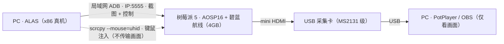

## 更新日志

- 2026.09.04：本文初版发布，整理「树莓派跑安卓 + PC 跑 ALAS」的最终方案，废弃 USB 采集卡截图路线
- 2026.05.04：受 nnieie 启发转向「pipi5 刷安卓 + 局域网 ALAS」，完整踩坑过程见[前作](/posts/alas/debian-waydroid/)第八章（该文及其混乱，已封存加密，仅供参考），密码为 2004122120070130

## 前言

笔者的主力设备是一台 2019 年的联想小新 13，16G 内存。因为要学 Golang，常驻一个 WSL2；而 ALAS 是个 7x24h 运行的碧蓝航线脚本，和主流的 Hyper-V 模拟器（蓝叠、MuMu）在低配机上互相挤占——电脑一旦干点别的（下资料、看网课），模拟器和 ALAS 就可能一起崩溃。

此前的思路是「把一切都塞进树莓派」：pipi5 上刷 Debian 13，用 Waydroid 跑安卓，再靠 LD_PRELOAD 注入旧版依赖、修改 ALAS 源码解决 arm64 上的识别问题。这套方案能跑，但 pipi5 长期超频，进图要 10s 左右，维护成本极高。

直到考研周期电脑闲置下来，和 [nnieie](https://github.com/nnieie) 闲聊时他说：可以试试刷一个安卓系统。参考[传统云手机文档](https://www.perfare.net/archives/1804)验证截图与点击的可行性后，路线就此确定：

**树莓派只当「安卓游戏机」，ALAS 搬回 PC。**

这个拆分有两个直接收益：

- **ALAS 运行在 x86 真机上**，照官方文档安装即可，前作里那些 `.so` 软链接、LD_PRELOAD 注入、OpenCV 版本错配的坑一条都不会遇到；
- **安卓跑在 arm64 原生环境**，没有模拟器的指令集转译开销。

实测三种方案的过图速度：

| 方案 | 进图时长 |
| --- | --- |
| pipi5 + Debian 13 + Waydroid + ALAS（前作方案） | ~10s |
| 小新 13 + MuMu 模拟器 + ALAS | ~5s（内存紧张时退化到 ~10s） |
| 小新 13 + pipi5 + AOSP16 + 局域网 ADB（本方案） | **~3s** |

本文即该方案的完整部署记录。

## 硬件清单

| 物料 | 规格 / 型号 | 用途 | 备注 |
| --- | --- | --- | --- |
| 树莓派 5 | **4GB** 内存 | 运行 AOSP16 + 碧蓝航线 | 必须 5V/5A 供电，详见「供电：一切奇怪现象的源头」 |
| 电源 | 5V/5A | 给树莓派供电 | 不要用电脑 USB 口凑合 |
| 存储卡 | 32GB 以上 | 系统 + 游戏资源 | 碧蓝航线资源包不小 |
| 采集卡 | MS2131 级 USB 采集卡 | PC 端实时看画面 | 几十块钱，mini HDMI 输入 |
| mini HDMI 线 | — | 树莓派 → 采集卡 | 首次配置也可能需要接显示器 |
| PC | x86，Windows / Linux 均可 | 部署 ALAS + scrcpy | 本方案的「控制主机」 |

> [!NOTE]
> 4GB 内存跑碧蓝航线主线足够，但 3D 宿舍、岛屿计划这类吃 GPU 的功能跑不动，详见「已知缺点」。

## 方案架构

全链路只有三条数据通路：



- **ADB 链路**：ALAS 通过局域网连到树莓派的 5555 端口，完成截图（ADB_nc）与点击（MaaTouch），这是自动化的主链路；
- **HDMI 链路**：树莓派的画面经采集卡送到 PC，用 PotPlayer / OBS 观看，供人工介入时观察；
- **scrcpy 链路**：需要手动操作时，用 scrcpy 以 uhid 模式把键鼠注入为树莓派的真实输入设备，且不传输画面，几乎不消耗树莓派性能。

## 刷安卓系统

### 系统选择

刷的是 [konstakang](https://konstakang.com/devices/rpi5/AOSP16/) 提供的 AOSP16 构建，用 Raspberry Pi Imager 或 balenaEtcher 烧录到存储卡即可。

首次启动建议先用 mini HDMI 接一台显示器，在图形界面里完成网络连接和开发者选项配置，配好后再搬到采集卡方案。

### 供电：一切奇怪现象的源头

> [!WARNING]
> 树莓派 5 对供电的要求比较苛刻，**请使用 5V/5A 的独立电源**。

如果暂时没有合适电源、想拿电脑 USB 口过渡，实测普通操作可以运行，但一旦进行复杂的网络握手（比如连接一个新的 Wi-Fi），就可能直接崩溃。规避方法是：**先在树莓派上把该网络添加好，再连接**，跳过握手过程。

这也是本文坚持走网络 ADB、而不是 USB 数据线连接的原因之一。

### 关闭网络连通性检测

AOSP 默认连接 Google 服务器检测网络连通性，国内网络下该检测必然失败，系统会误判为「断网」，进而导致游戏无法下载资源、无法登录。

前作在 Waydroid 上的做法是把检测地址换成国内的 `connect.rom.miui.com`；在 AOSP 上更直接——关掉检测：

```powershell
adb shell "settings put global captive_portal_mode 0"
adb shell "settings put global captive_portal_detection_enabled 0"
adb shell "settings put global network_avoid_bad_wifi 0"
```

> [!NOTE]
> 网络检测问题通常在**登录阶段**才暴露。刷完系统先别急着部署 ALAS，确认游戏能正常登录再说。

### 开启网络 ADB

在「开发者选项」中打开有线和无线 ADB 控制权限。部分构建的无线调试默认关闭，配好后确认 5555 端口能被局域网访问即可。

### 固定分辨率

ALAS 的模板匹配基于 1280x720，建议在「设置 → 显示」中把分辨率固定为 1280x720，或执行：

```powershell
adb shell wm size 1280x720
```

修改分辨率后需要重启游戏，否则模板会错位。

## 安装碧蓝航线

在树莓派上用浏览器访问碧蓝航线官网，直接下载 APK 安装即可，不需要任何额外工具。

几个实测经验：

- 资源包下载耗时较长，建议在网络好的环境下先完成下载和登录，再开始挂机；
- 游戏大版本更新后需要重新下载资源，届时挂机会中断，属于预期行为；
- 4GB 内存跑主线完全够用，但不要指望它跑 3D 宿舍。

## 网络 ADB 连接

因为树莓派的供电要求苛刻、且不想让它长期占用显示器，本文全程使用网络 ADB。

在路由器后台找到树莓派的局域网 IP，在 PC 上执行：

```powershell
adb connect IP:5555   # 替换为实际 IP
adb devices -l
```

看到 `IP:5555` 状态为 `device` 即连接成功。首次连接时树莓派会弹出调试授权弹窗，勾选「一律允许」并确认。

> [!TIP]
> **务必在路由器里给树莓派做 DHCP 静态绑定**（或在 AOSP 里配置静态 IP）。否则树莓派重启后 IP 变化，ALAS 会静默断连，而你不会第一时间注意到——这和「已知缺点」中 ADB_nc 偶发断连属于同一类隐患，提前掐掉。

## 部署 ALAS

### 安装

ALAS 部署在 PC 上，照 [ALAS 官方 Linux 安装文档](https://ALAS-wiki.saarcenter.com/zh-CN/manual/install/linux.html) 准备 git、python、虚拟环境即可。

需要特别强调的是：**本方案下 ALAS 运行在 x86 真机上，不存在任何 arm64 兼容问题**。前作里那些软链接、LD_PRELOAD、opencv-python 版本错配的坑，在这个方案里一条都不会遇到——这是「拆分」最大的隐性收益。

### 连接配置

在 ALAS 的设备配置中：

- 设备 Serial 填 `IP:5555`；
- 截图方式选择 `ADB_nc`；
- 控制方式选择 `MaaTouch`。

各环节实测延迟：

| 环节 | 方案 | 延迟 |
| --- | --- | --- |
| 截图 | ADB_nc（默认，快） | ~400ms |
| 截图 | ADB（备选，更稳） | 高于 400ms |
| 点击 | MaaTouch | ~50ms |
| 看画面 | 采集卡 + PotPlayer / OBS | ~100ms |

> [!NOTE]
> ADB_nc 截图快，但存在偶发的莫名断连。如果日常使用中遇到 ALAS 突然连不上，把截图方式切换为 `ADB` 通常能解决。

## 手动介入

ALAS 是半自动脚本，换队、处理突发弹窗都需要人工介入。本节提供三套可按需取用的手段。

### scrcpy 无画面控制

[scrcpy](https://github.com/Genymobile/scrcpy) 的常规用法会实时传输画面，实测对树莓派的性能消耗极大（延迟大、占用高），与挂机目标冲突。

解法是**只控制、不传画面**：

```powershell
adb connect IP:5555   # 需要替换为实际 IP
scrcpy --no-video --no-audio --mouse=uhid
```

逐参数解释：

- `--no-video --no-audio`：不传输画面和声音，这是不拖累树莓派性能的关键；
- `--mouse=uhid`：把键鼠通过 UHID 注入为真实的 HID 设备，游戏会认为你接了物理键鼠，比模拟坐标点击的兼容性更好。

如果 PC 上同时连着多台 ADB 设备，先用 `adb devices` 拿到目标设备的序列号，再用 `-s` 指定：

```powershell
adb devices
scrcpy -s IP:5555 --no-video --no-audio --mouse=uhid
```

至此，游戏内的手动操作全部通过 scrcpy 完成，画面观察交给下一节的采集卡。

### 采集卡看画面

scrcpy 关了画面，总得有地方观察游戏状态。方案是买一块 MS2131 级的廉价 USB 采集卡，用 mini HDMI 线接到树莓派上，在 PC 端用 PotPlayer 或 OBS 打开对应的摄像头设备即可看到实时画面，延迟约 100ms，且完全不消耗树莓派性能。

实测踩坑：采集卡画面出现撕裂、黑屏时，换一个 mini HDMI 接口通常就能解决，原因不明，但有效。

**为什么不让采集卡顺便给 ALAS 截图？**

前作试过：修改 ALAS 让采集卡画面直接作为截图来源，把 400ms 的 ADB_nc 压到 100ms。但廉价采集卡存在**人眼不可辨、OpenCV 可辨的色差**。例如委托成功页面，模板期望的关键颜色约为 `(233, 241, 127)`，而采集卡对应区域实测接近 `(245.6, 255.0, 134.2)`，差值超出模板阈值，直接导致识别失败。

为此先后尝试过 RGB 线性变换拟合（MAE 从 11.28 降到 6.79）、LUT / 3D LUT 乃至 C 加速应用，仍有漏网场景（军火商店的 YellowBookT3、3D 宿舍误识别），而 ADB 兜底策略又过于敏感、拖慢整体节奏。

结论：为了省 300ms 引入一套不可控的色差修正，不划算。最终退回 **ADB_nc 截图 + 采集卡只看不截**，普适性优先于极致延迟。

### 键鼠直插树莓派

嫌 scrcpy 麻烦的话，还有更懒的办法：把 USB 鼠标（和键盘）直接插在树莓派上，画面照旧走采集卡，用 PotPlayer 或 OBS 观看（延迟约 100ms），PC 上不用开任何控制软件，插上就能动。

- 优点：零配置、零软件开销，且实体键盘可以正常调出树莓派的输入法，**能打中文**——正好补上 scrcpy 方案的短板；
- 缺点：占用树莓派的 USB 口，线缆长度决定了你得坐在树莓派旁边。

日常托管交给 ALAS，偶发需要精细操作时把键鼠插上，几套手段按需取用。

## 已知缺点

1. **无法输入中文**。scrcpy 的 uhid 注入只能发送英文字符，调不出树莓派的输入法。规避：界面语言设为英文，或干脆把键鼠直接插到树莓派上（见「键鼠直插树莓派」）。
2. **点击速度受限**。uhid 鼠标注入的点击存在节流，手动介入时体感明显不如 ALAS 自己的 MaaTouch（50ms）。只影响手动操作，不影响自动化效率。
3. **无法运行岛屿计划**。4GB 的树莓派 5 撑不住 3D 宿舍、岛屿计划这类吃 GPU 的功能，请在该场景回到 PC 端处理，或放弃该功能。
4. **ADB_nc 偶发断连**。表现为不可预知的突然断开，把截图方式切换为 `ADB` 即可缓解；配合路由器的静态 IP 绑定，可以显著减少断连面。
5. **游戏更新会中断挂机**。大版本更新需要重新下载资源，期间无法托管，属预期行为。

## 结语

本方案的完整闭环是：**树莓派 5（4GB）跑 AOSP16 当安卓游戏机，PC 跑 ALAS 做控制端，中间靠局域网 ADB 串联，辅以采集卡观察画面、scrcpy 无画面模式手动介入**。过图 3s，PC 不再被模拟器绑架，树莓派也不再超频呻吟。

后续如果 arm64 的依赖生态继续完善，可能会尝试把 ALAS 也搬上树莓派，彻底单机化——但前作的血泪史证明，那是一场硬仗。

适合复刻的人群：手里有闲置树莓派、主力 PC 配置吃紧的玩家。如果只有 PC，直接上 MuMu 模拟器更简单，没必要折腾。

## 致谢

感谢 [nnieie](https://github.com/nnieie)，「可以试试刷一个安卓系统」这一句话，省掉了后面所有的麻烦；前作里那些通宵的排错与源码修改，也全部由他完成。

值得一提的是，本方案最终没有修改任何 ALAS 源码，算是给前作那部血泪史提供了一个干净的收尾。
