## 时间线

英语仔细阅读：第 19 周 - 第 28 周，共 10 周。掌握仔细阅读的基本方法，写完 07 - 18 的仔细阅读

英语套卷：第 29 周 - 第 32 周，共 5 周，14 年 - 20 年真题所有客观题（也就是 07-13 年的完型和新题型没做，不过这里新题型只用写 11,12,13，完型看情况了）

英语套卷：第 33 周 - 第 34 周：翻译和作文的简单研究，以及每天同时进行早年阅读重刷（10-11）

英语套卷：第 35 周：以 21 年真题为例，深度研究一份，然后模考一份 22 来点感觉，作文与翻译研究明白怎么学

政治：第 29 周 - 第 42 周，共 14 周。先花 6 周的时间刷一遍选择题（徐涛马原强化课 + 苍盾），也就是第 34 周结束，再花 6 周的时间 2 刷一遍选择题（肖背诵手册，肖 8 的选择题），再花 2 周的时间背大题。

## 政治前言

政治比我想象中的更猎奇。

## 马原必背

上层建筑

- 政治法律制度、国家政权机构

社会意识形式

- 道德、意识与哲学，是上层建筑，但是是意识形态（或者观念上层建筑

## 政治经济学

[30 分钟学完｜政治经济学、科学社会主义，速成课【空卡】](https://www.bilibili.com/video/BV1YnYL6SESt/?share_source=copy_web&vd_source=3fbbb3c2ad24817002f9c39fad247a3b)

## 英语前言

突然意识到近些年的英语在慢慢变简单，所以不要因为早年的英语分低而丢失自信心，但也不要狂妄......吗？

更新于 10 月 24 日，突然发现英语问题会非常非常严重啊！

现在是写了 2021 年的完型和阅读 ab，完型 -3，在可接受范围之内，但是 a 篇错了 2 个，b 篇整篇文章还是看了翻译才终于搞明白是什么意思（尽管全对，但是花了 30min+）。

但是复盘下来，发现这些阅读并不难，而且要知道 2021 年的阅读算简单的阅读了，那我这样算什么？

今天是考研报名截止日，也改不了了，所以拼尽全力去补。

以后每天早上先过来背半个小时单词，然后学 75min 英语，再开始学数学。

主要是其实并不难，但是我依旧想当然，一开始没有逐字逐句翻译去理解，所以明天也需要复盘，再加上最近确实太摆了。

目标是客观题拿 50 至少。

## 一些准则

在英语阅读里，一句话的逆否命题必然是对的。

例如，我因为可以展现理想中的自己享受 facebook = 我为了逃避不修边幅的自己而享受 facebook。

## 做题顺序

阅读 A/B 篇 -> 作文 -> 阅读 C/D 篇 -> 新题型 -> 翻译 -> 完型。

## 完型

> 方法论来源于刘琦老师，保 6，争 8，拼 10，但我认为我自己得稳 8。

考研完型不是选出来的，是找出来的，即从文章里找线索。

如果句子没有明显情感倾向，那么选中性词（包括翻译也是）

改变条件，必然结果相反。（例如实验 A 是抿嘴唇，倾向是是成功，那么实验 B 改变了条件，必然是失败）

不确定先跳，不然一对一片，一错一片。

意思相同同时不选。

首段首句为全文中心，段落首句为段落中心。

感觉后面再看课没什么意义了，就这样吧。

### 完型词汇积累

- go through：完成
- do away：废除
- catch up：赶上
- put up：容忍
- lean towards：倾向于
- send out：分发
- give away：泄露
- self-deceptive：自欺欺人的
- self-reliant：自立的
- self-destructive：自毁的
- self-evident：不言而喻的
- hold onto：抓住
- accuont for：解释

## 阅读

> 方法论来自于唐迟老师，以及自己的总结，我认为四篇阅读至少得拿 36 分。

### 整体做题方法 - 阅读

答案一定不是选出来的，而应该是比对出来的。

- 标段落
- 通读问题（仅仅问题，不需要选项），找出关键字，串联题干逻辑，推测文章主题
  - 找出关键字，锁定词汇
  - 找出明显的态度词，例如 help 对应好的态度
- 根据题目大致推断这道题在哪个段落（这是自己的方法），没推断出来也问题不大
- 翻译与做题
  - 抓情感色彩词
  - 梳理句间逻辑关系，如果没有转折那么前后句肯定是态度一致的
  - 逐词比对，逐项排除，但对于可能正确的选项，也要在文章里找到明确的依据

### 阅读词汇积累

- mess up：搞砸
- inexcusable：不可原谅
- density：密度

## 新题型

英 2 新题型有两类，一种是小标题，另一种是多项对应题。

> 方法论来源于刘琦老师，追求满分。

### 时间要求 - 新题型

<= 20min。

### 小标题

1. 先通读标题，记住标题对文章进行整体理解
2. 做题时不必拘泥于原文顺序，最好先简单后难，具体做的时候关注首段后和转折后（转折后优先），找出语段特征
3. 做出最终判断时，必须找到明确的匹配关系（即同义替换或复现）

看完小标题后，不允许多想，然后去读文章。

有转折和让步先看转折和让步，没有的话看首句，首句没有信息看末尾句（但是此时信息就弱了，所以应该全段读，然后找出下论断的句子，比如 so 等，例如 2020 年的题目）

注意不能同词根连连看，得意思连连看（但其实也基本上）。在做小标题的时候，基本只用看首句和转折后，其他不需要看，直接去判断即可。

不必拘泥于原文顺序，选不出来直接先跳，因为先易后难。

### 多项对映题

1. 读左侧一栏 5 题干，确定定位词，专有名词 > 普通名词 > 动词 > 副词或形容词
2. 找到定位词在原文中出现的所有位置，通读所有定位句，并概括。定位词可能在原文多次出现
3. 左侧题干对比右侧选项，找复现或同义词替换选项（复现：原词再现；同义词替换：同义词 / 近义词改写

只要碰到同义句改写，那么立刻选答案，不需要多想。

人名在原文中第一次出现用的是全名，第二次及之后出现用的只有姓。

关键词存在多处定位，需把每处内容看完再判断；考察内容偏细节，多关注文中任务所说的话；部分题目设计行南距，对于命题长难句需拆分理解。

## 翻译

### 时间要求

<= 20min。

### 翻译的评分标准

信 达 准确。

### 翻译方法

1. 找出谓语动词（三态一否）
2. 找出连词，初步切分句子并确定主干（并列连词 and，从属连词 which）
3. 梳理修饰成分，进一步切分句子（从句外是主干）

### 其他需要注意

1. 被动变主动
2. 并列句按照两个简单句处理

### 2010 翻译

7-8 分

- “稳定性”在这些日子逐渐变成一个热词，但是对于泰德·宁来说，这个概念永远有个人意义。

- “可持续性”（或承受力）如今成为了一个流行词，但对泰德·宁来说，这个概念永远有其特殊的个人意义。

- 他已经度过人生中一段痛苦的不稳定生活，这件事让他清楚地认识到稳定的价值必须通过每日的行动和选择来表达

- 在经历了人生中一段痛苦的不可持续生活后，他清楚地认识到，以可持续性为导向的价值观必须通过每日的行动和选择来体现。

- 宁回忆起他在 19 世纪 90 年代卖保险的一年

- 宁回忆起 20 世纪 90 年代末那令人困惑的一年，当时他正在卖保险。（注：修正世纪错误，补上 confusing）

- 他经历了互联网的爆炸，但是他对他的在波德尔旅社的工作十分失望。

- 他经历了互联网泡沫的膨胀与破灭，由于急需一份工作，便与博尔德市的一家代理机构签了约。（注：修正 boom and burst, desperate, agency 的翻译，理顺逻辑关系）

- 这过的并不好。“这真的很差，因为这不是我所热爱的。”宁在陷入换工作还是销量可能下降的困境中说。

- 但情况并不顺利。“这的确是个糟糕的决定，因为那激不起我的工作热情。”宁说道。不出所料，他对这份工作的进退两难导致了销售业绩不佳。（注：bad move 译为糟糕的决定；whose 引导的定语从句需要单独成句翻译，translated into 是导致/转化为的意思）

- “我很痛苦。我十分焦虑以至于我会在午夜的时候醒来并且盯着天花板。我没有钱并且我需要工作。每个人都说：‘只需要等待，你会绕过转角的，给点时间就可以了。’”

- “我很痛苦。我焦虑万分，以至于常常在半夜惊醒，盯着天花板发呆。我身无分文，需要这份工作。大家都说：‘等等吧，给点时间，你会渡过难关的。’”

### 2011 翻译

8 - 9 分

Who would have thought that, globally, the IT industry produces about the same volume of greenhouse gases as the world's airlines do—roughly 2 percent of all CO₂ emissions?

谁能想到呢？全球 IT 产业排放的温室气体——和全世界的航班排放的量等同，都是大约 2% 的二氧化碳。

订：谁能想到，全球 IT 产业排放的温室气体总量（volume）与全球航空业相当（或：一样多）——约占全球二氧化碳总排放量的 2%？

Many everyday tasks take a surprising toll on the environment. A Google search can leak between 0.2 and 7.0 grams of CO₂, depending on how many attempts are needed to get the"right" answer. To deliver results to its users quickly, then, Google has to maintain vast data centres around the world, packed with powerful computers.While producing large quantities of CO₂, these computers emit a great deal of heat, so the centres need to be well air-conditioned, which uses even more energy.

每天的每一个任务都对环境造成令人惊讶的恶果。

订：许多日常工作都会对环境造成惊人的危害。

一次谷歌搜索释放 0.2 克到 7.0 克的二氧化碳，释放的具体量取决于需要多少次尝试才能得到正确答案。

订：每用谷歌搜索一次就会释放出 0.2 克至 7.0 克的二氧化碳，释放量的多少取决于使用者需要尝试多少次才能得到“正确”的答案。

为了给用户更快的搜索结果，随后，谷歌必须去在全世界维护大量的数据中心，这些数据中心里面有着性能强大的计算机。

订：为了把搜索结果迅速传输给用户，因此（then），谷歌不得不在全球范围内建立（或维护）大型数据中心，并配备大功率计算机。

当产生大量的二氧化碳时，这些电脑还释放相当多的热量，所以数据中心还需要控制空气条件，这还需要使用更多的能量。

订：除了排放大量二氧化碳，这些计算机还释放大量热量，因此数据中心还需要良好的空调环境，而这又会消耗更多的能量。

However, Google and other big tech providers monitor their efficiency closely and make improvements. Monitoring is the first step on the road to reduction, but there is much more to be done, and not just by big companies.

然而，谷歌和其他科技巨头们对他们的效率密切关注，并且做出很多改进。

订：不过，谷歌和其他大型技术供应商已密切监控其（数据中心的）工作效率并做出改进。

监控只是减少排放的第一步，但是这还有很多需要做，不只是大公司。

订：监控只是减排的第一步，需要做的还有很多，而且这不仅仅是大公司的事情。

吸取的教训：每个东西的意思都要翻译出来。

### 2021 翻译

6-7

We tend to think that friends and family members are our biggest sources of connection, laughter, and warmth. While that may well be true, researchers have also recently found that interacting with strangers actually brings a boost in mood and feelings of belonging that we didn't expect.

- 我倾向于认为朋友和家庭成员是我们联系，笑声和温暖最大的来源。

- 订：我们倾向于认为，朋友和家人是我们情感联结、欢笑和温暖的最大来源。

- 这些确实很有可能是事实，不过最近研究院已经发现和陌生人交流事实上也带来情绪上的提升和一种我们从未期待的归属感。

- 订：虽然这很可能是事实，不过研究人员最近也发现，与陌生人交流其实也会带来情绪的提升和归属感，这是我们之前未曾预料到的。

In one series of studies, researchers instructed Chicago-area commuters using public transportation to strike up a conversation with someone near them. On average,participants who followed this instruction felt better than those who had been told to stand or sit in silence. The researchers also argued that when we shy away from casual interactions with strangers, it is often due to a misplaced anxiety that they might not want to talk to us. Much of the time, however, this belief is false. As it turns out, many people are actually perfectly willing to talk—and may even be flattered to receive your attention.

- 在一系列的实验中，研究人员建议芝加哥地区的通勤者在乘坐公共交通中，去突发的和他们相邻的人来一场对话。

- 订：在一系列研究中，研究人员要求芝加哥地区乘坐公共交通的通勤者，与旁边的人攀谈（开始交谈）。

- 平均下来，那些遵循这些建议的比那些被告知单独站着或安静的坐着的人感觉更好。

- 订：平均而言，遵循这一要求的参与者，比那些被要求默默站着或坐着的人感觉更好。

- 研究人员还发现对陌生人随意的讲话感到害羞这一现象一般来源于错位的尴尬——他们很有可能不想和我们说话。

- 订：研究人员还提出，当我们回避与陌生人的随意交流时，通常是因为一种不必要的焦虑，即担心他们可能不想跟我们说话。

- 然而，在大多数时候，这种相信是错误的。

- 订：然而，在大多数情况下，这种想法是错误的。

- 恰恰相反，事实上，很多人非常有意愿去聊天——并且甚至可能变得分散，为了收到你的关注。

- 订：事实证明，很多人其实非常乐意交谈——甚至可能会因为得到你的关注而感到受宠若惊（荣幸）。

### 2021 翻译立即二刷

- We tend to think that friends and family members are our biggest sources of connection, laughter, and warmth.
- 词块：We，tend think，定语从句（xxx 是最大的来源）
- 我们倾向于认为朋友和家庭成员是我们连接，欢笑和温暖的最大来源。
- 我们倾向于认为朋友和家庭成员是我们互联，欢笑和温暖的最大来源。
- 情感联结

- While that may well be true, researchers have also recently found that interacting with strangers actually brings a boost in mood and feelings of belonging that we didn't expect.
- 词块：研究员们，近期发现，和陌生人交流。
- 这或许是对的，但近期研究员们已经发现，和陌生人交流事实上会带来意想不到的情绪上涨和归属感。
- 这或许是对的，但近期研究员们已经发现，出乎意料的，和陌生人交流事实上会带来情绪上涨和归属感。
- 情绪提升，这是我们此前未预料到的（放最后）

- In one series of studies, researchers instructed Chicago-area commuters using public transportation to strike up a conversation with someone near them.
- 词块：在一些列的研究调查中；研究员们；指示；芝加哥地区；通勤者；公共交通；发起交流；他们附近的人；
- 在一系列的研究调查中，研究员们指示芝加哥地区的通勤者们在公共交通通勤时，和他们附近的人发起交流。
- 在一系列的研究调查中，研究员们指示芝加哥地区的通勤者们在使用公共交通通勤时，和他们附近的人发起交流。
- 要求，与旁边的乘客攀谈

- On average,participants who followed this instruction felt better than those who had been told to stand or sit in silence.
- 词块：平均下来；参与者们；遵循建议；那些被指示站着或者静静坐着（不交流）；干到更好
- 平均下来，比起哪些被指示站着或静静坐着不交流的人而言，这些遵守指示的参与者感到更好。
- 平均下来，比起那些被指示站着或静静坐着不交流的人而言，这些遵守指示的参与者感到更好。

- The researchers also argued that when we shy away from casual interactions with strangers, it is often due to a misplaced anxiety that they might not want to talk to us.
- 词块：研究员们也发现；回避；由于不必要的担心；
- 研究员们也发现，我们回避和陌生人交流，常常是由于不必要的担心，害怕他们不愿意和我们讲话。
- 研究员们也发现，当我们回避和陌生人交流时，常常是由于不必要的担心，害怕他们可能不愿意和我们讲话。
- 提出

- Much of the time, however, this belief is false. As it turns out, many people are actually perfectly willing to talk—and may even be flattered to receive your attention.
- 词块：然而在大多数时候，这种想法是错误的；事实上；事实非常想聊天；荣幸；受到关注
- 然而在大多数时候，这种想法是错误的。事实上，很多人有非常强烈的意愿去聊天，并且他们甚至可能因为受到你的关注而感到荣幸。
- 然而在大多数时候，这种想法是错误的。事实上，很多人有非常强烈的意愿去聊天，甚至，他们可能因为受到你的关注而感到荣幸。

### 2022 翻译

初版：5-6

订 1：9

订 2：12

- Although we try our best, sometimes our paintings rarely turn out as originally planned.
- 词块：尽管，我们竭尽全力做到最好；有时；我们离开了我们原有的计划；painting，猜测并意译为事件的结果（因为是完成的作品）；几乎离我们原有计划很远
- 初译：尽管，我们竭尽全力做到最好，但有时事件的结果和我们预期的相差甚远。
- 精修：尽管我们竭尽全力做到最好，但有时，事件的结果和我们原来计划的相去甚远。
- 订正 1：尽管，我们竭尽全力做到最好，但有时我们的画作和我们原来计划的表现出来相去甚远。
- 订正 2：（很少符合最初的计划）

- Changes in the light, the limitations of your painting materials, and the lack of experience and technique mean that what you start out trying to achieve may not come to life the way that you expected.
- 词块：为了改变这一光景；绘画材料的缺失（猜测意译为完成该事件的前提），经验和技术的缺少，意味着；你；可能达到你预期中的生活方式；尝试
- 初译：为了改变这一光景，，经验和技术的确实，意味着你努力尝试去达到的，可能并不会达到你预期的生活方式。
- 词块 2：换种想法；条件的限制，经验和技术的缺失；意味着；你开始尝试去达到的东西；可能并不会如你预期的方式进入你的生活；
- 初译 2：换种想法，前提条件的限制和经验技术的缺失意味着你开始想要努力完成的事情，可能并不会如你预期的方式进入你的生活。
- 订正 1：光线的改变，绘画材料的限制和经验技术的缺乏意味着你画出来的作品可能达不到你的期待。（确实不会翻译这里）

- Although this can be frustrating and disappointing, it turns out that this can actually be good for you.
- 词块：尽管这会导致沮丧和失望；但这可以；真切；对你很好，帮到你；
- 初译：尽管这会导致沮丧和失望，但恰恰相反，事实上这对你来说是件好事。
- 精修：尽管意识到了这点会让你沮丧和失望，但恰恰相反，这事实上对你来讲是件好事。
- 订正 2：尽管意识到了这点会让你沮丧和失望，这事实上对你来讲是件好事。

- Unexpected results have two benefits: you pretty quickly learn to deal with disappointment and realise that when one door closes, another opens.
- 词块：意料之外的预期结果有两个好处；你很好，很快，学会如何处理失望；意识到上帝为你关上了一扇门，但是会打开另一扇；
- 初译：意料之外的结果有两个好处：你会非常快地学会如何处理失望，也会意识到：上帝为你关上了一扇门，但会打开另一扇。
- 精修：意料之外的预期结果有两个好处，你会非常快的学会如何处理失望，也会意识到：上帝为你关上了一扇门，但会打开另一扇。

- You also quickly learn to adapt and come up with creative solutions to the problems the painting presents, and thinking outside the box will become your second nature.
- 词块：你也会很快学会；如何适应；有创造力的解决办法，学会；跳出框架思考；焕发第二春；
- 初译：你也会很快学会如何适应和“追随”对现有问题有创造力的解决方案，跳出框架思考将给到你带来第二春。
- 精修：你也会很快学会如何适应和探索现有问题的创造性解决方案，跳出框架思考将会给你带来第二春。
- 订 1：你也会很快学会如何适应和探索现有绘画问题的创造性解决方案，跳出框架思考将会给你带来第二春。
- 订 2：你也会很快学会如何适应和探索现有绘画问题的创造性解决方案，跳出框架思考将会变成你的第二天性。

- In fact, creative problem-solving skills are incredibly useful in daily life, with which you' re more likely to be able to find a solution when a problem arises.
- 词块：事实上；解决问题的方法；有创造力的；极大的；在日常生活中有用；你更有可能找到一个问题的解决方法，当这个问题出现；
- 初译：事实上，有创造力的解决问题这个的技能在日常生活中极其有用，当一个问题发生的时候，你更有可能找到解决方案。
- 精修：事实上，有创造性的问题解决方案这个技能在日常生活中极其有用，当一个问题发生的时候，你更有可能有这个能力找到解决方案。

### 翻译自己总结的做题方法

1. 找主谓宾，句子结构
2. 找出词块
3. 拼接组词
4. 通读润色

碰到不认识的词，根据语境推测模糊过去。

## 小作文与图表作文

### 这份东西怎么用

真题区当题库用，模板区当骨架用。**模板只是参考，句子必须换掉一半再背**——市面模板人人一套，阅卷老师一天看几百份，撞句就是低分。

三个数字记牢：

| 项 | 数量 | 说明 |
| :--- | :--- | :--- |
| 小作文外壳 | 2 套 | 去信、回信，**第二句起完全共用**，只有打头那句换调子 |
| 大作文外壳 | 1 套 | 首段 4 句 + 中段 2 因 + 尾段 3 句 |
| 功能词块 | 11 组小 + 5 类大 | 中间全部靠块拼，不背整篇 |

背诵优先级：

1. 先背 **小作文的头两行 + 尾两行**（两套共用，实际只有 3 句），这是小作文的地基；
2. 再背 **小作文 6 个高频块**（介绍、邀请、建议、致歉、感谢、投诉），够覆盖 2010-2026 的 14 年；
3. 最后背大作文的 **首段 4 句 + 中段 2 个原因句 + 尾段 3 句**，话题词块靠考前突击。

> 标「译」的是给人看的中文，考场不写。

---

### 第一部分 小作文真题（2010-2026）

#### 年份-任务速查

| 年份 | 任务 1 | 任务 2 | 外壳 |
| :--- | :--- | :--- | :--- |
| 2010 | 感谢接待 | 邀请来访 | 回信 |
| 2011 | 祝贺升学 | 给大学建议 | 去信 |
| 2012 | 投诉质量 | 要求解决 | 去信（投诉） |
| 2013 | 告知义卖细节 | 鼓励参与 | 去信（通知） |
| 2014 | 说明生活习惯 | 询问当地建议 | 去信 |
| 2015 | 介绍夏令营 | 招募志愿者 | 通知 |
| 2016 | 感谢祝贺 | 给翻译建议 | 回信 |
| 2017 | 接受邀请 | 介绍讲座要点 | 回信 |
| 2018 | 道歉说明 | 另约时间 | 去信（致歉） |
| 2019 | 建议辩题 | 说明安排 | 去信（建议） |
| 2020 | 介绍景点 | 给游览建议 | 去信 |
| 2021 | 邀请参会 | 说明细节 | 去信（邀请） |
| 2022 | 介绍美食节 | 邀请留学生 | 去信（邀请） |
| 2023 | 二选一建议 | 给理由 | 回信（建议） |
| 2024 | 提出调查计划 | 询问意见 | 去信 |
| 2025 | 介绍短剧 | 邀请参演 | 去信（邀请） |
| 2026 | 谈视频感受 | 想了解更多 | 回信 |

规律：**前五年偏「说明 + 请求」，近五年全是「介绍 + 邀请」和「建议 + 理由」**。所以 2027 大概率还是这两类之一。

#### 2010 小作文

You have just come back from the U. S. as a member of a Sino-American cultural exchange program. Write a letter to your American colleague to

1. express your thanks for his/ her warm reception;
2. welcome him/ her to visit China in due course.

You should write about 100 words on ANSWER SHEET 2.

Do not sign your own name at the end of the letter. Use "Zhang Wei" instead.

Do not write your address. (10 points)

#### 2011 小作文

Suppose your cousin Li Ming has just been admitted to a university. Write him/ her a letter to

1. congratulate him/ her, and
2. give him/ her suggestions on how to get prepared for university life.

You should write about 100 words on ANSWER SHEET 2.

Do not sign your own name at the end of the letter. Use "Zhang Wei" instead.

Do not write the address. (10 points)

#### 2012 小作文

Suppose you have found something wrong with the electronic dictionary that you bought from an online store the other day. Write an email to the customer service center to

1. make a complaint, and
2. demand a prompt solution.

You should write about 100 words on ANSWER SHEET 2.

Do not sign your own name at the end of the letter. Use "Zhang Wei" instead.

Do not write the address. (10 points)

#### 2013 小作文

Suppose your class is to hold a charity sale for kids in need of help. Write your classmates an email to

1. inform them about the details, and
2. encourage them to participate.

You should write about 100 words on the ANSWER SHEET.

Do not use your own name. Use "Li Ming" instead.

Do not write your address. (10 points)

#### 2014 小作文

Suppose you are going to study abroad and share an apartment with John, a local student. Write him an email to

1. tell him about your living habits, and
2. ask for advice about living there.

You should write about 100 words on the ANSWER SHEET.

Do not use your own name. Use "Li Ming" instead.

Do not write your address. (10 points)

#### 2015 小作文

Suppose your university is going to host a summer camp for high school students. Write a notice to

1. briefly introduce the camp activities, and
2. call for volunteers.

You should write about 100 words on the ANSWER SHEET.

Do not use your name or the name of your university.

Do not write your address. (10 points)

#### 2016 小作文

Suppose you won a translation contest and your friend, Jack, wrote an email to congratulate you and ask for advice on translation. Write him a reply to

1. thank him, and
2. give your advice.

You should write about 100 words on the ANSWER SHEET.

Do not use your own name. Use "Li Ming" instead.

Do not write your address. (10 points)

#### 2017 小作文

Suppose you are invited by Professor Williams to give a presentation about Chinese culture to a group of international students. Write a reply to

1. accept the invitation, and
2. introduce the key points of your presentation.

You should write about 100 words on the ANSWER SHEET.

Do not use your own name. Use "Li Ming" instead.

Do not write your address. (10 points)

#### 2018 小作文

Suppose you have to cancel your travel plan and will not be able to visit Professor Smith. Write him an email to

1. apologize and explain the situation, and
2. suggest a future meeting.

You should write about 100 words on the ANSWER SHEET.

Do not use your own name. Use "Li Ming" instead.

Do not write your address. (10 points)

#### 2019 小作文

Suppose Professor Smith asked you to plan a debate on the theme of city traffic. Write him an email to

1. suggest a specific topic with your reasons, and
2. tell him about your arrangements.

You should write about 100 words on the ANSWER SHEET.

Do not use your own name. Use "Li Ming" instead. (10 points)

#### 2020 小作文

Suppose you are planning a tour of a historical site for a group of international students. Write them an email to

1. tell them about the site, and
2. give them some tips for the tour.

You should write about 100 words on the ANSWER SHEET.

Do not use your own name. Use "Li Ming" instead. (10 points)

#### 2021 小作文

Suppose you are organizing an online meeting. Write an email to Jack, an international student, to

1. invite him to participate, and
2. tell him the details.

You should write about 100 words on the ANSWER SHEET.

Do not use your own name. Use "Li Ming" instead. (10 points)

#### 2022 小作文

Suppose you are planning a campus food festival. Write an email to the international students in your university to

1. introduce the food festival, and
2. invite them to participate.

You should write about 100 words on the ANSWER SHEET.

Do not use your own name. Use "Li Ming" instead. (10 points)

#### 2023 小作文

An art exhibition and a robot show are to be held on Sunday, and your friend David asks you which one he should go to. Write him an email to

1. make a suggestion, and
2. give your reason(s).

You should write about 100 words on the ANSWER SHEET.

Do not use your own name. Use "Li Ming" instead. (10 points)

#### 2024 小作文

Suppose you and Jack are going to do a survey on the protection of old houses in an ancient town. Write him an email to

1. put forward your plan, and
2. ask for his opinion.

You should write about 100 words on the ANSWER SHEET.

Do not use your own name. Use "Li Ming" instead. (10 points)

#### 2025 小作文

Suppose you are planning a short play based on a classic Chinese novel. Write your friend John an email to

1. introduce the play, and
2. invite him to take part in it.

You should write about 100 words on the ANSWER SHEET.

Do not use your own name. Use "Li Ming" instead. (10 points)

#### 2026 小作文

Suppose your friend Jack has shared with you a video of his family's travel in China. Write an email to tell him

1. how you feel about the video, and
2. your wish to learn more about their travel.

You should write about 100 words on the ANSWER SHEET.

Do not use your own name in your email; use "Li Ming" instead. (10 points)

---

### 第二部分 小作文模板（2 套外壳 + 11 组词块）

#### 先想明白：为什么 2 套就够

小作文的题干永远是「两个信息点」。所以：

- 中间 = 2 个块（块 1 干任务 1，块 2 干任务 2），块从下面的库里抽；
- 开头只管一件事：**我是谁、我为什么写**；
- 结尾只管一件事：**把球踢回给对方**（等你回话 / 等你来 / 等你改）。

于是「外壳 2 套 × 词块 11 组」就能覆盖 17 年真题。真正要背的只有开头两行、结尾两行，而这两套是**同一份**。

#### 模板 A：去信（我发起）

```text
Dear [称呼],

This is a short email with one purpose: [用不定式或从句说清请求].

[块 1：干题干第一个点]

[块 2：干题干第二个点]

If any part of it does not suit you, say so and we will adjust it.
Either way, a line by [时间] will do.

Yours sincerely,
Li Ming
```

译：
这是一封很短的邮件，只说一件事：……。
（两块正文）
哪一部分对你不合适，就说，我们改。不管怎样，……之前给我一行回复就好。

> **风格版**（好看但有风险，小作文 100 词不建议用，大作文可以）：
>
> `Some things deserve to be put in writing rather than left to a passing remark, and this is one of them: …` / `If any part of this sits awkwardly with your plans, say so plainly — a plan that has to be forced is worse than one that has to be rewritten. Whichever way you lean, a line by [时间] will do.`

#### 模板 B：回信（我回应）

```text
Dear [称呼],

This is a short reply with one purpose: [用不定式或从句说清回答].

[块 1]

[块 2]

If any part of it does not suit you, say so and we will adjust it.
Either way, a line by [时间] will do.

Yours sincerely,
Li Ming
```

译：
这是一封很短的回复，只说一件事：……。
剩下的都是细节。
（其余与去信一字不差。）

> 两套从**第二句起完全相同**，结尾、签名、块库一字不改，只有打头那句换调子（email / reply）。
>
> **小作文不要写「交代自己怎么写信」的句子**（诸如 "here are the details"、"the details follow"），那是元话语，占字数不传信息。破题句只承担一件事：说明这是请求还是答复。
>
> **换语气**：给教授写信时，开头换成 `A matter of some importance has brought me to write: [点题].`，结尾第二句换成 `I would welcome your comments before anything is settled.`；投诉信里收尾换成 `I am not after a long explanation; a workable solution by [时间] is all I ask.`

#### 写作口径（很影响分）

- **称呼**：给朋友/同学 `Dear John,`；给教授 `Dear Professor Smith,`；不知道是谁 `Dear Sir or Madam,`；给一群人 `Dear friends,` / `Dear international students,`。
- **落款**：`Yours sincerely,`（知道姓名的信）或 `Yours faithfully,`（不知姓名）；给朋友可 `Take care,`。姓名一律 `Li Ming`。
- **开头分场合**：朋友 / 同学 / 留学生 → `This is a short email with one purpose: to …`（有个人腔）；教授 / 公司 / 机构 → `I am writing to …`（**这里该用常规句**，正式语域才是得体）；通知 → 不用第一人称。
- **冒号后面接不定式或从句，不要接名词短语**——`with one purpose: your invitation` 语义不成立（那不是 purpose，是话题）。
- **通知/告示不写称呼**，见后文附录。
- 字数：**100 词左右，95-115 最稳**。大纲写的正是「100 词左右」，长度不符会「酌情扣分」，低于 90 词开始吃亏；超过 130 词只是徒增出错概率。

#### 想上 9 分：三条结构位（大纲要求「丰富的语法结构」）

只写简单句，小作文最多停在 8 分——第五档原文是「使用丰富的语法结构和词汇」。但不用整段重写，**每封信用一条就够**，插在块 1 里：

| 结构 | 现成句（换词即用） |
| :--- | :--- |
| 定语从句 | `The meeting, which will run for an hour, starts at eight.` |
| 非谓语 | `Three students report for ten minutes each, leaving the last half hour for questions.` |
| 条件状语 | `If the time does not suit you, say so and we will move it.` |

> 一条够用，两条封顶。堆三条会挤掉信息点，反而掉档。

**硬规则：不许照抄题干句子。** 大纲原文——「允许在作文中使用提示语中出现过的个别关键词或词组，但使用提示语中出现的句子将被扣分」。所以 2025 那句 `invite him to take part in it` 不能原样搬，要写成 `have you on stage`。

---

#### 中间块库（11 组，按任务抽两块）

每个块 2 句，约 22-28 词。**用完记得把方括号换成具体信息，别连括号一起抄。**

##### 块 1｜介绍活动（时间地点 + 内容亮点）

> The event falls on [日期], from [时间] to [时间], at [地点]. What makes it worth a trip is [最亮的环节], on top of [第二亮点].

译：活动定在……，地点在……。值得跑一趟的是……，除此之外还有……。

##### 块 2｜介绍事物（定义 + 实际好处）

> [对象] is best described as [一句大白话定义] — nothing fancy, but it does [核心功能] well. The practical payoff is simple: less time on [麻烦事], more on [要紧事].

译：……可以说是……——不花哨，但……做得很扎实。实际好处很简单：少花时间在……上，多花在……上。

##### 块 3｜邀请（为什么是你 + 来了能得到什么）

> I am asking you in particular because [为什么是你], and I think [具体环节] would be your kind of thing. Bring [同伴/作品] along if you feel like it.

译：我特意找你，是因为……，而且我觉得……会正合你口味。愿意的话把……带上。

##### 块 4｜建议（给一个做法 + 给一个理由）

> For a start, [做法一] — it costs you almost nothing and pays off quickly. Once that becomes a habit, [做法二] will feel natural rather than forced.

译：先做……——几乎不费成本，见效还快。等它成了习惯，……就水到渠成，不用硬撑。

##### 块 5｜致歉 / 取消（认错 + 补救）

> The plan has to be called off on my side, and the fault is entirely mine: [原因一句话,别找借口]. To make up for it, I have [补救方案], and I will [进一步承诺].

译：计划在我这边得取消，责任全在我：……。作为补偿，我已经……，并且我会……。

##### 块 6｜投诉（事实 + 要求）

> The problem showed up almost immediately: [具体表现,带时间和次数]. I am not after an explanation so much as a fix — [具体要求], preferably before [时间].

译：问题几乎是立刻就出现了：……。我要的不是解释，而是解决——……，最好在……之前。

##### 块 7｜感谢（具体到一件事 + 影响）

> Looking back, [对方做的具体事] made a real difference; without it, [后果]. I still owe you one, and I intend to pay it back properly.

译：回头看，……确实起了作用；没有它，……。我还欠你一份人情，而且我打算好好还。

##### 块 8｜祝贺（肯定成绩 + 夸付出）

> Congratulations are in order, and they are well earned: [成绩]. What impresses me most is not the result itself but the [坚持/取舍] behind it.

译：恭喜，而且实至名归：……。最让我佩服的不是结果，而是背后的……。

##### 块 9｜申请 / 自荐（岗位 + 两条资格）

> I would like to be considered for [岗位/名额]. Two things make me a reasonable fit: [资格一], and [资格二].

译：我想申请……。有两点让我还算合适：……，以及……。

##### 块 10｜询问 / 求建议（问两点 + 为什么信你）

> Before I commit, I would like your read on two points: [问题一], and [问题二]. You have been through this yourself, so your judgment carries more weight than any guidebook.

译：在定下来之前，我想听听你对两点的看法：……，还有……。你自己走过这一遭，你的判断比任何攻略都管用。

##### 块 11｜推荐（推什么 + 怎么用）

> My recommendation is [对象], and the reason is simple: [理由]. If you go, start with [具体入口] — that is where it shows its best side.

译：我推荐……，理由很简单：……。真去的话，从……开始——那里最见它的好处。

---

#### 附：通知 / 告示 外壳（2015 考过，2026 大纲新增会议纪要）

通知不写称呼、不写客套，**标题居中 + 正文 + 落款**，就这三块。

```text
Notice

[活动名称]

[背景一句] ... is scheduled for [日期] at [地点], and the organizers are now [动作].
[内容] It opens with [亮点一], and then moves on to [亮点二].
[号召] Those interested are welcome to sign up at [地点] before [时间].

The Students' Union
[日期]
```

会议纪要（大纲新形式，本质是「记录 + 结论」，用同一套块）：

```text
Minutes of the [会议名称]

Time: [时间]      Place: [地点]      Present: [参会人]

Chaired by [主持人], the meeting opened with [议题一].
[某人] proposed [方案], and after discussion it was agreed that [结论].
It was also decided that [后续安排], with [负责人] in charge.

[记录人]
```

要背的功能句只有三句：

- `... was scheduled for [时间] at [地点], and the response so far has been encouraging.`
- `It was agreed that [结论], though [保留意见] still needs to be looked at.`
- `Those interested are welcome to sign up at [地点] before [时间].`

---

### 第三部分 大作文真题（2010-2026）

题干统一长这样，不用逐字背：

> Write an essay based on the chart below. In your essay, you should 1) interpret the chart, and 2) give your comments. Write your answer in about 150 words on the ANSWER SHEET. (15 points)
>
> 图按真题原图重绘，单位与类别名保留原样；个别数值为原图目测值。

#### 2010｜手机订阅数：发展 vs 发达

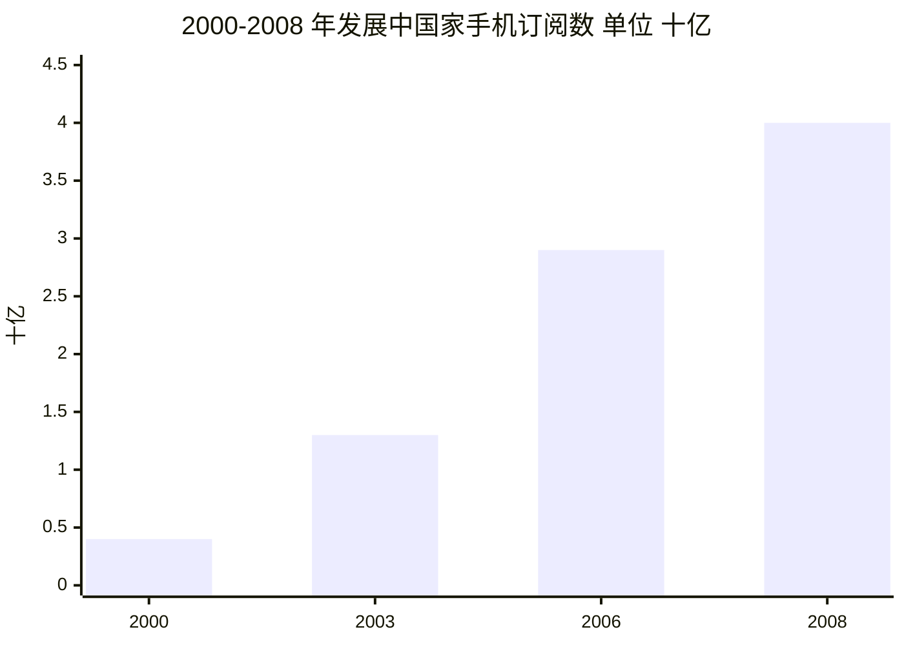

| 年份 | 发展中 | 发达 |
| :--- | :--- | :--- |
| 2000 | 0.4 | 0.7 |
| 2008 | 4.0 | 1.0 |

坑：两条线**在 2003 年前后交叉**，发展中国家反超。写「一个暴涨、一个原地踏步、中途换位」，别只写「都增长了」。

#### 2011｜国内轿车市场品牌份额

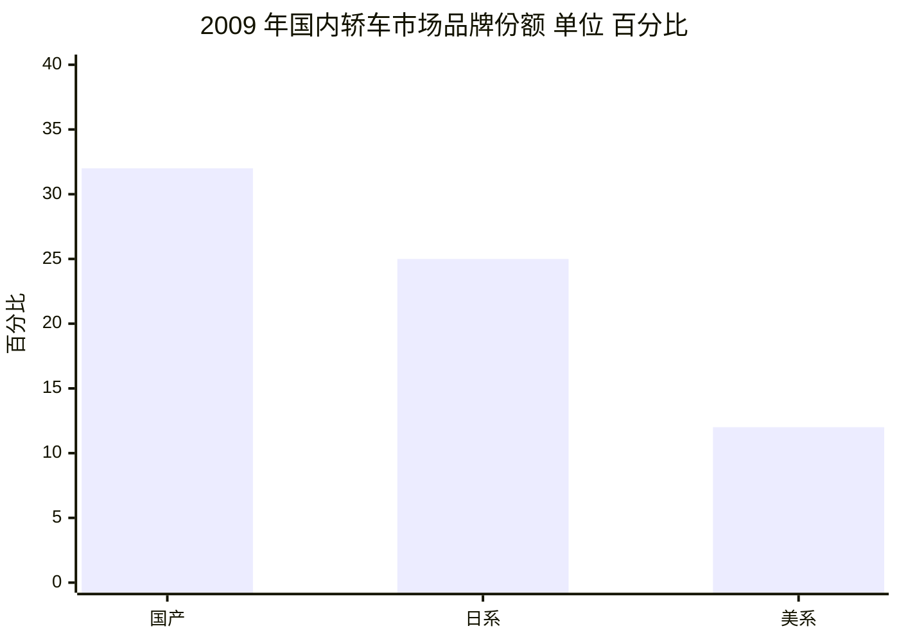

| 品牌 | 2008 | 2009 |
| :--- | :--- | :--- |
| 国产 | 25 | 32 |
| 日系 | 35 | 25 |
| 美系 | 12 | 12 |

坑：**日系掉、国产升，一升一降刚好换位**；美系两年不动，是「稳定项」。这题不写「都涨」就对了。

#### 2012｜某公司员工工作满意度（表格）

| 年龄段 | 满意 | 不清楚 | 不满意 |
| :--- | :--- | :--- | :--- |
| ≤40 岁 | 16.7% | 50.0% | 33.3% |
| 41-50 岁 | 0.0% | 36.0% | 64.0% |
| >50 岁 | 40.0% | 50.0% | 10.0% |

坑：三点反常识——**41-50 岁满意率是 0**；三组「不清楚」都在 36%-50%；越年轻不一定越满意。写「中年段最不满 + 大面积态度模糊」。

#### 2013｜某高校学生兼职情况

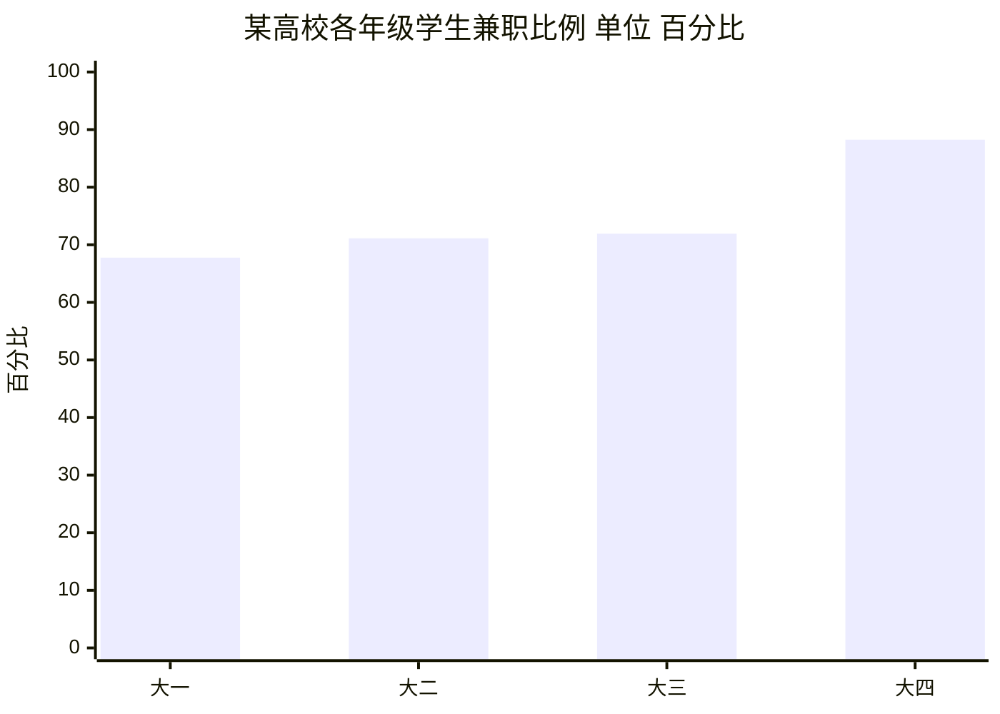

坑：前三档几乎平着走（67→72），**大四陡然跳到 88.24**。全文重心就放在「大四为什么跳」。

#### 2014｜20 年间城乡人口变化

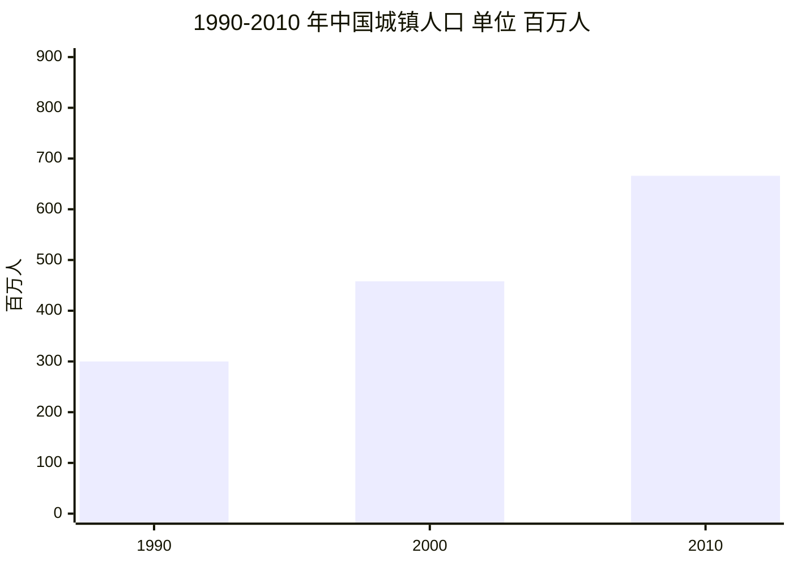

| 年份 | 城镇 | 乡村 |
| :--- | :--- | :--- |
| 1990 | 300 | 834 |
| 2000 | 458 | 807 |
| 2010 | 666 | 674 |

坑：**2010 年两条线几乎交汇**（666 vs 674），这是全图最有戏剧性的点；城镇 20 年涨了 120% 以上。

#### 2015｜某市居民春节假期花销（饼图）

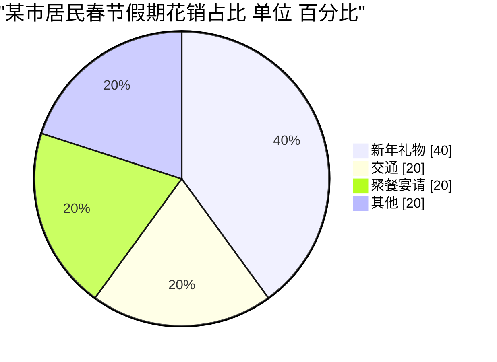

坑：**礼物一家占了四成**，其余三项整齐地各两成。写「人情支出压过一切」，别把三项平均写成一笔流水账。

#### 2016｜某高校学生旅游目的（饼图）

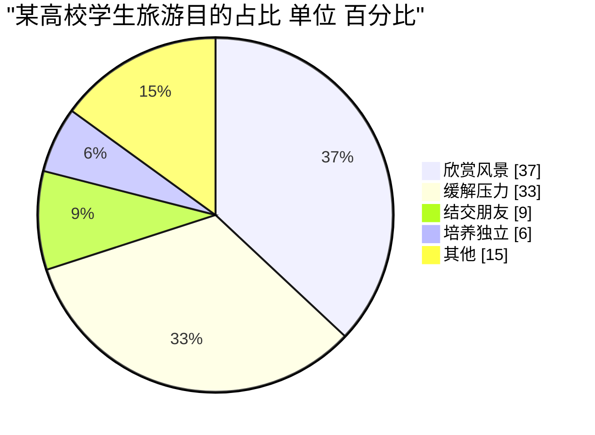

坑：前两项合计七成，**「看」和「喘口气」是同一件事的两面**；培养独立只有 6%，别写成主流。

#### 2017｜博物馆数量与参观人数（双折线）

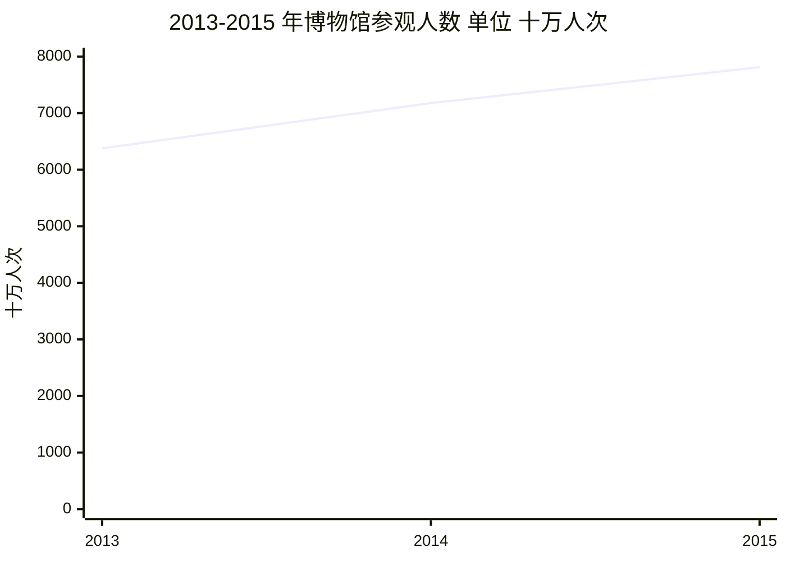

| 年份 | 博物馆数量（家） | 参观人数（十万人次） |
| :--- | :--- | :--- |
| 2013 | 4165 | 6378 |
| 2014 | 4510 | 7177 |
| 2015 | 4697 | 7811 |

坑：两条线**同步上升**，但数量只涨了 13%，人数涨了 22%——「馆多了一点，人多了很多」。两个单位不同，绝不能直接比大小。

#### 2018｜选择餐厅的关注因素（饼图）

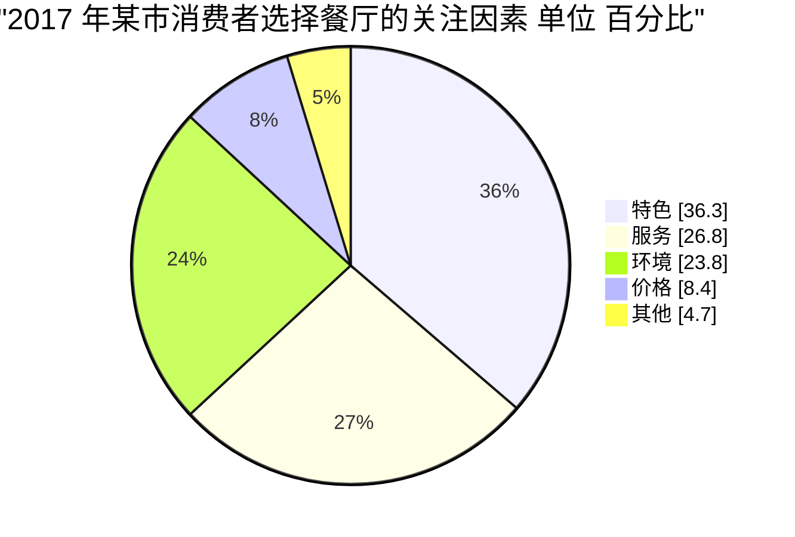

坑：**价格只排第四（8.4%）**，而特色、服务、环境合计 86.9%。这题的立意天然是「从吃饱到吃好」。

#### 2019｜本科毕业生去向（分组柱状）

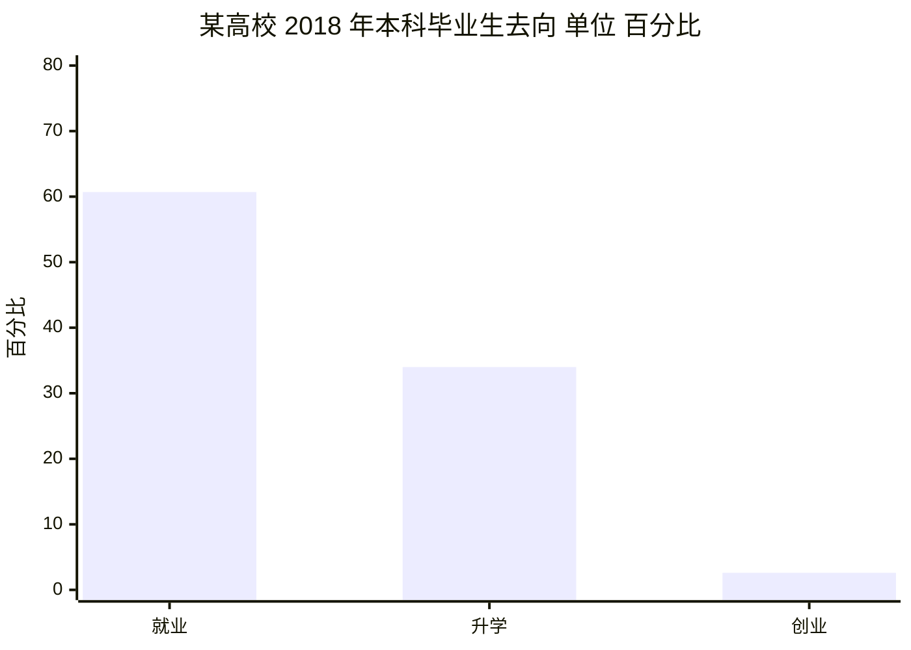

| 去向 | 2013 | 2018 |
| :--- | :--- | :--- |
| 就业 | 68.1% | 60.7% |
| 升学 | 26.3% | 34.0% |
| 创业 | 1.3% | 2.6% |

坑：**就业降 7.4、升学报 7.7，几乎一比一搬家**；创业虽翻倍，绝对值仍只有 2.6%，不能吹成「创业热」。

#### 2020｜大学生手机阅读目的（饼图）

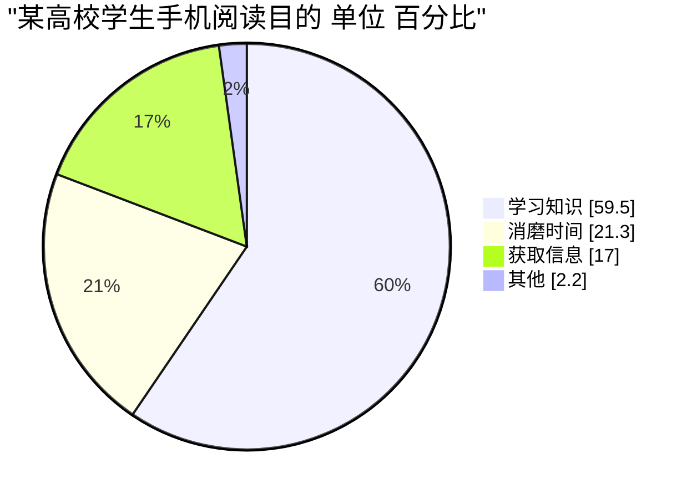

坑：近六成是「学习知识」，只有两成是「消磨时间」——**反直觉**，别按刻板印象写成「都在刷手机玩」。

#### 2021｜某市居民体育锻炼方式

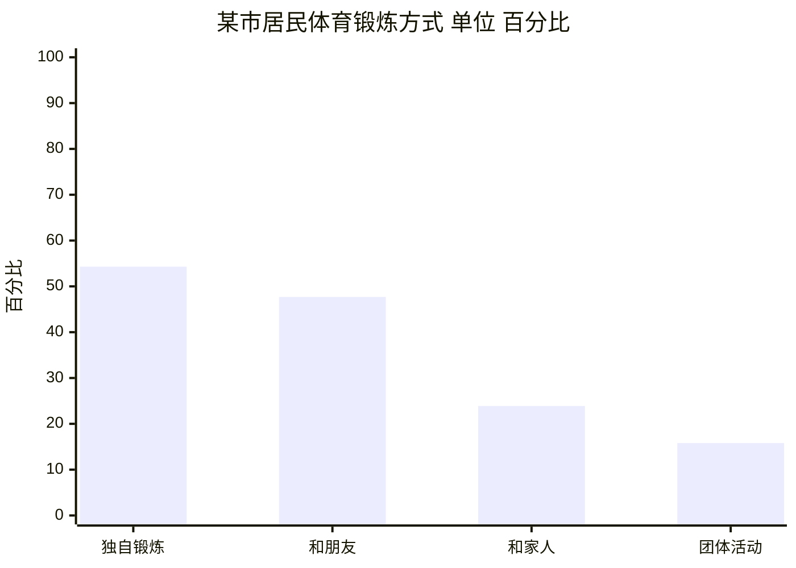

坑：**各项相加超过 100%**，说明是多选，不能画饼图、不能写成「占比结构」。真正看点是「独自 > 结伴」。

#### 2022｜我国快递业务量（总体 vs 农村）

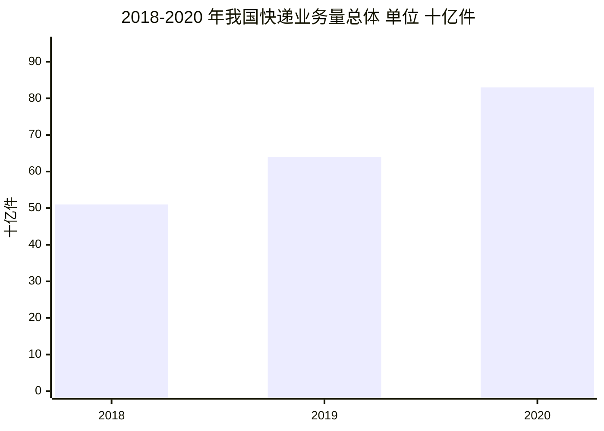

| 年份 | 总体 | 其中农村 |
| :--- | :--- | :--- |
| 2018 | 51 | 12 |
| 2019 | 64 | 15 |
| 2020 | 83 | 30 |

坑：农村从 15 涨到 30，**一年翻倍**，是增速之王；但农村本身包含在总体里，两组不能相加。

#### 2023｜我国居民健康素养水平（折线）

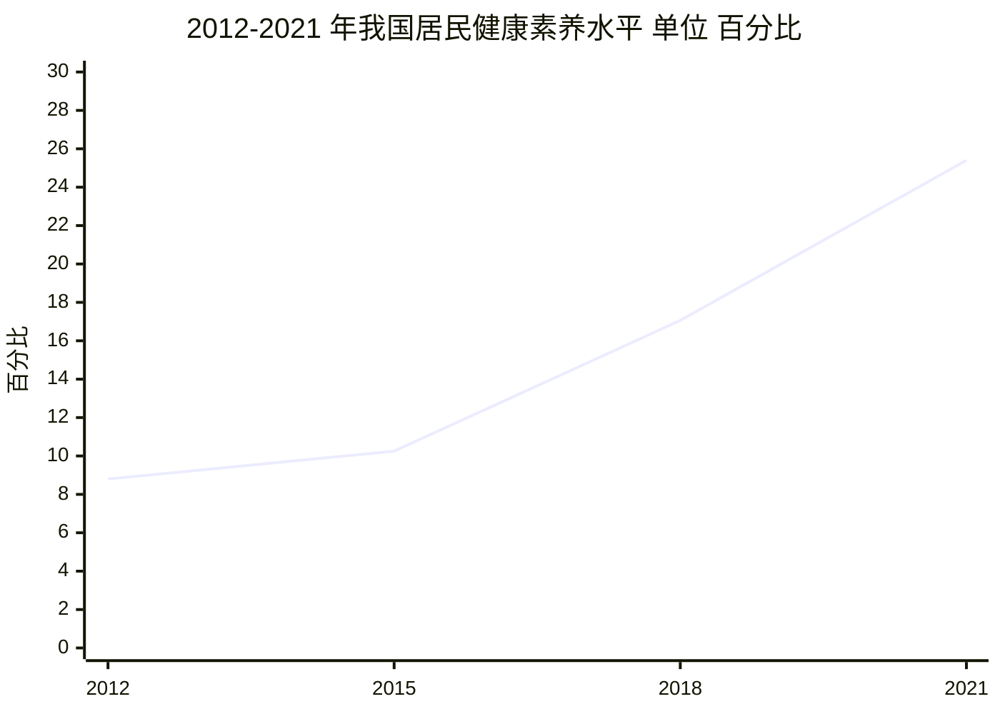

| 年份 | 2012 | 2013 | 2014 | 2015 | 2016 | 2017 | 2018 | 2019 | 2020 | 2021 |
| :--- | :--- | :--- | :--- | :--- | :--- | :--- | :--- | :--- | :--- | :--- |
| % | 8.80 | 9.48 | 9.79 | 10.25 | 11.58 | 14.18 | 17.06 | 19.17 | 23.15 | 25.40 |

坑：**前五年慢慢爬，后四年突然加速**（2019 之后斜率明显变陡）。写「拐点在 2019」，比写「一路增长」高一个档。

#### 2024｜劳动实践课的主要收获（条形图）

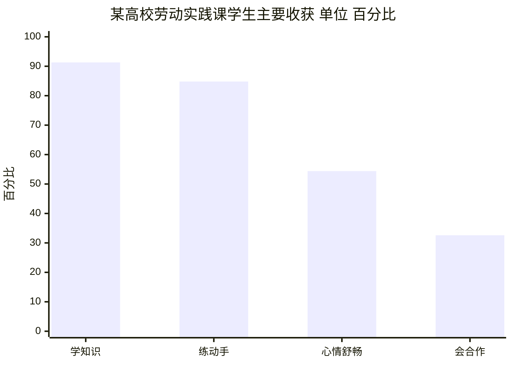

坑：**知识与动手都过 84，合作只有 32.6**——这是同一门课里的「长短腿」，立意必须是「补短板」，不是「效果好」。

#### 2025｜某社区老年人日常休闲活动

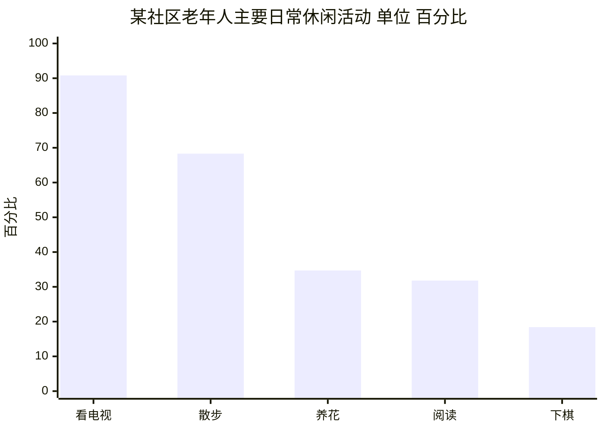

坑：**越省力的活动越受欢迎**（电视 90.8 / 下棋 18.4），这条隐性规律才是评论的抓手；各项非互斥，不能用饼图。

#### 2026｜关于儿童户外活动的看法

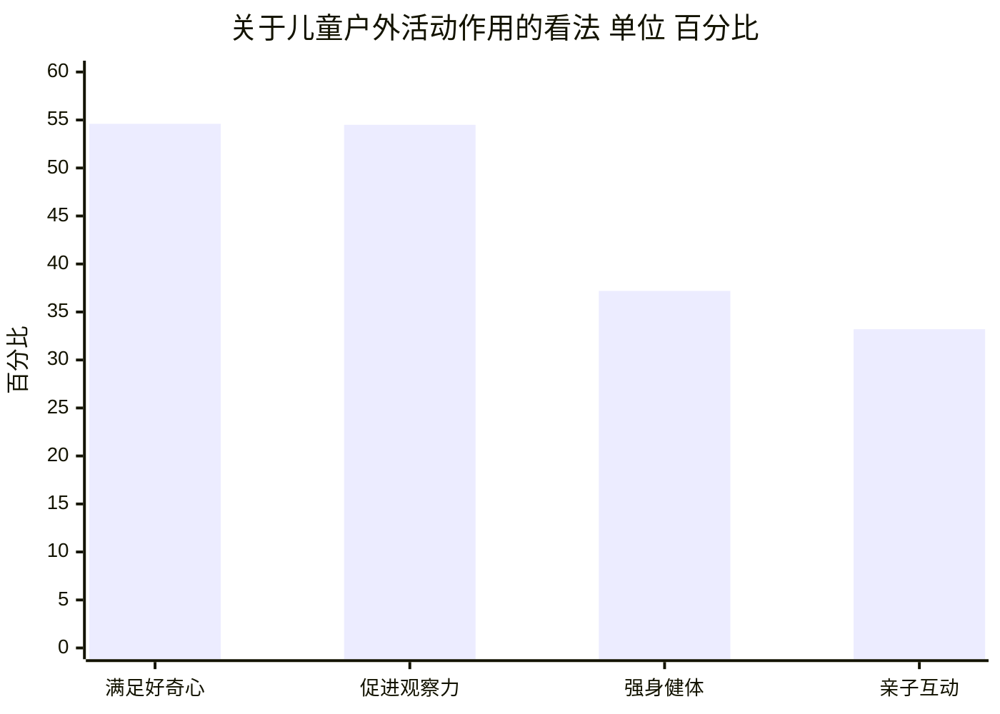

坑：前两项**只差 0.1 个百分点**，属于并列第一；而且这是「看法」不是「效果」，不能写成「户外活动确实提高了观察力」。

---

### 第四部分 大作文模板（1 套，11 句）

#### 骨架

三段共 11 句，约 155 词。**粗体是固定句，方括号是当天换的词。**

```text
第一段 描述 + 定性（4 句）
S1  The chart turns something we usually only sense into numbers: [主题名词短语], measured across [调查对象或时间段].
S2  [动态] Between [起点] and [终点], [A] climbed from [x] to [y], while [B] moved only from [x] to [y].
    [静态] The leading item is [A], at [x]%, with [B] following at [y]%.
S3  Put the two ends together and the gap is [差额]: [倍数] times over, which is hard to dismiss as noise.
S4  In plain words, [一句人话结论，不超过 15 词].

第二段 两个原因（4 句）
S5  Two forces usually sit behind a shift like this, and neither is mysterious.
S6  The first is structural: [政策/技术/经济] has driven the cost of [某行为] down, so what used to be a luxury has quietly become a default.
S7  The second is personal: people now weigh [价值] differently — [旧标准] counts for less than [新标准].
S8  [可选·让步] Not everyone welcomes it, and the worry about [担忧] is not unreasonable.

第三段 判断 + 建议（3 句）
S9  Where does that leave us? [趋势判断：还会走一段 / 已接近天花板].
S10 The trend will not reverse on its own; the sensible response is to [宏观建议].
S11 For individuals, the point [follows from the diagnosis / is simpler]: [个体建议] — that is how a trend turns into a benefit rather than a statistic.
```

> **骨架上有四个槽最容易写坏**，2021 那篇就是栽在第 1、4 条上：
>
> 1. **S2 的括注位**——单位、口径、是否可多选，一律塞进括号，最多 5 词：`Exercising alone leads at 54.3% (multiple answers allowed)`。**不要为它单开一句**，那会变成技术说明，还可能被当成算错。
> 2. **S3 是读图句，不是评图句**——只许出现「差距、倍数、拐点」，`shares add up to more than a hundred` 这种自我解释删掉。
> 3. **S5 要防「伪二分」**——两个原因必须来自不同系统：一个是外部结构（成本、政策、技术），一个是内部动机（观念、情绪、算计）。如果两条都能归到同一件事，说明你只找到一个原因，第二条换成「让步 / 对比」。
> 4. **S11 通常要带因果桥**——`the point follows from the diagnosis` 后面必须接一条**由第二段原因推出的动作**；只有建议与原因显然对应时，才用 `the point is simpler`。诊断和药方反着来，是第四档的典型特征。
>
> **骨架自带的四种结构**（大纲要「丰富的语法结构」和「多种衔接手法」，这里已经够，不要再堆）：
>
> - 倍数/差距句（S3）：`…, which is hard to dismiss as noise.`
> - 因果从句（S6）：`…drove the cost down, so what used to be a luxury has become a default.`
> - 让步句（S8，可选）：`Not everyone welcomes it, and the worry about … is not unreasonable.`
> - 条件推演（S11）：`if calendars keep people apart, put the partner into the calendar.`
>
> 衔接手法每段一个就够：`The first / The second`、`Put differently`、`That said`、`Either way`。骨架里已有三处，**不要再加 firstly / moreover / last but not least**——那是第三档的衔接。
>
> S1 的三种备选，按图的「气质」挑，别三篇都用同一句：
>
> - 反差明显：`Two numbers in the chart tell the whole story, and they pull in opposite directions.`
> - 单一趋势：`The chart records a shift that took [年数] years to complete and about three sentences to describe.`
> - 静态占比：`Ask people one question and the answers line up in a way that is almost too neat to be accidental.`

译（S1-S4）：
图表把一件我们平时只能感觉的事变成了数字：……，调查范围是……。
从……到……，……从……升到……，而……只从……动到……。（静态题改：占比最高的是……，为……%，其后是……，为……%。）
把两头放在一起看，差距是……：……倍，很难当成噪声忽略。
说人话：……。

译（S5-S8）：
这种变化背后通常有两股力量，且都不神秘。
第一股是结构性的：……把……的成本压低了，于是原来的奢侈品悄悄变成了默认选项。
第二股是个人的：人们衡量……的尺子变了——……不如……重要了。
当然不是人人都欢迎，对……的担心并非没有道理。

译（S9-S11）：
那这意味着什么？……。
趋势不会自己掉头，所以理性的反应是……。
对个人来说更简单：……——趋势才能变成红利，而不只是一个统计数字。

> 想让尾段更「文」一点，S9 或 S11 可换成（**三篇里最多用一次**，否则通篇都在抒情）：
>
> - `The numbers are only a mirror; what matters is what we choose to see in it.`
> - `A trend is not a verdict — it is an invitation to decide what comes next.`
> - `Statistics record where we have been; they say nothing about where we are willing to go.`
>
> **尾段的建议必须接回第二段的原因。**第二段说「日程难对齐」，第三段就该说「把搭档写进日程」，而不是「顺其自然」。诊断和药方反着来，阅卷会判收束不力。
>
> 反过来，只有**有争议**的题（2019 学历、2020 手机阅读、2025 老人看电视）才用 `neither to cheer nor to panic` 这版；中性题用它，会像在对着一个没人吵的问题喊口号。

#### 用 2025 真题走一遍（考场原速）

```text
The chart turns something we usually only sense into numbers: the leisure habits of older people in one community, measured across five activities.
The leading item is watching TV, at 90.8%, with walking following at 68.3%.
Put the two ends together and the gap is 72.4 percentage points — nearly five times over, which is hard to dismiss as noise.
In plain words, the easier an activity is, the more welcome it is.

Two forces usually sit behind a pattern like this, and neither is mysterious.
The first is structural: cheaper screens and round-the-clock broadcasting have driven the cost of entertainment down, so what used to require a trip outside has quietly become a default at home.
The second is personal: many older people now weigh comfort above novelty — a familiar programme feels safer than an unfamiliar chess partner.

Where does that leave us? The preference for low-effort leisure is unlikely to fade on its own.
The sensible response is neither to cheer nor to panic, but to make the alternatives easier to reach: more shaded walking paths, more chess tables in the courtyard.
For individuals, the point is simpler: walk with them instead of urging them to — that is how a trend turns into a benefit rather than a statistic.
```

（168 词，全部用骨架长出来的，没有一句是「模板腔」。）

#### 六种题型的首段改法

| 题型 | 真题 | S2 换成 | S3 换成 |
| :--- | :--- | :--- | :--- |
| 单柱趋势 | 2014、2022 | climbed from … to … | 差距 / 翻倍倍数 |
| 分组对比 | 2011、2019 | A fell from … to …, while B rose from … to … | 一升一降、换位 |
| 静态占比 | 2025、2026 | The leading item is … at …%, with … at …% | 头尾差多少个百分点 |
| 饼图 | 2015、2016、2018、2020 | A alone accounts for …%, with B and C at …% each | 前三项合计占多少 |
| 折线 | 2017、2023 | rose from … to … over nine years | 拐点在哪一年 |
| 表格 | 2012 | 按行说：the youngest group … , the middle group … | 最反常识的那一格 |

**S2/S3 只换这两句，S1、S4 和整个二、三段一字不动。**这是这套模板的全部工作量。

#### 五大话题词块（考前一周背）

##### 经济消费

- `disposable income` 可支配收入 / `purchasing power` 购买力
- `spending has shifted from goods to experiences` 花钱从买东西转向买体验
- `the cost of … has been driven down` ……的成本被压低了
- `a buyer's market` 买方市场
- 定性句：`What looks like a spending boom is really a change in what people are willing to pay for.`

##### 教育就业

- `credential pressure` 学历压力 / `a tighter job market` 更紧的就业市场
- `signal competence to employers` 向雇主释放能力信号
- `practical skills are valued over paper qualifications` 实操能力压过一纸文凭
- 定性句：`Behind the numbers sits a generation hedging its bets against an uncertain job market.`

##### 科技文化

- `lower the threshold for …` 降低……的门槛
- `technology has quietly rewritten the default` 技术悄悄改写了默认选项
- `cultural confidence` 文化自信 / `heritage on screen` 荧幕上的传统
- 定性句：`Convenience, once a bonus, has become the standard against which everything else is judged.`

##### 社会民生

- `an ageing population` 老龄化 / `public services` 公共服务
- `the gap between … and …` ……与……之间的落差
- `leave no one behind` 一个都不落下
- 定性句：`The chart measures habits, but what it really exposes is who has access and who does not.`

##### 生态健康

- `health literacy` 健康素养 / `a low-carbon routine` 低碳日常
- `prevention is cheaper than cure` 预防比治疗便宜
- `sustainable in the long run` 长期可持续
- 定性句：`A healthier population is less a medical achievement than a daily habit repeated by millions.`

#### 反套话对照表（左边这些别写）

| 市面常见（会被看穿） | 换成 |
| :--- | :--- |
| As is vividly depicted in the chart | The chart turns something we usually only sense into numbers |
| It is universally acknowledged that | Few would dispute that …（或直接陈述事实） |
| With the rapid development of society | 换成具体机制：cheaper screens / tighter job market |
| Every coin has two sides | Not everyone welcomes it, and the worry about … is not unreasonable |
| It is high time that we took measures | The trend will not reverse on its own; the sensible response is to … |
| Last but not least | （直接删掉，用内容承接） |
| plays an increasingly important role | has quietly become a default |
| This phenomenon is worth our attention | （删；改成一句判断句） |
| can not be ignored | 很难当成噪声：hard to dismiss as noise |
| Only in this way can we … | that is how a trend turns into a benefit |

#### 考前自查（30 秒）

1. **单位**写了吗？十亿件 / 十万人次 / 百万人 / 百分点，别混。
2. **对象**写清了吗？某高校 / 某市 / 某社区，不能推广成「我国」。
3. 没时间轴的静态图，**绝不能写「逐年上升」**。
4. 多选数据（2021、2025）**不能画饼图、不能说合计 100%**；也不要专门写一句解释「合计超过 100%」，那是技术说明，不是解读。
5. 「看法」≠「事实」（2026），别写成「确实提高了」。
6. 第二段有没有**两股不同的力量**？只写一条就是 12 分档。
7. 结尾有没有落到**具体动作**？「加强宣传」这种等于没写。
8. **有没有照抄题干句子**？大纲明写「使用提示语中出现的句子将被扣分」。
9. 字数落在区间里了吗（小 95-115、大 150-180）？长度不符会被「酌情扣分」；书写别潦草，影响阅读直接降一档。

#### 迭代流程（10 月起怎么滚）

1. 先用这 3 套写出**第一版**，别边写边改；
2. 拿 2010-2026 真题逐篇限时写：小作文 12 分钟、大作文 25 分钟，写完自己按评分点数一遍；
3. 把原题 + 自己的作文 + 评分标准丢给 AI，只问三件事：**信息点漏没漏、哪句是中式英语、哪句能换更地道的说法**；
4. 只改**固定句**（小作文头尾、S1、S5、S10），块库里的句子不要动——改多了就背不住；
5. 每三轮把高频替换词沉淀回上面的话题词块表，模板才算真变成自己的。

---

### 附录：起初那版（原样保留，只换变量名）

#### 变量名对照

| 旧写法 | 新写法 | 差别 |
| :--- | :--- | :--- |
| `[称呼]` | `[称呼]` | 不变 |
| `[承接任务]` / `[动作核心]` | `[点题]` | 旧版填动词短语，新版填**一句结论**，信息量更大 |
| `【肉块 1】` `【肉块 2】` `【肉块 3·可选】` | `[块 1]` `[块 2]` | 旧版三块，新版两块（第三块常被字数吃掉） |
| `[要点 1]` / `[方面 1]` | `[块 1]` | 同上 |
| `[期待点]` | 不需要 | 新版结尾只要「一行回复」，不再二次邀约 |

#### 旧版·回信

```text
Dear [称呼],

It was such a pleasant surprise to hear from you, and I truly appreciate your [kind words / thoughtful invitation / prompt email].
In response to what you mentioned, I would be more than delighted to [承接任务].

To give you a clearer picture, here is how I view the matter:

【块 1】On the one hand, priority should be given to [要点 1].
【块 2】Equally important is [要点 2], which will surely [带来某种良性结果].
【块 3·可选】As an added bonus, it would be wonderful to [要点 3].
I genuinely hope this clarifies things a bit.
Please let me know if you would like me to elaborate on any particular part.
Looking forward to our next interaction!

Warm regards,
Li Ming
```

#### 旧版·发信

```text
Dear [称呼],

I hope this note finds you well.
With [关键事件] just around the corner, I am reaching out to [动作核心].

To ensure everything proceeds seamlessly, I have organized the essentials as follows:

【块 1】First, as far as [方面 1] is concerned, [具体展开 1~2 句].
【块 2】Meanwhile, I would be immensely grateful if you could shed some light on [方面 2].
【块 3·可选】As an added bonus, it would be wonderful to [要点 3].
Feel free to voice your thoughts if anything needs fine-tuning.
Thank you so much for your understanding, and I cannot wait to [期待点].

Yours sincerely,
Li Ming
```

#### 旧版·图表作文三段表（原表照录，仅加一列判词）

| 段 | 功能 | 原句 | 判 |
| :--- | :--- | :--- | :--- |
| 一 | 概述 | The provided chart vividly illustrates the striking changes regarding [图表主题] over the period from [年份 A] to [年份 B]. | 改——`vividly illustrates` 是图表八股第一号 |
| 一 | 数据 A | Specifically, the figure for [主导项] [experienced a phenomenal surge / accounted for the lion's share], moving from [数据 1] to [数据 2]. | 留半句——`moving from…to…` 好用，`lion's share` 已泛滥 |
| 一 | 数据 B | [In sharp contrast / In parallel], the data for [次要项] [remained relatively stable / registered a downward trajectory]. | 留——对比词表可用 |
| 一 | 值得注意 | What is particularly noteworthy is that [最核心交叉点], which highlights a profound transition. | 改——`profound transition` 空洞，等于没说 |
| 二 | 联系主旨 | Such statistical patterns, beyond doubt, can be deeply associated with the trend of [核心主旨]. | 删——纯过渡，浪费一句 |
| 二 | 引出原因 | Then, what driving forces have propelled this prevailing phenomenon? Generally speaking, several interrelated factors account for it. | 改——设问句占 20 词，只换来「有几个原因」 |
| 二 | 原因 1 | To begin with, the robust economic growth along with [技术/政策红利] has laid a solid foundation for [现象], unlocking unprecedented possibilities. | 留骨架——`laid a solid foundation for` 稳，`unprecedented` 删 |
| 二 | 原因 2 | Furthermore, the general public nowadays places greater emphasis on [个人追求], which inevitably shifts their choices. | 留——观念类原因的标准写法 |
| 三 | 建议 1 | To foster a healthier and more sustainable environment, it is highly advisable for relevant authorities to formulate forward-looking guidelines. | 改——任何题都能套，阅卷一眼看穿 |
| 三 | 建议 2 | Meanwhile, individuals are expected to cultivate a rational mindset rather than following the trend blindly. | 改——`rational mindset` 空 |
| 三 | 举例 | For instance, striking a balance between [积极面 A] and [潜在风险 B] will undoubtedly steer this trend toward a promising future. | 留句式——`steer … toward` 好用 |

#### 两版对照：各让一步

| 维度 | 旧版 | 新版 |
| :--- | :--- | :--- |
| 句式来源 | LinkedIn 商务邮件腔（`I am reaching out to`） | 论文/散文腔（`rather than left to a passing remark`） |
| 抗撞句 | 差，全网都能搜到原句 | 好，句子是我拼的，搜不到 |
| 信息密度 | 低：开头两句 45 词只说「我收到信了」 | 高：开头 20 词已点题 |
| 容错率 | **高**：内容写空也能保 9-10 分 | 低：块写砸就没有安全句兜底 |
| 背诵量 | 两套各一整篇 | 两套共用一套头尾 |
| 图表结构 | 三段十一句，稳但空 | 三段十一句，骨架其实借的就是它 |

结论：

- **骨架用新版**（结构没变，还是旧版那套三段十一句，只是把空话换成真话）；
- **兜底留旧版两句**：时间不够时，`I would be immensely grateful if you could shed some light on …` 和 `it is highly advisable for relevant authorities to formulate …` 直接抄上去，句子本身没错，只是不新鲜；
- 旧版的 `Warm regards,` 可以留给朋友信，比 `Yours sincerely,` 松一点。

---

### 第五部分 全真题套写（2010-2026，34 篇）

全部用上面那 3 套骨架写成，**没有一个句子是临场编的**。年份后标的是用的外壳 / 首段类型。

#### 一、小作文（17 篇）

##### 2010｜回信 · 感谢 + 邀请

```text
Dear Mr. Brown,

This is a short reply with one purpose: to thank you for the fortnight you gave me.

Looking back, your patience with my halting English made a real difference; without it I would have eaten alone every night. I still owe you one.

So come and see China when your term allows: the night market near my campus would be your kind of thing. Bring your camera.

If any part of it does not suit you, say so and we will adjust it. Either way, a line by June will do.

Yours sincerely,
Li Ming
```

##### 2011｜去信 · 祝贺 + 建议

```text
Dear Li Ming,

This is a short email with one purpose: to congratulate you on the admission letter and to offer two pieces of advice.

Congratulations are in order, and they are well earned: two years at that desk finally paid off. What impresses me most is not the result but the persistence behind it.

For a start, learn to live with a roommate before term begins — it costs you a week and saves you a year. Once that becomes a habit, budgeting will feel natural rather than forced.

If any part of it does not suit you, say so and we will adjust it. Either way, a line before September will do.

Yours sincerely,
Li Ming
```

##### 2012｜去信 · 投诉 + 要求

```text
Dear Sir or Madam,

I am writing to complain about the dictionary I bought from you last month.

The problem showed up almost immediately: three keys stick, the screen flickers, and the battery dies within an hour of a full charge. The box itself arrived dented, which may explain the rest.

I am not after an explanation so much as a fix — a replacement unit, preferably before the new term starts.

I would rather settle this quietly than take it further. A workable solution by next Friday is all I ask.

Yours sincerely,
Li Ming
```

##### 2013｜去信 · 义卖细节 + 号召

```text
Dear classmates,

This is a short email with one purpose: to tell you what happens on Saturday and to ask for your help.

The sale falls on Saturday, from nine to four, at the south gate of the library. What makes it worth a morning is that everything on those tables was donated, so the money goes only to the children.

Two hours at the toy table is all we ask; bring a friend, since the crowd is the advertisement.

If any part of it does not suit you, say so and we will adjust it. Either way, a line by Thursday will do.

Yours sincerely,
Li Ming
```

##### 2014｜去信 · 生活习惯 + 求建议

```text
Dear John,

This is a short email with one purpose: to tell you how I live and to ask two questions about living there.

I keep early hours and cook most nights; music after eleven is the one thing I cannot sleep through. Weekends I am out, so the bathroom is yours.

Before I commit, I would like your read on two points: how quickly the landlord answers a broken boiler, and whether a bike is enough for the winter term.

If any part of it does not suit you, say so and we will adjust it. Either way, a line before August will do.

Yours sincerely,
Li Ming
```

##### 2015｜通知 · 夏令营 + 招募志愿者

```text
Notice

Summer Camp for High School Students

The camp is scheduled for July 15 at the university sports centre, and the organizers are now recruiting volunteers.
It opens with a campus tour, and then moves on to two days of science workshops run by our own labs.
Volunteers will guide the tours, run the workshops and stay with the groups at night, and each will receive a certificate.
The camp runs from nine to five, and lunch is provided on site.
Those interested are welcome to sign up at Room 203 before July 1.

The Students' Union
June 20
```

##### 2016｜回信 · 感谢 + 翻译建议

```text
Dear Jack,

This is a short reply with one purpose: to thank you for your congratulations and to answer your question about translation.

Looking back, that contest taught me more than any course; the only method that worked was translating one paragraph a day, out loud. I still owe that habit a debt.

For a start, stop hunting for the perfect word — write the sentence first and polish it afterwards. Once that becomes a habit, your drafts will read like English rather than translated Chinese.

If any part of it does not suit you, say so and we will adjust it. Either way, a line by June will do.

Yours sincerely,
Li Ming
```

##### 2017｜回信 · 接受邀请 + 讲座要点

```text
Dear Professor Williams,

I am writing to accept your invitation, and to set out the three points I would cover.

I would be glad to speak, and I would keep to three points: how festivals survive in cities, why food travels better than language, and what foreign students usually misread about both.

Before I commit, I would like your read on one thing: how long the audience can sit still, so I can cut the slides to fit the hour.

If any part of it does not suit you, say so and we will adjust it. Either way, a line by Friday will do.

Yours sincerely,
Li Ming
```

##### 2018｜去信 · 道歉取消 + 另约

```text
Dear Professor Smith,

I am writing to postpone my visit, and to explain why before you plan around it.

The plan has to be called off on my side, and the fault is entirely mine: my visa interview was moved to exactly that week, and missing it would cost me the term.

To make up for it, I have booked a slot in the first week of December, and I will send the material ahead so that the meeting is not wasted.

If any part of it does not suit you, say so and we will adjust it. Either way, a line by Friday will do.

Yours sincerely,
Li Ming
```

##### 2019｜去信 · 建议辩题 + 安排

```text
Dear Professor Smith,

I am writing to propose a topic for the debate, and to say how I would run it.

My suggestion is "Should city centres be closed to private cars?", a question that splits a room faster than any other and one every student has a stake in.

The arrangements are simple: two teams of three, eight minutes a side, then twenty minutes of questions from the floor. I will circulate the reading list a week ahead.

If any part of it does not suit you, say so and we will adjust it. Either way, a line by Friday will do.

Yours sincerely,
Li Ming
```

##### 2020｜去信 · 介绍古迹 + 游览提示

```text
Dear friends,

This is a short email with one purpose: to tell you about Saturday's walk and to give you two tips.

The site is best described as a Ming-era street that never quite became a museum — nothing fancy, but it still smells of woodsmoke in the morning.

Two tips before you come: wear shoes you can walk in for three hours, and bring cash, because the noodle stall at the corner takes nothing else.

If any part of it does not suit you, say so and we will adjust it. Either way, a line by Thursday will do.

Yours sincerely,
Li Ming
```

##### 2021｜去信 · 邀请参会 + 细节

```text
Dear Jack,

This is a short email with one purpose: I would like to invite you to our online meeting this Thursday.

The meeting runs from eight to nine on Tencent Meeting, room 815-220-337. Three students will report for ten minutes each, leaving the last half hour for questions.

I am asking you in particular because half the room has never spoken to a student outside China, and one honest question from you would do more than my slides.

If any part of it does not suit you, say so and we will adjust it. Either way, a line by Wednesday will do.

Yours sincerely,
Li Ming
```

##### 2022｜去信 · 美食节介绍 + 邀请

```text
Dear international students,

This is a short email with one purpose: to tell you about the food festival and to invite you.

The festival falls on Friday, from five till nine, with twenty stalls from eleven provinces. What makes it worth a detour is that every dish is cooked on the spot, not delivered in boxes.

I am asking you in particular because your table would be the only one with a story from outside China — bring one dish; we will find you a stove.

If any part of it does not suit you, say so and we will adjust it. Either way, a line by Wednesday will do.

Yours sincerely,
Li Ming
```

##### 2023｜回信 · 二选一 + 理由

```text
Dear David,

This is a short reply with one purpose: to tell you which exhibition to choose.

Take the robot show. The art exhibition will still be there next month, while half the machines on display are prototypes that may never be shown again.

My recommendation is simple: go early, and start with the arm that plays chess — that is where it shows its best side. If you have an hour left, the speech booth is the second stop.

If any part of it does not suit you, say so and we will adjust it. Either way, a line by Saturday will do.

Yours sincerely,
Li Ming
```

##### 2024｜去信 · 调查计划 + 询问意见

```text
Dear Jack,

This is a short email with one purpose: to put forward my plan for the survey and to ask for your opinion.

My plan is three days, three streets: we photograph the facades in the morning, interview whoever will talk in the afternoon, and leave a one-page questionnaire at the teahouses.

Before I commit, I would like your read on two points: how many houses we can realistically cover in a day, and whether to ask residents about relocation at all.

If any part of it does not suit you, say so and we will adjust it. Either way, a line before the weekend will do.

Yours sincerely,
Li Ming
```

##### 2025｜去信 · 短剧介绍 + 邀请

```text
Dear John,

This is a short email with one purpose: to invite you to join our short play.

The play takes one chapter of a classic novel — the part where a clever servant outwits a magistrate — and turns it into forty minutes of comedy on a bare stage.

I am asking you in particular because the servant needs an accent that is not mine, and yours would make the joke land. Rehearsals are Sunday afternoons.

If any part of it does not suit you, say so and we will adjust it. Either way, a line by Friday will do.

Yours sincerely,
Li Ming
```

##### 2026｜回信 · 视频感受 + 想了解更多

```text
Dear Jack,

This is a short reply with one purpose: to tell you what I thought of your video and to ask two questions.

Watching your mother argue with a ticket machine, and then win, was the best three minutes of my week; it made me homesick for a country I am already in.

Before I plan anything similar, I would like your read on two points: which city that night market was in, and how you persuaded your father to try the skewers.

If any part of it does not suit you, say so and we will adjust it. Either way, a line when you are free will do.

Yours sincerely,
Li Ming
```

#### 二、大作文（17 篇）

##### 2010｜动态 · 手机订阅

```text
The chart turns something we usually only sense into numbers: mobile subscriptions in two worlds, measured across eight years.
Between 2000 and 2008, subscriptions in developing countries climbed from 0.4 to 4 billion, while developed ones moved only from 0.7 to 1.
Put the two ends together and the gap is tenfold — hard to dismiss as noise.
In plain words, a phone stopped being a luxury exactly where people had waited longest.

Two forces usually sit behind a shift like this, and neither is mysterious. The first is structural: cheap handsets and shared towers drove the cost down, so an office tool became a household object. The second is personal: for many families a number was the first address they ever had.

Where does that leave us? The rich half has found its ceiling; the other half has not. The trend will not reverse on its own; the sensible response is to keep spectrum open to newcomers. For individuals, the point is simpler: a phone is only as useful as the market that resells it.
```

##### 2011｜分组对比 · 汽车品牌份额

```text
Two numbers in the chart tell the whole story, and they pull in opposite directions.
In 2008 Japanese brands led at 35% and domestic ones trailed at 25%; a year later the order reversed, 25% against 32%.
One year, seven points, and a decade-old hierarchy was gone — hard to dismiss as noise.
In plain words, the badge on the bonnet stopped deciding the sale.

Two forces usually sit behind a shift like this, and neither is mysterious. The first is structural: domestic makers moved their quality up while keeping prices below imported rivals. The second is personal: a car is increasingly bought as transport rather than as proof of taste, and buyers now read resale value before they read the logo.

Where does that leave us? The gap will keep narrowing until quality, not nationality, is what separates the three. The trend will not reverse on its own; the sensible response is to compete on safety tests rather than on slogans. For individuals, the point is simpler: compare the service bill, not the advertisement.
```

##### 2012｜表格 · 员工满意度

```text
The chart turns something we usually only sense into numbers: how three age groups rate the same company, measured in one survey.
The middle group is the puzzle: not one of them ticked "satisfied", while 64% ticked the opposite.
Zero against forty — the youngest and the oldest are happier than the people in between, which is hard to dismiss as noise.
In plain words, contentment dips exactly where ambition peaks.

Two forces usually sit behind a pattern like this, and neither is mysterious. The first is structural: the promotion ladder narrows between forty and fifty, so effort stops producing reward. The second is personal: this is when mortgages and school fees arrive together, and a flat salary feels like a verdict.

Where does that leave us? The middle of a career is where loyalty is cheapest to lose. The trend will not reverse on its own; the sensible response is to rotate roles and talk about paths before people look outside. For individuals, the point is simpler: ask for a review rather than a raise.
```

##### 2013｜单柱趋势 · 学生兼职

```text
The chart turns something we usually only sense into numbers: how many students in each year take part-time work, measured across four grades.
Between the first year and the fourth, the share climbed from 67.8% to 88.2%, with most of that gain in the final year.
Twenty points, most of it coming late, is hard to dismiss as noise.
In plain words, the closer graduation gets, the more the timetable bends.

Two forces usually sit behind a shift like this, and neither is mysterious. The first is structural: internships became the entry ticket to most industries, so experience stopped being optional and became a cost of applying. The second is personal: students price a line on the CV above an afternoon of rest.

Where does that leave us? The final-year jump suggests panic as much as planning. The trend will not reverse on its own; the sensible response is to cap weekly hours and treat marks as part of the same investment. For individuals, the point is simpler: choose the job that teaches a skill, not the one that pays the most.
```

##### 2014｜单柱趋势 · 城乡人口

```text
The chart turns something we usually only sense into numbers: where people in this country live, measured across two decades.
Between 1990 and 2010, the urban population climbed from 300 million to 666 million, while the rural figure fell from 834 to 674.
The two lines met almost exactly in 2010, which is hard to dismiss as noise.
In plain words, a country that farmed for a thousand years finished moving to town in twenty.

Two forces usually sit behind a shift like this, and neither is mysterious. The first is structural: factories and service jobs clustered where the roads already met. The second is personal: schools and hospitals decide where a family sleeps, and the countryside was short of both.

Where does that leave us? The flow is slowing, but it has not stopped. The trend will not reverse on its own; the sensible response is to fund schools where the newcomers live, and to make farming pay at the other end. For individuals, the point is simpler: count the rent before counting the wage.
```

##### 2015｜饼图 · 春节花销

```text
The chart turns something we usually only sense into numbers: how one city spends during the Spring Festival, measured in four categories.
Gifts alone account for 40%, with transport, dinners and everything else splitting the remaining sixty evenly.
Four yuan in every ten go on presents, while the other three categories split the rest almost evenly, which is hard to dismiss as noise.
In plain words, the festival is bought before it is enjoyed.

Two forces usually sit behind a pattern like this, and neither is mysterious. The first is structural: a gift has a market price, while a conversation does not, so the visible part of affection is the part that gets budgeted. The second is personal: most people spend to avoid being talked about, not to be talked about.

Where does that leave us? The forty percent will not fall on its own. The trend will not reverse on its own; the sensible response is to make time the gift that everyone can afford. For individuals, the point is simpler: one fewer box, one more evening.
```

##### 2016｜饼图 · 旅游目的

```text
The chart turns something we usually only sense into numbers: why students travel, measured across five answers.
Scenery takes 37% and relief from pressure 33%, while independence trails at 6%.
Two motives account for seventy percent of the trips, which is hard to dismiss as noise.
In plain words, students are not running towards a place so much as away from a timetable.

Two forces usually sit behind a pattern like this, and neither is mysterious. The first is structural: cheap tickets and two-day gaps in the term made the weekend trip a normal purchase rather than a rare adventure. The second is personal: an exam schedule leaves little room for anything that cannot be photographed and posted.

Where does that leave us? The appetite for escape is unlikely to fade. The trend will not reverse on its own; the sensible response is to keep student discounts and hostel beds within reach. For individuals, the point is simpler: stay one day longer instead of seeing one more city.
```

##### 2017｜折线 · 博物馆

```text
The chart turns something we usually only sense into numbers: the country's museums and the people walking through them, measured from 2013 to 2015.
Visitors rose from 6,378 to 7,811 ten-million-person-times, while the number of museums grew more modestly, from 4,165 to 4,697.
Attendance grew almost twice as fast as the buildings did, which is hard to dismiss as noise.
In plain words, the queues got longer while the walls stayed the same.

Two forces usually sit behind a shift like this, and neither is mysterious. The first is structural: free admission turned a Sunday outing into a habit, and new galleries gave that habit somewhere to go. The second is personal: a museum is cheap, indoor and photogenic, which is exactly what a family with two children and one afternoon needs.

Where does that leave us? The pressure will move from building halls to managing crowds. The trend will not reverse on its own; the sensible response is to spread demand with timed entry and evening openings. For individuals, the point is simpler: go on a Tuesday, not a holiday.
```

##### 2018｜饼图 · 选餐厅

```text
The chart turns something we usually only sense into numbers: what diners look for when they choose a restaurant, measured across five factors.
Speciality takes 36.3%, service 26.8% and atmosphere 23.8%, while price trails at 8.4%.
Three non-price factors account for 86.9%, which is hard to dismiss as noise.
In plain words, people no longer go out to eat; they go out to be served.

Two forces usually sit behind a pattern like this, and neither is mysterious. The first is structural: delivery apps quietly took over the cheap, quick meal, leaving restaurants to compete on everything else. The second is personal: a dinner is now judged by what can be photographed and remembered, and a discount photographs badly.

Where does that leave us? Price will keep sliding down this list. The trend will not reverse on its own; the sensible response is to let kitchens publish what they actually do well. For individuals, the point is simpler: pay for the dish, not for the lighting.
```

##### 2019｜分组对比 · 毕业去向

```text
Two numbers in the chart tell the whole story, and they pull in opposite directions.
Between 2013 and 2018, employment fell from 68.1% to 60.7%, while further study rose from 26.3% to 34.0%.
In five years, 7.4 points left the job market and 7.7 entered a classroom — hard to dismiss as noise.
In plain words, the queue for a degree got longer because the queue for a job got slower.

Two forces usually sit behind a shift like this, and neither is mysterious. The first is structural: a bachelor's degree no longer clears the first filter, so students buy a second. The second is personal: staying on feels like progress and postpones a decision nobody feels ready to make.

Where does that leave us? A master's will soon be the entry ticket, not the advantage. The sensible response is neither to cheer nor to panic, but to stop screening by diploma and start testing by task. For individuals, the point is simpler: know what the extra year buys before paying for it.
```

##### 2020｜饼图 · 手机阅读

```text
The chart turns something we usually only sense into numbers: why students open a book on a phone, measured across four answers.
Learning takes 59.5% and passing time 21.3%, while gathering information accounts for 17.0%.
Almost three in five read to learn something, which is hard to dismiss as noise.
In plain words, the pocket has become the library.

Two forces usually sit behind a pattern like this, and neither is mysterious. The first is structural: cheap data turned every dead ten minutes into reading time, and a phone is the only book people always carry. The second is personal: reading in fragments feels productive in a way that scrolling does not, and students are quietly grading themselves.

Where does that leave us? Attention is now the scarce resource, not access. The sensible response is neither to cheer nor to panic, but to put serious material where the reading already happens. For individuals, the point is simpler: finish one long piece a week, not twenty short ones a day.
```

##### 2021｜静态占比 · 锻炼方式

```text
The chart turns something we usually only sense into numbers: how one city exercises, measured across four arrangements.
Exercising alone leads at 54.3%, with friends at 47.7%, family at 23.9% and group classes at 15.8%.
Solo exercise outnumbers every shared arrangement, and the gap to a class reaches forty points.
In plain words, fitness has become a private appointment.

Two forces usually sit behind a pattern like this, and neither is mysterious. The first is structural: gym memberships and running apps made a workout something you can start at eleven at night. The second is personal: a shared class needs a shared calendar, and adult calendars rarely agree.

Where does that leave us? The preference for solo training will hold as long as schedules stay crowded. The trend will not reverse on its own; the sensible response is to keep parks lit and tracks free, since the cheapest gym is public space. For individuals, the point follows from the diagnosis: if calendars keep people apart, put the partner into the calendar — one fixed hour is enough.
```

##### 2022｜单柱趋势 · 快递业务量

```text
The chart turns something we usually only sense into numbers: parcels moved across the country, measured from 2018 to 2020.
Total volume climbed from 51 to 83 billion, while the rural share jumped from 12 to 30 in the same period.
Rural deliveries more than doubled in a single year, which is hard to dismiss as noise.
In plain words, the last mile finally reached the village.

Two forces usually sit behind a shift like this, and neither is mysterious. The first is structural: pickup stations and shared truck routes cut the cost of a village parcel to almost nothing. The second is personal: once a farmer can sell directly, a phone becomes a shopfront rather than a toy.

Where does that leave us? The growth will slow, but the map will keep filling in. The trend will not reverse on its own; the sensible response is to build recycling into the packaging before the rubbish does. For individuals, the point is simpler: combine orders, and keep the boxes for the next move.
```

##### 2023｜折线 · 健康素养

```text
The chart turns something we usually only sense into numbers: health literacy across the country, measured over ten years.
Between 2012 and 2021 the level rose from 8.8% to 25.4%, and the slope steepens visibly after 2019.
Sixteen points in a decade, with more than half gained in the last three years, which is hard to dismiss as noise.
In plain words, people learned to read their own bodies.

Two forces usually sit behind a shift like this, and neither is mysterious. The first is structural: public campaigns put basic knowledge on billboards, in lifts and on the evening news. The second is personal: a family that has nursed someone through an illness reads differently afterwards.

Where does that leave us? The curve will flatten once the easy gains are gone. The trend will not reverse on its own; the sensible response is to aim the next campaign at the villages and the oldest readers. For individuals, the point is simpler: check who wrote the advice before forwarding it.
```

##### 2024｜静态占比 · 劳动课收获

```text
The chart turns something we usually only sense into numbers: what students say they gained from a labour course, measured across four outcomes.
Knowledge leads at 91.3% and hands-on skill follows at 84.8%, while teamwork sits at 32.6%.
Fifty-nine points separate the top and the bottom, which is hard to dismiss as noise.
In plain words, the course teaches the hands and forgets the room.

Two forces usually sit behind a pattern like this, and neither is mysterious. The first is structural: a class of forty, marked individually, will always reward work that can be done alone. The second is personal: students treat a credit as a checklist, and cooperation cannot be ticked off quickly.

Where does that leave us? A skill nobody practises is a skill nobody keeps. The trend will not reverse on its own; the sensible response is to make one project impossible to finish without a partner. For individuals, the point is simpler: choose the task that needs a second pair of hands.
```

##### 2025｜静态占比 · 老年人休闲

```text
The chart turns something we usually only sense into numbers: how older people in one community fill their day, measured across five activities.
Watching television leads at 90.8%, with walking at 68.3% and chess at only 18.4%.
Seventy-two points separate the first and the last, which is hard to dismiss as noise.
In plain words, the easier an activity is, the more welcome it is.

Two forces usually sit behind a pattern like this, and neither is mysterious. The first is structural: a screen demands nothing but a socket, while a chess partner demands a phone call and a walk. The second is personal: after seventy, novelty costs more energy than it returns, and a familiar programme feels safer than an unfamiliar table.

Where does that leave us? The preference for low-effort leisure will not fade on its own. The trend will not reverse on its own; the sensible response is to put the alternatives within a hundred metres: shaded paths, benches, a table under the tree. For individuals, the point is simpler: walk with them instead of urging them to.
```

##### 2026｜静态占比 · 儿童户外活动看法

```text
The chart turns something we usually only sense into numbers: what people believe outdoor play does for children, measured across four answers.
Curiosity takes 54.6% and observation 54.5%, while fitness trails at 37.2% and family time at 33.2%.
The top two are a tenth of a point apart; the bottom two lag twenty points behind.
In plain words, adults praise what outdoor play does for the mind, and forget what it does for the legs.

Two forces usually sit behind a pattern like this, and neither is mysterious. The first is structural: a playground safe enough for a parent is often too far to walk to. The second is personal: a belief costs nothing and requires no shoes.

Where does that leave us? The chart records opinions, not results, and the gap between them is where policy belongs. The trend will not reverse on its own; the sensible response is to build the safe route before advertising the benefits. For individuals, the point is simpler: go outside with the child; the belief follows the habit.
```

#### 三、套写索引

| 年份 | 小作文外壳 | 用到的块 | 大作文首段型 |
| :--- | :--- | :--- | :--- |
| 2010 | 回信 | 7 + 3 | 动态·双线 |
| 2011 | 去信 | 8 + 4 | 分组对比 |
| 2012 | 去信 | 6（拆两段） | 表格 |
| 2013 | 去信 | 1 + 3 | 单柱趋势 |
| 2014 | 去信 | 2 + 10 | 单柱趋势 |
| 2015 | 通知 | — | 饼图 |
| 2016 | 回信 | 7 + 4 | 饼图 |
| 2017 | 回信 | 3 + 10 | 折线 |
| 2018 | 去信 | 5 + 10 | 饼图 |
| 2019 | 去信 | 11 + 自写安排 | 分组对比 |
| 2020 | 去信 | 2 + 4 | 单柱趋势 |
| 2021 | 去信 | 1 + 3 | 静态占比 |
| 2022 | 去信 | 1 + 3 | 单柱趋势 |
| 2023 | 回信 | 11 + 2 | 静态占比 |
| 2024 | 去信 | 3 + 10 | 静态占比 |
| 2025 | 去信 | 1 + 3 | 静态占比 |
| 2026 | 回信 | 2 + 10 | 静态占比 |

> 17 篇小作文只动用了 11 个块里的 10 个——**块 9（申请 / 自荐）一次都没考过**，可以不背。真正高频的是块 1、2、3、10，四个就够应付一半年份。

---

### 附录二：评分标准（大纲口径）与模板校准

#### 一、评分是怎么进行的

1. **先定档，再在档内给分**——不是逐句扣分。所以"某句写得漂亮"救不了整篇，反过来一句废话也未必致命，关键在整体落在哪一档。
2. **A 节（小作文，10 分）**评分重点：信息点覆盖、内容组织、语言准确、**格式与语域**。
3. **B 节（大作文，15 分）**评分重点：内容完整、组织连贯、**语法结构与词汇多样**、语言准确。
4. **可以用题干里的词，但不能照抄题干句子**——大纲原文：「允许在作文中使用提示语中出现过的个别关键词或词组，但使用提示语中出现的句子将被扣分。」
5. **长度不符「酌情扣分」**；拼写标点按对交际的影响程度考虑；英美拼写均可；**书写差到影响阅读，降一个档次**。

#### 二、小作文（A 节，10 分，一档 2 分）

| 档 | 分数 | 判据（摘要） |
| :--- | :--- | :--- |
| 第五档 | 9-10 | 全部要点；**丰富的语法结构和词汇**；自然流畅、几乎无错；**多种衔接**；格式语域贴切；完全达到预期效果 |
| 第四档 | 7-8 | 全部要点，允许漏 1-2 个次重点；较丰富；基本准确，只有尝试复杂结构或高级词时出错；衔接恰当、层次清晰 |
| 第三档 | 5-6 | 漏一些但含多数要点；结构词汇够用；有错但不影响理解；简单衔接；格式基本合理 |
| 第二档 | 3-4 | 漏要点或写无关内容；结构单调、词汇有限；错误多影响理解；衔接不当 |
| 第一档 | 1-2 | 明显遗漏主要内容；大量错误妨碍理解；无格式与语域概念 |

#### 三、大作文（B 节，15 分，一档 3 分）

| 档 | 分数 | 判据（摘要） |
| :--- | :--- | :--- |
| 第五档 | 13-15 | 内容完整、要点阐述充分；语法词汇丰富；流畅、几乎无错；多种衔接、层次清晰；语域恰当 |
| 第四档 | 10-12 | 要点齐全，少数要点阐述不充分；较丰富；基本准确；衔接得当 |
| 第三档 | 7-9 | 多数要点；结构词汇够用；有错不影响理解；简单衔接 |
| 第二档 | 4-6 | 漏要点或含无关内容；结构单调；错误较多 |
| 第一档 | 1-3 | 明显遗漏；妨碍理解 |

#### 四、字数与卷面

- 小作文 **100 词左右**、大作文 **150 词左右**，长度不符会酌情扣分。经验值：小作文低于 90、大作文低于 130 开始明显吃亏（各机构按每少 10 词扣 1 分上下的比例估，属经验，非大纲原文）。
- 大作文**不写标题**，不写地址；小作文署名固定 `Li Ming`。
- 大作文必须分段（三段最稳），段间空一行；小作文不分段也可以，但分段更清楚。
- 别涂改、别用花体——书写影响阅读会降一档，这是十年来唯一一条"硬扣"。

#### 五、标准 → 模板动作（这张表才是重点）

| 大纲条目 | 模板里的位置 | 落地动作 |
| :--- | :--- | :--- |
| 信息点覆盖 | 小作文 块 1 + 块 2 | 题干几个点就几个块，一块不漏 |
| 格式与语域 | 称呼 / 落款 / 通知外壳 | 朋友 `Dear John`，不知姓名 `Dear Sir or Madam`，通知不写称呼 |
| 丰富的语法结构 | 小作文三条结构位；大作文 S3 S6 S8 S11 | 小作文一条、两条封顶；大作文骨架已含四类，不用再堆 |
| 多种衔接手法 | 大作文 S5 / S9 / S11 | 每段一个显性衔接，全篇三处封顶 |
| 内容完整（B 节） | 首段 4 句 + 中段 2 因 + 尾段 3 句 | 描述 / 解读 / 评论三样齐 |
| 语言准确 | 11 组块库 + 5 类话题词块 | 现场只换名词和数字，不造新句式 |
| 不抄题干句子 | 块库全部改写 | 题干的动词短语一律换说法（`take part in` → `be on stage`） |
| 长度 | 小 95-115 / 大 150-180 | 写完全文数字数；低于下限补一个**细节句**，不要靠形容词凑 |
| 书写 | 考场 | 不用花体，只划一处改错 |

#### 六、拿这套模板去对照：现在几档

- **小作文**：信息点、格式、语域都在第五档线上，卡住的是"结构单一"。所以判 **8 分稳，补一条结构位争 9 分**。
- **大作文**：三段齐全、衔接显性、四类结构 ✓，判 **12-13 是常态**。上 14 卡在第二段的原因够不够具体——这一项模板给不了，只能靠平时积累（所以有第五部分那 17 篇打底）。
- 这套模板的天花板不是语言，是**内容的具体程度**。19 分的作文（小 9 + 大 14）里，模板贡献大约 24 分中的 20 分，剩下 4 分靠素材。

## 单词

- come to terms with sth：接受（令人不快的事实）
- evaporate：蒸发，逐渐消失
- in terms of sth：就...而言
- identical：完全相同的
- extraneous：无关的
- ornament：装饰品
- census：人口普查
- exacerbate：使恶化
- ethically：道德上的
- conversation：交谈，谈话
- pondar：沉思
