## 时间线

英语仔细阅读：第 19 周 - 第 28 周，共 10 周。掌握仔细阅读的基本方法，写完 07 - 18 的仔细阅读

英语套卷：第 29 周 - 第 32 周，共 5 周，14 年 - 20 年真题所有客观题（也就是 07-13 年的完型和新题型没做，不过这里新题型只用写 11,12,13，完型看情况了）

英语套卷：第 33 周 - 第 34 周：翻译和作文的简单研究，以及每天同时进行早年阅读重刷（10-11）

英语套卷 2：第 35 周 - 第 36 周：以 21 年真题为例，深度研究一份，22-23 真题来点感觉，小作文与翻译研究明白怎么学，二刷 12-16 年卷子。

英语套卷 3：第 37 周 - 第 38 周：研究大作文，模考 24、25 和 26 真题，复盘小作文和翻译，二刷 17-23 年试卷。

政治：第 29 周 - 第 42 周，共 14 周。先花 6 周的时间刷一遍选择题（徐涛马原强化课 + 苍盾），也就是第 34 周结束，再花 6 周的时间 2 刷一遍选择题（肖背诵手册，肖 8 的选择题），再花 2 周的时间背大题。注意这里的刷选择题是包含刷错题的。

## 政治前言

政治比我想象中的更猎奇。

## 马原必背

上层建筑

- 政治法律制度、国家政权机构

社会意识形式

- 道德、意识与哲学，是上层建筑，但是是意识形态（或者观念上层建筑

## 政治经济学

[30 分钟学完｜政治经济学、科学社会主义，速成课【空卡】](https://www.bilibili.com/video/BV1YnYL6SESt/?share_source=copy_web&vd_source=3fbbb3c2ad24817002f9c39fad247a3b)

## 政治二刷后模考

- 以 1600 为底，第一份随机 33 题：20 分

## 英语前言

突然意识到近些年的英语在慢慢变简单，所以不要因为早年的英语分低而丢失自信心，但也不要狂妄......吗？

更新于 10 月 24 日，突然发现英语问题会非常非常严重啊！

现在是写了 2021 年的完型和阅读 ab，完型 -3，在可接受范围之内，但是 a 篇错了 2 个，b 篇整篇文章还是看了翻译才终于搞明白是什么意思（尽管全对，但是花了 30min+）。

但是复盘下来，发现这些阅读并不难，而且要知道 2021 年的阅读算简单的阅读了，那我这样算什么？

今天是考研报名截止日，也改不了了，所以拼尽全力去补。

以后每天早上先过来背半个小时单词，然后学 75min 英语，再开始学数学。

主要是其实并不难，但是我依旧想当然，一开始没有逐字逐句翻译去理解，所以明天也需要复盘，再加上最近确实太摆了。

目标是客观题拿 50 至少。

## 一些准则

在英语阅读里，一句话的逆否命题必然是对的。

例如，我因为可以展现理想中的自己享受 facebook = 我为了逃避不修边幅的自己而享受 facebook。

## 做题顺序

阅读 A/B 篇 -> 作文 -> 阅读 C/D 篇 -> 新题型 -> 翻译 -> 完型。

## 完型

> 方法论来源于刘琦老师，保 6，争 8，拼 10，但我认为我自己得稳 8。

考研完型不是选出来的，是找出来的，即从文章里找线索。

如果句子没有明显情感倾向，那么选中性词（包括翻译也是）

改变条件，必然结果相反。（例如实验 A 是抿嘴唇，倾向是是成功，那么实验 B 改变了条件，必然是失败）

不确定先跳，不然一对一片，一错一片。

意思相同同时不选。

首段首句为全文中心，段落首句为段落中心。

感觉后面再看课没什么意义了，就这样吧。

### 完型词汇积累

- go through：完成
- do away：废除
- catch up：赶上
- put up：容忍
- lean towards：倾向于
- send out：分发
- give away：泄露
- self-deceptive：自欺欺人的
- self-reliant：自立的
- self-destructive：自毁的
- self-evident：不言而喻的
- hold onto：抓住
- accuont for：解释

## 阅读

> 方法论来自于唐迟老师，以及自己的总结，我认为四篇阅读至少得拿 36 分。

### 整体做题方法 - 阅读

答案一定不是选出来的，而应该是比对出来的。

- 标段落
- 通读问题（仅仅问题，不需要选项），找出关键字，串联题干逻辑，推测文章主题
  - 找出关键字，锁定词汇
  - 找出明显的态度词，例如 help 对应好的态度
- 根据题目大致推断这道题在哪个段落（这是自己的方法），没推断出来也问题不大
- 翻译与做题
  - 抓情感色彩词
  - 梳理句间逻辑关系，如果没有转折那么前后句肯定是态度一致的
  - 逐词比对，逐项排除，但对于可能正确的选项，也要在文章里找到明确的依据
  - 如果只是感觉对的，那么一定要 100% 保证这句话是对的才敢赌，不到万不得已不能用这个方法

### 阅读词汇积累

- mess up：搞砸
- inexcusable：不可原谅
- density：密度

## 新题型

英 2 新题型有两类，一种是小标题，另一种是多项对应题。

> 方法论来源于刘琦老师，追求满分。

### 时间要求 - 新题型

<= 20min。

### 小标题

1. 先通读标题，记住标题对文章进行整体理解
2. 做题时不必拘泥于原文顺序，最好先简单后难，具体做的时候关注首段后和转折后（转折后优先），找出语段特征
3. 做出最终判断时，必须找到明确的匹配关系（即同义替换或复现）

看完小标题后，不允许多想，然后去读文章。

有转折和让步先看转折和让步，没有的话看首句，首句没有信息看末尾句（但是此时信息就弱了，所以应该全段读，然后找出下论断的句子，比如 so 等，例如 2020 年的题目）

注意不能同词根连连看，得意思连连看（但其实也基本上）。在做小标题的时候，基本只用看首句和转折后，其他不需要看，直接去判断即可。

不必拘泥于原文顺序，选不出来直接先跳，因为先易后难。

### 多项对映题

1. 读左侧一栏 5 题干，确定定位词，专有名词 > 普通名词 > 动词 > 副词或形容词
2. 找到定位词在原文中出现的所有位置，通读所有定位句，并概括。定位词可能在原文多次出现
3. 左侧题干对比右侧选项，找复现或同义词替换选项（复现：原词再现；同义词替换：同义词 / 近义词改写

只要碰到同义句改写，那么立刻选答案，不需要多想。

人名在原文中第一次出现用的是全名，第二次及之后出现用的只有姓。

关键词存在多处定位，需把每处内容看完再判断；考察内容偏细节，多关注文中任务所说的话；部分题目设计行南距，对于命题长难句需拆分理解。

## 翻译

### 时间要求

<= 20min。

### 翻译的评分标准

信 达 准确。

### 翻译方法

1. 找出谓语动词（三态一否）
2. 找出连词，初步切分句子并确定主干（并列连词 and，从属连词 which）
3. 梳理修饰成分，进一步切分句子（从句外是主干）

### 其他需要注意

1. 被动变主动
2. 并列句按照两个简单句处理

### 2010 翻译

7-8 分

- “稳定性”在这些日子逐渐变成一个热词，但是对于泰德·宁来说，这个概念永远有个人意义。

- “可持续性”（或承受力）如今成为了一个流行词，但对泰德·宁来说，这个概念永远有其特殊的个人意义。

- 他已经度过人生中一段痛苦的不稳定生活，这件事让他清楚地认识到稳定的价值必须通过每日的行动和选择来表达

- 在经历了人生中一段痛苦的不可持续生活后，他清楚地认识到，以可持续性为导向的价值观必须通过每日的行动和选择来体现。

- 宁回忆起他在 19 世纪 90 年代卖保险的一年

- 宁回忆起 20 世纪 90 年代末那令人困惑的一年，当时他正在卖保险。（注：修正世纪错误，补上 confusing）

- 他经历了互联网的爆炸，但是他对他的在波德尔旅社的工作十分失望。

- 他经历了互联网泡沫的膨胀与破灭，由于急需一份工作，便与博尔德市的一家代理机构签了约。（注：修正 boom and burst, desperate, agency 的翻译，理顺逻辑关系）

- 这过的并不好。“这真的很差，因为这不是我所热爱的。”宁在陷入换工作还是销量可能下降的困境中说。

- 但情况并不顺利。“这的确是个糟糕的决定，因为那激不起我的工作热情。”宁说道。不出所料，他对这份工作的进退两难导致了销售业绩不佳。（注：bad move 译为糟糕的决定；whose 引导的定语从句需要单独成句翻译，translated into 是导致/转化为的意思）

- “我很痛苦。我十分焦虑以至于我会在午夜的时候醒来并且盯着天花板。我没有钱并且我需要工作。每个人都说：‘只需要等待，你会绕过转角的，给点时间就可以了。’”

- “我很痛苦。我焦虑万分，以至于常常在半夜惊醒，盯着天花板发呆。我身无分文，需要这份工作。大家都说：‘等等吧，给点时间，你会渡过难关的。’”

### 2011 翻译

8 - 9 分

Who would have thought that, globally, the IT industry produces about the same volume of greenhouse gases as the world's airlines do—roughly 2 percent of all CO₂ emissions?

谁能想到呢？全球 IT 产业排放的温室气体——和全世界的航班排放的量等同，都是大约 2% 的二氧化碳。

订：谁能想到，全球 IT 产业排放的温室气体总量（volume）与全球航空业相当（或：一样多）——约占全球二氧化碳总排放量的 2%？

Many everyday tasks take a surprising toll on the environment. A Google search can leak between 0.2 and 7.0 grams of CO₂, depending on how many attempts are needed to get the"right" answer. To deliver results to its users quickly, then, Google has to maintain vast data centres around the world, packed with powerful computers.While producing large quantities of CO₂, these computers emit a great deal of heat, so the centres need to be well air-conditioned, which uses even more energy.

每天的每一个任务都对环境造成令人惊讶的恶果。

订：许多日常工作都会对环境造成惊人的危害。

一次谷歌搜索释放 0.2 克到 7.0 克的二氧化碳，释放的具体量取决于需要多少次尝试才能得到正确答案。

订：每用谷歌搜索一次就会释放出 0.2 克至 7.0 克的二氧化碳，释放量的多少取决于使用者需要尝试多少次才能得到“正确”的答案。

为了给用户更快的搜索结果，随后，谷歌必须去在全世界维护大量的数据中心，这些数据中心里面有着性能强大的计算机。

订：为了把搜索结果迅速传输给用户，因此（then），谷歌不得不在全球范围内建立（或维护）大型数据中心，并配备大功率计算机。

当产生大量的二氧化碳时，这些电脑还释放相当多的热量，所以数据中心还需要控制空气条件，这还需要使用更多的能量。

订：除了排放大量二氧化碳，这些计算机还释放大量热量，因此数据中心还需要良好的空调环境，而这又会消耗更多的能量。

However, Google and other big tech providers monitor their efficiency closely and make improvements. Monitoring is the first step on the road to reduction, but there is much more to be done, and not just by big companies.

然而，谷歌和其他科技巨头们对他们的效率密切关注，并且做出很多改进。

订：不过，谷歌和其他大型技术供应商已密切监控其（数据中心的）工作效率并做出改进。

监控只是减少排放的第一步，但是这还有很多需要做，不只是大公司。

订：监控只是减排的第一步，需要做的还有很多，而且这不仅仅是大公司的事情。

吸取的教训：每个东西的意思都要翻译出来。

### 2012 翻译（1031）

- When people in developing countries worry about migration, they are usually concerned at the prospect of their best and brightest departure to Silicon Valley or to hospitals and universities in the developed world.
- 词块：当发展中国家的人们担心移民，他们经常也关心他们最好最光明，前景离开，硅谷，去医院，大学，发达国家。
- 初译：当发展中国家的人们担心移民时，他们经常也关心他们的前景，去美国硅谷，或者去发达世界的医院和校园，最好，最明亮的离开。
- 精修：当发展中国家的人们担心移民时，他们也经常关注一个最好，最光明的，离开本国去美国硅谷，或者去发达世界的医院和校园的前景。

- These are the kind of workers that countries like Britain, Canada and Australia try to attract by using immigration rules that privilege college graduates.
- 词块：这些人，类工人，来自于英国，加拿大，澳大利亚，尝试吸引这些人，移民政策，吸引大学毕业生。（特权）
- 初译：英国，加拿大和澳大利亚尝试用特权高于大学毕业生的移民政策吸引这类工人。
- 精修：这些人正是英国，加拿大和澳大利亚尝试通过对大学毕业生提供优惠的移民条例来吸引他们。

- Lots of studies have found that well-educated people from developing countries are particularly likely to emigrate.
- 词块：很多研究发现，发展中国家受到良好教育的人，尤其有意愿去移民。
- 初译：很多研究已经发现，那些来自于发展中国家，受到良好教育的人尤其会去移民。

- A big survey of Indian households in 2004 found that nearly 40% of emigrants had more than a high-school education, compared with around 3.3% of all Indians over the age of 25.
- 词块：大调查，印度，在 2004 年，接近 40% 的移民，高校教育，和全印度 25 岁的人，只有 3.3% 的人有高于高中的学历。
- 初译：印度（）在一场 2004 年的大调查中，发现接近 40% 的移民者至少受到过高中以上教育，和全印度超过 25 岁只有 3.3% 受过...比起来。

- This"brain drain" has long bothered policymakers in poor countries.
- 初译：这种“智力干涸”在很长时间内影响政策制定者，在贫穷国家。
- 初译：在贫穷国家，这种“智力干涸”在很长的时间里影响政策制定者。

- They fear that it hurts their economies, depriving them of much-needed skilled workers who could have taught at their universities, worked in their hospitals and come up with clever new products for their factories to make.
- 词块：他们害怕伤到国家的经济，剥夺仍需求很大，有技术的员工，那些可以在大学教，在他们医院工作，新产品，工厂制作
- 初译：他们害怕这种现象伤到国家的精细，剥夺有必要技能的工人，他们可以在大学任教，在他们自己国家的医院工作，在自己国家的工厂里制作新兴产品。

### 2020 翻译（1029）

精修：9-10/15

- It's almost impossible to go through life without experiencing some kind of failure.
- 词块：这几乎不可能；经历人生（不通顺）；不经历带来失败的经历；
- 初译：不经历某种失败度过人生，这是几乎不可能的。
- 精修：在经历人生中，不经历某种失败，这是几乎不可能的。
- 人的一生几乎不可能不经历某种失败。

- But, the wonderful thing about failure is that it's entirely up to us to decide how to look at it.
- 词块：但是；最棒的事情；关于失败；完全取决于我们如何看待它。
- 初译：但是，关于失败，（生硬）最棒的事是完全取决于我们决定如何去看待它。
- 精修：但是，关于失败最棒的事情，是（失败带来的影响）完全取决于我们决定如何去看待它。
- 把括号内换成它。

- We can choose to see failure as"the end of the world."
- 词块：我们可以选择；看待失败；如同世界终结；
- 初译：我们可以选择将失败视为如”世界终结“般。
- 精修：我们可以选择将失败视为“世界终结”般（悲伤）。
- 世界末日

- Or, we can look at failure as the incredible learning experience that it often is.
- 词块：或者；我们将失败视为；巨大学习经验；经常
- 初译：或者，我们更经常将失败视为巨大的学习经验。
- 精修：或者，我们更经常将失败视为广袤的学习经验。
- incredible：极好的；它往往就是如此；更经常这个翻译是错的。

- Every time we fail at something, we can choose to look for the lesson we' re meant to learn.
- 词块：每当我们在某方面失败了；我们可以选择；mean to 将要学；课程；
- 初译：每当我们在某件事失败了，我们可以选择去寻找那些课，我们将要学。（生硬）
- 精修：每当我们在某件事失败了，我们可以选择去寻找那些我们在失败中学到的教训。
- 应该汲取，meant to learn 是“注定/应该学到”的

- These lessons are very important;they' re how we grow, and how we keep from making that same mistake again.
- 词块：这些可很重要；怎样成长；原理重复这些错误；
- 初译：这些课程非常重要；他们是我们如何成长，如何远离再次犯相同错误的课（需微调）。
- 精修：这些教训非常重要，他们帮助我们如何成长，如何保持远离犯相同错误。
- 它们使我们成长，也使我们不再犯同样的错误。

- Failures stop us only if we let them.
- 词块：失败停止；只有我们携带他们；
- 初译：失败只有在我们准许它们存在的时候才会停止。（貌似过于意译了）
- 精修：失败只有在我们与之同行时才会停止。
- 订正：只有我们任由失败阻碍我们，我们才会被它阻碍。

- Failure can also teach us things about ourselves that we would never have learned otherwise.
- 词块：失败也可以教我们从来未从其他方面学到的东西；
- 初译：失败也可以教会我们哪些我们从未从其他事情中学到的东西。（需拆分结构）
- 精修：失败也可以教会我们一些，在其他地方从未学到的东西。
- 订正：失败也能教给我们一些有关我们自己的事情，没有失败，这些事我们永远不会了解。（补全漏译的 about ourselves）

- For instance, failure can help you discover how strong a person you are.
- 词块：例如；失败可以帮助你发现；一个人有多强壮（你自己），可能翻译成坚韧更好点。
- 初译：例如，失败可以帮助你发现自己是一个多坚韧的人。
- 精修：例如，失败可以帮助你发现自己是一个多坚韧的人。

- Failing at something can help you discover your truest friends, or help you find unexpected motivation to succeed.
- 词块：在某件事的失败可以帮助你发现值得信赖的朋友，或者帮助你找到预料之外的动力帮助你成功。
- 初译：在某件事的失败可以帮助你发现值得信赖的朋友，或者帮助你找到预期之外的动力，来帮助你取得成功。
- 精修：在某件事的失败可以帮助你发现值得信赖的朋友，或者帮助你找到预期之外的动力，来帮助你取得成功。
- 在某件事上失败，能帮你发现最真诚的朋友，或者帮你找到意想不到的成功动力。

### 2021 翻译

6-7

We tend to think that friends and family members are our biggest sources of connection, laughter, and warmth. While that may well be true, researchers have also recently found that interacting with strangers actually brings a boost in mood and feelings of belonging that we didn't expect.

- 我倾向于认为朋友和家庭成员是我们联系，笑声和温暖最大的来源。

- 订：我们倾向于认为，朋友和家人是我们情感联结、欢笑和温暖的最大来源。

- 这些确实很有可能是事实，不过最近研究院已经发现和陌生人交流事实上也带来情绪上的提升和一种我们从未期待的归属感。

- 订：虽然这很可能是事实，不过研究人员最近也发现，与陌生人交流其实也会带来情绪的提升和归属感，这是我们之前未曾预料到的。

In one series of studies, researchers instructed Chicago-area commuters using public transportation to strike up a conversation with someone near them. On average,participants who followed this instruction felt better than those who had been told to stand or sit in silence. The researchers also argued that when we shy away from casual interactions with strangers, it is often due to a misplaced anxiety that they might not want to talk to us. Much of the time, however, this belief is false. As it turns out, many people are actually perfectly willing to talk—and may even be flattered to receive your attention.

- 在一系列的实验中，研究人员建议芝加哥地区的通勤者在乘坐公共交通中，去突发的和他们相邻的人来一场对话。

- 订：在一系列研究中，研究人员要求芝加哥地区乘坐公共交通的通勤者，与旁边的人攀谈（开始交谈）。

- 平均下来，那些遵循这些建议的比那些被告知单独站着或安静的坐着的人感觉更好。

- 订：平均而言，遵循这一要求的参与者，比那些被要求默默站着或坐着的人感觉更好。

- 研究人员还发现对陌生人随意的讲话感到害羞这一现象一般来源于错位的尴尬——他们很有可能不想和我们说话。

- 订：研究人员还提出，当我们回避与陌生人的随意交流时，通常是因为一种不必要的焦虑，即担心他们可能不想跟我们说话。

- 然而，在大多数时候，这种相信是错误的。

- 订：然而，在大多数情况下，这种想法是错误的。

- 恰恰相反，事实上，很多人非常有意愿去聊天——并且甚至可能变得分散，为了收到你的关注。

- 订：事实证明，很多人其实非常乐意交谈——甚至可能会因为得到你的关注而感到受宠若惊（荣幸）。

### 2021 翻译立即二刷

- We tend to think that friends and family members are our biggest sources of connection, laughter, and warmth.
- 词块：We，tend think，定语从句（xxx 是最大的来源）
- 我们倾向于认为朋友和家庭成员是我们连接，欢笑和温暖的最大来源。
- 我们倾向于认为朋友和家庭成员是我们互联，欢笑和温暖的最大来源。
- 情感联结

- While that may well be true, researchers have also recently found that interacting with strangers actually brings a boost in mood and feelings of belonging that we didn't expect.
- 词块：研究员们，近期发现，和陌生人交流。
- 这或许是对的，但近期研究员们已经发现，和陌生人交流事实上会带来意想不到的情绪上涨和归属感。
- 这或许是对的，但近期研究员们已经发现，出乎意料的，和陌生人交流事实上会带来情绪上涨和归属感。
- 情绪提升，这是我们此前未预料到的（放最后）

- In one series of studies, researchers instructed Chicago-area commuters using public transportation to strike up a conversation with someone near them.
- 词块：在一些列的研究调查中；研究员们；指示；芝加哥地区；通勤者；公共交通；发起交流；他们附近的人；
- 在一系列的研究调查中，研究员们指示芝加哥地区的通勤者们在公共交通通勤时，和他们附近的人发起交流。
- 在一系列的研究调查中，研究员们指示芝加哥地区的通勤者们在使用公共交通通勤时，和他们附近的人发起交流。
- 要求，与旁边的乘客攀谈

- On average,participants who followed this instruction felt better than those who had been told to stand or sit in silence.
- 词块：平均下来；参与者们；遵循建议；那些被指示站着或者静静坐着（不交流）；干到更好
- 平均下来，比起哪些被指示站着或静静坐着不交流的人而言，这些遵守指示的参与者感到更好。
- 平均下来，比起那些被指示站着或静静坐着不交流的人而言，这些遵守指示的参与者感到更好。

- The researchers also argued that when we shy away from casual interactions with strangers, it is often due to a misplaced anxiety that they might not want to talk to us.
- 词块：研究员们也发现；回避；由于不必要的担心；
- 研究员们也发现，我们回避和陌生人交流，常常是由于不必要的担心，害怕他们不愿意和我们讲话。
- 研究员们也发现，当我们回避和陌生人交流时，常常是由于不必要的担心，害怕他们可能不愿意和我们讲话。
- 提出

- Much of the time, however, this belief is false. As it turns out, many people are actually perfectly willing to talk—and may even be flattered to receive your attention.
- 词块：然而在大多数时候，这种想法是错误的；事实上；事实非常想聊天；荣幸；受到关注
- 然而在大多数时候，这种想法是错误的。事实上，很多人有非常强烈的意愿去聊天，并且他们甚至可能因为受到你的关注而感到荣幸。
- 然而在大多数时候，这种想法是错误的。事实上，很多人有非常强烈的意愿去聊天，甚至，他们可能因为受到你的关注而感到荣幸。

### 2022 翻译

初版：5-6

订 1:9

订 2:12

- Although we try our best, sometimes our paintings rarely turn out as originally planned.
- 词块：尽管，我们竭尽全力做到最好；有时；我们离开了我们原有的计划；painting，猜测并意译为事件的结果（因为是完成的作品）；几乎离我们原有计划很远
- 初译：尽管，我们竭尽全力做到最好，但有时事件的结果和我们预期的相差甚远。
- 精修：尽管我们竭尽全力做到最好，但有时，事件的结果和我们原来计划的相去甚远。
- 订正 1：尽管，我们竭尽全力做到最好，但有时我们的画作和我们原来计划的表现出来相去甚远。
- 订正 2：（很少符合最初的计划）

- Changes in the light, the limitations of your painting materials, and the lack of experience and technique mean that what you start out trying to achieve may not come to life the way that you expected.
- 词块：为了改变这一光景；绘画材料的缺失（猜测意译为完成该事件的前提），经验和技术的缺少，意味着；你；可能达到你预期中的生活方式；尝试
- 初译：为了改变这一光景，，经验和技术的确实，意味着你努力尝试去达到的，可能并不会达到你预期的生活方式。
- 词块 2：换种想法；条件的限制，经验和技术的缺失；意味着；你开始尝试去达到的东西；可能并不会如你预期的方式进入你的生活；
- 初译 2：换种想法，前提条件的限制和经验技术的缺失意味着你开始想要努力完成的事情，可能并不会如你预期的方式进入你的生活。
- 订正 1：光线的改变，绘画材料的限制和经验技术的缺乏意味着你画出来的作品可能达不到你的期待。（确实不会翻译这里）

- Although this can be frustrating and disappointing, it turns out that this can actually be good for you.
- 词块：尽管这会导致沮丧和失望；但这可以；真切；对你很好，帮到你；
- 初译：尽管这会导致沮丧和失望，但恰恰相反，事实上这对你来说是件好事。
- 精修：尽管意识到了这点会让你沮丧和失望，但恰恰相反，这事实上对你来讲是件好事。
- 订正 2：尽管意识到了这点会让你沮丧和失望，这事实上对你来讲是件好事。

- Unexpected results have two benefits: you pretty quickly learn to deal with disappointment and realise that when one door closes, another opens.
- 词块：意料之外的预期结果有两个好处；你很好，很快，学会如何处理失望；意识到上帝为你关上了一扇门，但是会打开另一扇；
- 初译：意料之外的结果有两个好处：你会非常快地学会如何处理失望，也会意识到：上帝为你关上了一扇门，但会打开另一扇。
- 精修：意料之外的预期结果有两个好处，你会非常快的学会如何处理失望，也会意识到：上帝为你关上了一扇门，但会打开另一扇。

- You also quickly learn to adapt and come up with creative solutions to the problems the painting presents, and thinking outside the box will become your second nature.
- 词块：你也会很快学会；如何适应；有创造力的解决办法，学会；跳出框架思考；焕发第二春；
- 初译：你也会很快学会如何适应和“追随”对现有问题有创造力的解决方案，跳出框架思考将给到你带来第二春。
- 精修：你也会很快学会如何适应和探索现有问题的创造性解决方案，跳出框架思考将会给你带来第二春。
- 订 1：你也会很快学会如何适应和探索现有绘画问题的创造性解决方案，跳出框架思考将会给你带来第二春。
- 订 2：你也会很快学会如何适应和探索现有绘画问题的创造性解决方案，跳出框架思考将会变成你的第二天性。

- In fact, creative problem-solving skills are incredibly useful in daily life, with which you' re more likely to be able to find a solution when a problem arises.
- 词块：事实上；解决问题的方法；有创造力的；极大的；在日常生活中有用；你更有可能找到一个问题的解决方法，当这个问题出现；
- 初译：事实上，有创造力的解决问题这个的技能在日常生活中极其有用，当一个问题发生的时候，你更有可能找到解决方案。
- 精修：事实上，有创造性的问题解决方案这个技能在日常生活中极其有用，当一个问题发生的时候，你更有可能有这个能力找到解决方案。

### 翻译自己总结的做题方法

1. 找主谓宾，句子结构
2. 找出词块
3. 拼接组词
4. 通读润色

碰到不认识的词，根据语境推测模糊过去。

## 英语作文

### 怎么用

#### 考场上五步

题干永远给你两个点。所以第一步不是想内容，是把那两个动词圈出来。

1. 圈动词。2018 那题圈 `apologize and explain` 和 `suggest a future meeting`。圈不出两个，说明题读错了，回头重读。
2. 照下面那张表找块。别现场判断——判断会犹豫，犹豫就出错。
3. 抄块，从第一句往下数，凑到 95 词上下就停。90 到 115 都算合格，别硬凑。
4. 套骨架：`Dear X,` → 开头句 → `[块]` → 收尾两句 → `Yours sincerely,` → `Li Ming`。
5. 回头查三样：两点都写了没、落款是不是 `Yours`、字数在 90 到 115 之间没有。

五步里只有第 3 步要动脑，其余都是抄。

#### 动词找块

| 题干里的动词 | 用哪块 |
| :---------------------------- | :---------- |
| invite / introduce / welcome | A 邀请 |
| suggest / advise / recommend | B 建议 |
| thank / congratulate | C 感谢 |
| apologize / cancel / postpone | D 道歉 |
| complain / demand | E 投诉 |
| 以上都不是 | 见后面的三句结构 |

两个动词就找两块，叠起来用。

#### 方括号填什么

每个方括号只填两样之一：一个名词短语，或者一个动词原形开头的短语。

不填句子，不堆形容词。三到八个词就够。

想不出漂亮的，就写最土的那个。`the library` 比 `a place of cultural significance` 安全一百倍——后者写错一个介词就露馅。

| 模板位 | 别这么填 | 这么填 |
| :------------------------ | :---------------------- | :--------------------------------- |
| `invitation to [活动]` | `a meaningful activity` | `the welcome party` |
| `a good chance to [好处]` | `improve yourself` | `meet people and practise Chinese` |
| `I would start with [做法]` | `translation practice` | `one paragraph a day` |
| `[对象] sits [位置]` | `in a nice place` | `at the north end of the old town` |

一个共性：右边都带**具体名词**，左边都是空话。阅卷看的就是这个差别。

#### 走一遍，2018

题：给 Professor Smith 写信，取消访问，说明情况，另约时间。

第 1 步，圈出 `apologize and explain` 和 `suggest a future meeting`。

第 2 步，`apologize` 对到块 D。

第 3 步，D1 到 D6 顺次抄，91 词，正好收手。

第 4 步，套骨架（含开头句）。第 5 步，查：道歉在 D1、D2，另约在 D3，落款是 `Yours`，98 词在区间里。

写完的样子在后面的成篇示范里。

#### 双块的题怎么接

2016 要写「感谢 + 给建议」，就是 C 全加 B 前四句。

两段中间空一行，什么过渡词都不加。

为什么能不加——上一段已经把「谢谢你」说完了，下一段直接开始给方法，读者不觉得断。硬塞 `Besides` 反而像凑字数。

#### 背的顺序

别从 A 背到 E。按覆盖年份排：

| 顺序 | 背什么 | 一次覆盖 |
| :- | :------- | :---------------------------- |
| 1 | 骨架 29 词 | 每封信用 |
| 2 | 块 A 71 词 | 2013 2015 2020 2021 2022 2025 |
| 3 | 块 B 71 词 | 2011 2019 2023 2024 |
| 4 | 块 D 69 词 | 2018 |
| 5 | 块 C 35 词 | 2010 2016 |
| 6 | 块 E 74 词 | 2012 |

前四样背完，17 年里能写 12 年。C 和 E 是补漏的，放最后。

每天的排期在本文最后。

#### 怎么算背过了

不是读顺了，是**合上文档默写，拼写和标点一个不错**。

错一个字母，整段重来。

理由很实在：你上次把 `Yours sincerely` 写成 `Your sincerely`，扣的不是知识点，是印象分。

### 为什么推翻重来

旧版 39 句、石雷鹏 20 篇，你两个都不满意，原因不是句子不好，是**记忆单元切错了**。

功能句是零件，考场上要现装。你手写那两篇里的错——`insist in`、`reading ... and recite`、`Your sincerely`——全是装配期的错，不是不懂。

所以这版改成背**整块**：一块 5-6 句，讲完一个信息点，语义完整。考场上只做两件事：选块、换名词。

先把账说清楚，免得又是幻觉：

> 小作文要 100 词，题干永远两个信息点，每块至少 65 词才撑得起一篇。  
> 覆盖 17 年真题的下限是 **340 词左右**（不含接口句），这个减不掉。  
> 能减的是**考场的思考量**：从「用哪个块、怎么缝」变成「选一段、换个名词」。
>
> 全书实际背诵量：小作文 418 词（五块 + 骨架 + 7 个接口句），大作文 147 词，合计 565 词。

下面每个数字都是数出来的，不是估的。

### 五条规则

1. **一句不超过 16 词。** 默写错误率和句子长度成正比，你已经在落款上验证过。
2. **整块背，不拆句。** 块是语义流，比孤立句子好记。
3. **双信息点的题，两块直接叠。** 中间不加过渡词。
4. **只有 4 个位置需要现场组织。** 其余全是默写。
5. **准确优先于华丽。** 写对一句简单句，比写错一句长难句划算。

### 小作文（10 分，100 词）

#### 3.1 骨架（固定，29 词，所有信通用）

```text
Dear [称呼],

[开头句]

[一块]

If anything here does not suit you, tell me. A line back by Friday is enough.

Yours sincerely,
Li Ming
```

| 场合   | 称呼                      | 落款                                |
| :--- | :---------------------- | :-------------------------------- |
| 朋友   | `Dear Jack,`            | `Yours sincerely,` 或 `Take care,` |
| 教授   | `Dear Professor Smith,` | `Yours sincerely,`                |
| 不知姓名 | `Dear Sir or Madam,`    | `Yours faithfully,`               |
| 一群人  | `Dear friends,`         | `Yours sincerely,`                |

> 落款是 `Yours`，不是 `Your`。写完回头看一眼。

开头句三选一，按场合挑，别每篇都用同一句：

| 用途 | 句子 | 词 |
| :--- | :--- | :--- |
| 通用 | `I hope this email finds you well.` | 7 |
| 回信 | `Thank you for your email last week.` | 7 |
| 老朋友 | `It has been a while since we last spoke.` | 10 |

这句是**字数保底**用的。不算内容分，但也不扣分——它是最标准的书信开场白，阅卷看到不会皱眉。

真正的内容从下一句开始。

#### 3.2 字数怎么算

先说结论：**`Yours sincerely` 算 2 个词，`Li Ming` 算 2 个词，`Dear Jack,` 也算 2 个词。**

评卷按整篇数，称呼落款都在里面。以 2018 那篇（98 词）拆开为例：

| 部分 | 词数 |
| :--- | :--- |
| 称呼 | 2 |
| 开头句 | 7 |
| 正文（块） | 69 |
| 收尾两句 | 16 |
| 落款 + 姓名 | 4 |
| **合计** | **98** |

块换成 A 或 E 就多三五个词，落点 101 到 103。都在区间里。

但正文别太短。**正文（块加收尾）低于 80 词就悬了**——阅卷看到一大片空白，会先入为主判内容单薄。

所以块写够是第一位的，开头句只是把总数顶到 100 附近。

写完数一遍，落在 95 到 110 之间就放心。

#### 3.3 块 A｜邀请 + 细节（72 词，配骨架 101 词）

```text
A1  This is an invitation to [活动], which takes place on [日期] at [地点].
A2  There will be [内容一], [内容二] and [内容三], so there is something
    for everyone.
A3  Last year about forty students came, and this time we expect more.
A4  Come if you can: it is a good chance to [好处].
A5  Bring a friend if you like — the more the better.
```

译：这是……的邀请，活动在……（日期）……（地点）举行。会有……、……和……，总有一项适合你。去年来了四十来个学生，今年预计更多。能来就来：这是……的好机会。愿意的话带个朋友，人越多越好。

> A1 是定语从句，一篇里有一条就够。  
> A4 的 `[好处]` 填**动词原形**：`meet people and practise Chinese`。

**A1 的介绍版**（2020 介绍景点这种「不请人来，只讲清楚」的题，换这一句就够）：

```text
A1' This is a short introduction to [对象], which sits [位置] and dates
    back to [年代].
```

其余 A2-A5 照用，把 A4 的 `[好处]` 换成 `[看点]`。

#### 3.4 块 B｜建议 + 理由（71 词，配骨架 100 词）

```text
B1  I would start with [做法]. It costs little and pays off fast.
B2  Give it a month before you judge it. Most people quit too early.
B3  A friend read a hundred pages once and remembered none of it.
B4  Ten sentences a day beats a hundred once.
B5  Slow and steady is boring, but it is the only thing that works.
B6  The first week is the hardest, so keep it small.
```

译：我会从……开始。它几乎不花成本，见效还快。先做一个月再判断。多数人放弃得太早。有个朋友一口气读了一百页，结果什么都没记住。一天十句胜过一夜百句。慢而稳很无聊，但它是唯一有效的东西。第一周最难，所以量要小。

> B1 的 `[做法]` 必须是**动作**：写 `one paragraph a day`，别写 `translation practice`。

#### 3.5 块 C｜感谢 + 影响（35 词，半块）

```text
C1  Thank you for your congratulations — they came at the right time.
C2  The contest was hard, and your note kept me going.
C3  I still owe you one, and I hope to pay it back soon.
```

译：谢谢你的祝贺，来得正是时候。比赛很难，你的信让我撑了下去。我还欠你一份人情，希望能早点还上。

> 这块只干「感谢」一个点，所以不单独成篇，永远配 A 或 B 用。

#### 3.6 块 D｜道歉 + 另约（69 词，配骨架 98 词）

```text
D1  I am sorry to say I must call off my visit next week.
D2  My mother had a fall and needs me at home.
D3  Could we meet in early December instead? I will send the material ahead.
D4  I would rather move it than drop it.
D5  Thank you for your patience, and I am sorry for the short notice.
D6  I will make the next visit longer to make up for it.
```

译：很抱歉，下周的拜访我得取消。我母亲摔了一跤，需要人照顾。能不能改到十二月初？我会提前把材料发过去。我宁愿改期也不想取消。谢谢你的耐心，也很抱歉通知得这么晚。下次拜访我会待久一些，把这次补回来。

> D3 是题干的任务二（另约时间）。**漏了这句直接掉档**，2018 那篇就栽在这。

#### 3.7 块 E｜投诉 + 要求（74 词，配骨架 103 词）

```text
E1  I am writing about the dictionary I bought from your store last month.
E2  Three keys stick and the screen goes black, so it is hard to use.
E3  I wrote to you on the 5th and got no reply.
E4  I would like a replacement, and I hope we can settle this quietly.
E5  A new one would solve it; a long explanation would not.
E6  I have kept the receipt and can send a photo if needed.
```

译：我写信说说上个月在你们店买的那本词典。三个键按了弹不回来，屏幕会黑，用起来很费劲。我五号写过一次，没有人回。我希望换一个新的，也希望这件事私下解决。换个新的就能解决，长篇解释不行。收据我留着，需要的话可以拍照发过去。

#### 3.8 接口句（7 个，68 词，每题最多一句）

| 编号 | 句子 | 用在哪 |
| :- | :------------------------------------------------------------------------------ | :----------- |
| I1 | `Congratulations — you earned it.` | 2011 祝贺 |
| I2 | `Tell me what you think before I decide.` | 2024 问意见 |
| I3 | `I would be glad to come, and I will keep it to three points.` | 2017 接受邀请 |
| I4 | `The video made me want to go there myself.` | 2026 谈感受 |
| I5 | `Two hours of your time would help a lot.` | 2013／2015 号召 |
| I6 | `I would also like to know where you stayed.` | 2026 想了解更多 |
| I7 | `Take the exhibition — the robot show will come again; the paintings will not.` | 2023 二选一 |

### 拼装表（2010-2026）

「实算」= 块词数 + 骨架 29，全部按真词数相加，落在 95-112 才算合格。

骨架 29 词已经含了开头句（7 词）。**开头句可以不加**，那样总数减 7，落到 88-105。低于 92 就加上。

**块内句子按顺序取，凑到 95-110 词就停。** 不用记哪句必用、哪句可省——从第一句往下数，够数了收手。这是唯一需要临场判断的地方。

| 年份 | 任务 | 用哪几块 | 实算 |
| :--- | :--- | :--- | :--- |
| 2010 | 感谢接待 + 邀请来访 | C 前 2 句 + A 前 4 句 | 112 |
| 2011 | 祝贺升学 + 给建议 | I1 + B 前 5 句 | 95 |
| 2012 | 投诉 + 要求解决 | E 全 | 103 |
| 2013 | 义卖细节 + 号召参与 | A 全 + I5 | 110 |
| 2014 | 生活习惯 + 求建议 | 见 4.1 | — |
| 2015 | 夏令营介绍 + 招志愿者 | A 全 + I5 | 110 |
| 2016 | 感谢祝贺 + 翻译建议 | C 全 + B 前 3 句 | 104 |
| 2017 | 接受邀请 + 讲座要点 | 见 4.1 | — |
| 2018 | 道歉说明 + 另约 | D 全 | 98 |
| 2019 | 建议辩题 + 说明安排 | B 全，B1 换填充 ＋ 自补一句安排 | 100 |
| 2020 | 介绍景点 + 游览建议 | A 全，首句换 A1' | 101 |
| 2021 | 邀请参会 + 细节 | A 全 | 101 |
| 2022 | 介绍美食节 + 邀请 | A 全 | 101 |
| 2023 | 二选一建议 + 理由 | I7 + B 前 5 句 | 104 |
| 2024 | 提出计划 + 问意见 | B 全 + I2 | 108 |
| 2025 | 介绍短剧 + 邀请参演 | A 全 | 101 |
| 2026 | 谈视频感受 + 想了解更多 | I4 + I6 + 自补 | — |

#### 4.1 模板救不了的三类题

2014（说生活习惯）、2017（讲讲座要点）、2026（谈视频感受）——内容高度个人化，任何模板都只能给框架，剩下 50 词必须自己写。

写法固定成三句，每句一个具体细节：

```text
第一句：一件具体的事（时间／地点／人）
第二句：一个可验证的细节（数字／次数／时长）
第三句：所以这对你意味着什么
```

2014 的示范：

```text
I keep early hours and cook most nights, so the kitchen is busy until eight.
I am out at weekends, which leaves the flat quiet for you.
Music after eleven is the one thing I cannot sleep through.
```

> 三句没有生词，但每句都带一个具体信息。这就是内容分的来源——不靠形容词，靠细节。

2017 的示范（三点用「并列 + 各带一个具体」）：

```text
I would cover three points: how festivals survive in cities, why food
travels better than language, and what foreign students usually misread.
Each point comes with one example from my own city, so the talk stays
concrete rather than abstract.
```

> 这两句超过了 16 词——因为三项并列压不短。它们属于「现场组织句」，不计入必背，  
> 但结构要记住：**冒号后三个 how／why／what 头，第二句补一句「每个都带例子」**。

#### 4.2 两篇成篇示范

2016（C 全 + B 前 3 句，104 词）：

```text
Dear Jack,

I hope this email finds you well.

Thank you for your congratulations — they came at the right time. The
contest was hard, and your note kept me going. I still owe you one, and
I hope to pay it back soon.

I would start with one paragraph a day. It costs little and pays off
fast. Give it a month before you judge it. Most people quit too early.

If anything here does not suit you, tell me. A line back by Friday is enough.

Yours sincerely,
Li Ming
```

2018（D 全，98 词）：

```text
Dear Professor Smith,

I hope this email finds you well.

I am sorry to say I must call off my visit next week. My mother had a
fall and needs me at home. Could we meet in early December instead? I
will send the material ahead. I would rather move it than drop it.
Thank you for your patience, and I am sorry for the short notice. I will
make the next visit longer to make up for it.

If anything here does not suit you, tell me. A line back by Friday is enough.

Yours sincerely,
Li Ming
```

> 两篇都没加过渡词。第二段开头直接 `I would start with ...`，读者不会觉得断——因为上一段已经把「谢谢你」说完了。

### 大作文（15 分，150 词）

#### 5.1 骨架（9 句，81 词）

```text
S1  The chart shows how [主题] changed between [年] and [年].
S2  [A] rose from [x] to [y], while [B] fell from [x] to [y].
S3  The gap is [n] times, too wide to be chance.
S4  Two forces explain it.
S5  The first is practical: [力量] has made [行为] cheaper and easier.
S6  The second is personal: people now value [新] more than [旧].
S7  The trend is unlikely to turn around by itself.
S8  For [主体], the useful move is to [动作].
S9  That is how a number becomes a benefit.
```

逐句译：图表显示了……在……到……之间的变化。……从……升到……，而……从……降到……。差距是……倍，大到不可能是巧合。两股力量可以解释。第一股是现实的：……让……变得又便宜又容易。第二股是个人的：人们现在更看重……而不是……。这个趋势不会自己掉头。对……来说，有用的做法是……。数字才能变成好处。

> S3 的 `[n] times` 只写整数倍。算不准就换 `The gap is too wide to be chance.`——算错比不写更亏。
>
> S5 与 S6 必须来自两个系统：一个外部（成本、技术、政策），一个内部（观念、习惯）。两条都归到「方便」，说明你只找到一个原因。

#### 5.2 首段三变体（只换 S1-S3）

| 图型 | S1 | S2 | S3 |
| :--------- | :------------------------------------------------------ | :---------------------------------------------- | :------------------------------------- |
| 柱状／折线（有年份） | `The chart shows how [主题] changed between [年] and [年].` | `[A] rose from [x] to [y], while [B] fell.` | 倍数／拐点 |
| 饼图／静态柱 | `The chart shows how [主题] are distributed among [对象].` | `[A] leads at [x]%, with [B] at [y]%.` | `The top two together take over half.` |
| 表格 | 同饼图 | `The youngest group spends most, at [x] hours.` | 最反常识那一格 |

> 静态图**绝不能写「逐年上升」**。这是最常见的读图硬伤，一见就掉档。

#### 5.3 四个展开位（46 词，唯一要现场组织的部分）

| 位置 | 接在 | 补什么 | 2025 真题的例子 |
| :- | :--- | :----- | :-------------------------------------------------------------- |
| X1 | S2 后 | 其余项怎么样 | `The rest are far behind, at under thirty percent each.` |
| X2 | S5 后 | 机制，用对比 | `A screen costs less than a trip, and it never needs planning.` |
| X3 | S6 后 | 心理，用对比 | `A familiar programme feels safer than a stranger at the door.` |
| X4 | S8 后 | 一个具体动作 | `Join them for one walk a week, and let them set the pace.` |

> X2／X3 的写法固定：**A 怎么样，而 B 怎么样**。两个具体名词一对比，内容就实了，不用形容词。
>
> X1 只在「有第三、第四项」时用。2025 那张图只有两项突出，所以下面那篇跳过了 X1。

#### 5.4 字数不够时加这两句（20 词）

骨架 81 + 展开 46 = 127 词，离 150 差 23，正好这两句补上。差多少加多少，按顺序取：

```text
P1（放 S3 后）That is a gap most people would not guess.
P2（放 S7 后）Left alone, it will widen the difference between the two groups.
```

两句话都不带生词，且都能接住上下文。只缺 10 词就只加 P1。

#### 5.5 走一遍（2025 真题，150 词）

```text
The chart shows how older people in one community spend their leisure
time. Watching TV leads at 90.8%, with walking at 68.3%. The gap is wide,
and the easiest activity wins by a large margin. That is a gap most people
would not guess.

Two forces explain it. The first is practical: cheap screens have made
home entertainment easier than ever. A screen costs less than a trip, and
it never needs planning. The second is personal: people now value comfort
more than novelty. A familiar programme feels safer than a stranger at
the door.

The trend is unlikely to turn around by itself. Left alone, it will widen
the difference between the two groups. For families, the useful move is to
walk with them, not urge them to. Join them for one walk a week, and let
them set the pace. That is how a number becomes a benefit.
```

> 90.8 与 68.3 之间是百分点差，算不出倍数，所以 S3 换成了「差距很大」的说法。  
> **算不出倍数就别硬算**，写错一个数字比不写更亏。

#### 5.6 万一考图画或材料（合计 30%）

只换 S1，S2 起全部不动：

- 图画：`The picture shows [场景]: [一句描述].`
- 材料：`The passage describes [现象] in a few lines.`

第二三段讨论的本来就是「现象、原因、态度」，跟出题形式无关。

### 格式卡

**通知**（不写称呼，标题居中，落款是单位）：

```text
Notice

[活动名称]

[活动] is scheduled for [日期] at [地点]. It opens with [环节一], and
then moves on to [环节二]. Those interested are welcome to sign up at
[地点] before [时间].

The Students' Union
```

**会议纪要**（大纲新形式，本质是「记录 + 结论」）：

```text
Minutes of the [会议名称]

Time: [时间]    Place: [地点]    Present: [参会人]

The meeting opened with [议题]. After discussion it was agreed that
[结论], and [负责人] will [后续动作].

[记录人]
```

### 七天计划

按前面那个顺序走，不跳。

| 天 | 任务 | 用时 |
| :---- | :----------------------- | :--- |
| Day 1 | 骨架 + 块 A，背完默写 | 40 分 |
| Day 2 | 块 B | 30 分 |
| Day 3 | 块 D + 块 C | 40 分 |
| Day 4 | 大作文 S1-S9 + P1 P2 默写 | 40 分 |
| Day 5 | 块 E + 七个接口句 | 30 分 |
| Day 6 | 2016／2018／2021 各写一篇小作文 | 40 分 |
| Day 7 | 2025／2019 各写一篇大作文，全部默写一遍 | 40 分 |

Day 6 和 Day 7 是唯一要动笔的两天，前面五天只做一件事：默写。

默写的判定只有一条：**拼写和标点一个不错**。内容对不对是下一步的事。

### 天花板在哪

- 小作文稳 8 分，冲 9 分靠信息点写得比块更具体。
- 大作文稳 11-12 分，冲 13 分靠第二段原因够具体——**这一项模板给不了**，只能靠 X2／X3 填得实。
- 上限不是语言，是内容。句子全对但空，最多第四档。

一句话：**语法分靠这 557 词拿稳，内容分靠四个展开位现场填。前者能背，后者只能拿真题练。**

### 小作文真题（2010-2026）

#### 年份 - 任务速查

| 年份 | 任务 1 | 任务 2 | 外壳 |
| :--- | :--- | :--- | :--- |
| 2010 | 感谢接待 | 邀请来访 | 回信 |
| 2011 | 祝贺升学 | 给大学建议 | 去信 |
| 2012 | 投诉质量 | 要求解决 | 去信（投诉） |
| 2013 | 告知义卖细节 | 鼓励参与 | 去信（通知） |
| 2014 | 说明生活习惯 | 询问当地建议 | 去信 |
| 2015 | 介绍夏令营 | 招募志愿者 | 通知 |
| 2016 | 感谢祝贺 | 给翻译建议 | 回信 |
| 2017 | 接受邀请 | 介绍讲座要点 | 回信 |
| 2018 | 道歉说明 | 另约时间 | 去信（致歉） |
| 2019 | 建议辩题 | 说明安排 | 去信（建议） |
| 2020 | 介绍景点 | 给游览建议 | 去信 |
| 2021 | 邀请参会 | 说明细节 | 去信（邀请） |
| 2022 | 介绍美食节 | 邀请留学生 | 去信（邀请） |
| 2023 | 二选一建议 | 给理由 | 回信（建议） |
| 2024 | 提出调查计划 | 询问意见 | 去信 |
| 2025 | 介绍短剧 | 邀请参演 | 去信（邀请） |
| 2026 | 谈视频感受 | 想了解更多 | 回信 |

规律：**前五年偏「说明 + 请求」，近五年全是「介绍 + 邀请」和「建议 + 理由」**。所以 2027 大概率还是这两类之一。

#### 2010 小作文

You have just come back from the U. S. as a member of a Sino-American cultural exchange program. Write a letter to your American colleague to

1. express your thanks for his/ her warm reception;
2. welcome him/ her to visit China in due course.

You should write about 100 words on ANSWER SHEET 2.

Do not sign your own name at the end of the letter. Use "Zhang Wei" instead.

Do not write your address. (10 points)

#### 2011 小作文

Suppose your cousin Li Ming has just been admitted to a university. Write him/ her a letter to

1. congratulate him/ her, and
2. give him/ her suggestions on how to get prepared for university life.

You should write about 100 words on ANSWER SHEET 2.

Do not sign your own name at the end of the letter. Use "Zhang Wei" instead.

Do not write the address. (10 points)

#### 2012 小作文

Suppose you have found something wrong with the electronic dictionary that you bought from an online store the other day. Write an email to the customer service center to

1. make a complaint, and
2. demand a prompt solution.

You should write about 100 words on ANSWER SHEET 2.

Do not sign your own name at the end of the letter. Use "Zhang Wei" instead.

Do not write the address. (10 points)

#### 2013 小作文

Suppose your class is to hold a charity sale for kids in need of help. Write your classmates an email to

1. inform them about the details, and
2. encourage them to participate.

You should write about 100 words on the ANSWER SHEET.

Do not use your own name. Use "Li Ming" instead.

Do not write your address. (10 points)

#### 2014 小作文

Suppose you are going to study abroad and share an apartment with John, a local student. Write him an email to

1. tell him about your living habits, and
2. ask for advice about living there.

You should write about 100 words on the ANSWER SHEET.

Do not use your own name. Use "Li Ming" instead.

Do not write your address. (10 points)

#### 2015 小作文

Suppose your university is going to host a summer camp for high school students. Write a notice to

1. briefly introduce the camp activities, and
2. call for volunteers.

You should write about 100 words on the ANSWER SHEET.

Do not use your name or the name of your university.

Do not write your address. (10 points)

#### 2016 小作文

Suppose you won a translation contest and your friend, Jack, wrote an email to congratulate you and ask for advice on translation. Write him a reply to

1. thank him, and
2. give your advice.

You should write about 100 words on the ANSWER SHEET.

Do not use your own name. Use "Li Ming" instead.

Do not write your address. (10 points)

#### 2017 小作文

Suppose you are invited by Professor Williams to give a presentation about Chinese culture to a group of international students. Write a reply to

1. accept the invitation, and
2. introduce the key points of your presentation.

You should write about 100 words on the ANSWER SHEET.

Do not use your own name. Use "Li Ming" instead.

Do not write your address. (10 points)

#### 2018 小作文

Suppose you have to cancel your travel plan and will not be able to visit Professor Smith. Write him an email to

1. apologize and explain the situation, and
2. suggest a future meeting.

You should write about 100 words on the ANSWER SHEET.

Do not use your own name. Use "Li Ming" instead.

Do not write your address. (10 points)

#### 2019 小作文

Suppose Professor Smith asked you to plan a debate on the theme of city traffic. Write him an email to

1. suggest a specific topic with your reasons, and
2. tell him about your arrangements.

You should write about 100 words on the ANSWER SHEET.

Do not use your own name. Use "Li Ming" instead. (10 points)

#### 2020 小作文

Suppose you are planning a tour of a historical site for a group of international students. Write them an email to

1. tell them about the site, and
2. give them some tips for the tour.

You should write about 100 words on the ANSWER SHEET.

Do not use your own name. Use "Li Ming" instead. (10 points)

#### 2021 小作文

Suppose you are organizing an online meeting. Write an email to Jack, an international student, to

1. invite him to participate, and
2. tell him the details.

You should write about 100 words on the ANSWER SHEET.

Do not use your own name. Use "Li Ming" instead. (10 points)

#### 2022 小作文

Suppose you are planning a campus food festival. Write an email to the international students in your university to

1. introduce the food festival, and
2. invite them to participate.

You should write about 100 words on the ANSWER SHEET.

Do not use your own name. Use "Li Ming" instead. (10 points)

#### 2023 小作文

An art exhibition and a robot show are to be held on Sunday, and your friend David asks you which one he should go to. Write him an email to

1. make a suggestion, and
2. give your reason(s).

You should write about 100 words on the ANSWER SHEET.

Do not use your own name. Use "Li Ming" instead. (10 points)

#### 2024 小作文

Suppose you and Jack are going to do a survey on the protection of old houses in an ancient town. Write him an email to

1. put forward your plan, and
2. ask for his opinion.

You should write about 100 words on the ANSWER SHEET.

Do not use your own name. Use "Li Ming" instead. (10 points)

#### 2025 小作文

Suppose you are planning a short play based on a classic Chinese novel. Write your friend John an email to

1. introduce the play, and
2. invite him to take part in it.

You should write about 100 words on the ANSWER SHEET.

Do not use your own name. Use "Li Ming" instead. (10 points)

#### 2026 小作文

Suppose your friend Jack has shared with you a video of his family's travel in China. Write an email to tell him

1. how you feel about the video, and
2. your wish to learn more about their travel.

You should write about 100 words on the ANSWER SHEET.

Do not use your own name in your email; use "Li Ming" instead. (10 points)

### 大作文真题（2010-2026）

题干统一长这样，不用逐字背：

> Write an essay based on the chart below. In your essay, you should 1) interpret the chart, and 2) give your comments. Write your answer in about 150 words on the ANSWER SHEET. (15 points)
>
> 图按真题原图重绘，单位与类别名保留原样；个别数值为原图目测值。

#### 2010｜手机订阅数：发展 vs 发达

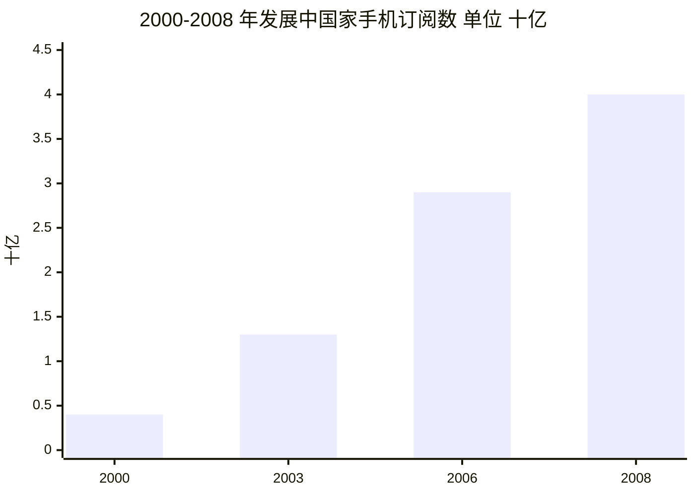

| 年份 | 发展中 | 发达 |
| :--- | :--- | :--- |
| 2000 | 0.4 | 0.7 |
| 2008 | 4.0 | 1.0 |

坑：两条线**在 2003 年前后交叉**，发展中国家反超。写「一个暴涨、一个原地踏步、中途换位」，别只写「都增长了」。

#### 2011｜国内轿车市场品牌份额

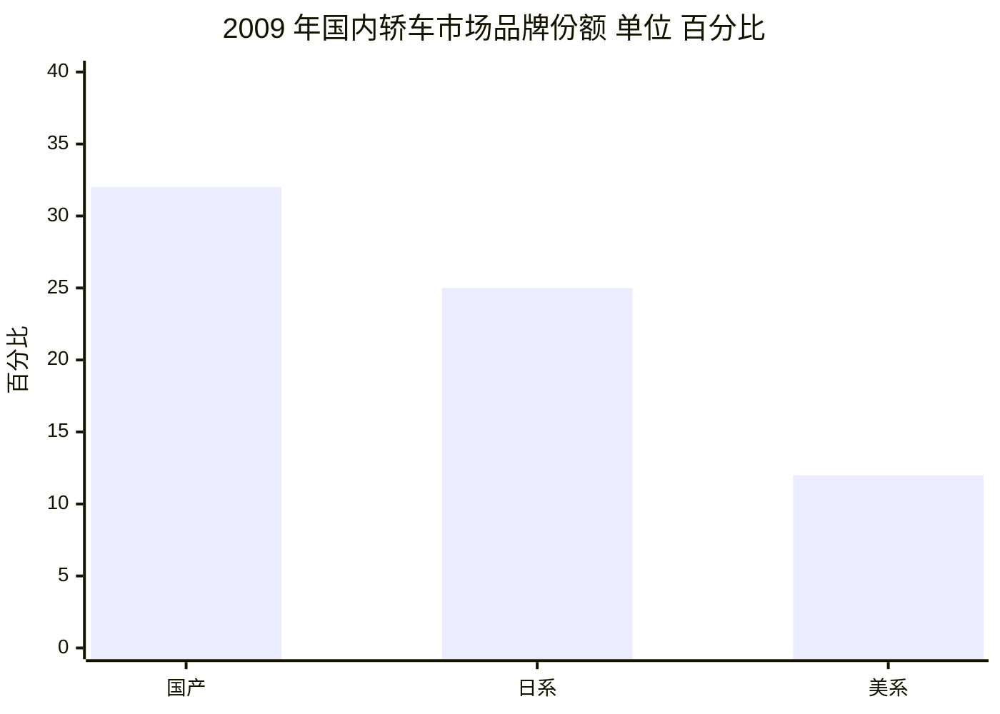

| 品牌 | 2008 | 2009 |
| :--- | :--- | :--- |
| 国产 | 25 | 32 |
| 日系 | 35 | 25 |
| 美系 | 12 | 12 |

坑：**日系掉、国产升，一升一降刚好换位**；美系两年不动，是「稳定项」。这题不写「都涨」就对了。

#### 2012｜某公司员工工作满意度（表格）

| 年龄段 | 满意 | 不清楚 | 不满意 |
| :--- | :--- | :--- | :--- |
| ≤40 岁 | 16.7% | 50.0% | 33.3% |
| 41-50 岁 | 0.0% | 36.0% | 64.0% |
| >50 岁 | 40.0% | 50.0% | 10.0% |

坑：三点反常识——**41-50 岁满意率是 0**；三组「不清楚」都在 36%-50%；越年轻不一定越满意。写「中年段最不满 + 大面积态度模糊」。

#### 2013｜某高校学生兼职情况

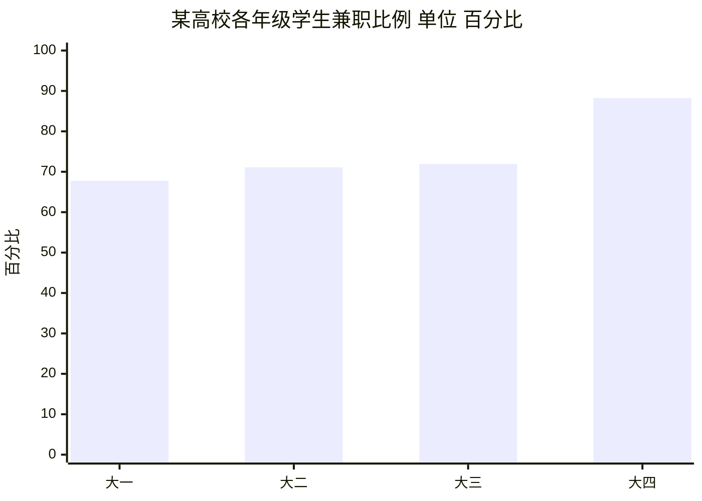

坑：前三档几乎平着走（67→72），**大四陡然跳到 88.24**。全文重心就放在「大四为什么跳」。

#### 2014｜20 年间城乡人口变化

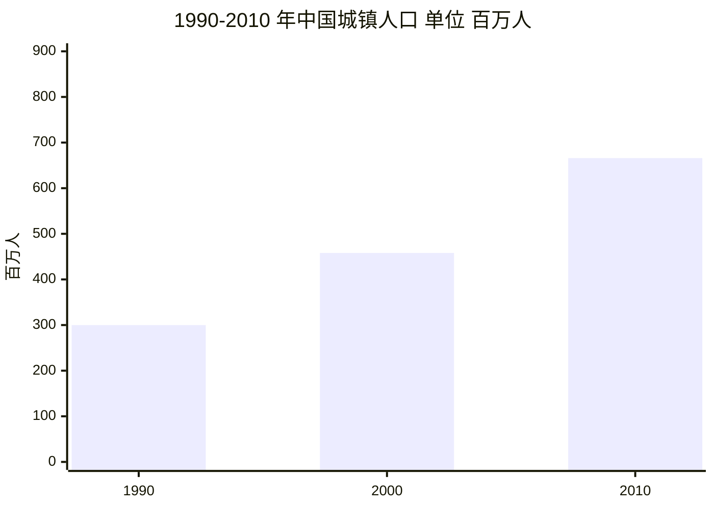

| 年份 | 城镇 | 乡村 |
| :--- | :--- | :--- |
| 1990 | 300 | 834 |
| 2000 | 458 | 807 |
| 2010 | 666 | 674 |

坑：**2010 年两条线几乎交汇**（666 vs 674），这是全图最有戏剧性的点；城镇 20 年涨了 120% 以上。

#### 2015｜某市居民春节假期花销（饼图）

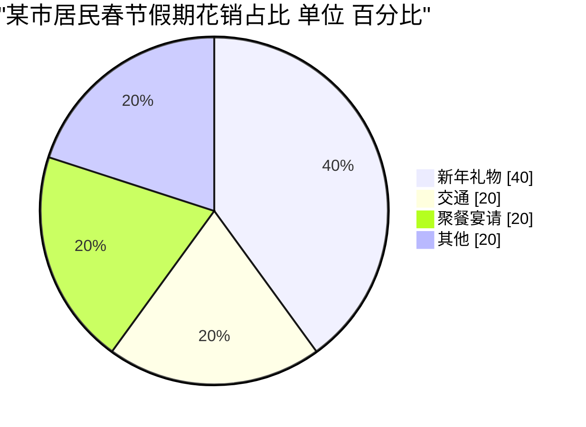

坑：**礼物一家占了四成**，其余三项整齐地各两成。写「人情支出压过一切」，别把三项平均写成一笔流水账。

#### 2016｜某高校学生旅游目的（饼图）

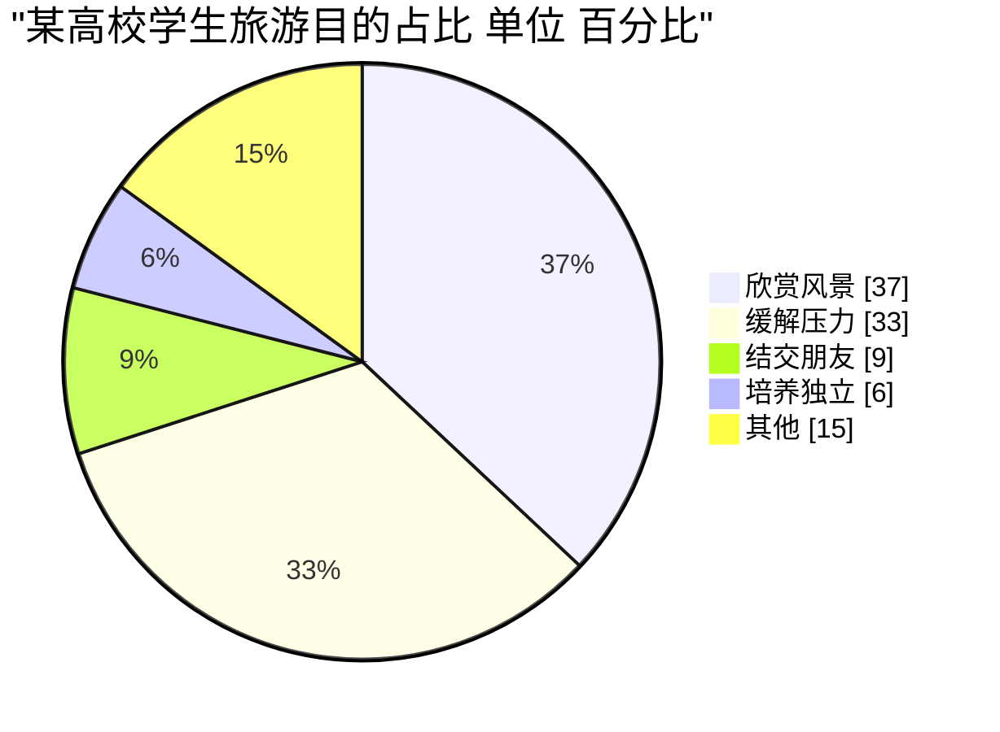

坑：前两项合计七成，**「看」和「喘口气」是同一件事的两面**；培养独立只有 6%，别写成主流。

#### 2017｜博物馆数量与参观人数（双折线）

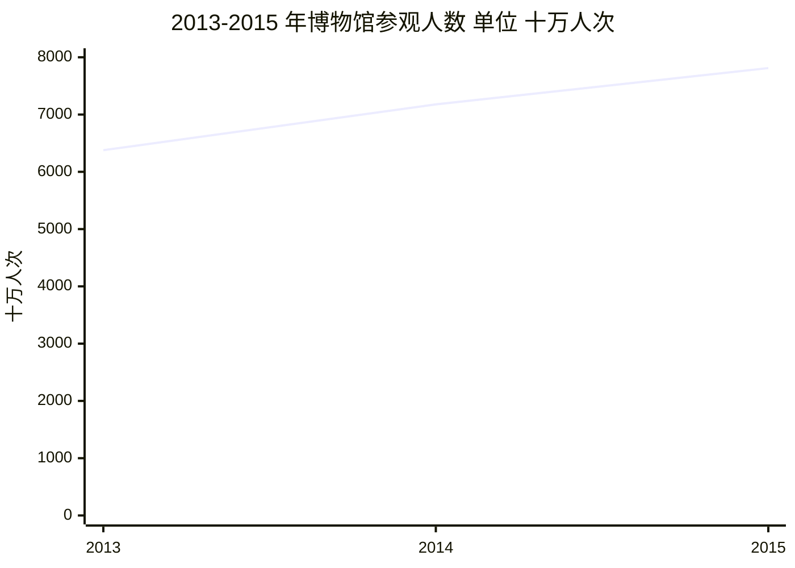

| 年份 | 博物馆数量（家） | 参观人数（十万人次） |
| :--- | :--- | :--- |
| 2013 | 4165 | 6378 |
| 2014 | 4510 | 7177 |
| 2015 | 4697 | 7811 |

坑：两条线**同步上升**，但数量只涨了 13%，人数涨了 22%——「馆多了一点，人多了很多」。两个单位不同，绝不能直接比大小。

#### 2018｜选择餐厅的关注因素（饼图）

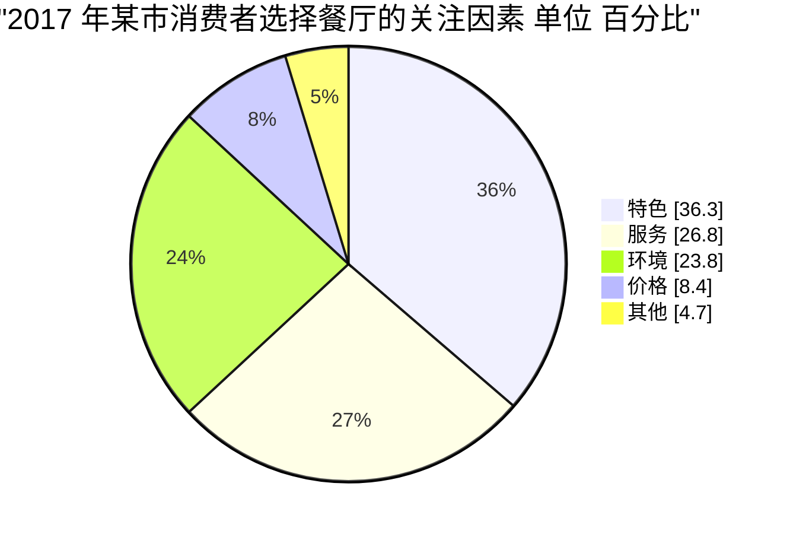

坑：**价格只排第四（8.4%）**，而特色、服务、环境合计 86.9%。这题的立意天然是「从吃饱到吃好」。

#### 2019｜本科毕业生去向（分组柱状）

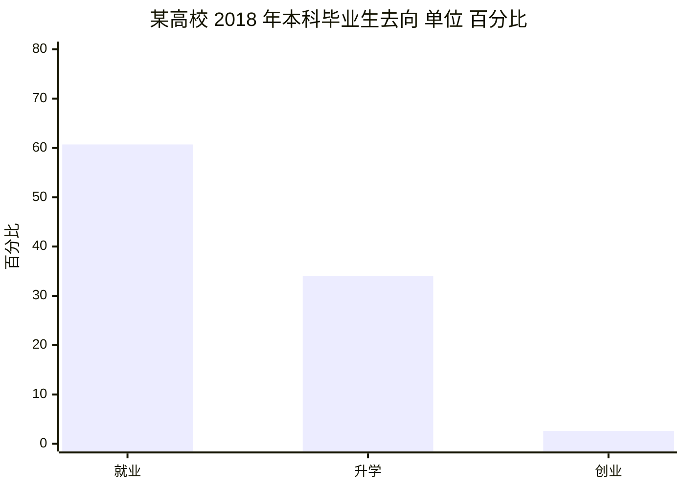

| 去向 | 2013 | 2018 |
| :--- | :--- | :--- |
| 就业 | 68.1% | 60.7% |
| 升学 | 26.3% | 34.0% |
| 创业 | 1.3% | 2.6% |

坑：**就业降 7.4、升学报 7.7，几乎一比一搬家**；创业虽翻倍，绝对值仍只有 2.6%，不能吹成「创业热」。

#### 2020｜大学生手机阅读目的（饼图）

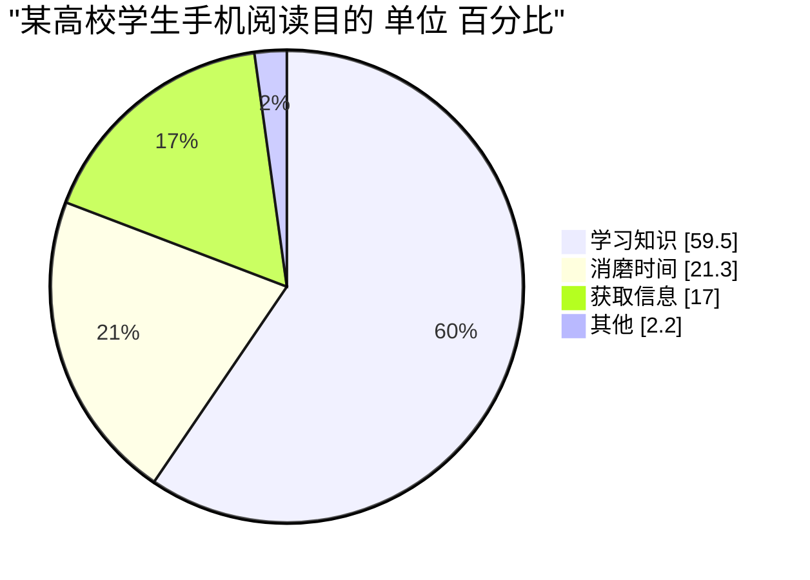

坑：近六成是「学习知识」，只有两成是「消磨时间」——**反直觉**，别按刻板印象写成「都在刷手机玩」。

#### 2021｜某市居民体育锻炼方式

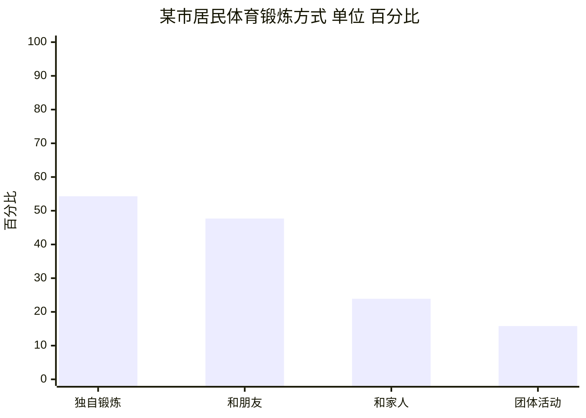

坑：**各项相加超过 100%**，说明是多选，不能画饼图、不能写成「占比结构」。真正看点是「独自 > 结伴」。

#### 2022｜我国快递业务量（总体 vs 农村）

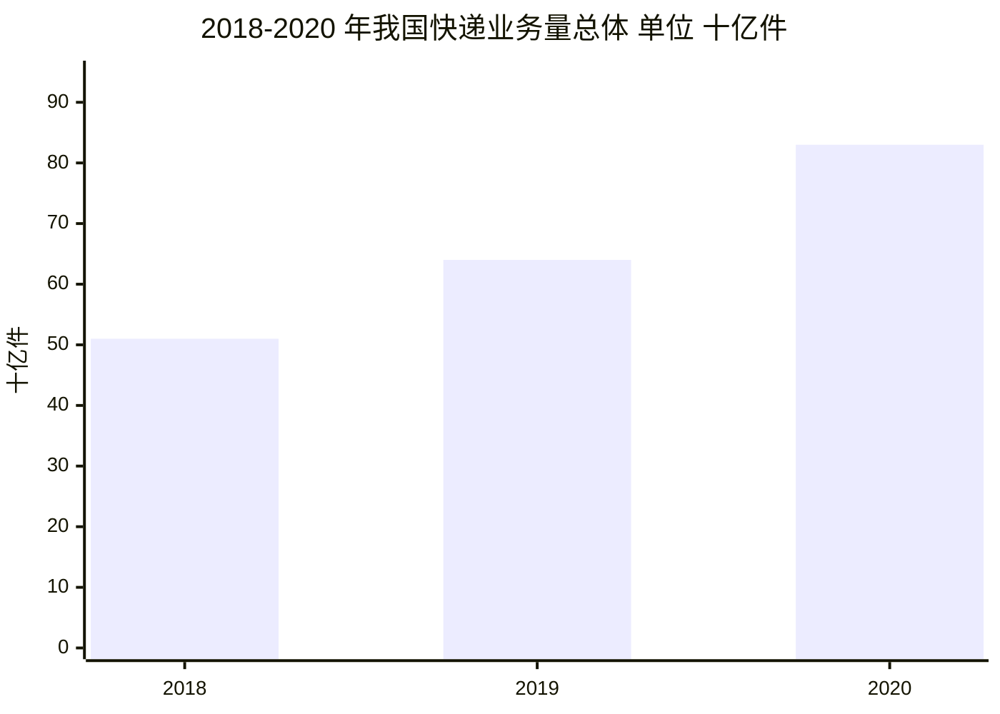

| 年份 | 总体 | 其中农村 |
| :--- | :--- | :--- |
| 2018 | 51 | 12 |
| 2019 | 64 | 15 |
| 2020 | 83 | 30 |

坑：农村从 15 涨到 30，**一年翻倍**，是增速之王；但农村本身包含在总体里，两组不能相加。

#### 2023｜我国居民健康素养水平（折线）

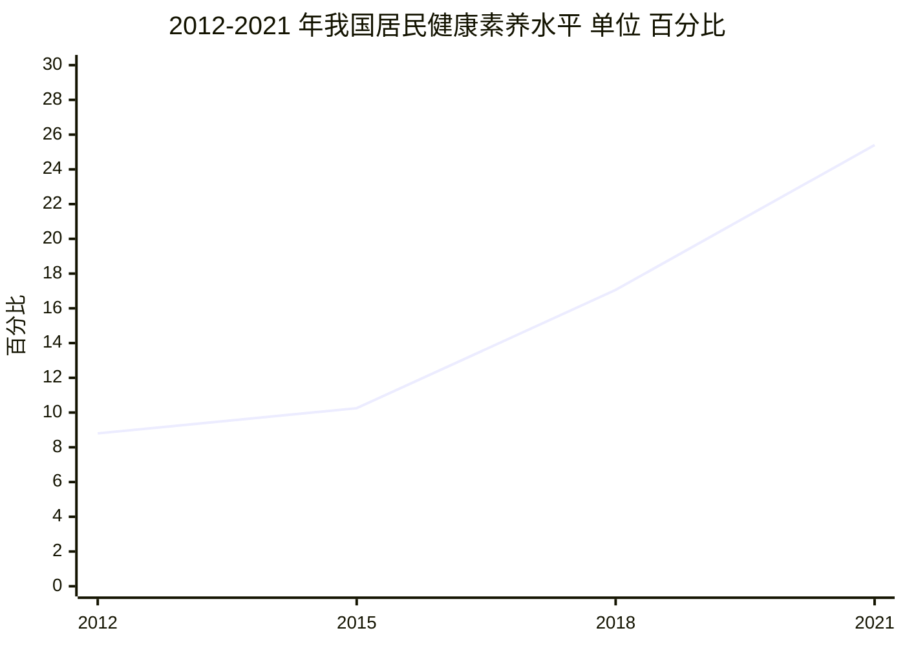

| 年份 | 2012 | 2013 | 2014 | 2015 | 2016 | 2017 | 2018 | 2019 | 2020 | 2021 |
| :--- | :--- | :--- | :--- | :--- | :--- | :--- | :--- | :--- | :--- | :--- |
| % | 8.80 | 9.48 | 9.79 | 10.25 | 11.58 | 14.18 | 17.06 | 19.17 | 23.15 | 25.40 |

坑：**前五年慢慢爬，后四年突然加速**（2019 之后斜率明显变陡）。写「拐点在 2019」，比写「一路增长」高一个档。

#### 2024｜劳动实践课的主要收获（条形图）

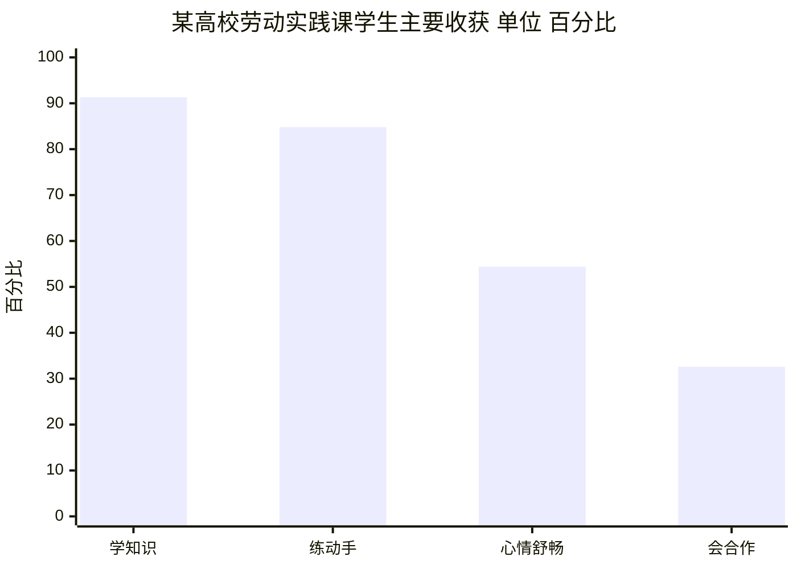

坑：**知识与动手都过 84，合作只有 32.6**——这是同一门课里的「长短腿」，立意必须是「补短板」，不是「效果好」。

#### 2025｜某社区老年人日常休闲活动

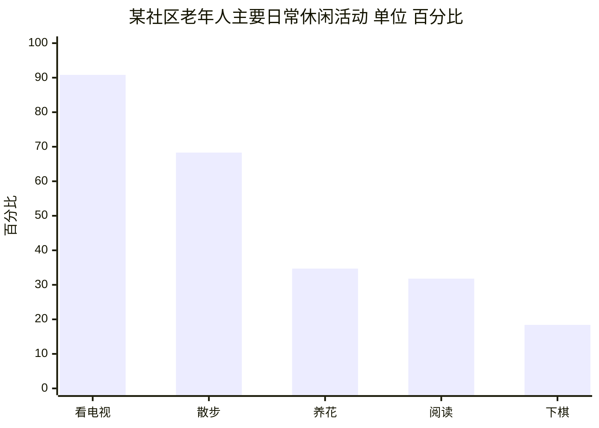

坑：**越省力的活动越受欢迎**（电视 90.8 / 下棋 18.4），这条隐性规律才是评论的抓手；各项非互斥，不能用饼图。

#### 2026｜关于儿童户外活动的看法

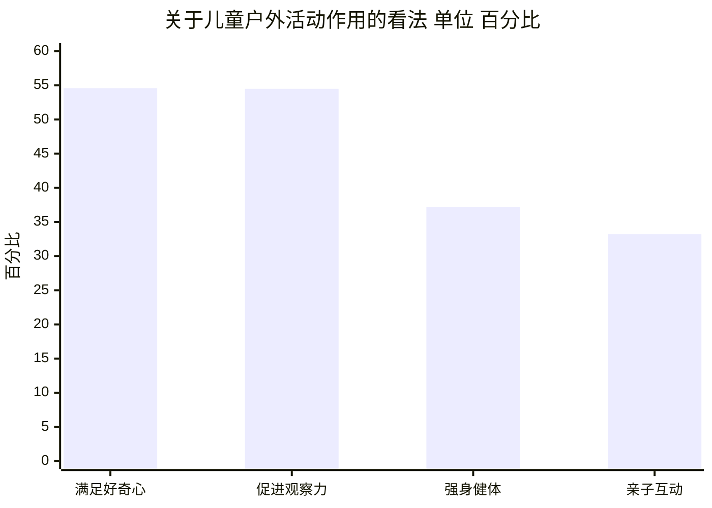

坑：前两项**只差 0.1 个百分点**，属于并列第一；而且这是「看法」不是「效果」，不能写成「户外活动确实提高了观察力」。

### 评分标准（大纲口径）

#### 一、评分是怎么进行的

1. **先定档，再在档内给分**——不是逐句扣分。所以"某句写得漂亮"救不了整篇，反过来一句废话也未必致命，关键在整体落在哪一档。
2. **A 节（小作文，10 分）**评分重点：信息点覆盖、内容组织、语言准确、**格式与语域**。
3. **B 节（大作文，15 分）**评分重点：内容完整、组织连贯、**语法结构与词汇多样**、语言准确。
4. **可以用题干里的词，但不能照抄题干句子**——大纲原文：「允许在作文中使用提示语中出现过的个别关键词或词组，但使用提示语中出现的句子将被扣分。」
5. **长度不符「酌情扣分」**；拼写标点按对交际的影响程度考虑；英美拼写均可；**书写差到影响阅读，降一个档次**。

#### 二、小作文（A 节，10 分，一档 2 分）

| 档 | 分数 | 判据（摘要） |
| :--- | :--- | :--- |
| 第五档 | 9-10 | 全部要点；**丰富的语法结构和词汇**；自然流畅、几乎无错；**多种衔接**；格式语域贴切；完全达到预期效果 |
| 第四档 | 7-8 | 全部要点，允许漏 1-2 个次重点；较丰富；基本准确，只有尝试复杂结构或高级词时出错；衔接恰当、层次清晰 |
| 第三档 | 5-6 | 漏一些但含多数要点；结构词汇够用；有错但不影响理解；简单衔接；格式基本合理 |
| 第二档 | 3-4 | 漏要点或写无关内容；结构单调、词汇有限；错误多影响理解；衔接不当 |
| 第一档 | 1-2 | 明显遗漏主要内容；大量错误妨碍理解；无格式与语域概念 |

#### 三、大作文（B 节，15 分，一档 3 分）

| 档 | 分数 | 判据（摘要） |
| :--- | :--- | :--- |
| 第五档 | 13-15 | 内容完整、要点阐述充分；语法词汇丰富；流畅、几乎无错；多种衔接、层次清晰；语域恰当 |
| 第四档 | 10-12 | 要点齐全，少数要点阐述不充分；较丰富；基本准确；衔接得当 |
| 第三档 | 7-9 | 多数要点；结构词汇够用；有错不影响理解；简单衔接 |
| 第二档 | 4-6 | 漏要点或含无关内容；结构单调；错误较多 |
| 第一档 | 1-3 | 明显遗漏；妨碍理解 |

#### 四、字数与卷面

- 小作文 **100 词左右**、大作文 **150 词左右**，长度不符会酌情扣分。经验值：小作文低于 90、大作文低于 130 开始明显吃亏（各机构按每少 10 词扣 1 分上下的比例估，属经验，非大纲原文）。
- 大作文**不写标题**，不写地址；小作文署名固定 `Li Ming`。
- 大作文必须分段（三段最稳），段间空一行；小作文不分段也可以，但分段更清楚。
- 别涂改、别用花体——书写影响阅读会降一档，这是十年来唯一一条"硬扣"。

### 考前一页速查

进场前最后看一眼这张。

```text
小作文
  圈两个动词 → 对块 → 块内按序抄，90-115 词 → 套骨架
  invite A ｜ suggest B ｜ thank C ｜ apologize D ｜ complain E
  Dear X, / [块] / If anything here does not suit you, tell me.
  A line back by Friday is enough. / Yours sincerely, Li Ming
  双块题：两段之间空一行，不加过渡词

大作文
  S1 图 → S2 数据 → S3 差距 → S4 两股力量
  S5 外部 → S6 内部 → S7 趋势不掉头 → S8 主体动作 → S9 变成好处
  四个展开位 X1-X4，字数不够加 P1 P2
  静态图不写「逐年上升」，算不出倍数就别算

三处必查
  落款是 Yours，不是 Your
  题干两个点都写了没
  拼写（apologize / congratulations / sincerely）
```

### 砍掉了什么

| 砍掉的 | 原因 |
| :------------------------------------------ | :--------------------------------- |
| 11 组块库 | 块与块之间要缝合，缝合就是出错的地方 |
| `This is a short email with one purpose` 外壳 | 一句装两件事，语义不自洽；给教授也不合语域 |
| 三条结构位（定语从句／非谓语／条件句） | 骨架已自带，再堆会挤掉信息点 |
| 五大话题词块 | 考前突击性价比低，容易背串 |
| 石雷鹏式 `it is advisable for you to` | 功能句路线，拼装压力大 |
| 20 词以上的长句 | 默写错误率陡增，你已在 `Yours sincerely` 上验证过 |

保留的只有一条：**整块背，块间只选不拼。**

## 单词

- come to terms with sth：接受（令人不快的事实）
- evaporate：蒸发，逐渐消失
- in terms of sth：就...而言
- identical：完全相同的
- extraneous：无关的
- ornament：装饰品
- census：人口普查
- exacerbate：使恶化
- ethically：道德上的
- conversation：交谈，谈话
- pondar：沉思
