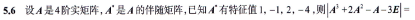

## 前言

本篇原本的产物为一份 docx，是 6-8 月写的，记录了数学写的练习册（张宇基础 30 讲高数、张宇 1000 基础、张宇基础 30 讲线代、张宇 1000 基础线代、武忠祥强化讲义、杨威线性代数讲义、880 综合题，以及上述所有题的二刷）。

未来应该会在卷子开完一遍之后，写一下李永乐 660，当然还有卷子的复盘。

数学未来的题目复盘就全部看这里了。

当然除了高数还有王道 408 选择题的 1 刷和 2 刷，以及真题 1 刷，王道选择题 3 刷等。前 2 刷很多是知识点没背熟，所以相对而言不那么重要（还没拟合）。

至于为什么要迁移，为了强迫自己再写一遍错题，不然就只会采用瞪眼法的方式看错题。

这份文档将持续更新，直至考研结束。

## 时间线

数学基础：第 1 周 - 第 8 周，共 8 周。将基础 30 讲，三大计算（积分）和基础练习册 1000 写完，刷了一遍基础 30 讲，三大计算（积分）和基础练习册 1000 的错题。

数学强化：第 9 周 - 第 20 周，共 12 周。听完武忠祥老师的强化课，写完武忠祥强化讲义并错题重刷，杨威线代强化，880。

数学 2 轮：第 21 周 - 第 25 周，共 5 周。重刷一遍基础 30 讲，基础练习册 1000，武忠祥强化讲义，杨威线代强化。其中需要错题重刷 880。那么计划就是：基础 30 讲重刷，刷 880 高数部分错题，刷 880 线代部分错题；基础练习册 1000 重刷，重刷武忠祥强化；重刷杨威强化。

数学真题：第 26 周 - 第 30 周，共 5 周。09 - 20 的 12 年真题，以及超越部分试卷（3 套），因为课内 + 状态很差，这 5 周只干了这些事

数学模拟卷 1 + 二刷 880 一半：第 31 周 - 第 32 周，共 2 周。26 李 4 + 880 二刷一半，880 二刷一半

数学模拟卷 2 + 真题 + 二刷所有错题 + 卷子复盘：第 33 周 - 第 34 周，共 2 周。27 李 6，21 真题 - 22 真题，24 超越 9-10

数学模拟卷 3 + 真题 + 选刷专题：第 35 周 - 第 38 周，共 4 周：23-26 数学真题，24 超越 4-8，27 张 8，25 超越，660 选刷，880 线代

## 张宇 30 讲基础高数 1 刷（补）

最开始没有写错题本，所以是后续补充的。

### 张宇 30 讲基础高数 1 刷第 1 章

> 求函数 $y=f(x)=\ln\left(x+\sqrt{x^2+1}\right)$ 的反函数 $f^{-1}(x)$ 的表达式及其定义域。

没想出来怎么做，函数有四大性质：奇偶性，有界性，单调性，周期性，考虑该函数为奇函数，由此解答。

其实也有利用到奇函数的特性，我是利用相加去做的，最后做的有点复杂，但是也能做出来。

> 设 $g(x)=\begin{cases}2-x, & x\leq0\\ 2+x, & x>0\end{cases}$，$f(x)=\begin{cases}x^2, & x<0\\ -x-1, & x\geq0\end{cases}$，则 $g[f(x)]=$ ______。

本题混淆定义域和值域的概念，对于这种题，首先要画图，然后将里面函数的值域作为外面函数的定义域带入，但是最后的定义域是写内层函数的。

> 证明函数 $f(x)=\dfrac{x}{1+x^2}$ 在 $(-\infty,+\infty)$ 内有界。

做这道题的时候利用的是导数的性质。而答案采用的是基本不等式，上下同时除以一个绝对值 $|x|$（需要排除 $0$）。当然我认为不如分开讨论 $x$、$-x$ 和 $0$，上下同时除以 $-x$ 然后用基本不等式感觉也不错。

> 设 $0<x<\dfrac{1}{2}$，求 $y(x)=x^6(1-x)^2(1-2x)^4$ 的最大值点。

针对这种题的思路是同取对数进行处理。

并且本题 1 刷时数字抄错（$6\ln x$ 求导时少抄了 $6$），错题重刷时 $14^2-12^2$ 少算一个 $10$（算成 $42$）充分证明了计算错误的可怕，以及一步一回头的必要性。

> 已知 $e^x=\sum\limits_{n=0}^{\infty}\dfrac{x^n}{n!}, x\in R$，则 $2^x=$（ ）。
>
> - A. $\sum\limits_{n=1}^{\infty}\dfrac{(x\ln 2)^n}{n!}$
> - B. $\sum\limits_{n=0}^{\infty}\dfrac{(x\ln 2)^n}{n!}$
> - C. $\sum\limits_{n=1}^{\infty}\dfrac{(\ln 2)x^n}{n!}$
> - D. $\sum\limits_{n=0}^{\infty}\dfrac{(\ln 2)x^n}{n!}$

本题在 1 刷时采用类泰勒公式的解法，而事实上 $2^x$ 可以化成类似 $e^x$ 的形式，直接将 $x$ 带入即可。

如果采用类似泰勒公式的解法，则是事实上完全不需要给出这个式子。

直接像下面那样子 $x=0$ 处泰勒展开就好了。

> [原图非题目：主人手写解题过程截图]

> 设 $y=\sin x, 0\leq x\leq2\pi$，求其所有单调区间上的反函数。

本题的做法是需要注意到 $y=\arcsin x$ 的值域为 $\left[-\frac{\pi}{2},\frac{\pi}{2}\right]$，所以得分区间进行讨论。1 刷的时候进入了一个很大的误区，那就是：

令 $y=\sin(x-\pi)$，$x$ 的范围为 $\left[\frac{\pi}{2},\frac{3\pi}{2}\right]$，此时也就是说 $x-\pi$ 的范围是 $\left[-\frac{\pi}{2},\frac{\pi}{2}\right]$，如果直接取反三角函数，也就是 $\arcsin y=x-\pi$，最后得到 $x=\arcsin y+\pi$。

错误点在于，原函数其实是 $y=\sin x$（也就是此 $y$ 非彼 $y$），$x$ 的范围为 $\left[\frac{\pi}{2},\frac{3\pi}{2}\right]$，变化为 $-y=\sin(x-\pi)$ 才对，而不是直接令 $y=\sin(x-\pi)$。

> 在下列区间内，函数 $f(x)=\dfrac{x\sin(x-3)}{(x-1)(x-3)^2}$ 有界的是（ ）。
>
> - A. $(-2,1)$
> - B. $(-1,0)$
> - C. $(1,2)$
> - D. $(2,3)$

本题采用直觉做，错误，告诫一定每一题都要算出来，而不是依靠直觉。

> 证明：(1) 若 $\lim\dfrac{f(x)}{g(x)}=A$，且 $\lim g(x)=0$，则 $\lim f(x)=0$；
>
> (2) 若 $\lim\dfrac{f(x)}{g(x)}=A\neq0$，且 $\lim f(x)=0$，则 $\lim g(x)=0$。

关于这题，对是对了，可以注意一下解法，也就是令 $g(x)=\frac{f(x)}{f(x)/g(x)}$，当然直接反过来得到 $1/A$ 也是没什么问题的。

> 设函数 $f(x)=\lim\limits_{n\to\infty}\dfrac{x^2+nx(1-x)\sin^2\pi x}{1+n\sin^2\pi x}$，则 $f(x)=$ ______。

本题把两边同时除以一个 $n$，错误点在于没有讨论 $x=k$ 的情况。

> 求极限 $\lim\limits_{x\to1^-}\ln x\ln(1-x)$。

本题采用洛必达，不过其实用 $x\ln x$ 的快慢收敛更简单。

> 求 $I=\lim\limits_{x\to0}x\left[\dfrac{10}{x}\right]$，其中 $[\cdot]$ 为取整符号。

这道题需要注意方法，也就是夹逼定理。需要注意的是其等号的作用范围。尤其需要注意当 $\frac{10}{x}$ 时，符号方向得反过来。

> 求极限 $\lim\limits_{x\to0}\left(\dfrac{e^x+e^{2x}+e^{3x}}{3}\right)^{\dfrac{e}{x}}$。

关于本题，其实是作对的，但是一开始的时候把 $\ln(x+y)$ 拆成 $\ln x+\ln y$ 了，尤其需要注意。

> 设函数 $f(x)=\dfrac{\sin x}{1+x^2}$ 在 $x=0$ 处的 3 次泰勒多项式为 $ax+bx^2+cx^3$，则（ ）。
>
> - A. $a=1,b=0,c=-\dfrac{7}{6}$
> - B. $a=1,b=0,c=\dfrac{7}{6}$
> - C. $a=-1,b=-1,c=-\dfrac{7}{6}$
> - D. $a=-1,b=-1,c=\dfrac{7}{6}$

本题完全忽略了 $(1+x)^2$ 也可以展开，所以没做出来。

尤其需要注意两个展开式应该相乘，而不是展开式直接相加。

> 已知 $f(x)=\begin{cases}(\cos x)^{x^{-2}}, & x\neq0\\ a, & x=0\end{cases}$ 在 $x=0$ 处连续，则 $a=$ ______。

$\frac{\ln(\cos x)}{x^2}$，其中不可以直接利用 $\ln x<x$，第一是因为这是无穷大时的结论，第二是因为 $\ln 1=0$，$\frac{0}{0}$ 属于未定式。

> 函数 $f(x)=\dfrac{e^{\frac{1}{x-1}}\ln|1+x|}{(e^x-1)(x-2)}$ 的第二类间断点的个数为（ ）。
>
> - A. 1
> - B. 2
> - C. 3
> - D. 4

注意求的是第二类间断点个数，不要把第一类算进去了。

求解这类题的时候，首先是找出可能的点，然后一个个去试，需要注意 $\arctan x$、$e^x$、$|x|$。

> 设函数 $f(x)=\dfrac{1}{e^{\frac{x}{x-1}}-1}$，则（ ）。
>
> - A. $x=0,x=1$ 都是 $f(x)$ 的第一类间断点
> - B. $x=0,x=1$ 都是 $f(x)$ 的第二类间断点
> - C. $x=0$ 是 $f(x)$ 的第一类间断点，$x=1$ 是 $f(x)$ 的第二类间断点
> - D. $x=0$ 是 $f(x)$ 的第二类间断点，$x=1$ 是 $f(x)$ 的第一类间断点

错选为 C。想当然的锅，事实上认真算一下就知道了。

> 设函数 $f(x)=\lim\limits_{n\to\infty}\dfrac{1+x}{1+x^{2n}}$，关于该函数的间断点，下列结论正确的是（ ）。
>
> - A. 不存在间断点
> - B. 存在间断点 $x=1$
> - C. 存在间断点 $x=0$
> - D. 存在间断点 $x=-1$

错选为 C。只考虑了 $>1$，没有考虑 $<1$ 的情况，倒反天罡。

> 设函数 $f(x)=\dfrac{x}{1+x}, x\in[0,1]$，定义函数列：$f_1(x)=f(x), f_2(x)=f[f_1(x)],\cdots, f_n(x)=f[f_{n-1}(x)](n=1,2,3,\cdots)$，则 $f_n(x)=$ ______。

本题也是错在想当然上面，$1+x+x=2+x$，然后填错了。

> 设 $f(x)=\arcsin(\sin x)$，画出 $f(x)$ 的图形。

做出来是一条直线，对完答案之后没有复盘。

> 求极限 $\lim\limits_{x\to0}\left(\dfrac{e^x+xe^x}{e^x-1}-\dfrac{1}{x}\right)$。

对于这题，化简到 $xe^x-e^x+1$ 的时候，如果提取 $e^x$ 然后一阶泰勒展开就可以得到经典的错误，标准的零分。原因是底下是 $x^2$，而泰勒展开是有皮亚诺余项的，显然不足以满足。

> 设 $\lim\limits_{x\to0}\dfrac{\ln(1+x)-(ax+bx^2)}{x^2}=2$，求常数 $a,b$。

-() 要变号，低级错误。

> 求常数 $a$ 和 $b$ 的值，使得函数 $f(x)=x-(a+b\cos x)\sin x$ 在 $x\to0$ 时是 $x$ 的 5 阶无穷小。

泰勒展开只对 $\sin x$ 展开，没有考虑 $\cos x$。事实上这题应该把 $\sin x\cos x$ 视为 $\sin 2x$ 来处理会很方便。

### 张宇 30 讲基础高数 1 刷第 2 章

> 已知 $a_n=1-\dfrac{(-1)^n}{n}(n=1,2,\cdots)$，则 $\{a_n\}$（ ）。
>
> - A. 有最大值，有最小值
> - B. 有最大值，没有最小值
> - C. 没有最大值，有最小值
> - D. 没有最大值，没有最小值

本题利用函数极限的保号性，只不过是对 $1$ 保号，也就是最终肯定是在 $1$ 处附近。所以前有限项只要有比 $1$ 更大的，那么就存在最大值，前有限项只要有比 $1$ 更小的，那么就存在最小值。

> 其实是保序性。

> $\lim\limits_{n\to\infty}\left(\dfrac{1}{n^2+n+1}+\dfrac{2}{n^2+n+2}+\cdots+\dfrac{n}{n^2+n+n}\right)=$ ______。

低级错误，脑测为 1。

> 设 $0<a_n<\dfrac{\pi}{2}, 0<b_n<\dfrac{\pi}{2}, \cos a_n-a_n=\cos b_n$，且 $\lim\limits_{n\to\infty}b_n=0$，求 $\lim a_n,\lim\dfrac{a_n}{b_n^2}$。

本题 1 刷时毫无思路，对于第一问，显然是使用夹逼定理；对于第 2 小问，应该想办法把 $a_n$ 或者 $b_n$ 变成对方，从而得出答案。既然思路是这样，那么根据等式，$a_n$ 显然不方便进行代换，所以换 $b_n$。由于 $b_n^2$ 和 $1-\cos x$ 可以代换，所以进行代换，从而迎刃而解。

本题作为错题二刷时做错了，因为分数倒腾来倒腾去导致计算错误。

> 设 $0<x_1<3, x_{n+1}=\sqrt{x_n(3-x_n)}(n=1,2,\cdots)$，证明数列 $\{x_n\}$ 的极限存在，并求此极限。

证明此类题有两种做法，证单调有界，利用压缩映射（先猜再证）

对于本题，先证单调性。后一项减去前一项，可得一串式子，这串式子算对了，但是最后想利用单调性的时候，$\frac{3}{2}$ 算成 $\frac{3}{4}$，且没有利用有界性。

顺带提一嘴，本题在二刷的时候最后脑算 $2A^2=3A$，算错了。

> 设 $x_{n+1}=f(x_n)$，则以下命题正确的是（ ）。
>
> ① 若 $f(x)$ 单调增加，且 $x_1<x_2$，则数列 $\{x_n\}$ 单调增加
>
> ② 若 $f(x)$ 单调增加，且 $x_1>x_2$，则数列 $\{x_n\}$ 单调减少
>
> ③ 若 $f(x)$ 单调减少，且 $x_1<x_2$，则数列 $\{x_n\}$ 单调增加
>
> ④ 若 $f(x)$ 单调减少，且 $x_1>x_2$，则数列 $\{x_n\}$ 单调减少
>
> - A. ①②
> - B. ①③
> - C. ②③
> - D. ②④

利用结论，1 刷和错题刷都错了。

事实上，只需要画图就可以很好的理解这个结论。

> (1) 证明方程 $x=\cos x$ 在 $\left(0,\dfrac{\pi}{3}\right)$ 内有唯一实根 $a$；
>
> (2) 设 $-1\leq x_1\leq1$，定义 $x_{n+1}=\cos x_n, n=1,2,\cdots$，证明 $\lim\limits_{n\to\infty}x_n$ 存在，且极限值就是 (1) 中的 $a$。

本题 1 刷和错题订正都没做出来，原因是不会。当然经过强化之后，这点知识是还可以的，因为这道题明显是上面说的第 2 类做法，在进行压缩映射的时候，需要利用拉格朗日中值定理等条件去放缩。

> “存在正整数 $N$，当 $n\geq N$ 时，恒有 $|x_n-a|\leq\dfrac{1}{n}$”是数列 $\{x_n\}$ 收敛于 $a$ 的（ ）。
>
> - A. 充分不必要条件
> - B. 必要不充分条件
> - C. 充分必要条件
> - D. 既不充分也不必要条件

用夹逼定理和特值法做。

> $\lim\limits_{n\to\infty}\left(\sqrt{n+\sqrt{n}}-\sqrt{n-\sqrt{n}}\right)=$ ______。

本题为低级错误，$\sqrt{n}$ 除下去的时候要注意。

> 设函数 $f(x)$ 在 $[a,b]$ 上连续，$x_1,x_2,\cdots,x_n$ 是 $[a,b]$ 上的一个点列，求 $\lim\limits_{n\to\infty}\sqrt[n]{\dfrac{1}{n}\sum_{k=1}^{n}e^{f(x_k)}}$。

违规使用等价无穷小代换

考虑夹逼定理，这题二刷差点没做出来。比较正规的做法是分块算，也就是把 $\frac{1}{n}$ 和后面的一大坨给分开。

> 设 $x_1=2$，$x_n+(x_n-4)x_{n-1}=3$（$n=2,3,\cdots$），证明 $\lim\limits_{n\to\infty}x_n$ 存在，并求其值。

一刷时没思路，错题重刷时没写，现在再做一次，二刷的时候再做一段时间才做出来。本质的思路是把 $x_n$ 解出来，然后 $x_1<x_2$，对应的函数单调递增，可得单调性，有界性对于 $x_n$ 而言显然。

### 张宇 30 讲基础高数 1 刷第 3 章

> 设函数 $f(x)=(e^x-1)(e^{2x}-2)\cdots(e^{nx}-n)$，其中 $n$ 为正整数，则 $f'(0)=$（ ）。
>
> - A. $(-1)^{n-1}(n-1)!$
> - B. $(-1)^n(n-1)!$
> - C. $(-1)^{n-1}n!$
> - D. $(-1)^n n!$

关于这道题，1 刷的时候暴露了一个问题，那就是我不是不会做，而是总是在最后一两步的时候突然犯蠢。所以不只是得走一步看一步，还得着重检查最开始和最后，这些都是最容易让人懈怠的。

> 设 $f(x)$ 在 $x=a$ 处连续，$F(x)=f(x)|x-a|$，则 $f(a)=0$ 是 $F(x)$ 在 $x=a$ 处可导的（ ）。
>
> - A. 充要条件
> - B. 充分非必要条件
> - C. 必要非充分条件
> - D. 既非充分又非必要条件

> 设函数 $f_1(x)=(x^2-1)|x^3+x^2-2x-2|$，$f_2(x)=(x^2-1)|x^3-2x^2-x+2|$，$f_3(x)=(x^2-1)|x^3+3x^2-2x-6|$，将函数 $f_i(x)$（$i=1,2,3$）的不可导点个数记为 $n_i$，则（ ）。
>
> - A. $n_2<n_1<n_3$
> - B. $n_1<n_2<n_3$
> - C. $n_3<n_2<n_1$
> - D. $n_2<n_3<n_1$

这两题可以放在一起讲。这道题其实是有结论的，具体结论在武忠祥老师的强化课基本搞明白了。包括我没放进来的下一题，重点是记住这两个：

$x|x|$ 以及画图，画一张图就能理解函数的导数绝对值之间的关系了。

当然也可以用传统做法做。

例 3.5 就是想当然了，算一半直接选了错误选项。

例 3.6 则是试根用长除法，但是 2 刷的时候才突然意识到，原来可以先因式分解，然后问题就迎刃而解了。

开卷子初期时候补充：需要注意本身就不可导的点，例如 $x^{1/2}$，$x=0$ 不可导。

> 设曲线 $y=f(x)=x^n$ 在点 $(1,1)$ 处的切线与 $x$ 轴的交点为 $(\xi_n,0)$，则 $\lim\limits_{n\to\infty}f(\xi_n)=$ ______。

这道题是一刷的时候没算完，只算出来了交点没算完极限。

> 设函数 $y=f(x)$ 在任意点 $x$ 处的增量 $\Delta y=\dfrac{y\Delta x}{x+\sqrt{x^2+y^2}}+o(\Delta x)$，且 $f(0)=1$，则 $y=f(x)$ 在点 $x=0$ 处的微分 $\mathrm{d}y=$（ ）。
>
> - A. $0$
> - B. $\mathrm{d}x$
> - C. $2\mathrm{d}x$
> - D. $3\mathrm{d}x$

> 设函数 $f(u)$ 可导，且 $y=f(x^2)$，当自变量 $x$ 在 $x=-1$ 处取得增量 $\Delta x=-0.1$ 时，相应的函数增量 $\Delta y$ 的线性主部为 $0.1$，则 $f'(1)=$（ ）。
>
> - A. $-1$
> - B. $0.1$
> - C. $0.5$
> - D. $1$

这两题可以放在一起讲，1 刷的时候明显对概念不熟悉，错题重刷的时候也一般，2 刷的时候险些没反应过来。

对于不经常考的考点也需要注意。

> 设函数 $y=f(x)$ 在点 $x_0$ 处可导，且 $f'(x_0)\neq 0$，当自变量有增量 $\Delta x$ 时，函数 $y=f(x)$ 的增量为 $\Delta y$，则当 $\Delta x\to 0$ 时，$\Delta y-\mathrm{d}y$ 是 $\mathrm{d}y$ 的（ ）。
>
> - A. 高阶无穷小
> - B. 低阶无穷小
> - C. 同阶非等价无穷小
> - D. 等价无穷小

本题是知识点的不熟悉，需要注意。

> 证明：(1) 若 $F(x)$ 在 $[x_0,x_0+\delta)$（$\delta>0$）连续，在 $(x_0,x_0+\delta)$ 内可导，当 $\lim\limits_{x\to x_0^+}F'(x)=A$ 时，有 $F'_+(x_0)=A$；
>
> (2) 若 $F(x)$ 在 $(x_0-\delta,x_0]$（$\delta>0$）连续，在 $(x_0-\delta,x_0)$ 内可导，当 $\lim\limits_{x\to x_0^-}F'(x)=A$ 时，有 $F'_-(x_0)=A$。

没想到洛必达。

2 刷的时候看了提示才想起来。

在这里可以辨析一下洛必达可以洛几次，如果某个函数在一个区间内 $k$ 阶可导，那么在这个区间内可以洛 $k$ 次；如果一个函数在某点处 $k$ 阶可导，那么在这个区间内只能洛 $k-1$ 次。

上面这个说法是错误的！一样只能洛 $k-1$ 次。可以洛的前提是第 $k$ 阶导存在（或为无穷）

### 张宇 30 讲基础高数 1 刷第 4 章

> 设 $f(x)=\prod\limits_{n=1}^{100}\left(\tan\dfrac{\pi x^n}{4}-n\right)$，则 $f'(1)=$ ______。

本题一开始想成相加，后来做的时候使用的是上一节的导数思想，然而在处理 $\tan\frac{\pi x}{4}$ 的时候翻车了，这里 $x$ 趋向于 $1$，而不是 $0$，所以在这里的处理需要小心。2 刷的时候用的是洛必达，感觉也是可以去凑一下的，但是没必要。

本题答案的解法采用的是第 2 种，也就是采用 $(uv)'$ 的求导。

> 当 $x>0$ 时，设 $y=f(x)=3x^2+e^x$ 有反函数 $x=\varphi(y)$，则 $\varphi''(3+e)=$ ______。

注意辨析 $x$ 和 $y$ 之间的关系，这里的 $3+e$ 指的是 $y$，也就是当 $y=3+e$ 的时候，$x=1$，而不是 $x=3+e$

> 设函数 $y=y(x)$ 由方程 $y^3+xy^2+x^2y+6=0$ 确定，且 $y'(1)=0$，求 $y''(1)$ 的值。

连续的 yx 等的计算错误以及加减号

> 设 $y=y(x)$ 由参数方程 $\begin{cases}x=\sin t,\\ y=t\sin t+\cos t\end{cases}$ 确定，则 $\left.\dfrac{d^2y}{dx^2}\right|_{t=\frac{\pi}{4}}=$ ______。

这题错在利用公式法的时候，求解出 $\frac{\mathrm{d}y}{\mathrm{d}t}$ 和 $\frac{\mathrm{d}x}{\mathrm{d}t}$，直接拿前者去对 $t$ 求导，而不是拿 $\frac{\mathrm{d}y}{\mathrm{d}x}$ 对 $t$ 求导。本题 2 刷时尝试使用公式法。

> 设函数 $y=y(x)$ 由 $\begin{cases}x=\arctan t,\\ 2y-ty^2+e^t=5\end{cases}$ 所确定，则 $\dfrac{\mathrm{d}y}{\mathrm{d}x}=$ ______。

本题错在两个地方，第一，$x=\arctan t$ 求导求出来最后是带 $x$ 的，第二，一个经典的错误，标准的零分：除以 $\frac{1}{1+t^2}$ 一定不是直接把这个写在分母。

> 设函数 $y=y(x)$ 由方程 $xe^{f(y)}=e^y\ln 2$ 确定，其中 $f$ 具有二阶导数，[?] $f'\neq 1$，则 $\dfrac{d^2y}{dx^2}=$ ______。

大量的计算错误，且一开始没注意到取对数。

> 设 $y=\dfrac{1-x}{1+x}$，则 $y^{(n)}(0)=$（ ）。
>
> - A. $(-1)^n 2\cdot n!$
> - B. $-2^n\cdot n!$
> - C. $2^n\cdot(n-1)!$
> - D. $-2^n\cdot(n-1)!$

题没看完，求的是 $x=0$ 时的点，而不是完整的。

> 设 $f(x)=xe^x$，则 $f^{(n)}(x)=$ ______。

本题可以采用归纳法，1 刷时采用牛莱公式，但是确在计算 $C_n^1$（上 1 下 n）时出现问题，做出来等于 $1$，实际上应该为 $n$。

> 设 $f(x)=x^2 2^x$，则当 $n\geqslant 1$ 时，$f^{(n)}(0)=$ ______。

利用牛莱公式，结果 $C(n,k)$ 再次记错公式。

> 设 $f(x)=\lim\limits_{t\to0} x(1-2t)^{-\frac{x}{t}}$，则 $f'(x)=$ ______。

低级错误，漏抄了一个 2

> 已知 $f'(x)=Ae^x$（$A$ 为正常数），则 $f(x)$ 的反函数的二阶导数为 ______。

低级错误，求二阶导的时候求成 $A+1$ 了。

> 设函数 $y=y(x)$ 由 $\begin{cases}x=\ln(1+t^2)+1,\\ y=2\arctan t-(t+1)^2\end{cases}$ 确定，则 $\dfrac{d^2y}{dx^2}=$ ______。

低级错误，求 $\frac{\mathrm{d}y}{\mathrm{d}x}$ 的时候忘记除以 $\frac{\mathrm{d}x}{\mathrm{d}t}$ 了。

> 已知 $g(x)$ 在 $x=0$ 处二阶可导，且 $g(0)=g'(0)=0$，设 $f(x)=\begin{cases}\dfrac{g(x)}{x},&x\neq0,\\ 0,&x=0\end{cases}$，证明：$f(x)$ 的导函数在 $x=0$ 处连续。

没想到用泰勒公式

> 求函数 $f(x)=x^2\ln(1+x)$ 在 $x=0$ 处的 $n$ 阶导数 $f^{(n)}(0)$（$n\geqslant3$）。

进行泰勒展开的时候需要尤其注意最后求的是什么，而不是直接把 x 的形式保留在那里。

### 张宇 30 讲基础高数 1 刷第 5 章

> 设函数 $f(x)$ 可导，且 $f(x)f'(x)>0$，则（ ）。
>
> - A. $f(1)>f(-1)$
> - B. $f(1)<f(-1)$
> - C. $|f(1)|>|f(-1)|$
> - D. $|f(1)|<|f(-1)|$

看了半眼才反应过来是构造函数

> 设函数 $f(x)$ 二阶可导，且在 $x=x_0$ 处取极大值，则有（ ）。
>
> - A. $f''(x_0)<0$
> - B. $f''(x_0)\leqslant0$
> - C. $f''(x_0)>0$
> - D. $f''(x_0)\geqslant0$

严谨的证明是利用费马定理 + 举特例

> 求曲线 $y=\dfrac{1}{x}+\ln(1+e^x)$ 的渐近线。

关于这题，需要注意两件事。第一，看到 $e^x$ 一定要想到正无穷和负无穷；第二，关于无穷的时候 $e^x>x>\ln x$，这个要记住。

> 求数列 $\{\sqrt[n]{n}\}$ 的最大项。

数列。

> 曲线 $\begin{cases}x=\cos^3 t,\\ y=\sin^3 t\end{cases}$ 在 $t=\dfrac{\pi}{4}$ 对应点处的曲率为 ______。

1 刷时已经根据不出草稿了判断出哪里计算错了，二刷时则是因为对 $\tan x$ 求导，求导求成 $\sec x$ 求导。

> 设函数 $f(x),g(x)$ 具有二阶导数，且 $g''(x)<0$。若 $g(x_0)=a$ 是 $g(x)$ 的极值，则 $f[g(x)]$ 在 $x_0$ 取极大值的一个充分条件是（ ）。
>
> - A. $f'(a)<0$
> - B. $f'(a)>0$
> - C. $f''(a)<0$
> - D. $f''(a)>0$

低级错误。1 刷时做对了，但是选错选项了（答案是 B，错选为 D）

> 曲线 $y=(2x-1)e^{\frac{1}{x}}$ 的斜渐近线方程为 ______。

本质是极限的计算错误：

1 刷的时候错误在计算 $y-ax$ 的时候，单独先算了前一项；错题重刷时错了是因为不知道为啥洛必达的时候，把 $-e^x$ 跳步成了 $-xe^x$。

### 张宇 30 讲基础高数 1 刷第 6 章

> 设函数 $f(x)$ 在 $[0,1]$ 上连续，且 $f(1)=0$，$f(\frac{1}{2})=1$，证明：存在 $\eta\in(\frac{1}{2},1)$，使得 $f(\eta)=\eta$。

注意零点定理的作用范围。在 $[a,b]$ 连续，在 $(a,b)$ 上有零点

> 设 $f(x)$ 在 $[a,b]$ 上可导，证明当 $f'_+(a)\cdot f'_-(b)<0$ 时，存在 $\xi\in(a,b)$，使得 $f'(\xi)=0$。

做这题的时候完全没有任何思路，只尝试了一下用二阶导表达。但是显然二阶导不能用

> 设 $f(x)$ 在 $[a,b]$ 上连续，在 $(a,b)$ 内可导，$f(a)=0$，$a>0$，证明：存在 $\xi\in(a,b)$，使得 $f(\xi)=\frac{b-\xi}{a}f'(\xi)$。

本题做的时候当时还没学为微分方程，所以没做出来。

这题 2 刷的时候虽然做出来了，但是花了大量的时间，原因有以下两点：

1. 被一阶线性非齐次微分方程的通解公式给影响了
2. $e^x$，$e$ 的次方上面的式子假设是 $a\ln x$，那么不可以变成 $e^a\cdot e^{\ln x}$，原因很简单，$e$ 的乘法等于幂上的加法。

> 设函数 $f(x)$ 在区间 $[0,1]$ 上具有二阶导数，且 $f(1)>0$，$\lim\limits_{x\to0^+}\frac{f(x)}{x}<0$。证明：方程 $f(x)f''(x)+[f'(x)]^2=0$ 在区间 $(0,1)$ 内至少存在两个不同实根。

应该是做了一会儿没思路直接看的答案。

本题可以利用罗尔原话去做，具体就不讲了。

> 若 $f(x)$ 在 $(a,b)$ 内可导且 $f'(x)$ 有界，证明：$f(x)$ 在 $(a,b)$ 内有界。

这题证明的时候采用的是导数的定义，其实是可以做的，最后也是导向类似拉格朗日中值定理，但是当时做的时候完全没反应过来。

> 设 $f(x)$ 在 $[0,1]$ 上连续，在 $(0,1)$ 内可导，$f(0)=0$，且 $f(x)$ 在 $[0,1]$ 上不恒等于零。证明：存在 $\xi\in(0,1)$，使得 $f(\xi)f'(\xi)>0$。

$$
x^2 \ge 0
$$

> 设函数 $f(x)$ 满足 $f(0)=0$，且当 $x>0$ 时，$f(x)<0$，$f'(x)<0$，$f''(x)>0$，则当 $0<a<x<b$ 时，有（ ）。
>
> - A. $xf(x)>af(a)$
> - B. $bf(b)>xf(x)$
> - C. $xf(a)>af(x)$
> - D. $xf(b)>bf(x)$

这题做的是对的，不过除了构造法之外，还可以用拉格朗日中值定理。

> 设函数 $f(x)$ 在 $[0,1]$ 上二阶可导，且 $\int_0^1 f(x)\,dx=0$，则（ ）。
>
> - A. 当 $f'(x)<0$ 时，$f(\frac{1}{2})<0$
> - B. 当 $f''(x)<0$ 时，$f(\frac{1}{2})<0$
> - C. 当 $f'(x)>0$ 时，$f(\frac{1}{2})<0$
> - D. 当 $f''(x)>0$ 时，$f(\frac{1}{2})<0$

一刷时标记先跳过，结果也没看。

> 证明 $2^x-x^2-1=0$ 有且仅有三个根。

这道题可以注意一下，可以看出有 3 个根，然后证唯一性可以用罗尔定理的推论来获得上界。

> 已知方程 $x^n+nx-1=0$，其中 $n$ 为正整数。证明此方程存在唯一正实根 $x_n$。

本题没看完题目（求正实根）

> 证明：$\left(\ln\frac{1+x}{x}-\frac{1}{1+x}\right)^2<\frac{1}{x(1+x)^2}$（$x>0$）。

本题 1 刷时没做，2 刷时也没做，难度不高计算量很大，就放了。

但是可以注意一开始如何设函数。

> 设 $0<a<b$，证明不等式 $\frac{2a}{a^2+b^2}<\frac{\ln b-\ln a}{b-a}<\frac{1}{\sqrt{ab}}$。

> 设实数 $a_0,a_1,a_2,\cdots,a_n$ 满足 $a_0+\frac{a_1}{2}+\frac{a_2}{3}+\cdots+\frac{a_n}{n+1}=0$。证明：方程 $a_0+a_1x+a_2x^2+\cdots+a_nx^n=0$ 在 $(0,1)$ 内至少有一个根。

本题和答案方法不一样，利用罗尔原话！

这道题我自己是在做的时候硬求导然后反复利用题设的结论。

> 设函数 $f(x)$ 在 $[a,b]$ 上连续（$0<a<b$），在 $(a,b)$ 内可导，且 $f(a)\ne f(b)$。证明：存在 $\xi,\eta\in(a,b)$，使得 $\frac{f'(\xi)}{2\xi}=\frac{f'(\eta)}{b+a}$。

没做出来。对于这类题在强化的时候总结为要证两可以相等的，用两次拉个两日/柯西中值去凑。

> 证明 $0<x<\frac{\pi}{4}$ 时，有 $\tan x<\frac{4}{\pi}x$。

本题采用隐函数反带入做的，但是和 2 刷时的 $\sin x$ 那个一样，可以采用罗尔原话！

### 张宇 30 讲基础高数 1 刷第 7 章

> 已知动点 $P$ 在曲线 $y=x^3$ 上运动，记坐标原点与点 $P$ 间的距离为 $l$。若点 $P$ 的横坐标对时间的变化率为常数 $v_0$，则当点 $P$ 运动到点 $(1,1)$ 时，$l$ 对时间的变化率是 ______。

用定义去做

> 质点 $P$ 沿抛物线 $x=y^2$（$y>0$）移动，$P$ 的横坐标 $x$ 对时间的变化率为 5cm/s。当 $x=9$ 时，点 $P$ 到原点 $O$ 的距离对时间的变化率为 ______。

单位

> 甲车以 24km/h 的速度向北行驶，同时正东 10km 处乙车以 20km/h 的速度向东行驶。从这一时刻起经过 1 小时后，求两车间的距离对时间的变化率。

1 刷时没做。

### 张宇 30 讲基础高数 1 刷第 8 章

> 设 $0<x<1$，且 $\int(1-x^2)f(x^2)\,dx=\arcsin x+C$，则 $f(x)=$（ ）。
>
> - A. $(1-x)^{\frac{3}{2}}$
> - B. $(1-x)^{-\frac{3}{2}}$
> - C. $(1-x^2)^{\frac{3}{2}}$
> - D. $(1-x^2)^{-\frac{3}{2}}$

1 刷时没想到两边同时对 x 求导，需要注意这一点。同时求导可以消去积分号。

错题重刷时这题算错了。

> 设可导函数 $y=f(x)$ 在 $[0,+\infty)$ 上的值域是 $[0,+\infty)$，$f(0)=0$，$f'(x)>0$，$x=\varphi(y)$ 是 $y=f(x)$ 的反函数。记 $I=\int_0^a f(x)\,dx+\int_0^b\varphi(y)\,dy$，常数 $a,b>0$，当 $a<\varphi(b)$ 时，则（ ）。
>
> - A. $I>ab$
> - B. $I<ab$
> - C. $I=ab$
> - D. $I$ 与 $ab$ 的大小关系不确定

想到用几何法做了，但是在做的时候没有沉下心来捋清楚对应关系所以才做错了。沉下心来捋清楚关系其实不难。

> $y=e^{-x}\sin x$ 在 $[0,+\infty)$ 上与 $x$ 轴所围平面区域的面积写成如下表达式：
> ① $\int_0^{+\infty}e^{-x}|\sin x|\,dx$；② $\left|\int_0^{+\infty}e^{-x}\sin x\,dx\right|$；③ $\lim\limits_{n\to\infty}\sum\limits_{k=0}^{n}\left|\int_{k\pi}^{(k+1)\pi}e^{-x}\sin x\,dx\right|$。（③ 积分上下限末字不清 [?]）
> 其中正确表达式的个数是（ ）。
>
> - A. $0$
> - B. $1$
> - C. $2$
> - D. $3$

3 没想到用几何法去做，而 2 则是想当然的直接认为是对的。

事实上这题结合图像去做很简单。

> $\lim\limits_{n\to\infty}\left(\frac{n+1}{n^2+1}+\frac{n+2}{n^2+4}+\frac{n+3}{n^2+9}+\cdots+\frac{n+n}{n^2+n^2}\right)=$（ ）。
>
> - A. $\int_0^1\frac{1+x}{1+x^2}\,dx$
> - B. $\int_0^1\frac{1}{1+x}\,dx$
> - C. $\int_0^1\frac{x}{1+x^2}\,dx$
> - D. $\int_0^1\frac{2x}{1+x^2}\,dx$

想到强化阶段时武忠祥老师的一个简单结论，如果变化和 n 程度相当，大概率是往定积分方向去想，所以先提出一个 1/n，然后去凑形式。

这题错是因为上下同时乘上 n，而不是一步步去凑形式。

> 设 $I_1=\int_0^{\frac{\pi}{4}}\frac{\tan x}{x}\,dx$，$I_2=\int_0^{\frac{\pi}{4}}\frac{x}{\tan x}\,dx$，则（ ）。（积分上限小分数的分母不清 [?]）
>
> - A. $I_1>I_2>1$
> - B. $1>I_1>I_2$
> - C. $I_2>I_1>1$
> - D. $1>I_2>I_1$

本题错在 2 个方面。第 1 是经典的错误标准的零分，$\tan\frac{\pi}{4}=1$，而不是 $\frac{1}{2}$，$\tan\frac{\pi}{2}$ 不存在，而不是 $1$；第 2 是没有想到怎么放缩，也就是对放缩用的不熟练，这题是一个经典的放缩，并且在第 6 章的课后题有证明。

> 设 $M=\int_0^{\frac{\pi}{2}}\sin(\sin x)\,dx$，$N=\int_0^{\frac{\pi}{2}}\cos(\cos x)\,dx$，则（ ）。（积分上限小分数的分母不清 [?]）
>
> - A. $M<1<N$
> - B. $M<N<1$
> - C. $N<M<1$
> - D. $1<M<N$

没想到怎么做。对于含三角的式子，第一反应就应该是区间再现。

> 设函数 $y=f(x)$ 在区间 $[-1,3]$ 上的图形如图所示，则函数 $F(x)=\int_0^x f(t)\,dt$ 的图形为（ ）。
>
> - [图示] 题干 $f(x)$ 图形：在 $[-1,0)$ 上为 $y=1$ 的水平线段（$x=0$ 端为空心点）；在 $(0,2)$ 上为自 $(0,-1)$ 上升、过 $(1,0)$、至 $(2,2)$ 的曲线；在 $[2,3]$ 上为 $x$ 轴上的水平线段（两端为实心点）。
>
> - A. [图示] $F(x)$ 的候选图形：左支自 $x$ 轴上方下降穿过原点，在 $x=1$ 附近取极小值后上升，$[2,3]$ 上为水平线段。
> - B. [图示] $F(x)$ 的候选图形：左支自 $x$ 轴下方上升穿过原点，在 $x=1$ 附近取极小值后陡升，$[2,3]$ 上为 $x$ 轴上的水平线段。
> - C. [图示] $F(x)$ 的候选图形：自 $(-1,0)$ 上升至 $(0,1)$（实心点），再下降至 $x=1$ 附近的极小值后上升，$[2,3]$ 上为水平线段。
> - D. [图示] $F(x)$ 的候选图形：左支自 $x$ 轴下方上升穿过原点，在 $x=1$ 附近取极小值后上升，$[2,3]$ 上为水平线段。

变限积分存在就连续，其他就是应用对于变限积分的讨论了。这题应该是不小心看到了答案，做的还是没问题的。

> 设 $f(x)=\begin{cases}e^{x^2}+x^2,&x\ne0\\a,&x=0\end{cases}$，其中 $a$ 为常数，令 $F(x)=\int_{-1}^x f(t)\,dt$，则以下命题：①当 $a=1$ 时，$F(x)$ 在 $x=0$ 处可导；②当 $a\ne1$ 时，$F(x)$ 在 $x=0$ 处可导；③当 $a=1$ 时，$F(x)$ 在 $x=0$ 处不可导；④当 $a\ne1$ 时，$F(x)$ 在 $x=0$ 处不可导。所有真命题的序号为（ ）。
>
> - A. ①④
> - B. ①②
> - C. ③④
> - D. ②③

导函数在该点存在不意味着导函数在该点连续。事实上这道题只需要说明导函数在该点存在就可以了，显然这道题导函数的左右极限都相等，所以存在导数。

又可以联想到此前的论证，函数极限存在和函数连续是两码事，函数的极限存在和 $\lim\limits_{x\to x_0^-}f(x)=\lim\limits_{x\to x_0^+}f(x)$ 一样，但是 $\lim\limits_{x\to x_0^-}f(x)=\lim\limits_{x\to x_0^+}f(x)=f(x_0)$ 才可以说明函数连续，这是一个我经常错误的点，需要注意。

当然这道题用结论做就好了。

> 设 $a>0$，函数 $f(x)$ 在 $[0,+\infty)$ 内连续有界，$C$ 为任意常数，证明 $y=e^{-ax}\left[\int_0^x f(t)e^{at}\,dt+C\right]$ 有界。

这道题没有思路，但是放在 2 刷来看的话，其实绰绰有余，不断地利用绝对值不等式以及积分不等式就可以了，对于这类题，必要的时候也应该联想到拉格朗日中值定理。

> 以下反常积分发散的是（ ）。
>
> - A. $\int_1^{+\infty}\left[\ln\left(1+\frac{1}{x}\right)-\frac{1}{1+x}\right]dx$
> - B. $\int_0^{+\infty}\frac{\ln x}{1+x^2}\,dx$
> - C. $\int_{-1}^{1}\frac{dx}{\sin x}$
> - D. $\int_{-\infty}^{+\infty}\frac{\sin x}{1+x^2}\,dx$

这道题可以注意一下，是凭感觉直接做的。

> 已知 $\alpha>0$，则对于反常积分 $\int_0^1\frac{\ln x}{x^\alpha}dx$ 的敛散性的判别，正确的是（ ）。
>
> - A. 当 $\alpha\geqslant 1$ 时，积分收敛
> - B. 当 $\alpha<1$ 时，积分收敛
> - C. 敛散性与 $\alpha$ 的取值无关，必收敛
> - D. 敛散性与 $\alpha$ 的取值无关，必发散

> 已知 $\alpha>0$，则对于反常积分 $\int_1^{+\infty}\frac{\ln x}{x^\alpha}dx$ 的敛散性的判别，正确的是（ ）。
>
> - A. 当 $0<\alpha\leqslant 1$ 时，积分收敛
> - B. 当 $\alpha>1$ 时，积分收敛
> - C. 敛散性与 $\alpha$ 无关，必收敛
> - D. 敛散性与 $\alpha$ 无关，必发散

这两题放在一起讨论。这两题张宇的课本给的都是很玄学的做法，导致我完全不能理解这一块内容。事实上，对于反常积分而言，并不是所有的点都是在 0 或者在 + 无穷处无定义，1 这个点只是常用分界点，而不是必然分界点。

所以，对于第 18 题，观察到无定义点为 $0$ 和 $1$，所以分区间讨论，分成 $\left(0,\frac{1}{2}\right)$ 和 $\left(\frac{1}{2},1\right)$。当 $x\to0$，可以发现 $\ln x$ 对 $x$ 无影响，所以由 $p$ 积分可知 $a<1$；当 $x\to1$ 时，对 $\ln x$ 进行变形可以得到 $x-1$，对其进行讨论发现其无论如何都可以积出来，所以不影响收敛性。

对于 19 题是类似的，这里就不展开了。

> 设 $I_1=\int_0^{\frac{\pi}{2}}\frac{\sin x}{x}dx$，$I_2=\int_0^{\frac{\pi}{2}}\frac{x}{\sin x}dx$，则（ ）。
>
> - A. $I_1>I_2>1$
> - B. $1>I_1>I_2$
> - C. $I_2>I_1>1$
> - D. $1>I_2>I_1$

没想到简单做法，在那里硬算。

> 设 $f(x)=\begin{cases}x,&x<0\\\frac{1}{2},&x=0\\1,&x>0\end{cases}$，则下列命题：
>
> ① $f(x)$ 在 $[-1,1]$ 上有原函数；② $f(x)$ 在 $[-1,1]$ 上可积；
>
> ③ $F(x)=\int_{-1}^{x}f(t)dt$ 在 $x=0$ 处可导；④ $F(x)=\int_{-1}^{x}f(t)dt$ 在 $x=0$ 处连续但不可导。
>
> 正确命题的个数为（ ）。
>
> - A. $1$
> - B. $2$
> - C. $3$
> - D. $4$

和前文同质错误，也就是原函数，可积和变限的可导连续判断。

> $\lim\limits_{n\to\infty}\left(\frac{1}{\sqrt{n^2+n}}+\frac{1}{\sqrt{n^2+2n}}+\frac{1}{\sqrt{n^2+3n}}+\cdots+\frac{1}{\sqrt{n^2+n^2}}\right)=$ ______。

本题没有踏踏实实计算，直接化简成了 $\frac{1}{\sqrt{1+x^2}}$ 去做，很是低级。

> $\lim\limits_{n\to\infty}\sum\limits_{i=1}^{n}\frac{\sin\frac{i\pi}{n}}{n+\frac{1}{i}}=$ ______。

没想到怎么做，本题是夹逼定理和积分的结合。

> 设 $F(x)=\int_0^x(t-[t])dt$，其中 $[x]$ 表示不超过 $x$ 的最大整数，则 $F'_-(1)+F'_+(1)=$ ______。

本题采用一个很低效的办法做，也就是定义，而且最后还因为+-错误而错误。事实上，这道题可以利用本章第 1 题的做法，两边同时求导，就很轻松能做出来。

> 讨论 $\int_2^{+\infty}\frac{1}{x\ln^p x}dx$ 的敛散性，其中 $p$ 为任意实数。

和前文的敛散性判断同质错误。

### 张宇 30 讲基础高数 1 刷第 9 章

关于这一章，计算问题非常的大，需要多复盘。

> 求不定积分 $\int\sqrt{a^2-x^2}dx$（$a>0$）。

1 刷，错题重刷等多次错误。包括但不限于对 a 的处理以及+c

> 求不定积分 $\int\frac{xe^x}{\sqrt{e^x-1}}dx$。

1 刷采用换元法进行处理，做错了，2 刷忘+c。

> 求不定积分 $\int\frac{xe^{\arctan x}}{(1+x^2)^{\frac{3}{2}}}dx$。

+c

> 设 $f(\ln x)=\frac{\ln(1+x)}{x}$，计算 $\int f(x)dx$。

采用换元法，但是这道题题抄错了，题抄成 $f(\ln x)=\frac{\ln x}{e^x}$ 了。

+C

> 计算不定积分 $\int e^{2x}(\tan x+1)^2dx$。

毫无思路。考虑到 $e^x$ 的存在，猜测这道题应该是弄出来两项可以消掉或者可以合并。又考虑到三角恒等式。

> 求 $\int\frac{4x^2-6x-1}{(x+1)(2x-1)^2}dx$。

1 刷的时候极为轻视，将这题直接跳过了，强化阶段也选择性的跳过了这部分。事实上，结果就是 2 刷的时候第 8 题错的一塌糊涂。

> 求 $\int\frac{x}{x^3-x^2+x-1}dx$。

本题处理时对于 $x^2+1$ 项用的直接是 $B$，而不是 $Bx+C$

> $\int\frac{2x+3}{x^2-x+1}dx=$ ______。

对于 $\arctan x$ 的变形公式背错。我认为对于这种不应该去背公式，而应该求导完之后再算一次看看有没有问题。

> $\lim\limits_{n\to\infty}\frac{1}{n}\sum\limits_{i=1}^{n}\left[\ln(3n-2i)-\ln(n+2i)\right]=$ ______。

算这道题的时候题抄错了，少抄了一个 $\ln$。另外可以注意一下区间再现。

> $\int_0^1\arcsin\sqrt{1-x^2}dx=$ ______。

> $\int_0^1 x\arcsin\sqrt{4x-4x^2}dx=$ ______。

这两题可以放一起讲。后面那题没去算，因为计算太复杂了。前面那题则是没想到可以利用 $\arcsin(\sin x)$ 去简便计算。

> 设 $f(x)$ 在 $[0,1]$ 上连续，证明 $\int_0^{\pi}xf(\sin x)dx=\frac{\pi}{2}\int_0^{\pi}f(\sin x)dx$，并计算 $\int_0^{\pi}x\sin^9 x\,dx$。

需要注意，这道题的结论的积分上限一直是 $\pi$，其他变形另说，而不是一步到位。

> 设 $f(x)=\int_1^{x^2}e^{-t^2}dt$，则 $\int_0^1 xf(x)dx=$（ ）。
>
> - A. $\frac{1}{4}(e^{-1}+1)$
> - B. $\frac{1}{4}(e^{-1}-1)$
> - C. $\frac{1}{4}(e+1)$
> - D. $\frac{1}{4}(e-1)$

一步步计算，本题变限积分求导的时候，一定要注意是 $x^4$！

> 曲线 $y=\int_0^{[?]}e^{t^2}dt$ 在点 $(0,0)$ 处的法线方程为（ ）。
>
> - A. $y=\frac{1}{2}x$
> - B. $y=-\frac{1}{2}x$
> - C. $y=x$
> - D. $y=-x$

法线。

> $F(x)=\int_0^x|\sin x-\sin t|dt$（$x\geqslant 0$）在 $x\to 0^+$ 处的二次泰勒多项式为 $a+bx+cx^2$，则 $abc=$ ______。

第一是没想到应该拆绝对值。碰到绝对值想办法拆绝对值，这基本是铁律。

第二是理解错泰勒公式。这道题是 F(x) 展开式后面的式子，而不是里面的东西展开是这个式子。

> 设函数 $f(x)$ 可导，且 $f(x)<-2xf'(x)$，则曲线 $F(x)=\int_0^x tf'(x^2-t^2)dt$（ ）。
>
> - A. 在 $x=0$ 处取极大值
> - B. 在 $x=0$ 处取极小值
> - C. 拐点是 $(0,0)$
> - D. 在 $(0,0)$ 处既非极值点也非拐点

这题在做的时候应该是认为里面的太复杂了，然后没敢化简。事实上，这题化简一下就可以迎刃而解了。

> 求 $\int_3^{+\infty}\frac{dx}{(x-1)^4\sqrt{x^2-2x}}$。

这道题应该是一直在那里想着怎么拆，对于这种题，一定要想一下三角换元。

> 计算 $I_n=\int_0^{+\infty}x^n e^{-x}dx$（$n$ 为非负整数）。

> 设 $f(x)=\begin{cases}\frac{4x^2}{a^3\sqrt{\pi}}e^{-\frac{x^2}{a^2}},&x>0\\0,&x\leqslant 0\end{cases}$，[?] 为正常数，则 $\int_0^{+\infty}x^2f(x)dx=$ ______。

这两题都没做，问题不大，和数学 1,3 相关。

> 求 $\int\max\{1，|x|\}dx$。

做的时候没处理好连续。

> 求定积分 $\int_0^{\frac{3}{4}\pi}\frac{1}{1+\cos^2 x}dx$。

定义，$\tan x$ 在 $\frac{\pi}{2}$ 上无定义。

> 计算 $\int_{-\frac{\pi}{4}}^{\frac{\pi}{4}}e^{\frac{x}{2}}\frac{\cos x-\sin x}{\sqrt{\cos x}}dx$。

不会做。

> 求 $\int_{-1}^{1}\frac{x+1}{1+\sqrt{x^2}}\,dx$。

没有想到可以先利用奇偶性化简，导致做出来很复杂，然后计算错误。

> 求连续函数 $f(x)$，使它满足 $\int_0^1 f(tx)\,dt=f(x)+x\sin x$。

思路正确，但当令 $tx=u$ 进行变量代换时，对 $x$，$t$ 和 $u$ 之间谁是变量谁是常量混淆。

> 设 $f(x)=\int_0^1 t|t-x|\,dt$，求 $f'(x)$。

没考虑定义域。

### 张宇 30 讲基础高数 1 刷第 10 章

> 设 $A_n$ 是曲线 $y=x^n$ 与 $y=x^{n+1}\,(n=1,2,\cdots)$ 所围区域的面积，则
>
> $\lim\limits_{n\to\infty}\left(2\sum\limits_{k=1}^{n}A_k\right)^n=$ ______。

没有想好定义域和值域，也没有画图直接想当然做，导致减反了。

> 求由摆线 $\begin{cases}x=a(t-\sin t)\\ y=a(1-\cos t)\end{cases}$ $(a>0)$ 的一拱（见图）与 $x$ 轴所围平面图形的面积。
>
> - [图示] 摆线一拱与 $x$ 轴围成的阴影区域；纵轴标 $y$，原点标 $O$，横轴右侧标 $2\pi a$，拱高标 $2a$，图中另注参数方程及 $(a>0)$

对于本类题无从下手，事实上这种题相当于换元。

> 伯努利双纽线 $r^2=a^2\cos2\theta$ 围成的图形的面积为 ______。

对于这种题没有头绪，但是事实上这种常见曲线需要背诵。另外需要注意其定义域。

> 求曲线 $y=e^{-x}\sin x\,(x\ge0)$ 与 $x$ 轴所围平面图形的面积。

对于这题想到了这道题有很多个区间，但是没想到要分成 $k\pi\sim(k+1)\pi$ 讨论，这点需要着重注意。另外可以注意一下等比数列的计算。

> 求曲线 $y=e^{-\frac{x}{2}}\sqrt{\sin x}$ 在 $[0,2\pi]$ 部分与 $x$ 轴围成的平面图形绕 $x$ 轴旋转一周所成的旋转体的体积。

第一，注意定义域；第二，计算错误，最后这道题没有除以 2。

> 设函数 $f(x)$ 的定义域为 $(0,+\infty)$，且满足 $2f(x)+x^2f\left(\frac{1}{x}\right)=\frac{x^2+2x}{\sqrt{1+x^2}}$。求 $f(x)$，并求曲线 $y=f(x)$、直线 $y=\frac{1}{2}$、$y=\frac{\sqrt{3}}{2}$ 及 $y$ 轴所围图形绕 $x$ 轴旋转一周所成旋转体的体积。

本题直接列公式硬算，但是最后在换元法的时候积分上下限理解错误。

但是我觉得这道题不应该硬算，而应该利用强化课武忠祥老师的方法去做，这样这道题就不会碰到什么很神秘的问题了。

> 过坐标原点作曲线 $y=e^x$ 的切线，该切线与曲线 $y=e^x$ 以及 $x$ 轴围成的向 $x$ 轴负向无限伸展的平面图形记为 $D$。求：
>
> (1) $D$ 的面积 $A$；
>
> (2) $D$ 绕直线 $x=1$ 旋转一周所成的旋转体的体积 $V$。

采用微元法第 2 问计算错误。和上一题类似的，对于这类题用二重积分的思想去解题。这里微元法的错误来自于对锥形的计算错误，因为这道题的锥形是绕着 $x=1$ 去算的，所以不可以粗浅的理解为绕着 $y$ 轴转那样去算。

> 设 $f(x)$ 连续，且 $f(x+2)-f(x)=x$，$\int_0^2 f(x)\,dx=0$，则 $f(x)$ 在 $[1,3]$ 上的平均值为 ______。

对于变上限积分理解不足。

> 曲线 $y=\sqrt{x}$ 与 $y=x$ 所围平面有界区域绕直线 $y=x$ 旋转一周所得旋转体的体积为 ______。

没做。利用强化课的二重积分思想即可。

> (仅数学一、数学二) 曲线 $x=\frac{1}{4}y^2-\frac{1}{2}\ln y$ 相应于 $1\le y\le e$ 的一段弧的长度为 ______。

属于低级错误。对 1/y 积分，求出来是 lny，而不是-lny。

> 设 $D_1$ 是由抛物线 $y=2x^2$ 和直线 $x=a$、$x=2$ 及 $y=0$ 所围成的平面区域，$D_2$ 是由抛物线 $y=2x^2$ 和直线 $y=0$、$x=a$ 所围成的平面区域，其中 $0<a<2$。
>
> (1) 求 $D_1$ 绕 $x$ 轴旋转一周而成的旋转体体积 $V_1$，$D_2$ 绕 $y$ 轴旋转一周而成的旋转体体积 $V_2$；
>
> (2) 问当 $a$ 为何值时，$V_1+V_2$ 取得最大值？并求此最大值。

漏看范围，以及提取因子提取错误。

> 求曲线 $y=3-|x^2-1|$ 与 $x$ 轴围成的封闭图形绕直线 $y=3$ 旋转一周所得旋转体的体积。

微元法的锅了，这道题采用二重积分思想很快。

### 张宇 30 讲基础高数 1 刷第 11 章

> (1) 设 $f(x),g(x)$ 在 $[a,b]$ 上连续，且 $g(x)$ 在 $[a,b]$ 上不变号。证明：存在 $\xi\in(a,b)$，使得 $\int_a^b f(x)g(x)\,dx=f(\xi)\int_a^b g(x)\,dx$；
>
> (2) 设 $f(x)$ 在 $[1,2]$ 上连续，计算 $\lim\limits_{n\to\infty}\int_1^2 f(x)e^{-x^n}\,dx$。

本题错在这几个方面。第 1，没想到变限积分；第 2，关于第 2 问，把 e 踢出去，而不是把 f(x) 提出去。这样犯了两个问题，其一，利用推广后的积分中值定理需要注意内部是不变号的，其二，就算 f(x) 是不变号的，那么提取出去的东西会有一个很抽象的问题，那就是随着 n 的变化，ε会变。

> $\lim\limits_{n\to\infty}\int_0^1 (n+1)x^n\ln(1+x)\,dx=$（ ）。
>
> - A. $\ln2$
> - B. $1$
> - C. $e^2$
> - D. $+\infty$

夹逼定理。

> 设函数 $f(x)=x-[x]$，其中 $[x]$ 表示不超过 $x$ 的最大整数，则 $\lim\limits_{x\to+\infty}\frac{1}{x}\int_0^x f(t)\,dt=$ ______。

> 设 $f(x)$ 的二阶导数 $f''(x)$ 在 $[0,1]$ 上连续，且 $f(0)=f(1)=0$。证明：
>
> (1) $\int_0^1 f(x)\,dx=\frac{1}{2}\int_0^1 x(x-1)f''(x)\,dx$；
>
> (2) $\left|\int_0^1 f(x)\,dx\right|\le\frac{1}{12}\max\limits_{0\le x\le1}\{|f''(x)|\}$。

没做。

> 设函数 $f(x),g(x)$ 在区间 $[a,b]$ 上连续，且 $f(x)$ 单调增加，$0\le g(x)\le1$。证明：
>
> (1) $0\le\int_a^x g(t)\,dt\le x-a$，$x\in[a,b]$；
>
> (2) $\int_a^{a+\int_a^b g(x)\,dx} f(x)\,dx\le\int_a^b f(x)g(x)\,dx$。

这道题的问题本质上来源于对变限积分的不熟悉。

> 设 $f(x)$ 在 $[0,1]$ 上具有二阶连续导数，且 $f(0)=f(1)=0$。记 $M=\max\limits_{x\in[0,1]}\{|f''(x)|\}$。证明：$\left|\int_0^1 f(x)\,dx\right|\le\frac{1}{4}M$。

这道题想到利用两次拉格朗日中值定理并不难，但是难的是想到放缩这里要拆开放缩。

> 设 $f(x)$ 在 $[0,2\pi]$ 上具有一阶连续导数，且 $f'(x)\ge0$。证明：对任意正整数 $n$ 有 $\left|\int_0^{2\pi} f(x)\sin nx\,dx\right|\le\frac{2}{n}[f(2\pi)-f(0)]$。

> 设 $f'(x)$ 在 $[a,b]$ 上连续，且 $f(a)=f(b)=0$。证明：$|f(x)|\le\frac{1}{2}\int_a^b|f'(x)|\,dx$。

这两题放在一起讲。本质是因为路径依赖，始终想到利用拉格朗日中值定理。但是事实上除了中值定理之外，面对积分还有两个处理路径。第一是分部积分，第二是牛莱公式。在拉格朗日中值定理走不通的情况下，可以考虑用分部积分或者牛莱公式，而且对于分部积分的考虑应该提前。

> 若函数 $\varphi(x)$ 具有二阶导数，且满足 $\varphi(2)>\varphi(1)$，$\varphi(2)>\int_1^2\varphi(x)\,dx$。证明：至少存在一点 $\xi\in(1,3)$，使得 $\varphi''(\xi)<0$。

没想到积分中值定理。

> 证明：$\int_0^{\frac{\pi}{4}}\frac{\cos x}{1+x^2}\,dx\ge\int_0^{\frac{\pi}{4}}\frac{\sin x}{1+x^2}\,dx$。

没想清楚本质是在证明什么。

这道题只需要证明里面的大于等于 0 即可。

> 设 $\varphi(x)$ 是可微函数 $f(x)$ 的反函数，且 $f(1)=0$。证明：$\int_0^1\left[\int_0^{f(x)}\varphi(t)\,dt\right]dx=2\int_0^1 xf(x)\,dx$。

和 11.10，11.11 一样。

> 设 $f(x)$ 在 $[a,b]$ 上连续且严格单调增加，证明：$(a+b)\int_a^b f(x)\,dx<2\int_a^b xf(x)\,dx$。

这道题 1 刷的时候完全没想明白在干啥，事实上利用一个很“土”的办法就是变量代换 $b$ 为 $x$，迎刃而解。

> 设 $f(x)$ 在区间 $[0,1]$ 上有二阶导数，且 $f\left(\frac{1}{2}\right)=1$，$f''(x)>0$。证明：$\int_0^1 f(x)\,dx\ge1$。

泰勒公式背错了。

### 张宇 30 讲基础高数 1 刷第 12 章

> 用铁锤将一铁钉击入木板，设木板对铁钉的阻力与铁钉击入木板的深度成正比，在击第一次时，将铁钉击入木板 $1\,\mathrm{cm}$。如果铁锤每次击打做功相等，则第二锤可将铁钉又击入 ______。

“又”

> 有一倒圆锥形容器，高为 $a$，上底半径为 $b$，装满水。记水的密度为 $\rho$，重力加速度为 $g$，则将容器中的水全部从容器顶部抽出所做的功为 ______。

搞清楚坐标系的位置，对于这类题，一定要搞清楚 $x$ 和 $s$ 之间到底分别是什么。

> (仅数学一、数学二) 斜边长为 $2a$ 的等腰直角三角形平板铅直地沉没在水中，且斜边与水面相齐。记重力加速度为 $g$，水的密度为 $\rho$，则该平板一侧所受的水压力为 ______.

这里的 $P$ 其实就是 $F$（公式里的），按照自己的理解就好了。

> (仅数学一、数学二) 有一半径为 $4\mathrm{m}$ 的半球形水池蓄满了水，现在要将水全部抽到距水池原水面 $6\mathrm{m}$ 高的水箱中，求需做多少功.(水的密度 $\rho=1000\,\mathrm{kg/m^3}$，重力加速度 $g=9.8\,\mathrm{m/s^2}$，$\pi=3.14$)

不会做。对于物理应用题，事实上强化那块搞一下才真正大概搞明白怎么个回事，对谁积分，谁是变量等，以及抽水做功是对重力做功，而不是对压力做功。

### 张宇 30 讲基础高数 1 刷第 13 章

> 设 $I_1=\lim\limits_{\substack{x\to0\\y\to0}}\frac{|xy|}{\sqrt{x^2+y^2}}$，$I_2=\lim\limits_{\substack{x\to0\\y\to0}}\frac{x|y|}{x^2+y^2}$，则（ ）.
>
> - A. $I_1$ 存在，$I_2$ 不存在
> - B. $I_1$ 存在，$I_2$ 存在
> - C. $I_1$ 不存在，$I_2$ 存在
> - D. $I_1$ 不存在，$I_2$ 不存在

本题没想到用夹逼定理，对于这类题，根据强化经验可知，先判断是否齐次，然后一般采用夹逼定理去证明。

> 设函数 $f(t)$ 连续，令 $F(x,y)=\int_0^{x-y}(x-y-t)f(t)\,dt$，则（ ）.
>
> - A. $\frac{\partial F}{\partial x}=\frac{\partial F}{\partial y}$，$\frac{\partial^2F}{\partial x^2}=\frac{\partial^2F}{\partial y^2}$
> - B. $\frac{\partial F}{\partial x}=\frac{\partial F}{\partial y}$，$\frac{\partial^2F}{\partial x^2}=-\frac{\partial^2F}{\partial y^2}$
> - C. $\frac{\partial F}{\partial x}=-\frac{\partial F}{\partial y}$，$\frac{\partial^2F}{\partial x^2}=\frac{\partial^2F}{\partial y^2}$
> - D. $\frac{\partial F}{\partial x}=-\frac{\partial F}{\partial y}$，$\frac{\partial^2F}{\partial x^2}=-\frac{\partial^2F}{\partial y^2}$

本题巧合做对，事实上这道题如果采用换元法问题会很大，即便换元了，还是里面的 t 还是 t，又不会发生变化。

> 设函数 $f(x,y)=\int_0^{xy}e^{-x^2t^2}dt$，则 $f_x'(1,+\infty)=$ ______.

对于这题需要注意这几个问题：第一，$u^2$ 抄错了；第二，换元法之后的代回问题。

> 设 $z=f(e^x\sin y,x^2+y^2)$，其中 $f$ 具有二阶连续偏导数，$f_1'(0,0)=1$，$f_2'(0,0)=-1$，则 $\left.\frac{\partial^2z}{\partial x\partial y}\right|_{(0,0)}=$（ ）.
>
> - A. $0$
> - B. $1$
> - C. $2$
> - D. $-1$

本题巧合做对。原因是没有对 $f_1$ 等进行求导。

> 设函数 $f(x,e^x)=x+e^x$，且 $\left.f_x'(x,y)\right|_{y=e^x}=1+2e^x$，则 $\left.f_y'(x,y)\right|_{y=e^x}=$ ______.

关于这题主要是对记号理解不清晰，对于第一个式子求导，是对 $f(x,e^x)$ 求导，而不是对 $f(x,y)$ 求偏导，这种题可以联想到先代后求和先求后代。

> 设对任意的 $x,y$ 有 $\left(\frac{\partial f}{\partial x}\right)^2+\left(\frac{\partial f}{\partial y}\right)^2=4$，用变量代换 $x=uv$，$y=\frac{u^2-v^2}{2}$ 将函数 $f(x,y)$ 变换成函数 $g(u,v)$，且满足关系式 $a\left(\frac{\partial g}{\partial u}\right)^2-b\left(\frac{\partial g}{\partial v}\right)^2=u^2+v^2$，求 $a,b$.

想当然没取倒数。

> 设 $F(x,y)$ 在点 $(x_0,y_0)$ 的某邻域内有连续的偏导数，且 $F(x_0,y_0)=0$，则 $F_y'(x_0,y_0)\neq0$ 是 $F(x,y)=0$ 在点 $(x_0,y_0)$ 的某邻域内能确定一个连续函数 $y=y(x)$，且满足 $y_0=y(x_0)$，并有连续导数的（ ）.
>
> - A. 必要非充分条件
> - B. 充分非必要条件
> - C. 充要条件
> - D. 既不充分又不必要条件

没想到举反例：$(y-x)^3$。

> 设函数 $z=z(x,y)$ 由方程 $F(x+2y^{-1},y+2x^{-1})=0$ 所确定，其中 $F$ 具有连续偏导数，且 $xF_1'+yF_2'\neq0$，则 $x\frac{\partial z}{\partial x}+y\frac{\partial z}{\partial y}=$ ______.

公式法求的时候要有负号。

> 二元函数 $f(x,y)$ 在点 $(x_0,y_0)$ 处取得极值是一元函数 $f(x,y_0)$ 和 $f(x_0,y)$ 分别在 $x_0$ 和 $y_0$ 处取得极值的（ ）.
>
> - A. 充分条件
> - B. 必要条件
> - C. 充要条件
> - D. 既非充分也非必要条件

> 设函数 $f(x,y)$ 具有二阶连续偏导数，且在点 $(x_0,y_0)$ 处取极大值，记 $a=\left.\frac{\partial^2f}{\partial x^2}\right|_{(x_0,y_0)}$，$b=\left.\frac{\partial^2f}{\partial y^2}\right|_{(x_0,y_0)}$，则（ ）.
>
> - A. $a>0,b>0$
> - B. $a\geq0,b\geq0$
> - C. $a<0,b<0$
> - D. $a\leq0,b\leq0$

> 已知函数 $z=z(x,y)$ 由方程 $(x^2+y^2)z+\ln z+2(x+y+1)=0$ 确定，求 $z(x,y)$ 的极值。

> 设 $a,b$ 满足 $\int_a^b|x|dx=\frac{1}{2}$（$a<0,b>0$），求曲线 $y=x^2+ax$ 与直线 $y=bx$ 所围区域面积的最大值和最小值。

本题是不封闭曲线（也就是得考虑区间），所以使用拉格朗日乘数法算出来的只是边界条件。

事实上这道题 2 刷的时候用了三角换元，迎刃而解。

> 已知函数 $z=f(x,y)$ 的全微分 $dz=2xdx-2ydy$，并且 $f(1,1)=2$.求 $f(x,y)$ 在椭圆域 $D=\left\{(x,y)\left|x^2+\frac{y^2}{4}\leq1\right.\right\}$ 上的最大值和最小值。

这题当时 1 刷的时候没看懂是什么意思，其实很简单，先利用偏积分求出原函数，然后因为是面积内，所以需要考虑边界和本身。

> 函数 $f(x,y)=\sqrt{|xy|}$ 在点 $(0,0)$ 处（ ）.
>
> - A. 偏导数不存在
> - B. 偏导数存在，但不可微
> - C. 可微，但偏导数不连续
> - D. 偏导数连续

属于低级错误，本题做对了，选项选错了。

### 张宇 30 讲基础高数 1 刷第 14 章

> 设平面闭区域 $D_i(i=1,2,3,4)$ 分别是由 $L_1:x^2+y^2=1$，$L_2:x^2+y^2=2$，$L_3:x^2+2y^2=2$，$L_4:2x^2+y^2=2$ 围成的平面区域，记 $I_i=\iint_{D_i}\left(1-x^2-\frac{1}{2}y^2\right)dxdy$，则 $\max\{I_1,I_2,I_3,I_4\}=$（ ）.
>
> - A. $I_1$
> - B. $I_2$
> - C. $I_3$
> - D. $I_4$

对于本题应该利用定义求解，没有理解定义。

> 设 $D(t)=\{(x,y)\mid2x^2+3y^2\leq6t\}(t\geq0)$，
>
> $f(x,y)=\begin{cases}\frac{\sqrt{1-(x^2+y^2)}-1}{e^{x^2+y^2}-1},&(x,y)\neq(0,0),\\ a,&(x,y)=(0,0)\end{cases}$
>
> 为连续函数，令 $F(t)=\iint_{D(t)}f(x,y)dxdy$，则 $F_+'(0)=$ ______.

对于这道题，没有想到用二元积分的积分中值定理去做，对于二元积分的积分中值定理，可以类比一元的去理解。

> 设 $I_i=\iint_{D_i}\sqrt{x-y}\,dxdy\ (i=1,2,3)$，其中 $D_1=\{(x,y)\mid0\leq x\leq1,0\leq y\leq1\}$，$D_2=\{(x,y)\mid0\leq x\leq1,0\leq y\leq\sqrt{x}\}$，$D_3=\{(x,y)\mid0\leq x\leq1,x^2\leq y\leq1\}$，则（ ）.
>
> - A. $I_1<I_2<I_3$
> - B. $I_3<I_1<I_2$
> - C. $I_2<I_3<I_1$
> - D. $I_2<I_1<I_3$

对于这题，没有理解什么是 $x-y$ 给的条件是什么，也是用定义去做。

> 设 $f(x)=\iint_{D(x)}\frac{v\ln\sqrt{u^2+v^2}}{u+v}dudv$，$D(x)=\left\{(u,v)\left|\frac{1}{4}\leq u^2+v^2\leq x^2,u>0,v>0\right.\right\}\left(x>\frac{1}{2}\right)$，则 $f(x)=$（ ）.
>
> - A. $\frac{1}{4}\iint_{D(x)}\ln(u^2+v^2)dudv$
> - B. $\frac{1}{2}\iint_{D(x)}\ln(u^2+v^2)dudv$
> - C. $\iint_{D(x)}\ln(u^2+v^2)dudv$
> - D. $2\iint_{D(x)}\ln(u^2+v^2)dudv$

对于这题犯了一个经典的错误，也就是 $\frac{1}{2}\left(\frac{1}{2}x+\frac{1}{2}x\right)=\frac{1}{2}$

> 设函数 $f(x,y)$ 连续，则二次积分 $\int_0^{\pi}dx\int_{\sin x}^{1}f(x,y)dy=$（ ）.
>
> - A. $\int_0^1dy\int_{\pi+\arcsin y}^{\pi}f(x,y)dx$
> - B. $\int_0^1dy\int_{\pi-\arcsin y}^{\pi}f(x,y)dx$
> - C. $\int_0^1dy\int_{[?]}^{\pi+\arcsin y}f(x,y)dx$
> - D. $\int_0^1dy\int_{[?]}^{\pi-\arcsin y}f(x,y)dx$

对于这种题，曾经一直执着于直接带入去计算，事实上只需要画出积分区间就很简单了。

> 当 $x\to0^+$ 时，$f(x)=\int_0^{x^2}dy\int_x^{\sqrt{y}}\sin\frac{y}{t}dt$ 与 $g(x)=ax^b$ 是等价无穷小量，则 $ab=$ ______.

对于这题是对 $t$ 和 $y$ 积分，尤其需要注意是对谁积分，二刷的时候也差点没捋过来。

> 设区域 $D=\{(x,y)\mid x^2+y^2\leq\sqrt{2}\}$，则 $\iint_D\left(x^2+\frac{y^2}{2}\right)dxdy=$ ______.

没有想到轮换对称性在那里硬解。

> 设平面有界区域 $D$ 位于第一象限，由曲线 $x^2+y^2-xy=1$，$x^2+y^2-xy=2$ 与直线 $y=\sqrt{3}x$，$y=0$ 围成，计算 $\iint_D\frac{1}{3x^2+y^2}dxdy$.

没有想到利用极坐标且这道题跳步导致计算错误。

> 设 $f(x)=\iint_{D(x)}\frac{v\ln\sqrt{u^2+v^2}}{u+v}dudv$，$D(x)=\left\{(u,v)\left|\frac{1}{4}\leq u^2+v^2\leq x^2,u>0,v>0\right.\right\}$，求曲线 $y(x)=\int_1^x f(t)dt\left(x>\frac{1}{2}\right)$ 的拐点。

积分区域搞成整个圆。

> 计算 $\int_0^{+\infty}e^{-x^2}dx$.
>
> 计算 $\int_{-\infty}^{+\infty}x^2e^{-x^2}dx$.

这俩没啥好说的，直接跳。

> 已知 $\lim\limits_{x\to+\infty}\frac{\int_0^x t^2e^{x^2-t^2}dt+ae^{x^2}}{x^b}=-\frac{1}{2}$，求 $a,b$ 的值。

本质这道题 $a$ 不会算是对极限的定义理解不清晰以及对知识点迁移的能力还是不够。

> $\int_0^1dx\int_{1-x}^{\sqrt{1-x^2}}\frac{x+y}{x^2+y^2}dy=$ ______.

考虑轮换对称性，然后被薄纱。对于这种题需要就事论事去分析。

> $\int_{-1}^{1}dx\int_{x^2}^{\sqrt{2-x^2}}\sin(x^2+y^2)dy=$（ ）.
>
> - A. $\frac{\pi}{4}(\cos2-1)$
> - B. $\frac{\pi}{4}(-\cos2+1)$
> - C. $\frac{\pi}{4}(\cos2+1)$
> - D. $\frac{\pi}{4}(-\cos2-1)$

最后一步。

> 设 $a>0$，$f(x)=g(x)=\begin{cases}a,&0\leq x\leq1,\\ 0,&\text{其他},\end{cases}$ 而 $D$ 表示全平面，则 $I=\iint_Df(x)g(y-x)dxdy=$ ______.

没想到怎么做。

> 设区域 $D=\{(x,y)\mid x^2+y^2\leqslant 1,x\geqslant 0\}$，计算二重积分 $I=\iint_D \frac{1+xy}{1+x^2+y^2}\,dxdy$。

没想到先化简。

> 计算二重积分 $I=\iint_D r^2e^{-r^2\sin^2\theta}\cos\theta\,dr\,d\theta$，其中 $D=\{(r,\theta)\mid r\geqslant 0,\frac{\pi}{4}\leqslant\theta\leqslant\frac{\pi}{2}\}$。

> (1) 设积分区域 $D$ 能使二重积分 $\iint_D (1-2x^2-y^2)\,d\sigma$ 的值达到最大，求出该积分区域 $D$；
>
> (2) 对 (1) 中的二重积分 $\iint_D (1-2x^2-y^2)\,d\sigma$，求出其最大值。

对于这两题没有稳扎稳打去分析，非常浮躁（这两题最开始先跳了，回头再来写的）

### 张宇 30 讲基础高数 1 刷第 15 章

> 求微分方程 $dy=\sin(x+y+100)\,dx$ 的通解。

本题没想到积分怎么积分，其实这个积分也是经典积分：$\frac{1}{1+\sin u}$。

> 设 $L$ 是一条平面曲线，其上任意一点 $P(x,y)(x>0)$ 到坐标原点的距离恒等于该点处的切线在 $y$ 轴上的截距，且 $L$ 经过点 $(\frac{1}{2},0)$，求曲线 $L$ 的方程。

本题没有辨析清楚 $y$ 和 $Y$ 的区别。

> 微分方程 $ydx+(x-3y^2)dy=0$ 满足条件 $y\big|_{x=1}=1$ 的解为 $y=$ ______。

本题应该辨析清楚 $y$ 和 $x$ 的关系，这道题采用 $\frac{\mathrm{d}x}{\mathrm{d}y}$ 便迎刃而解。

> 设函数 $y=\varphi(x)$ 是微分方程 $y'+ay=(1-\frac{1}{x})^x$ 的一个解，则 $\lim\limits_{x\to+\infty}\varphi(x)=$（ ）。
>
> - A. $e$
> - B. $e^2$
> - C. $\frac{1}{e}$
> - D. $\frac{1}{e^2}$

这里 1 刷的时候是没有搞明白变限积分函数和不定积分的联系是什么，所以没有联想起来。

> 设 $a>0$，函数 $f(x)$ 在 $[0,+\infty)$ 内连续有界。证明：微分方程 $y'+ay=f(x)$ 的解在 $[0,+\infty)$ 内有界。

本题错误原因和上一题类似。

> 求微分方程 $y''=y'[1+(y')^2]$ 满足 $y(0)=0,y'(0)=1$ 的特解。

对于这一题是利用换元法，但是在写这道题的时候却进入误区，惯性思维直接 $\frac{\mathrm{d}y}{\mathrm{d}x}$ 转换为 $\frac{\mathrm{d}p}{\mathrm{d}y}$，而没有就题论题去分析。

> 设函数 $y=y(x)$ 是微分方程 $y''+y'-2y=0$ 的解，且在 $x=0$ 处 $y(x)$ 取得极值 $3$，则 $y(x)=$ ______。

这道题在转换为特征方程的时候错误，所以还是一步步计算。

后面的题 1 刷的时候都没做，需要注意的是做了一道物理题，但是要分辨清楚变化率的正负性。

> 微分方程 $y''-4y'+4y=x^2+8e^{2x}$ 的一个特解应具有的形式为（其中 $a,b,c,d$ 为常数）（ ）。
>
> - A. $ax^2+bx+ce^{2x}$
> - B. $ax^2+bx+c+dx^2e^{2x}$
> - C. $ax^2+bx+cxe^{2x}$
> - D. $ax^2+(bx^2+cx)e^{2x}$

本题错在想当然上面，和 2 刷的时候的一个错误点（也就是没有想清楚 2 重根）类似。

> 已知 $y_1=e^{3x}-xe^{2x}$，$y_2=e^x-xe^{2x}$，$y_3=-xe^{2x}$ 是某二阶常系数非齐次线性微分方程的 3 个解，则该方程满足 $y(0)=0,y'(0)=1$ 的特解为 ______。

本题没有搞懂怎么做，但是其实慢慢分析能做出来。

> （仅数学一、数学二）微分方程 $xy''+3y'=0$ 的通解为 ______。

关于这道题，手生 + 计算量大，所以没算完。

> 设函数 $f(t)$ 在 $[0,+\infty)$ 上连续，且满足方程 $f(t)=e^{4\pi t^2}+\iint_{x^2+y^2\leqslant 4t^2}f(\frac{1}{2}\sqrt{x^2+y^2})\,dxdy$，求 $f(t)$。

本题错在没有一点一点分析背后的本质，所以心虚没做对。

## 三大计算积分篇

## 张宇 30 讲基础线代 1 刷（补）

### 张宇 30 讲基础线代 1 刷第 1 章

> 计算 $D_4=\begin{vmatrix}2&-1&0&0\\0&2&-1&0\\0&0&2&-1\\-1&0&0&2\end{vmatrix}=$（ ）。
>
> - A. 17
> - B. 15
> - C. 13
> - D. 11

本题错误原因为第 3 行第 4 列的 $-1$ 抄成了 $1$。

> 计算行列式 $\begin{vmatrix}1&1&1&1\\1&2&0&0\\1&0&3&0\\1&0&0&4\end{vmatrix}$。

本题错误原因为行列式不是矩阵，对某一行乘上一个 $k$，那么外面需要除以一个 $k$，而不是什么都不做。

> 计算 $n$ 阶行列式 $D_n=\begin{vmatrix}a&b&b&\cdots&b\\b&a&b&\cdots&b\\b&b&a&\cdots&b\\\vdots&\vdots&\vdots&&\vdots\\b&b&b&\cdots&a\end{vmatrix}$。

在全部加到第 1 行提取出来之后不会做了。这道题属于经典题，需要注意。

> 计算行列式 $\begin{vmatrix}a&b&c\\a^2&b^2&c^2\\b+c&a+c&a+b\end{vmatrix}$。

本题硬做的，没想到范德蒙行列式。

> 计算 $D_4=\begin{vmatrix}1-a&a&0&0\\-1&1-a&a&0\\0&-1&1-a&a\\0&0&-1&1-a\end{vmatrix}=$（ ）。
>
> - A. $a^4+2a^3+6a^2+2a+1$
> - B. $a^4-2a^3+6a^2+a$[?]（原图右侧被裁）
> - C. $a^4+a^3+a^2+a+1$
> - D. $a^4-a^3+a^2-a+1$

三对角矩阵用递推法，本题硬做没做出来。

> 设 $f(x)=\begin{vmatrix}1&0&x\\1&2&x^2\\1&3&x^3\end{vmatrix}$，求 $f(x+1)-f(x)$。

硬算然后算错了。

> 设关于 $\lambda$ 的方程 $\begin{vmatrix}\lambda-1&-2&3\\1&\lambda-4&3\\-1&a&\lambda-5\end{vmatrix}=0$ 有二重根，求参数 $a$ 的值。

只想到了一边，没想到另一边。

> 设 $\alpha_1,\alpha_2,\alpha_3$ 均为 3 维列向量，已知 $A=[\alpha_1,\alpha_2,\alpha_3]$，$B=[\alpha_1-\alpha_2+2\alpha_3,\ 2\alpha_1+3\alpha_2-5\alpha_3,\ \alpha_1+2\alpha_2-\alpha_3]$，且 $|A|=2$，则 $|B-A|=$ ______。

可拆分矩阵，再做一遍果然能有新的不同理解！

> 设 $|A|=\begin{vmatrix}2&-1&2&3\\0&1&-1&0\\2&3&4&5\\1&1&1&1\end{vmatrix}$，则 $A_{31}+A_{32}+A_{33}+M_{34}=$（ ）。
>
> - A. 8
> - B. 6
> - C. 4
> - D. 2

对概念的理解，没想到替换行。

> 已知 3 阶矩阵 $B\neq O$，且 $B$ 的每一个列向量都是以下方程组的解：
>
> $\begin{cases}x_1+2x_2-2x_3=0,\\2x_1-x_2+\lambda x_3=0,\\3x_1+x_2-x_3=0.\end{cases}$
>
> (1) 求 $\lambda$ 的值；
>
> (2) 证明 $|B|=0$。

再做一遍确有不晓得收获，对于这道题一开始完全没有意识到是什么意思，也就是学了后面的才知道这道题应该怎么分析，用矩阵不等式，而不是像答案里这样用反证法。

> 设 $f(x)=\begin{vmatrix}x-2&x-1&x-2&x-3\\2x-2&2x-1&2x-2&2x-3\\3x-3&3x-2&4x-5&3x-5\\4x&4x-3&5x-7&4x-3\end{vmatrix}$，则方程 $f(x)=0$ 的根的个数为（ ）。
>
> - A. 1
> - B. 2
> - C. 3
> - D. 4
>
> 设 $|A|=\begin{vmatrix}1&-1&0&1\\-2&1&-1&1\\3&-2&2&-1\\0&0&3&4\end{vmatrix}$，$A_{1j}$ 是元素 $a_{1j}(j=1,2,3,4)$ 的代数余子式，则 $A_{11}-A_{12}=$（ ）。
>
> - A. 4
> - B. $-4$
> - C. 2
> - D. $-2$
>
> 多项式 $f(x)=\begin{vmatrix}x&x&1&2x\\1&x&2&-1\\2&1&x&1\\2&-1&1&x\end{vmatrix}$ 中 $x^3$ 项的系数为 ______。

第 1 题，第 3 题没做，除了硬解之外没什么好方法。

第 2 题直接带进去了，没有考虑是否应该变号。

### 张宇 30 讲基础线代 1 刷第 2 章

> 设 $\alpha=[a_1,a_2,a_3]^T$，$\beta=[b_1,b_2,b_3]^T$，$A=\alpha\beta^T$，则 $A^n=$ ______。

本题没想到可以中间合并，需要注意的是，不要把矩阵当一个简单的 $a$，$b$ 数值元素看待 0。

> 设 $A=\begin{bmatrix}1&-1&-1&-1\\-1&1&-1&-1\\-1&-1&1&-1\\-1&-1&-1&1\end{bmatrix}$，则 $A^9=$ ______。

本题犯了一个经典的错误，标准的零分，那就是将 $A$ 先变形成好算的样子再求幂，先变形意味着 $A$ 不再是原本的 $A$ 了。

> 已知 $A=\begin{bmatrix}1&1&0\\0&1&1\\0&0&1\end{bmatrix}$，求 $A^n$。

本题是没想到可以将 $E$ 拆出来，事实上对于这种题后续直接用求相似的方式去解就可以了。

> 设 $A,B$ 是同阶可逆方阵，且 $A^{-1}+B^{-1}$ 可逆，证明 $A+B$ 是可逆矩阵，并求 $(A+B)^{-1}$。

本题没有思路。事实上需要将二者联系起来，也就是找一个可逆矩阵联系起来就好了。

多个可逆矩阵相乘一定是可逆矩阵，用行列式证明即可。

> 已知 $A=\begin{bmatrix}a&b\\c&d\end{bmatrix}$，写出 $A$ 可逆的一个充要条件，当 $A$ 可逆时，求 $A^{-1}$。

$A^*$ 是竖着写。

> 求矩阵 $A=\begin{pmatrix}1&0&1\\2&1&0\\-3&2&-5\end{pmatrix}$ 的逆矩阵。

算出 $A^*$ 后，第一行第三列符号抄反。

> 设 $A$，$B$ 均为 2 阶方阵，$A^*$，$B^*$ 分别为 $A$，$B$ 的伴随矩阵，若 $|A|=2$，$|B|=3$，则分块矩阵 $\begin{pmatrix}O&A\\B&O\end{pmatrix}$ 的伴随矩阵为（ ）。
>
> - A. $\begin{pmatrix}O&3B^*\\2A^*&O\end{pmatrix}$
> - B. $\begin{pmatrix}O&2B^*\\3A^*&O\end{pmatrix}$
> - C. $\begin{pmatrix}O&3A^*\\2B^*&O\end{pmatrix}$
> - D. $\begin{pmatrix}O&2A^*\\3B^*&O\end{pmatrix}$

忘记拉普拉斯定理。

> 设 $A$，$B$ 是 $n$ 阶方阵，$|A|=2$，$|B|=-4$，则 $|2B^*A^{-1}|=$ ______。

提取提出去的时候要 $n$ 次方，需要注意。

> 设矩阵 $A$ 的伴随矩阵 $A^*=\begin{pmatrix}1&0&0&0\\0&1&0&0\\1&0&1&0\\0&-3&0&8\end{pmatrix}$，且 $ABA^{-1}=BA^{-1}+3E$，其中 $E$ 是 4 阶单位矩阵，求矩阵 $B$。

本题错误原因在使用伴随矩阵提出去的时候没有按照行列式去算，也就是没有 $n$ 次方。

> 设矩阵 $A=\begin{pmatrix}1&0&1\\-1&-1&1\\0&2&a\end{pmatrix}$，$B=\begin{pmatrix}1&0&1\\0&-1&2\\0&0&0\end{pmatrix}$。
>
> (1) 当 $a$ 为何值时，矩阵 $A$ 和 $B$ 等价；
>
> (2) 当 $A$ 和 $B$ 等价时，求一个可逆矩阵 $P$，使得 $PA=B$。

与错题重刷时错误原因一致，没有考虑到可逆。

> 设 $A$ 为 $m\times n$ 矩阵，$B$ 为 $n\times m$ 矩阵，$E$ 为 $m$ 阶单位矩阵，若 $AB=E$，则（ ）。
>
> - A. $r(A)=m$，$r(B)=m$
> - B. $r(A)=m$，$r(B)=n$
> - C. $r(A)=n$，$r(B)=m$
> - D. $r(A)=n$，$r(B)=n$

主要是矩阵不等式的应用需要熟练。

> 设 3 阶矩阵 $A=\begin{pmatrix}a&b&b\\b&a&b\\b&b&a\end{pmatrix}$，其中 $b\ne0$，已知 $A$ 的伴随矩阵 $A^*$ 的秩为 $r(A^*)=1$，则 $a$，$b$ 应满足关系（ ）。
>
> - A. $a=b$
> - B. $a=-2b$
> - C. $a=0$
> - D. $a=2b$

本题没有考虑利用行列式法进行考虑。

> 设 $A=\begin{pmatrix}1&2&-1\\-2&-4&2\\3&6&-3\end{pmatrix}$，则 $A^n=$ ______。

本题 $-6$ 的 $n$ 次方的 $n$ 系数错误，属于低级错误。

> 设矩阵 $A$ 满足 $A^2+A-4E=O$，其中 $E$ 为单位矩阵，则 $(A-E)^{-1}=$ ______。
>
> 设 $A=\begin{pmatrix}1&0&0&0\\-2&3&0&0\\0&-4&5&0\\0&0&-6&7\end{pmatrix}$，$E$ 为 4 阶单位矩阵，且 $B=(E+A)^{-1}(E-A)$，则 $(E+B)^{-1}=$ ______。
>
> 设矩阵 $A=(a_{ij})_{3\times3}$ 满足 $A^*=A^T$，其中 $A^*$ 为 $A$ 的伴随矩阵，$A^T$ 为 $A$ 的转置矩阵，若 $a_{11}$，$a_{12}$，$a_{13}$ 为三个相等的正数，则 $a_{11}=$ ______。
>
> 设矩阵 $\begin{pmatrix}a&-1&-1\\-1&a&-1\\-1&-1&a\end{pmatrix}$ 与 $\begin{pmatrix}1&1&0\\0&-1&1\\1&0&1\end{pmatrix}$ 等价，则 $a=$ ______。

第 9 题主要是没想到可以用那种方法表达。

第 10 题取逆的时候化简错误。

第 11 题在那里展开算，而不是同时取行列式分析，属于方法性错误。

第 12 题没有考虑到等价是秩相等。

> 设 3 阶方阵 $A$，$B$ 满足 $A^{-1}BA=6A+BA$，且 $A=\begin{pmatrix}\frac{1}{3}&0&0\\0&\frac{1}{4}&0\\0&0&\frac{1}{5}\end{pmatrix}$，求 $B$。
>
> 设 4 阶矩阵 $B=\begin{pmatrix}0&-1&0&0\\0&0&-1&0\\0&0&0&-1\\0&0&0&0\end{pmatrix}$，$C=\begin{pmatrix}2&1&3&4\\0&2&1&3\\0&0&2&1\\0&0&0&2\end{pmatrix}$，且矩阵 $A$ 满足关系式 $A(E-C^{-1}B)^TC^T=E+A$，求矩阵 $A$。

第 14 题主要的问题是提取错误，例如 $B-AB=(E-A)B$，这个需要尤其注意。

第 15 题取逆计算错误。

### 张宇 30 讲基础线代 1 刷第 3 章

> 已知 $\alpha_1=[1,4,0,2]^T$，$\alpha_2=[2,7,1,3]^T$，$\alpha_3=[0,1,-1,a]^T$，$\beta=[3,10,b,4]^T$。问：
>
> (1) $a$，$b$ 取何值时，$\beta$ 不能由 $\alpha_1$，$\alpha_2$，$\alpha_3$ 线性表示？
>
> (2) $a$，$b$ 取何值时，$\beta$ 可由 $\alpha_1$，$\alpha_2$，$\alpha_3$ 线性表示？并写出此表达式。

对于这题，本质上是一刷的时候没有捋清楚向量组和方程之间的关系，所以完全不会做。

> 已知 4 维列向量组 $\alpha_1$，$\alpha_2$，$\alpha_3$，$\alpha_4$ 线性无关，则下列向量组中线性无关的是（ ）。
>
> - A. $\alpha_1-\alpha_2$，$\alpha_2-\alpha_3$，$\alpha_3-\alpha_4$，$\alpha_4-\alpha_1$
> - B. $\alpha_1+\alpha_2$，$\alpha_2+\alpha_3$，$\alpha_3+\alpha_4$，$\alpha_4+\alpha_1$
> - C. $\alpha_1+\alpha_2$，$\alpha_2+\alpha_3$，$\alpha_3-\alpha_4$，$\alpha_4-\alpha_1$
> - D. $\alpha_1+\alpha_2$，$\alpha_2+\alpha_3$，$\alpha_3+\alpha_4$，$\alpha_4-\alpha_1$

$0$ 向量肯定和其他向量线性相关。

> 设 $a_1$，$a_2$，$\cdots$，$a_s$ 是 $s$ 个互不相同的数，试讨论 $s$ 个 $n$ 维列向量 $\alpha_i=[1,a_i,a_i^2,\cdots,a_i^{n-1}]^T\ (i=1,2,\cdots,s)$ 的线性相关性。

没有考虑过方阵时采用行列式法。

> 设 $A=\begin{pmatrix}1&-2&-1&2\\2&-3&-2&3\\2&-2&-2&2\\1&-1&-1&1\end{pmatrix}=BC$，$B=\begin{pmatrix}-1&-2\\-2&-3\\-2&-2\\-1&-1\end{pmatrix}$，则 $CB=$（ ）。
>
> - A. $\begin{pmatrix}1&0\\-1&2\end{pmatrix}$
> - B. $\begin{pmatrix}1&0\\-1&-2\end{pmatrix}$
> - C. $\begin{pmatrix}-1&0\\-1&2\end{pmatrix}$
> - D. $\begin{pmatrix}-1&0\\-1&-2\end{pmatrix}$

用矩阵定义去做，错题重刷时计算错误（$-1$ 想成 $1$）

> 证明：$r(AB)\le\min\{r(A),r(B)\}$。

> 设 $A$，$B$ 均是 $m\times s$ 矩阵，证明：$r(A+B)\le r([A,\ B])\le r(A)+r(B)$。

> 设 $A$ 是 $n(n\ge2)$ 阶方阵，$A^*$ 是 $A$ 的伴随矩阵。证明：$r(A^*)=\begin{cases}n,&r(A)=n,\\1,&r(A)=n-1,\\0,&r(A)<n-1.\end{cases}$

这三题 1 刷的时候直接跳了。

> 设 $\alpha_1=\begin{pmatrix}0\\0\\c_1\end{pmatrix}$，$\alpha_2=\begin{pmatrix}0\\1\\c_2\end{pmatrix}$，$\alpha_3=\begin{pmatrix}1\\-1\\c_3\end{pmatrix}$，$\alpha_4=\begin{pmatrix}-1\\1\\c_4\end{pmatrix}$，其中 $c_1$，$c_2$，$c_3$，$c_4$ 为任意常数，则下列向量组线性相关的是（ ）。
>
> - A. $\alpha_1$，$\alpha_2$，$\alpha_3$
> - B. $\alpha_1$，$\alpha_3$，$\alpha_4$
> - C. $\alpha_1$，$\alpha_2$，$\alpha_4$
> - D. $\alpha_2$，$\alpha_3$，$\alpha_4$
>
> 设 $\alpha_1=\begin{pmatrix}\lambda\\1\\1\end{pmatrix}$，$\alpha_2=\begin{pmatrix}1\\\lambda\\1\end{pmatrix}$，$\alpha_3=\begin{pmatrix}1\\1\\\lambda\end{pmatrix}$，$\alpha_4=\begin{pmatrix}1\\1\\\lambda^2\end{pmatrix}$。若向量组 $\alpha_1$，$\alpha_2$，$\alpha_3$ 可由 $\alpha_1$，$\alpha_2$，$\alpha_4$ 线性表示，则 $\lambda$ 的取值范围是（ ）。
>
> - A. $\{1,-1\}$
> - B. $\{\lambda\mid\lambda\in\mathbf{R},\lambda\ne1\}$
> - C. $\{\lambda\mid\lambda\in\mathbf{R},\lambda\ne-1\}$
> - D. $\{\lambda\mid\lambda\in\mathbf{R},\lambda\ne1,\lambda\ne-1\}$

第 2 题为低级错误，但凡多想一下就不会错。

第 3 题是想错了谁应该秩更大。

### 张宇 30 讲基础线代 1 刷第 4 章

> 求齐次线性方程组 $\begin{cases}x_1+x_2-3x_4-x_5=0,\\x_1-x_2+2x_3-x_4=0,\\4x_1-2x_2+6x_3+3x_4-4x_5=0,\\2x_1+4x_2-2x_3+4x_4-7x_5=0\end{cases}$ 的通解。

单纯是没有捋清楚解这种题的套路。

> 与向量 $\alpha_1=[2,-1,-3]$，$\alpha_2=[-3,1,5]$ 都正交的单位向量 $\beta^0=$ ______。

没有捋清楚背后的转换，以及没有填+-

> 设 $A=\begin{pmatrix}a_{11}&a_{12}&a_{13}\\a_{21}&a_{22}&a_{23}\end{pmatrix}$，$B=\begin{pmatrix}b_{11}&b_{12}\\b_{21}&b_{22}\\b_{31}&b_{32}\end{pmatrix}$，若 $AB=\begin{pmatrix}1&0\\2&1\end{pmatrix}$，则齐次线性方程组 $Ax=0$，$By=0$ 线性无关解的个数分别是（ ）。
>
> - A. $0$，$1$
> - B. $1$，$0$
> - C. $2$，$1$
> - D. $2$，$0$

完全没有想到从秩不等式的角度出发。

> 设 $A=[\alpha_1,\alpha_2,\alpha_3,\alpha_4]$ 是 4 阶矩阵，$A^*$ 为 $A$ 的伴随矩阵，若 $[1,0,1,0]^T$ 是方程组 $Ax=0$ 的一个基础解系，则 $A^*x=0$ 的基础解系可以为（ ）。
>
> - A. $\alpha_1$，$\alpha_3$
> - B. $\alpha_1$，$\alpha_2$
> - C. $\alpha_1$，$\alpha_2$，$\alpha_3$
> - D. $\alpha_2$，$\alpha_3$，$\alpha_4$

本题也一样是秩不等式。

> 设 $\xi_1$，$\xi_2$，$\xi_3$ 是方程组 $Ax=0$ 的基础解系，则下列向量组中也是方程组 $Ax=0$ 的基础解系的是（ ）。
>
> - A. $\xi_1-\xi_2$，$\xi_2-\xi_3$，$\xi_3-\xi_1$
> - B. $\xi_1+\xi_2$，$\xi_2-\xi_3$，$\xi_3+\xi_1$
> - C. $\xi_1+\xi_2-\xi_3$，$\xi_1+2\xi_2+\xi_3$，$2\xi_1+3\xi_2$
> - D. $\xi_1+\xi_2$，$\xi_2+\xi_3$，$\xi_3+\xi_1$

本题想当然地认为 D 是错的，而没有上手去算。

> 设非齐次线性方程组为 $A_{m\times n}x=b$，则（ ）。
>
> - A. 当 $r(A)=m$ 时，方程组有解
> - B. 当 $r(A)=n$ 时，方程组有唯一解
> - C. 当 $m=n$ 时，方程组有唯一解
> - D. 当 $r(A)<n$ 时，方程组有无穷多解

> 设 $A$ 是 $m\times n$ 实矩阵，则对任意 $m$ 维列向量 $b$，线性方程组 $A^TAx=A^Tb$（ ）。
>
> - A. 无解
> - B. 有解
> - C. 必有唯一解
> - D. 必有无穷多解

这两题都应该从秩不等式的角度去考虑。

> 设 $A=\begin{pmatrix}\lambda&1&1\\0&\lambda-1&0\\1&1&\lambda\end{pmatrix}$，$b=\begin{pmatrix}a\\1\\1\end{pmatrix}$。已知线性方程组 $Ax=b$ 存在两个不同的解。
>
> (1) 求 $\lambda$，$a$ 的值；
>
> (2) 求方程组 $Ax=b$ 的通解。

从来没有想过可以从行列式的角度去思考，本质是对线代的理解不足，没有非常融会贯通。

> 设 $r(A_{4\times4})=2$，$\eta_1$，$\eta_2$，$\eta_3$ 是 $Ax=b$ 的 3 个解向量，其中 $\begin{cases}\eta_1-\eta_2=[-1,0,3,-4]^T,\\\eta_1+\eta_2=[3,2,1,-2]^T,\\\eta_3+2\eta_2=[5,1,0,3]^T,\end{cases}$ 则 $Ax=b$ 的通解是 ______。

对于这类题要辨析解的结构，然后就迎刃而解了。

> 已知 $A=[\alpha_1,\alpha_2,\alpha_3,\alpha_4]$，其中 $\alpha_1$，$\alpha_2$，$\alpha_3$，$\alpha_4$ 是 4 维列向量，且 $\alpha_1=2\alpha_2+\alpha_3$，$r(A)=3$。若 $\beta=\alpha_1+2\alpha_2+3\alpha_3+4\alpha_4$，则线性方程组 $Ax=\beta$ 的通解是 ______。

本题没有想清楚路线，通解一定是求齐次解和非齐次解，分清楚慢慢求。

> 设线性方程组
>
> (Ⅰ) $\begin{cases}x_1+3x_3+5x_4=0,\\x_1-x_2-2x_3+2x_4=0,\\2x_1-x_2+x_3+3x_4=0.\end{cases}$
>
> 在 (Ⅰ) 的基础上，添加一个方程 $4x_1+ax_2+bx_3+13x_4=0$，得
>
> (Ⅱ) $\begin{cases}x_1+3x_3+5x_4=0,\\x_1-x_2-2x_3+2x_4=0,\\2x_1-x_2+x_3+3x_4=0,\\4x_1+ax_2+bx_3+13x_4=0.\end{cases}$
>
> (1) 求方程组 (Ⅰ) 的通解；
>
> (2) $a$，$b$ 满足什么条件时，方程组 (Ⅰ)，(Ⅱ) 是同解方程组？

仅考虑了片面，没有考虑所有情况。

> 设方程组 $Ax=b$ 有解，证明：$A^Tx=0$ 和 $\begin{pmatrix}A^T\\b^T\end{pmatrix}x=0$ 是同解方程组。

这道题就是捋清楚有解的结论以及如何变形为同解方程组即可。

> 已知线性方程组 $A_{m\times n}x=0$ 有基础解系 $\xi_1=[1,2,-3,0]^T$，$\xi_2=[2,-1,0,1]^T$，$\xi_3=[1,0,-2,1]^T$，则下列向量是该方程组的解的是（ ）.
>
> - A. $[-1,5,3,7]^T$
> - B. $[0,4,-9,1]^T$
> - C. $[1,2,-3,1]^T$
> - D. $[2,-1,-2,0]^T$

没理解透增广矩阵的意义。

### 张宇 30 讲基础线代 1 刷第 5 章

> 求矩阵 $A=\begin{pmatrix}2&2&-2\\2&5&-4\\-2&-4&5\end{pmatrix}$ 的特征值与特征向量。

本题理解错行列式，对于行列式，初等行变换和初等列变换都是可以的。

> 证明：对于秩为 1 的 $n$ 阶矩阵 $A$ 或 $A=\alpha\beta^T$（或 $\beta\alpha^T$）（$\alpha,\beta$ 都是 $n$ 维非零列向量），其特征值为 $\lambda_1=\lambda_2=\cdots=\lambda_{n-1}=0$，$\lambda_n=\sum a_{ii}=\beta^T\alpha$（或 $\alpha^T\beta$）.

跳了。事实上这道题可以利用秩，显然秩为 $1$，所以有 $n-1$ 个特征值为 $0$，所以用矩阵的迹可得后面。

> 设 $A$ 是 $n$ 阶矩阵，且满足 $A^2=A$.
>
> (1) 求 $A$ 的特征值可能的取值；
>
> (2) 证明：$E+A$ 是可逆矩阵。

对于这道题没有理解透约束，在强化阶段理解了。

> 已知 $A$ 是 3 阶方阵，特征值为 $1,2,3$，则 $|A|$ 的元素 $a_{11},a_{22},a_{33}$ 的代数余子式 $A_{11},A_{22},A_{33}$ 的和 $\sum\limits_{i=1}^{3}A_{ii}=$ ______.

没想出来怎么做。本题利用 $A^*$ 和 $A$ 得关系就可以解出来了。

> 设 $A=(a_{ij})$ 为 3 阶矩阵，$A_{ij}$ 为元素 $a_{ij}$ 的代数余子式。若 $A$ 的每行元素之和均为 2，且 $|A|=3$，则 $A_{11}+A_{21}+A_{31}=$ ______.

本题毫无思路，原因是没有意识到 $A$ 得每行元素之和为 $2$ 意味着什么。并且本题也没有意识到 $A^*$ 与 $A$ 的关系。

> 设 $W=\begin{pmatrix}1&1&1\\2&2&2\\3&3&3\end{pmatrix}$，则与 $W$ 相似的矩阵是（ ）.
>
> - A. $A=\begin{pmatrix}1&0&1\\0&2&0\\0&0&0\end{pmatrix}$
> - B. $B=\begin{pmatrix}1&0&0\\0&0&2\\0&3&0\end{pmatrix}$
> - C. $C=\begin{pmatrix}1&1&1\\2&2&2\\-3&-3&-3\end{pmatrix}$
> - D. $D=\begin{pmatrix}1&2&1\\2&4&2\\1&2&1\end{pmatrix}$

矩阵相似迹相等，本题本来用的是算出特征值，其实完全没必要。

> 已知 $A=\begin{pmatrix}2&0&0\\0&0&1\\0&1&a\end{pmatrix}$，$B=\begin{pmatrix}2&&\\&b&\\&&-1\end{pmatrix}$，且 $A\sim B$，则 $(a,b)=$ ______.

属于经典关系，矩阵相似迹和行列式相等。

> 已知可逆矩阵 $A$ 相似于 $B$，则下列选项不正确的是（ ）.
>
> - A. $A^*+A^{-1}$ 与 $B^*+B^{-1}$ 相似
> - B. $A^2+A^{-1}$ 与 $B^2+B^{-1}$ 相似
> - C. $A^2+A^*$ 与 $B^2+B^*$ 相似
> - D. $A^2+A^T$ 与 $B^2+B^T$ 相似

判断这类题，首先从实对称矩阵入手，实对称矩阵一定可以化简成对角矩阵；对于 $B$，显然有 $3$ 个不同的特征值；对于 $C$，显然 $0$ 为其特征值，并且 $0$ 时有 $2$ 个线性无关的解，所以可以相似于对角矩阵。

> 设 $A$ 是 3 阶矩阵，已知 $|E+A|=0$，$(3E-A)x=0$ 有非零解，$E-3A$ 不可逆，问 $A$ 是否相似于对角矩阵，并说明理由。

即凑形式。

> 设 $A$ 为 3 阶矩阵，$\alpha_1,\alpha_2$ 为 $A$ 的属于特征值 1 的线性无关的特征向量，$\alpha_3$ 为 $A$ 的属于特征值 $-1$ 的特征向量，则满足 $P^{-1}AP=\begin{pmatrix}1&0&0\\0&-1&0\\0&0&1\end{pmatrix}$ 的可逆矩阵 $P$ 可为（ ）.
>
> - A. $[\alpha_1+\alpha_3,\alpha_2,-\alpha_3]$
> - B. $[\alpha_1+\alpha_2,\alpha_2,-\alpha_3]$
> - C. $[\alpha_2+\alpha_3,-\alpha_3,\alpha_2]$
> - D. $[\alpha_1+\alpha_2,-\alpha_3,\alpha_2]$

一一对应，但是我认为用分开成两个矩阵再做的方式更保险。

> 设 $A$ 为 2 阶矩阵且 $A^2-A=2E$，$P=[\alpha,A\alpha]$，其中 $\alpha$ 是非零向量且不是 $A$ 的特征向量。
>
> (1) 证明 $|P|\neq 0$；
>
> (2) 求 $P^{-1}AP$，并判断 $A$ 是否相似于对角矩阵。

本题想当然认为 $P=A\alpha$。

> 设 $A$ 为 3 阶矩阵，$P$ 为 3 阶可逆矩阵，且 $P^{-1}AP=\begin{pmatrix}1&0&0\\0&1&0\\0&0&2\end{pmatrix}$. 若 $P=[\alpha_1,\alpha_2,\alpha_3]$，$Q=[\alpha_1+\alpha_2,\alpha_2,\alpha_3]$，则 $Q^{-1}AQ=$（ ）.
>
> - A. $\begin{pmatrix}1&0&0\\0&2&0\\0&0&1\end{pmatrix}$
> - B. $\begin{pmatrix}1&0&0\\0&1&0\\0&0&2\end{pmatrix}$
> - C. $\begin{pmatrix}2&0&0\\0&1&0\\0&0&2\end{pmatrix}$
> - D. $\begin{pmatrix}2&0&0\\0&2&0\\0&0&1\end{pmatrix}$

与 11 题类似的错误。

> 设 $A$ 是 3 阶矩阵，已知 $A\xi_i=i\xi_i\ (i=1,2,3)$，其中 $\xi_1=[1,0,0]^T$，$\xi_2=[1,1,0]^T$，$\xi_3=[1,1,1]^T$，则矩阵 $A=$ ______.

本质是对概念和定义理解不清晰。

> 已知 $A$ 是 3 阶矩阵，且 $A\sim\Lambda=\begin{pmatrix}1&&\\&2&\\&&3\end{pmatrix}$. 设 $B=A^3-6A^2+11A-8E$，则 $B=$ ______.

本题二刷时也有疑惑，为什么，但是实际上证明一遍就很清楚了。

> 设 $A$ 是 $n$ 阶实对称矩阵，$P$ 是 $n$ 阶可逆矩阵。已知 $n$ 维列向量 $\alpha$ 是 $A$ 的属于特征值 $\lambda$ 的特征向量，则矩阵 $(P^{-1}AP)^T$ 属于特征值 $\lambda$ 的特征向量是（ ）.
>
> - A. $P^{-1}\alpha$
> - B. $P^T\alpha$
> - C. $P\alpha$
> - D. $(P^{-1})^T\alpha$

本题对与 A 相关的特征值和特征向量不熟悉，在 2 刷的时候仍然忘记了。

> 设 $A$ 是 4 阶实矩阵，$A^*$ 是 $A$ 的伴随矩阵，已知 $A^*$ 有特征值 $1,-1,2,-4$，则 $|A^3+2A^2-A-3E|=$ ______.
>
> 设 $A=\begin{pmatrix}0&0&1\\x&1&y\\1&0&0\end{pmatrix}$，若 $A$ 可相似于对角矩阵，则 $x,y$ 应满足 ______.

第 6 题理解错 $A^*$ 的行列式与 $A$ 行列式的关系，对于 $A$ 的行列式，其 $A$ 行列式/特征值可以得到 $A^*$ 的特征值，而已知 $A^*$ 的行列式，不能用这个方法反过来，而应该是利用行列式那里学的，$A^*$ 恒等式来直接算出来 $A$ 的行列式。

第 7 题应该是个关系式，只写了一个点。

> 设 $A=\begin{pmatrix}a&-1&c\\5&b&3\\1-c&0&-a\end{pmatrix}$，且 $|A|=-1$，$A^*$ 是 $A$ 的伴随矩阵，$A^*$ 有特征值 $\lambda_0$，对应于 $\lambda_0$ 的特征向量为 $\xi=[-1,-1,1]^T$，求 $a,b,c$ 及 $\lambda_0$.

计算错误。

### 张宇 30 讲基础线代 1 刷第 6 章

> 写出三元二次型 $f(x_1,x_2,x_3)=2x_1^2+2x_2^2+2x_3^2-2x_1x_2-2x_2x_3+2x_1x_3$ 的二次型矩阵 $A$.

得拆成对称。

> 化二次型 $f(x_1,x_2,x_3)=x_1^2+2x_1x_2+2x_1x_3-x_2^2-2x_2x_3-x_3^2$ 为标准形，并写出所作的可逆线性变换。

注意配方法，以及必须得写出可逆线性变换是什么。

> 将二次型 $f(x_1,x_2,x_3)=x_1x_2+x_1x_3-x_2x_3$ 化为规范形，并求所用的可逆线性变换。

使用配方法的时候，没有平方项要去凑。

> 用正交变换化二次型 $f(x_1,x_2,x_3)=2x_1^2+5x_2^2+5x_3^2+4x_1x_2-4x_1x_3-8x_2x_3$ 为标准形，并求所作的正交变换。

注意是化成标准型，而不是规范形。

> 设二次型 $f(x_1,x_2)=x_1^2-4x_1x_2+ax_2^2$ 经过正交变换 $\begin{pmatrix}x_1\\x_2\end{pmatrix}=Q\begin{pmatrix}y_1\\y_2\end{pmatrix}$ 化为二次型 $g(y_1,y_2)=4y_1^2+4y_1y_2+by_2^2$.
>
> (1) 求 $a,b$ 的值；
>
> (2) 求正交矩阵 $Q$.

两次变形得到的经典题目。

> 设二次型 $f(x_1,x_2,x_3)=x_1^2-x_2^2+2ax_1x_3+4x_2x_3$ 的负惯性指数为 1，则 $a$ 的取值范围是 ______.

配方法没配出来。

> 设 $A=\begin{pmatrix}1&2&0\\2&1&0\\0&0&1\end{pmatrix}$，则下列矩阵中与 $A$ 合同的是（ ）.
>
> - A. $\begin{pmatrix}1&0&0\\0&1&0\\0&0&1\end{pmatrix}$
> - B. $\begin{pmatrix}1&0&0\\0&1&0\\0&0&-1\end{pmatrix}$
> - C. $\begin{pmatrix}1&0&0\\0&-1&0\\0&0&-1\end{pmatrix}$
> - D. $\begin{pmatrix}-1&0&0\\0&-1&0\\0&0&-1\end{pmatrix}$

没有想明白合同应该考虑的是什么，合同应该考虑惯性系数。

> 设 $A$ 为 3 阶实对称矩阵，互换 $A$ 的 1，2 行得到矩阵 $B$，再互换 $B$ 的 1，2 列得到矩阵 $C$，则矩阵 $A$ 与矩阵 $C$（ ）.
>
> - A. 合同但不相似
> - B. 相似但不合同
> - C. 合同且相似
> - D. 不合同也不相似

实对称矩阵必然合同；本题又是相似的变形。

> 设实二次型 $f(x_1,x_2,\cdots,x_n)=x^TAx$，其中 $A=(a_{ij})_{n\times n}$ 是实对称矩阵，则 $f(x_1,x_2,\cdots,x_n)$ 为正定二次型的充要条件是（ ）.
>
> - A. $A^*$ 是正定矩阵
> - B. $A^{-1}$ 是正定矩阵
> - C. $f(x_1,x_2,\cdots,x_n)$ 的负惯性指数为零
> - D. 存在 $n$ 阶实矩阵 $C$，使得 $A=C^TC$

1 刷的时候非常迷茫，现在 2 刷再做一次理解了。

> 设 $f(x_1,x_2)=x_1^2+3x_2^2+4x_1x_2$，则 $f(x_1,x_2)$ 对应的矩阵与下列矩阵不合同的是（ ）.
>
> - A. $\begin{pmatrix}-1&1\\1&2\end{pmatrix}$
> - B. $\begin{pmatrix}1&2\\2&1\end{pmatrix}$
> - C. $\begin{pmatrix}0&-1\\-1&1\end{pmatrix}$
> - D. $\begin{pmatrix}1&1\\1&2\end{pmatrix}$

想当然。

> $f(x_1,x_2,x_3)=x_1^2+2tx_1x_2-2x_1x_3+x_2^2+4x_2x_3+5x_3^2$ 正定，则 $t$ 的取值范围是 ______.

低级计算错误。

## 张宇 1000 基础 1 刷（补）

### 张宇 1000 基础 1 刷第 1 章

> 下列选项中，极限存在的是（ ）.
>
> - A. $\lim\limits_{x\to0}\frac{\sin x}{|x|}\arctan\frac{1}{|x|}$
> - B. $\lim\limits_{x\to0}\frac{\sin x}{x}\arctan\frac{1}{x}$
> - C. $\lim\limits_{x\to0}\frac{|\sin x|}{|x|}\arctan\frac{1}{x}$
> - D. $\lim\limits_{x\to0}\frac{|\sin x|}{x}\arctan\frac{[?]}{x}$

本题没上手做直接选的答案，也就是想当然导致的错误。

> 设函数 $f(x),g(x)$ 在 $x=0$ 的某去心邻域内有定义且不为零，若当 $x\to0$ 时，$f(x)$ 是 $g(x)$ 的高阶无穷小，则当 $x\to0$ 时，对于以下结论：
>
> ① $f(x)+g(x)=o(f(x))$；
>
> ② $f(x)g(x)=o(g^{2}(x))$；
>
> ③ $f(x)=o(\ln[1+g(x)])$；
>
> ④ $f(x)=o(g^{2}(x))$.
>
> 正确结论的个数为（ ）。
>
> - A. 1
> - B. 2
> - C. [?]
> - D. 4

对于这题是定义理解错误。

> $\lim\limits_{x\to0}\frac{\sqrt{1+\tan x}-\sqrt{1+\sin x}}{x^{2}-x\ln(1+x)}=$ ______。

这道题不会做，并且对泰勒公式的定义理解错误（上下均用泰勒公式用了不知道多少次而且分子泰勒公式用错。

> $f(x)=\frac{\tan x}{1+x^{2}}$ 在 $x=0$ 处的 3 次泰勒多项式为 ______。
>
> 已知 $\lim\limits_{x\to1}f(x)$ 存在，且 $f(x)=x^{2}+e^{x}\lim\limits_{x\to1}f(x)$，则 $f(x)=$ ______。

第 17 题泰勒公式理解错误，只展开了 $\tan x$ 而没有展开下面的。

第 18 题题没看完，求的是函数而不是单个极限。

> 函数 $f(x)=\frac{|x|^{x}-1}{x(x+1)\ln|x|}$ 的可去间断点的个数为（ ）。
>
> - A. 0
> - B. 1
> - C. 2
> - D. 3

本题抄错正负号并且滥用等价无穷小。

### 张宇 1000 基础 1 刷第 2 章

> 若对于数列 $\{x_n\}$，$x_{n+1}=f(x_n)$，$n=1,2,\cdots$，$f(x)$ 可导，$a$ 是 $f(x)=x$ 的唯一解，且对任意的 $x\in\mathbf{R}$，有 $|f'(x)|\le k<1$. 证明 $\{x_n\}$ 收敛于 $a$.

本题没想到使用拉格朗日中值定理，并且在错题重刷的算半错，因为这道题错题重刷的时候一开始就放缩为 1，导致实质上没法使用夹逼定理。

> 设 $c=2\ln(1+b)$，$b>a>0$，且 $a$ 是方程 $x-2\ln(1+x)=0$ 的唯一非零解，证明 $c>a$.

本题 1 刷时在那里试，错题重刷的时候对题目理解不清晰。事实上这道题只需要稳扎稳打分析，并且利用好 $a=2\ln(1+a)$ 这个条件。

### 张宇 1000 基础 1 刷第 3 章

> 设连续函数 $f(x)$ 满足 $\lim\limits_{x\to2}\frac{\ln(x-1)}{f(3-x)}=2$，且 $f(1)=0$，则 $f'(1)$ 的值为（ ）。
>
> - A. 2
> - B. $-2$
> - C. $\frac{1}{2}$
> - D. $-\frac{1}{2}$

本题错误是因为滥用等价无穷小，$\frac{\ln(x-1)}{f(3-x)}$ 确实可以代换为 $2$，但是在化简到需要通过定义计算的时候，想当然直接求了，也就是 $\frac{x-1}{2f(2-x)}$ 的时候没有细致分析，而是直接认为是 $\frac{1}{2}$。

> 设 $f(x)$ 在 $x_0$ 处可导，$x_n=\sin\frac{1}{n}+\frac{1}{n^{2}}$，则 $\lim\limits_{n\to\infty}\frac{f\left(x_0+\frac{1}{n}\right)-f(x_0-x_n)}{\sin\frac{1}{n}}=$ ______。
>
> 设 $f(x)$ 为在 $x=0$ 处可导的奇函数，则 $\lim\limits_{x\to0}\frac{f([?]x)-5f(x)}{x}=$ ______。

第 12 题做着做着题目抄错了，$\pm$ 符号问题。错题重刷的时候仍然是同一个问题。

第 13 题一下没想出来怎么做，使用特值法做做错。

### 张宇 1000 基础 1 刷第 4 章

> 设函数 $f(x)$ 可导，$f(1)=f'(1)=\frac{1}{4}$，若 $y(x)=e^{\sqrt{f(2x-1)}}$，则 $y'(1)=$（ ）。
>
> - A. $\sqrt{e}$
> - B. $\frac{1}{4}\sqrt{e}$
> - C. $\frac{1}{2}\sqrt{e}$
> - D. $2\sqrt{e}$

本题错误原因在于没有对 $f(x)$ 本身求导。

> 设函数 $y=f(x)$ 由 $\begin{cases}x=2t+|t|，\\ y=|t|\tan t\end{cases}$ 所确定，则在 $\left(-\frac{\pi}{2},\frac{\pi}{2}\right)$ 内（ ）。
>
> - A. $f(x)$ 连续，$f'(0)$ 不存在
> - B. $f'(0)$ 存在，$f'(x)$ 在 $x=0$ 处不连续
> - C. $f'(x)$ 连续，$f''(0)$ 不存在
> - D. $f''(0)$ 存在，$f''(x)$ 在 $x=0$ 处不连续
>
> 设可导的奇函数 $f(x)$ 满足 $f'(x)=f^{2}(x)$，且 $f(-1)=1$，则 $f'''(1)=$ ______。

第 8 题错误原因在于对参数方程的理解错误，原参数方程分别对 $t$ 求导后得到的方程并不是导函数的参数方程。

第 9 题到最后一步推出来是偶函数，但是还是想着原函数是奇函数，事实上这道题一开始的时候就直接把 $f(1)$ 算出来就好了，还代入代入那么多。

### 张宇 1000 基础 1 刷第 5 章

> 已知函数 $y=f(x)$ 连续，其二阶导函数的图像如图所示，则曲线 $y=f(x)$ 的拐点个数为（ ）。
>
> - [图示] 坐标系中画有二阶导函数 $y=f''(x)$ 的图象，$x$ 轴上自左向右依次标注 $x_1$、$O$、$x_2$、$x_3$。
>
> - A. 1
> - B. 2
> - C. 3
> - D. 4

本题错选为 B。错题重刷时仍错。

> 已知函数 $f(x)=ax^{3}+x^{2}+2$ 在 $x=0$ 和 $x=-1$ 处取得极值，求 $f(x)$ 的增减区间、极大值、极小值和拐点。

本题 $-\frac{1}{2}$ 带入错误。

> 曲线 $y=\frac{x^{2}+1}{\sqrt{x^{2}-1}}$ 的渐近线的条数为（ ）。
>
> - A. 4
> - B. 3
> - C. 2
> - D. 1

未考虑正负无穷。错题重刷时仍错。

> 曲线 $x^{2}=y+1$ 在点 $(0,-1)$ 的曲率圆方程为 ______。

本题不会做。错题重刷时仍错。

### 张宇 1000 基础 1 刷第 6 章

> 设存在 $0<\theta<1$，使得 $\arcsin x=\frac{x}{\sqrt{1-(\theta x)^{2}}}$，$-1\le x\le1$，则 $\lim\limits_{x\to0}\theta=$ ______。

本题被拉格朗日中值定理带偏，事实上只需要变形然后求解即可，错题重刷时也是错的。

> 设函数 $f(x)$ 在 $[a,+\infty)\ (a>0)$ 上一阶导数连续，$\lim\limits_{x\to+\infty}f'(x)=0$，则（ ）。
>
> - A. $\lim\limits_{x\to+\infty}\left[f(2x)+f(x)\right]=0$
> - B. $\lim\limits_{x\to+\infty}\left[f(2x)-f(x)\right]=0$
> - C. $\lim\limits_{x\to+\infty}\left[f(x+1)-f(x)\right]=0$
> - D. $\lim\limits_{x\to+\infty}\left[f(x+1)+f(x)\right]=0$

没想到用拉格朗日中值定理求解。

> 设函数 $f(x)$ 在 $[a,b]$ 上可导，$c\in(a,b)$，证明：
>
> (1) 存在一点 $\xi\in(a,c)$，使得 $f(c)-f(a)=f'(\xi)(c-a)$；
>
> (2) 存在一点 $\eta\in(a,b)$，使得 $f(b)-f(a)=f'(\eta)(b-a)$ 且 $\eta>\xi$.

没想到怎么做，包括错题重刷的时候也没想到。对于这类题也就是需要踩一个点去解，公式化两次拉格朗日找点。

详细解释一下这里的介质定理，$ax+by$，其中 $a+b=1$，那么一定存在一个 $z=ax+by$，其中 $z$ 介于 $x$ 和 $y$ 之间。

### 张宇 1000 基础 1 刷第 7 章

> 已知一容器中水增加的速率为 $1\ \mathrm{m^3/min}$，且水的体积 $V$ 与水面高度 $y$ 满足 $V=\frac{\pi}{2}y^{2}$，当水面上升到高为 $1\ \mathrm{m}$ 时，求水面高度上升的速率。

对于这题属于低级错误，$2$ 和 $\frac{1}{2}$ 约分的时候，结果是 $1$ 而不是 $2$。另外也需要注意这道题具体是求什么，$\frac{\mathrm{d}V}{\mathrm{d}t}=1$，而不是其他东西。

### 张宇 1000 基础 1 刷第 8 章

> 设函数 $f(x)$ 在区间 $[0,1]$ 上连续，则 $\int_0^1 f(x)\mathrm{d}x=$（ ）。
>
> - A. $\lim\limits_{n\to\infty}\sum\limits_{k=1}^{n}f\left(\frac{3k-1}{3n}\right)\frac{1}{3n}$
> - B. $\lim\limits_{n\to\infty}\sum\limits_{k=1}^{n}f\left(\frac{3k-1}{3n}\right)\frac{1}{n}$
> - C. $\lim\limits_{n\to\infty}\sum\limits_{k=1}^{3n}f\left(\frac{k-1}{3n}\right)\frac{1}{n}$
> - D. $\lim\limits_{n\to\infty}\sum\limits_{k=1}^{3n}f\left(\frac{k}{3n}\right)\frac{3}{n}$
>
> $\lim\limits_{n\to\infty}\frac{1}{n^{3}}\left[\ln\frac{1}{n}+4\ln\frac{2}{n}+\cdots+(n-1)^{2}\ln\frac{n-1}{n}\right]=$ ______。

第 1 题对积分的定义理解错误，没有仔细去看。

第 2 题完全没理解自己当时在做什么，只能归咎于经验不足。

> 设 $M=\int_{-\frac{1}{2}}^{\frac{1}{2}}\left(1+\frac{x}{1+x^{2}}\right)\mathrm{d}x$，$N=\int_0^1\frac{(1+x)\ln^{2}(1+x)}{x^{2}}\mathrm{d}x$，$K=\int_0^1\frac{e^{x}}{1+x}\mathrm{d}x$，则（ ）。
>
> - A. $M>N>K$
> - B. $N>K>M$
> - C. $K>M>N$
> - D. $K>N>M$

本题错选为 B，滥用等价无穷小。对于这种题应该先用奇偶性化简才对。

> 若反常积分 $\int_0^{+\infty}\frac{\ln x}{(1+x)x^{1-p}}\mathrm{d}x$ 收敛，则（ ）。
>
> - A. $p<1$
> - B. $p>1$
> - C. $0<p<1$
> - D. $0\le p<1$

这类题不看当时是怎么解的了，当时对 $p$ 积分的理解基本为 $0$。

> $\lim\limits_{n\to\infty}\frac{1}{n^{2}}\left[\sqrt{n^{2}-1}+\sqrt{n^{2}-2^{2}}+\cdots+\sqrt{n^{2}-(n-1)^{2}}\right]=$ ______。

本题 $1-x^2$，$2$ 次方抄没了。

> 设 $F(x)=\int_0^{x}(t-[t])\mathrm{d}t$，其中 $[x]$ 表示不超过 $x$ 的最大整数，则 $F'_-(1)-F'_+(1)=$ ______。

这道题印象深刻，是多个 $\pm$ 号导致的错误。但是事实上这道题直接用绘图法就可以轻松解决。

### 张宇 1000 基础 1 刷第 9 章

> $\int_0^1 e^{-\sqrt{x}}\mathrm{d}x=$（ ）。
>
> - A. 2
> - B. $2-\frac{4}{e}$
> - C. $1-\frac{2}{e}$
> - D. $1-\frac{1}{e}$
>
> $\int_0^1\frac{4x-3}{x^{2}-x+1}\mathrm{d}x=$ ______。

第 5 题属于低级错误，$-2e^{-1}-2e^{-1}\ne0$。

第 6 题代入的时候少抄了一个 2 倍。

> $\int_0^{\frac{\pi}{4}}\sec^{3}\theta\,\mathrm{d}\theta=$ ______。
>
> 设连续函数 $f(x)$ 满足 $f(x+1)-f(x)=x\ln x$，$\int_0^1 f(x)\mathrm{d}x=0$，则 $\int_1^2 f(x)\mathrm{d}x=$ ______。

第 8 题没做，属于当时不熟。

第 9 题 $x\ln x$ 将 $1$ 代入算成非 $0$。

> 设 $f(x)$ 在 $x=0$ 的某邻域内连续，在 $x=0$ 处可导，且 $f(0)=0$，$\varphi(x)=\begin{cases}\frac{1}{x^{2}}\int_0^{x}tf(t)\mathrm{d}t, & x\ne0,\\ 0, & x=0,\end{cases}$ 则 $\varphi(x)$ 在 $x=0$ 处（ ）。
>
> - A. 不连续
> - B. 连续但不可导
> - C. 可导但 $\varphi'(x)$ 在 $x=0$ 处不连续
> - D. 可导且 $\varphi'(x)$ 在 $x=0$ 处连续

本题只算到一半，然后就没继续算下去了。

> 设 $a_n=\int_0^1 x^{n}\sqrt{1-x^{2}}\,\mathrm{d}x\ (n=0,1,2,\cdots)$，则 $\lim\limits_{n\to\infty}\left(\frac{a_n}{a_{n-2}}\right)^{n}=$ ______。

本题不会做，我感觉答案的做法学不来，所以应该是利用 2 刷时的换元法做。

> $\int_{-1}^{1}\left(\frac{1}{1+2^{\frac{1}{x}}}\right)'\mathrm{d}x=$ ______。
>
> $\int_{-\frac{1}{2}}^{\frac{1}{2}}\frac{|x|(\arcsin x+\arccos x)}{\sqrt{1-x^{2}}}\mathrm{d}x=$ ______。
>
> $\int_1^{\frac{3}{2}}\frac{(1-x)\arcsin(1-x)}{\sqrt{2x-x^{2}}}\mathrm{d}x=$ ______。

第 24 题 $\frac{1}{3}+\frac{1}{3}$ 算成 $0$

第 25 题应该是拆根号的问题。

第 26 题换元法的时候上下限求错。

> $\int_0^{\frac{1}{2}}\frac{x\arcsin x}{\sqrt{1-x^{2}}}\mathrm{d}x=$ ______。
>
> $\int_0^1 x\arcsin(1-x)\mathrm{d}x=$ ______。
>
> 设 $y=y(x)$ 满足 $xy'=\sqrt{1-x^{2}}$，$y(1)=0$，则 $\int_0^1 y(x)\mathrm{d}x=$ ______。

第 32 题少抄了一个 $x$。

第 33 题把 $\arcsin x$ 抄成 $\arctan x$。

第 34 题直接将 $1$ 代入然后计算出 $y'$ 是 $\pm1$，显然错误的想法

### 张宇 1000 基础 1 刷第 10 章

> 如图所示，抛物线 $y=(\sqrt{2}-1)x^{2}$ 把曲线 $y=x(b-x)\ (b>0)$ 与 $x$ 轴所围成的闭区域分成面积为 $S_A$ 与 $S_B$ 的两部分，则（ ）。
>
> - [图示] 坐标系中，曲线 $y=x(b-x)$ 与 $x$ 轴交于 $O$ 与 $b$，抛物线 $y=(\sqrt{2}-1)x^{2}$ 与之相交，把所围区域分成标为 $S_A$、$S_B$ 的两部分（$S_B$ 部分带阴影）。
>
> - A. $S_A<S_B$
> - B. $S_A=S_B$
> - C. $S_A>S_B$
> - D. $S_A$ 与 $S_B$ 的大小关系与 $b$ 的数值有关

本题采用估算，结果估算算半天不如正常算。估算还估错了。

> 设平面区域 $D$ 由曲线段 $y=\sin \pi x\ (0\le x\le 1)$ 与 $x$ 轴围成，则 $D$ 绕 $y$ 轴旋转一周所成旋转体的体积为 ______。

经典错误，积分上下限错了，直接填的 $[0,\pi]$，而没有根据题目意思是 $[0,1]$。

> 已知曲线 $L:y=e^{-x}\ (x\ge 0)$，设 $P$ 是 $L$ 上的动点，$V$ 是 $L$ 上从点 $A(0,1)$ 到点 $P$ 的一段弧绕 $x$ 轴旋转一周所得的旋转体体积，当 $P$ 运动到点 $\left(1,\frac{1}{e}\right)$ 时，沿 $x$ 轴正向的速度为 1，求此时 $V$ 关于时间 $t$ 的变化率。

单纯是因为没有认真分析。

> 曲线 $y=\ln \sin x\ \left(\frac{\pi}{6}\le x\le \frac{\pi}{3}\right)$ 的弧长为 ______。

牛莱公式最后一步代入错误。

> 已知函数 $y=y(x)$ 由方程 $y^4-6xy+3=0\ (1\le y\le 2)$ 所确定，则曲线 $y=y(x)$ 从点 $\left(\frac{2}{3},1\right)$ 到点 $\left(\frac{19}{12},2\right)$ 的长度为 ______。

算半天结果就是合起来算不如分开来算。

> 曲线 $f(x)=x\ln x\ (0<x\le 2)$ 绕 $x$ 轴旋转一周所得旋转体的体积为 ______。
>
> 曲线 $y=\frac{1}{2}x^2\ (0\le x\le 1)$ 的长度为 ______。

第 14 题积分求解错误，多约了一个 $x$。

第 15 题单纯是因为积分没积出来。

> 设平面区域 $D=\left\{(x,y)\left|0\le y\le \frac{\sqrt{x^2-1}}{x^2},\ \sqrt{2}\le x\le 2\right.\right\}$，求：
>
> (1) $D$ 的面积；
>
> (2) $D$ 绕 $x$ 轴旋转一周所成旋转体的体积。

本题属于一个印象很深的错误，积分是升次，我算成了降次。

### 张宇 1000 基础 1 刷第 11 章

> 设 $a>0$，则在 $[0,a]$ 上方程 $\int_0^x \sqrt{4a^2-t^2}\,dt+\int_x^a \frac{1}{\sqrt{4a^2-t^2}}\,dt=0$ 的根的个数为（ ）。
>
> - A. $0$
> - B. $1$
> - C. $2$
> - D. $3$
>
> 设函数 $f(x)$ 具有二阶导数，$f'(x)>0$，$f''(x)<0$，记 $I_1=\int_{-\pi}^{\pi} f(x)\sin x\,dx$，$I_2=\int_{-\pi}^{\pi} f(x)\cos x\,dx$，则（ ）。
>
> - A. $I_1>0,I_2<0$
> - B. $I_1<0,I_2>0$
> - C. $I_1<0,I_2<0$
> - D. $I_1>0,I_2>0$

第 1 题完全没想到用基本的求导 + 零点定理就可以解决。

第 2 题也是完全没想到可以利用分部积分。

个人认为是熟练度问题。

> 设 $f(x)=\int_x^{x+1}\sin u^2\,du$，证明：当 $x>0$ 时，有 $|f(x)|\le \frac{1}{x}$。

不会做。

### 张宇 1000 基础 1 刷第 12 章

> 设沿 $y$ 轴上的区间 $[0,1]$ 放置一长度为 1 且线密度为 $\rho$ 的均匀细杆，在 $x$ 轴上 $x=1$ 处有一单位质点，则该细杆对此质点的引力（$G$ 为引力常量）沿 $x$ 轴正向的分力为 ______。
>
> 边长为 $a$ 的正方形平板置于水面下，且一个顶点与水面相齐，其中一条对角线与水面垂直，如图所示。记水的密度为 $\rho$，重力加速度为 $g$，则其一侧所受的静水压力为 ______。
>
> - [图示] 正方形平板的一个顶点与水面相齐，一条对角线与水面垂直，边长标为 $a$
>
> 将地面上质量为 1 的物体铅直向上举高，记地球半径为 $R$，质量为 $M$，引力常数为 $G$，则物体摆脱地球引力所做的功至少为 ______。
>
> 有一内表面为旋转抛物面的水缸，其深为 $a$（单位：米），缸口直径为 $2a$（单位：米），缸内盛满了水，设水的密度为 $\rho$（单位：千克/立方米）。若以每秒 $Q$ 立方米的速率将缸中的水全部抽出，问：
>
> (1) 共需多少时间？
>
> (2) 需做多少功？
>
> 在一个高为 1 m 的圆柱形容器内储存某种液体，并将容器横放，底面圆的方程为 $x^2+y^2=1$（单位：m）。如果容器内存满了液体后，以 $0.2\ \mathrm{m^3/min}$ 的速率将液体从容器顶端抽出。
>
> (1) 当液面在 $y=0$ 时，求液面下降的速率；
>
> (2) 如果 $1\ \mathrm{m^3}$ 液体所受重力为 1 N，求抽完全部液体需做多少功？
>
> 设一单位质量细杆的长为 1，$G$ 为引力常数。当质量为 $a$ 的质点在细杆延长线上距杆右端点的 $\frac{1}{2}$ 处移至 $\frac{1}{3}$ 处时，引力做功大小为（ ）。
>
> - A. $Ga\ln\frac{4}{3}$
> - B. $Ga\ln\frac{5}{3}$
> - C. $Ga\ln 2$
> - D. $Ga\ln 3$
>
> 直角三角形板的斜边长度为 1，将该直角三角形板竖直插入水中，并使其一个直角边与水面齐平，当三角板受到水的压力最大时，其水平直角边的长度为（ ）。
>
> - A. $\frac{\sqrt{3}}{3}$
> - B. $\frac{\sqrt{5}}{5}$
> - C. $\frac{\sqrt{6}}{3}$
> - D. $\frac{\sqrt{2}}{2}$

全部贴在这里，就不分析了。这里的每一题我其实都记忆深刻。

### 张宇 1000 基础 1 刷第 13 章

> 设函数 $z=z(x,y)$ 由方程 $(x+1)z+2y\ln z-\arctan(xy)=1$ 确定，则 $\left.\frac{\partial z}{\partial x}\right|_{(0,2)}=$ ______。

> 设 $f\left(x+y,\frac{x}{y}\right)=x^2-xy+y^2$，则 $f_x'(x,y)=$ ______。
>
> 设函数 $f(x,y)=\sqrt{|xy|}$，求 $\frac{\partial[f(x,y)]}{\partial x}$。

第 8 题，事实上这道题我都不知道在做什么，令 $uv$ 即可。

第 9 题，二刷时才真正理解这道题的具体意思，把 $y$ 当成常数来讨论，而不是当成变量来讨论。

> 设函数 $f(u,v)$ 具有二阶连续偏导数，函数 $g(x,y)=xy-f\left(\frac{y}{x},\frac{x}{y}\right)$，求 $x^2\frac{\partial^2 g}{\partial x^2}+2xy\frac{\partial^2 g}{\partial x\partial y}+y^2\frac{\partial^2 g}{\partial y^2}$。

一个计算量超级大的题，算错了。

> 设 $f(x,y)$ 在有界闭区域 $D$ 上连续，在 $D$ 内有一阶偏导数。若 $f(x,y)$ 在 $D$ 的边界 $\partial D$ 上的值均为 0，且 $\frac{\partial[f(x,y)]}{\partial x}+\frac{\partial[f(x,y)]}{\partial y}=f(x,y)$，则 $f(x,y)$（ ）。
>
> - A. 在 $D$ 内有正的最大值
> - B. 在 $D$ 内有负的最小值
> - C. 只在 $D$ 的边界 $\partial D$ 上取到最大值
> - D. 在 $D$ 的边界 $\partial D$ 上可以取到最小值

没想到怎么做，令 $\cdots=0$ 即可

> 求函数 $f(x,y)=x^3-3xy-y^2-y-9$ 的极值。

计算错误。

### 张宇 1000 基础 1 刷第 14 章

> 设函数 $f(x,y)$ 连续，且 $f(x,y)=f(y,x)=f(-x,y)$，则 $\int_{-2}^{2}dx\int_{\sqrt{4-x^2}}^{2}f(x,y)\,dy=$（ ）。
>
> - A. $\int_0^2\left[\int_{-2}^{-\sqrt{4-y^2}}f(x,y)\,dx+\int_{-\sqrt{4-y^2}}^{2}f(x,y)\,dx\right]dy$
> - B. $2\int_0^2\left[\int_{\sqrt{4-y^2}}^{2}f(x,y)\,dy\right]dx$
> - C. $4\int_0^{\frac{\pi}{4}}d\theta\int_2^{2\sec\theta}f(r\cos\theta,r\sin\theta)r\,dr$
> - D. $4\int_0^{\arctan\frac{1}{2}}d\theta\int_2^{2\sec\theta}f(r\cos\theta,r\sin\theta)r\,dr$

对于这类题的处理手法当时不清晰。先绘制出积分区域，然后再判断对称性。

> 设平面区域 $D$ 由曲线 $y=\sqrt{3(1-x^2)}$ 与直线 $y=\sqrt{3}x$ 及 $y$ 轴所围成。计算二重积分 $\iint_D (x^2+y^2)\,dxdy$。

第 13 题属于计算错误。

> 设 $D$ 是由 $y=|x|$ 及 $y=1$ 围成的有界区域，计算二重积分 $\iint_D \frac{x^2-x\cos y-y^2}{x^2+y^2}\,dxdy$。
>
> 计算二重积分 $\iint_D \sqrt{1-x^2-y^2}\,d\sigma$，其中 $D=\{(x,y)\mid x^2+y^2\le y\}$。

第 15 题漏抄一个乘 2。

第 16 题也是错在拆根号，当初没有意识到，结果就是二刷的时候也错了。

> 计算 $I=\int_0^1 dy\int_y^{\sqrt{2y-y^2}}\frac{1}{\sqrt{x^2+y^2}\sqrt{4-x^2-y^2}}\,dx$。

错的乱七八糟的。

> 设平面区域 $D=\{(x,y)\mid x+y\le 1,\ x\ge 0,\ y\ge 0\}$，计算 $\iint_D \frac{e^{-(x+y)}}{\sqrt{xy}}\,d\sigma$。

跳了，没想到用极坐标去做。

> 计算二重积分 $\iint_D (x+y^2)\,d\sigma$，其中 $D=\{(x,y)\mid x^2+y^2\le x+y\}$。

方法复杂。本体就是想多了，直接轮换对称 + 正常地 $x=r\cos\theta$ 即可。

> 计算 $\iint_D \sqrt{\frac{1-x^2-y^2}{1+x^2+y^2}}\,dxdy$，其中 $D$ 为圆 $x^2+y^2=1$ 所包围的在第一象限内的区域。

本题对于积分换元法的理解不够充分，已经把 $p^2$ 凑进去了，然后不会做了。

### 张宇 1000 基础 1 刷第 15 章

> $x\,dy+y\,dx=\sin x\,dx$ 满足 $y(\pi)=0$ 的特解为 ______。
>
> 已知曲线上任一点的切线在 $y$ 轴上的截距与法线在 $x$ 轴上的截距之比为 $3:1$，则该曲线方程为 ______。
>
> 设 $y_1,y_2$ 是一阶非齐次线性微分方程 $y'+p(x)y=q(x)$ 的两个特解，若常数 $\lambda,\mu$ 使 $\lambda y_1+\mu y_2$ 是该方程的解，$\lambda y_1-\mu y_2$ 是该方程对应的齐次方程的解，则（ ）。
>
> - A. $\lambda=\frac{1}{2},\mu=\frac{1}{2}$
> - B. $\lambda=-\frac{1}{2},\mu=-\frac{1}{2}$
> - C. $\lambda=\frac{2}{3},\mu=\frac{1}{3}$
> - D. $\lambda=\frac{2}{3},\mu=\frac{2}{3}$

第 1 题代入的时候把特解想当然为 $0$。

第 2 题没有注意到法线。

第 3 题其实稳扎稳炸分析列出来就能做了。

> 过原点的曲线 $y=y(x)$ 满足 $\frac{dy}{dx}=(x+y)^2$，则 $\lim\limits_{x\to 0^+}[y(x)]^x=$ ______。
>
> 微分方程 $y'=(x+1)\sec y-\tan y$ 的通解为 ______。

这两题都没想到换元。

> 设 $f(x)$ 有连续导数，$x\in[0,+\infty)$，且满足方程 $\int_0^x (x-1)f(t)\,dt-\int_0^x t f(t)\,dt=x$，求函数 $f(x)$。

本题少抄了一个 $+1$。

> 设曲线 $y=y(x)\ (x>0)$ 经过点 $(1,0)$，该曲线上任一点 $P(x,y)$ 到 $y$ 轴的距离等于该点处的切线在 $y$ 轴上的截距，求 $y(x)$ 在区间 $(0,1)$ 上与 $x$ 轴所围平面图形的面积。

注意到 $y$ 轴的距离应该是 $x$。

### 张宇 1000 基础 1 刷线代第 1 章

> $\begin{vmatrix}2&1&0&-1\\-1&2&-5&3\\3&0&a&b\\1&-3&5&0\end{vmatrix}-\begin{vmatrix}2&1&0&-1\\-1&2&-5&3\\3&0&a&b\\1&-1&1&0\end{vmatrix}=$ ______。

利用余子式计算的时候 $\pm$ 号错误。注意并非 $\pm$ 轮替，而是必须得用 $(-1)^{i+j}$ 去研究。

> 设 $A$ 是 3 阶矩阵，$\alpha_1,\alpha_2,\alpha_3$ 是 3 维线性无关列向量，且满足 $A\alpha_1=\alpha_1+2\alpha_2+\alpha_3$，$A\alpha_2=2\alpha_1+\alpha_2+\alpha_3$，$A\alpha_3=\alpha_1+\alpha_2+2\alpha_3$，则 $|A|=$ ______。

利用基础方法做，不如根据回头来看的经验去做（也就是相似性）

### 张宇 1000 基础 1 刷线代第 2 章

> 设矩阵 $A=\begin{pmatrix}1&2&4\\0&1&5\\0&0&3\end{pmatrix}$，$B=\begin{pmatrix}1&0&0\\3&1&0\\4&5&1\end{pmatrix}$，则 $|A^{-1}B^*-A^*B^{-1}|=$ ______。
>
> 设 $A,B$ 为 3 阶矩阵，且 $AB=\begin{pmatrix}0&1&0\\1&0&0\\0&0&1\end{pmatrix}$，则必有（ ）。
>
> - A. 互换矩阵 $A^{-1}$ 的第 1,2 行得矩阵 $B$
> - B. 互换矩阵 $A^{-1}$ 的第 1,2 列得矩阵 $B^{-1}$
> - C. 互换矩阵 $A$ 的第 1,2 行得矩阵 $B^{-1}$
> - D. 互换矩阵 $A$ 的第 1,2 列得矩阵 $B^{-1}$

第 8 题。算半天的 $A$ 的逆和 $B$ 的逆，不如好好展开分析。

第 9 题属于超级低级的错误，2 刷的时候错的也是一模一样的原因，懒得喷了。

> 设 $A,B,C$ 均是 3 阶方阵，满足 $AB=C$，其中 $B=\begin{pmatrix}1&2&2\\2&1&1\\-2&-1&a\end{pmatrix}$，$C=\begin{pmatrix}0&0&0\\2&1&1\\0&0&0\end{pmatrix}$，则必有（ ）。
>
> - A. $a=-1$ 时，$r(A)=1$
> - B. $a=-1$ 时，$r(A)=2$
> - C. $a\ne -1$ 时，$r(A)=1$
> - D. $a\ne -1$ 时，$r(A)=2$

### 张宇 1000 基础 1 刷线代第 3 章

> 已知向量组 $\alpha,\beta,\gamma$ 线性无关，则 $k\ne 1$ 是向量组 $\alpha+k\beta,\ \beta+k\gamma,\ \alpha-\gamma$ 线性无关的（ ）。
>
> - A. 充分必要条件
> - B. 充分非必要条件
> - C. 必要非充分条件
> - D. 既非充分又非必要条件

### 张宇 1000 基础 1 刷线代第 4 章

> 设 $A$ 为 $n(n\geqslant2)$ 阶方阵，$A^*$ 为 $A$ 的伴随矩阵，若对任一 $n$ 维列向量 $\alpha$，均有 $A^*\alpha=0$，则齐次线性方程组 $Ax=0$ 的基础解系所含解向量的个数 $k$ 必定满足 ______。

2 刷犯了一模一样的错误，上界和下界不能漏。

> 设 $A=[\alpha_1,\alpha_2,\cdots,\alpha_n]$ 经过若干次初等行变换得 $B=[\beta_1,\beta_2,\cdots,\beta_n]$，则 $A$ 与 $B$（ ）。
>
> - A. 对应的任何部分行向量组具有相同的线性相关性
> - B. 对应的任何部分列向量组具有相同的线性相关性
> - C. 对应的任何 $k$ 阶子式同时为零或同时不为零
> - D. 对应的非齐次线性方程组 $Ax=b$ 和 $Bx=b$ 是同解方程组
>
> 设 $A$ 是 3 阶非零矩阵，满足 $A^2=O$，若非齐次线性方程组 $Ax=b$ 有解，则其线性无关的解向量的个数为（ ）。
>
> - A. 1
> - B. 2
> - C. 3
> - D. 4

第 8 题，对于 $D$ 注意是行满秩才满足，而这道题是列满秩。当初的对行，列的定义理解地非常不清晰。

第 9 题需要注意这里是非齐次的，所以得 $+1$。

> 已知 $A$ 是 3 阶矩阵，$A$ 的每行元素之和为 3，且齐次线性方程组 $Ax=0$ 有通解 $k_1[1,2,-2]^T+k_2[2,1,2]^T$，$\alpha=[1,1,1]^T$，其中 $k_1$，$k_2$ 是任意常数。
>
> (1) 证明：对任意的一个 3 维列向量 $\beta$，向量 $A\beta$ 和 $\alpha$ 线性相关。
>
> (2) 若 $\beta=[3,6,-3]^T$，求 $A\beta$。
>
> 设 3 维列向量组 $\alpha_1,\alpha_2,\alpha_3$ 与 $\beta_1,\beta_2,\beta_3$ 等价，记 $A=[\alpha_1,\alpha_2,\alpha_3]$，$B=[\beta_1,\beta_2,\beta_3]$，则下列结论：
>
> ① $Ax=0$ 与 $Bx=0$ 同解；
>
> ② $A^Tx=0$ 与 $B^Tx=0$ 同解；
>
> ③ $\begin{bmatrix}A\\B\end{bmatrix}x=0$ 与 $Ax=0$ 同解；
>
> ④ $\begin{bmatrix}A^T\\B^T\end{bmatrix}x=0$ 与 $A^Tx=0$ 同解。
>
> 所有正确结论的序号是（ ）。
>
> - A. ①②
> - B. ①③
> - C. ②④
> - D. ①②③④
>
> 设 $A$ 为 $m\times n$ 矩阵，$e=[1,1,\cdots,1]^T$。若方程组 $Ay=e$ 有解，则对于 (Ⅰ) $A^Tx=0$ 与 (Ⅱ) $\begin{cases}A^Tx=0,\\e^Tx=0\end{cases}$，说法正确的是（ ）。
>
> - A. (Ⅰ) 的解都是 (Ⅱ) 的解，但 (Ⅱ) 的解未必是 (Ⅰ) 的解
> - B. (Ⅱ) 的解都是 (Ⅰ) 的解，但 (Ⅰ) 的解未必是 (Ⅱ) 的解
> - C. (Ⅰ) 的解不是 (Ⅱ) 的解，且 (Ⅱ) 的解也不是 (Ⅰ) 的解
> - D. (Ⅰ) 的解都是 (Ⅱ) 的解，且 (Ⅱ) 的解也都是 (Ⅰ) 的解
>
> 设齐次线性方程组 (Ⅰ) $\begin{cases}x_1+3x_3+5x_4=0,\\x_1-x_2-2x_3+2x_4=0,\\2x_1-x_2+x_3+3x_4=0.\end{cases}$ 在齐次线性方程组 (Ⅰ) 的基础上增添一个方程 $ax_1+bx_2+cx_3+dx_4=0$，得 (Ⅱ) $\begin{cases}x_1+3x_3+5x_4=0,\\x_1-x_2-2x_3+2x_4=0,\\2x_1-x_2+x_3+3x_4=0,\\ax_1+bx_2+cx_3+dx_4=0.\end{cases}$ 问 $a$，$b$，$c$，$d$ 满足什么条件时，方程组 (Ⅰ)，(Ⅱ) 是同解方程组？并求出此时方程组 (Ⅱ) 的通解。

第 11 题当初是完全没有理解什么意思。显然三个无关的向量可以表示任意向量，然后根据这个去做。

第 12，13 放一起讲，也是对行满秩，列满秩的理解，以及对于线性方程组有解秩的理解。

第 14 题则是用了三秩相等，但是没有理解为什么这么用，所以导致的错误。

### 张宇 1000 基础 1 刷线代第 5 章

> 已知 $A$ 为 3 阶方阵，$1,1,2$ 是 $A$ 的 3 个特征值，$\alpha_1,\alpha_2,\alpha_3$ 为这 3 个特征值对应的特征向量，则（ ）。
>
> - A. $\alpha_1,\alpha_2,\alpha_3$ 必为矩阵 $2E-A$ 的特征向量
> - B. $\alpha_1-\alpha_2$ 必为矩阵 $2E-A$ 的特征向量
> - C. $\alpha_1+\alpha_3$ 必为矩阵 $2E-A$ 的特征向量
> - D. $\alpha_1,\alpha_2$ 不是矩阵 $2E-A$ 的特征向量，$\alpha_3$ 必为矩阵 $2E-A$ 的特征向量

当初对本章的理解极为匮乏。对于 $E$ 的变形，特征值可以变，然后特征向量不变（可以证明过去）

> 已知 $A$ 为 2 阶方阵，可逆矩阵 $P=[\alpha,\beta]$ 使得 $P^{-1}AP=\begin{pmatrix}1&0\\0&2\end{pmatrix}$，$Q=[\beta,\alpha]$，则 $Q^{-1}A^*Q=$ ______。

单纯不会做。事实上利用初等矩阵去做。

> 设 $A$ 是 3 阶实对称矩阵，已知 $A$ 的每行元素之和为 3，且有二重特征值 $\lambda_1=\lambda_2=1$。求 $A$ 的全部特征值、特征向量，并求 $A^n$。
>
> 设 $A$ 是 3 阶实对称矩阵，满足 $A+A^2+\frac{1}{2}A^3=O$，则 $r(A)=$ ______。
>
> (1) 设 $A$，$B$ 是 $n$ 阶矩阵，$A$ 有特征值 $\lambda=1,2,\cdots,n$。证明 $AB$ 和 $BA$ 有相同的特征值且 $AB\sim BA$。
>
> (2) 对一般的 $n$ 阶矩阵 $A$，$B$，是否必有 $AB\sim BA$？说明理由。
>
> 已知 $A=\begin{pmatrix}3&a&4\\2&-1&2\\-2&-a&-3\end{pmatrix}$，求 $A$ 的特征值，问 $a$ 为何值时，$A$ 不能相似于对角矩阵；$a$ 为何值时，$A$ 相似于对角矩阵，并求可逆矩阵 $P$，使得 $P^{-1}AP=\Lambda$。
>
> 已知 3 阶矩阵 $A$ 有三个特征值 $-1,2,\frac{1}{3}$，对应的特征向量分别是 $\xi_1,\xi_2,\xi_3$，取 $P=[2\xi_2,-\xi_1,3\xi_3]$，则 $P^{-1}AP=$ ______。

> 已知 $A$ 是 3 阶矩阵，$r(A)=1$，则 $\lambda=0$ 是 $A$ 的特征值，其重数（ ）。
>
> - A. 必为 2
> - B. 可能为 2 或 3
> - C. 可能为 1 或 2
> - D. 可能为 1，2 或 3
>
> 设 $A$ 是 2 阶矩阵，有特征值 $\lambda_1=1$，$\lambda_2=2$，$f(x)=x^2-3x+3$，则 $f(A)=$ ______。
>
> 设 $A$，$B$ 是 $n$ 阶可逆矩阵，且 $A\sim B$，则以下结论中：
>
> ① $A^{-1}\sim B^{-1}$；② $A^T\sim B^T$；③ $A^*\sim B^*$；④ $AB\sim BA$。
>
> 正确结论的个数是（ ）。
>
> - A. 1
> - B. 2
> - C. 3
> - D. 4
>
> 设 $A=E-\frac{3}{\alpha^T\alpha}\alpha\alpha^T$，其中 $E$ 是 $n$ 阶单位矩阵，$\alpha=[a_1,a_2,\cdots,a_n]^T\neq0$。
>
> (1) 计算 $A^2$，并求 $A^{-1}$；
>
> (2) 验证 $\alpha$ 是 $A$ 的特征向量，并求 $A$ 的对应于 $\alpha$ 的特征值。
>
> 设 $A$ 是 3 阶矩阵，$\lambda_0$ 是 $A$ 的特征值，对应的特征向量为 $\xi=[1,1,1]^T$，且 $|A|=1$，$A^*$ 是 $A$ 的伴随矩阵，$A^*=\begin{pmatrix}-a&1&-2\\-1&b&-\frac{7}{2}\\2&-3&a\end{pmatrix}$，求参数 $a$，$b$ 及 $\lambda_0$。
>
> 设 $A$ 是 3 阶矩阵，$\lambda_1,\lambda_2,\lambda_3$ 是 $A$ 的三个不同的特征值，对应的特征向量分别是 $\xi_1,\xi_2,\xi_3$，令 $\beta=\xi_1+\xi_2+\xi_3$。证明：
>
> (1) $\beta$ 不是 $A$ 的特征向量；
>
> (2) 向量组 $\beta,A\beta,A^2\beta$ 线性无关。
>
> 设 $A$ 为 3 阶实对称矩阵，$\operatorname{tr}(A)=1$，齐次线性方程组 $Ax=0$ 的通解为 $x=k_1[-2,1,0]^T+k_2[-3,0,1]^T$，$k_1$，$k_2$ 为任意常数，求 $A^n$。

本章的 12-23 题全部都做的非常神秘，我认为也是对线代理解地不完善，就不一道题一道题地解释了。在做完杨威线性代数之后，对线代地理解加深了非常多，从而对这类题也理解了很多。

### 张宇 1000 基础 1 刷线代第 6 章

> 已知二次型 $f(x_1,x_2,x_3)=ax_1^2+ax_2^2+ax_3^2+2x_1x_2+2x_1x_3-2x_2x_3$ 对应的矩阵为 $A$，且其在正交变换 $x=Qy$ 下的标准形为 $y_1^2+y_2^2-2y_3^2$。
>
> (1) 求 $a$ 的值和正交矩阵 $Q$。
>
> (2) 设矩阵 $B=\begin{pmatrix}1&0&0\\c&b&0\\-1&-1&1\end{pmatrix}$，若 $A$ 与 $B$ 相似，求 $b$，$c$ 的值。在此情形下，是否存在正交矩阵 $P$，使 $P^TAP=B$？若存在，求 $P$；若不存在，请说明理由。
>
> 设 $A=\begin{pmatrix}0&0&0&1\\0&0&1&0\\0&1&0&0\\1&0&0&0\end{pmatrix}$，$B=\begin{pmatrix}-1&0&0&0\\0&-1&0&0\\0&0&1&0\\0&0&0&1\end{pmatrix}$，则 $A$ 和 $B$（ ）。
>
> - A. 不相似且不合同
> - B. 相似但不合同
> - C. 不相似但合同
> - D. 相似且合同
>
> 设 $A$ 为 $n(n>1)$ 阶方阵，$i,j=1,2,\cdots,n$；$i\neq j$，互换 $A$ 的第 $i$ 行与第 $j$ 行得到矩阵 $B$，再互换 $B$ 的第 $i$ 列与第 $j$ 列得到矩阵 $C$，则 $A$ 与 $C$（ ）。
>
> - A. 等价，相似且合同
> - B. 等价，合同但不相似
> - C. 合同，相似但不等价
> - D. 等价，相似但不合同

> 设 $A$ 为 $n$ 阶方阵，有下列结论：
>
> ①若 $A$ 的全部顺序主子式为正，则 $A$ 正定；
>
> ②若 $A$ 相似于对角矩阵 $\Lambda$，则 $A$ 与 $\Lambda$ 合同；
>
> ③若 $A$ 与正定矩阵合同，则 $A$ 为正定矩阵。
>
> 则正确结论的个数为（ ）。
>
> - A. 0
> - B. 1
> - C. 2
> - D. 3
>
> 已知 $A$ 为 3 阶矩阵，$E$ 为 3 阶单位矩阵，且 $(aE+A)^2=\begin{pmatrix}1&0&1\\0&2&0\\1&0&1\end{pmatrix}$，$\operatorname{tr}(A)=2\sqrt{2}-3a$，$a$ 为常数。
>
> (1) 求矩阵 $A$；
>
> (2) 若 $A$ 正定，求 $a$ 的取值范围。

> 设 3 阶实对称矩阵 $A$ 的各行元素之和均为 2，其主对角线元素之和为 5，$r(A)=2$，则二次型 $f(x_1,x_2,x_3)=x^TAx$ 满足条件 $x_1^2+x_2^2+x_3^2=1$ 的最大值为（ ）。
>
> - A. $\frac{1}{5}$
> - B. $\frac{1}{2}$
> - C. 2
> - D. 3
>
> 设 $A=\begin{pmatrix}1&1&1\\1&a+2&1\\1&1&a\end{pmatrix}$。若二次型 $f(x_1,x_2,x_3)=x^TAx$ 的规范形为 $z_1^2+z_2^2$，求 $a$ 的值与将其化为规范形的可逆线性变换。
>
> 设 $\alpha$，$\beta$ 为 $n$ 维列向量，$P=[\alpha,\beta]$，$Q=[\alpha+\beta,2\alpha]$。若矩阵 $A$ 使得 $P^TAP=\begin{pmatrix}1&0\\0&0\end{pmatrix}$，则 $Q^TAQ=$（ ）。
>
> - A. $\begin{pmatrix}1&4\\4&2\end{pmatrix}$
> - B. $\begin{pmatrix}4&2\\2&1\end{pmatrix}$
> - C. $\begin{pmatrix}1&2\\2&4\end{pmatrix}$
> - D. $\begin{pmatrix}2&1\\1&4\end{pmatrix}$
>
> 已知 $A=\begin{pmatrix}3&2&1\\2&2&1\\1&1&1\end{pmatrix}$，$\Lambda=\begin{pmatrix}2&0&0\\0&3&0\\0&0&1\end{pmatrix}$，求可逆矩阵 $C$，使得 $C^TAC=\Lambda$。

> 下列二次型中，属于正定二次型的是（ ）。
>
> - A. $f_1(x_1,x_2,x_3,x_4)=(x_1-x_2)^2+(x_2-x_3)^2+(x_3-x_4)^2+(x_4-x_1)^2$
> - B. $f_2(x_1,x_2,x_3,x_4)=(x_1+x_2)^2+(x_2+x_3)^2+(x_3+x_4)^2+(x_4+x_1)^2$
> - C. $f_3(x_1,x_2,x_3,x_4)=(x_1-x_2)^2+(x_2+x_3)^2+(x_3-x_4)^2+(x_4+x_1)^2$
> - D. $f_4(x_1,x_2,x_3,x_4)=(x_1-x_2)^2+(x_2+x_3)^2+(x_3+x_4)^2+(x_4+x_1)^2$

这些都是第一次学不懂的产物。

## 武忠祥高数强化 1 刷（补）

### 武忠祥高数强化 1 刷第 1 章

> 【例 2】已知 $f(x)=e^{x^2}$，$f(\varphi(x))=1-x$，且 $\varphi(x)\geqslant0$，求 $\varphi(x)$ 及其定义域。

本题 1 刷时没求定义域，错题重刷时候定义域写漏了 $0$。

> 【例 3】设 $f(x)=\begin{cases}0,&x<0,\\1,&x\geqslant0,\end{cases}$ $g(x)=\begin{cases}2-x^2,&|x|<1,\\|x|-2,&|x|\geqslant1,\end{cases}$ 试求 $f(g(x))$，$g(f(x))$。

本题 1 刷时定义域求解错误，$1-x\ge1$ 求出来并非 $x\le2$。错题重刷时绘图错误。

> 【例 3】给出以下 4 个命题：
>
> ① 若 $f'(x_0)$ 存在，则 $f(x)$ 在 $x_0$ 点的某邻域内严格单调增加的充要条件是 $f'(x_0)>0$。
>
> ② 若 $f'(x_0)>0$，则当 $n$ 充分大时，$\left[f\left(x_0+\frac{1}{n}\right)-f(x_0)\right]\left[f\left(x_0-\frac{1}{n}\right)-f(x_0)\right]<0$。
>
> ③ 若 $\lim\limits_{x\to x_0}\frac{f'(x)}{(x-x_0)^2}=1$，则 $f(x)$ 在 $x_0$ 点的某邻域内严格单调增加。
>
> ④ 若在 $x_0$ 点的某邻域内 $f(x)$ 可导且 $f'(x)\neq0$，则 $f(x)$ 在 $x_0$ 的该邻域内严格单调。
>
> 其中真命题个数为
>
> - A. 0
> - B. 1
> - C. 2
> - D. 3

1 刷，错题重刷时均错误，从下面可以得知，2 刷时也错了。1 刷时候，没想到 1 为什么是错的。错题重刷时则没有考虑到：该点极限不一定为该点的值，需要尤其注意。

考虑这类定义题的时候，一定要先考虑不连续的情况。

> (1) 设 $f(x)$ 连续且为奇函数，则下列函数中必为偶函数的为
>
> - A. $\int_0^x\mathrm{d}u\int_a^u tf(t)\,\mathrm{d}t$
> - B. $\int_0^x\mathrm{d}u\int_a^x f(t)\,\mathrm{d}t$
> - C. $\int_0^x\mathrm{d}u\int_a^u f(t)\,\mathrm{d}t$
> - D. $\int_0^x\mathrm{d}u\int_0^u tf(t)\,\mathrm{d}t$

属于低级错误，这道题忘记自己在选必为偶函数了。

> 【例 1】设 $\lim\limits_{n\to\infty}a_n=a$，且 $a\neq0$，则当 $n$ 充分大时有
>
> - A. $|a_n|>\frac{|a|}{2}$
> - B. $|a_n|<\frac{|a|}{2}$
> - C. $a_n>a-\frac{1}{n}$
> - D. $a_n<a+\frac{1}{n}$

这道题需要注意，尤其是 $|f(x)|=0$ 那个结论。以及这道题在选择题上的技巧，也就是直接法和排除法的应用。

> 【例 5】证明：
>
> (Ⅰ) 若 $\lim\limits_{n\to\infty}\frac{a_{n+1}}{a_n}=a$，且 $|a|<1$，则 $\lim\limits_{n\to\infty}a_n=0$；
>
> (Ⅱ) $\lim\limits_{n\to\infty}\frac{2^nn!}{n^n}=0$，$\lim\limits_{n\to\infty}\frac{3^nn!}{n^n}=+\infty$。

对于这道题的第 1 问利用极限的保号性。

> 【例 6】(1) 证明：对任意的正整数 $n$，都有 $\frac{1}{n+1}<\ln\left(1+\frac{1}{n}\right)<\frac{1}{n}$ 成立。
>
> (2) 设 $a_n=1+\frac{1}{2}+\cdots+\frac{1}{n}-\ln n$（$n=1,2,\cdots$），证明数列 $\{a_n\}$ 收敛。

这道题是单调有界，但是这道题直接展开 $\ln n$ 的思想其实是不对的，应该是判断 $a_n>0$ 和用 $a_{n+1}-a_n$ 来算，然后发现可以化简。

> 【例】求极限 $\lim\limits_{x\to0}\frac{\frac{x^2}{2}+1-\sqrt{1+x^2}}{(\cos x-e^{x^2})\sin^2x}$。

对于泰勒公式的应用不要考虑弯弯绕绕，用最低次幂原则展开到不能约分即可。

> 【例】求极限 $\lim\limits_{n\to\infty}\left(\frac{1}{n+1}+\frac{1}{n+2}+\cdots+\frac{1}{n+n}\right)$。

对于这道题利用定积分定义的时候变成了 $1+x^2$。

> 【例 1】求极限 $\lim\limits_{x\to0}\frac{\sqrt{1+\tan x}-\sqrt{1+\sin x}}{x\ln(1+x)-x^2}$。

这道题是对经典极限的定义把握不明确，$x^2-\ln(1+x)$，泰勒展开后应该是 $\frac{1}{2}$，而不是 $-\frac{1}{2}$ 的。

> 【注】类似地，求极限 $\lim\limits_{x\to0}\frac{\ln(1+x)\ln(1-x)-\ln(1-x^2)}{x^4}$。

利用泰勒公式的经典问题，即要全部展开，并且 $x$ 可以和 $x^3$ 匹配。

> (1) $\lim\limits_{x\to0}\left(\frac{1}{\sin^2x}-\frac{\cos^2x}{x^2}\right)$；

对 $\cos x$ 的泰勒展开不明确。

> 【例 4】$\lim\limits_{x\to+\infty}\left[\frac{x^{1+x}}{(1+x)^x}-\frac{x}{e}\right]$。

认为提出 e 是非法操作，本质是对概念理解不清晰。

> 【例 2】求极限 $\lim\limits_{x\to+\infty}x\left(1-\frac{\ln x}{x}\right)^x$。

对泰勒展开的理解问题，一定是要展开到不能约掉为止。

> 【例 1】求极限 $\lim\limits_{x\to0^+}(\cos\sqrt{x})^{\frac{1}{x}}$。

对 $\cos x$ 相关的泰勒展开不明确。$1-\cos x$，对 $x$ 进行变换和对 $\cos x$ 的次数进行变换是两码事。

> 【例 2】求极限 $\lim\limits_{x\to0}\left(\frac{\arcsin x}{x}\right)^{\frac{1}{x^2}}$。

$$
\arcsin x-x \sim \frac{1}{6}x^3
$$

> 【例 2】求极限 $\lim\limits_{x\to+\infty}\left(x^{\frac{1}{x}}-1\right)^{\frac{1}{\ln x}}$。

错题重刷也错了，$\frac{u}{v}$ 一整个求导不要和 $\frac{1}{u}$ 求导混用。

> 【例 2】求极限 $\lim\limits_{n\to\infty}\left[\frac{\left(1+\frac{1}{n}\right)^n}{e}\right]^n$。

没想到怎么做。

连续取 2 次 e 就好了，其实不会难。

> (2) $\lim\limits_{n\to\infty}\frac{2^n\cdot(n!)\cdot\ln^{10}n}{n^n}$。

本题想当然认为 $n^n$ 和 $(n-1)^{n-1}$ 相关可以直接去掉。

> (2) $\lim\limits_{n\to\infty}\left(\frac{e}{e^n+1^2}+\frac{e^2}{e^n+2^2}+\cdots+\frac{e^n}{e^n+n^2}\right)$；

忘记等比数列求和公式。

> 求极限 $\lim\limits_{n\to\infty}\left(\frac{\sin\frac{\pi}{n}}{n+1}+\frac{\sin\frac{2\pi}{n}}{n+\frac12}+\cdots+\frac{\sin\frac{n\pi}{n}}{n+\frac1n}\right)$。

对于这类题需要注意 $\frac{n}{n-1}$ 之类的去凑。

> 求极限 $\lim\limits_{n\to\infty}\left[\frac{1}{n^2}\sum\limits_{k=1}^{n}k\ln(n+k)-\frac{n+1}{2n}\ln n\right]$。

这类题需要注意 $k$ 和 $n$ 的区别。

> 设 $a_n=\sqrt[n]{\frac12\times\frac34\times\cdots\times\frac{2n-1}{2n}}$，求极限 $\lim\limits_{n\to\infty}a_n$。

没有思路。

> 求 $\lim\limits_{n\to\infty}\frac{1}{n}\sqrt[n]{(n+1)(n+2)\cdots(n+n)}$。

没有思路。

> (2) 求极限 $\lim\limits_{n\to\infty}\frac{n!}{(a+1)(a+2)\cdots(a+n)}$，其中 $a>0$。

没有思路。

> 设 $x_1=\sqrt6$，$x_2=\sqrt{6+\sqrt6}$，$\cdots$，$x_n=\sqrt{6+\sqrt{6+\sqrt{6+\cdots+\sqrt6}}}$，求极限 $\lim\limits_{n\to\infty}x_n$。

这道题证明上界用的是数学归纳法。

> 设 $x_1>0$，$x_{n+1}=1-e^{-x_n}$，$n=1,2,\cdots$。
>
> (1) 证明数列 $\{x_n\}$ 收敛，并求极限 $\lim\limits_{n\to\infty}x_n$。
>
> (2) 求极限 $\lim\limits_{n\to\infty}\frac{x_nx_{n+1}}{x_n-x_{n+1}}$。

对于这道题，$e^x\ge x+1$，如果将 $x$ 替换为 $-x$，符号不变。

> 设 $f(x)$ 可微，且 $0<f'(x)\le\frac{1}{2+x^2}$，数列 $x_0=A$，$x_n=f(x_{n-1})$，$n=1,2,\cdots$。证明 $\lim\limits_{n\to\infty}x_n$ 存在且是方程 $f(x)=x$ 的唯一实根。

没想到怎么做。

> 类似地，设数列 $\{x_n\}$ 由 $x_1\in(-\infty,+\infty)$ 和 $x_{n+1}=\frac13x_n+\frac23-\frac12\int_1^{x_n}e^{-t^2}\,dt\ (n=1,2,\cdots)$ 所确定，证明：极限 $\lim\limits_{n\to\infty}x_n$ 存在并求此极限。

知道要去把后面的消掉，但是不知道怎么消。显然不是利用三角不等式去消（因为带了尾巴）

> 若 $\lim\limits_{x\to-\infty}\left(\sqrt{x^2+x+1}+ax+b\right)=0$，求 $a,b$。

提取 $-x$ 后直接利用泰勒展开。尤其注意这道题是提取 $-x$。

> 若 $\lim\limits_{x\to+\infty}\left[(x^n+7x^4+1)^m-x\right]=b$，$(n>4,b\ne0)$，求 $n,m,b$。

完全没有理解 $mn=1$。

> 当 $x\to0$ 时，下列无穷小中最高阶的是
>
> - A. $(2+\tan x)^x-2^x$.
> - B. $(\cos x^2)^{\frac1x}-1$.
> - C. $\int_0^{1-\cos x}e^{xt}\sin t^2\,dt$.
> - D. $\int_{\sin x}^{1-\sqrt{\cos x}}\ln(1+t^3)\,dt$.

生搬硬套结论，不如硬算。

> 已知 $\{x_n\},\{y_n\}$ 满足：$x_1=y_1=\frac12$，$x_{n+1}=\sin x_n$，$y_{n+1}=y_n^2\ (n=1,2,\cdots)$，则当 $n\to\infty$ 时，
>
> - A. $x_n$ 是 $y_n$ 的高阶无穷小。
> - B. $y_n$ 是 $x_n$ 的高阶无穷小。
> - C. $x_n$ 与 $y_n$ 是等价无穷小。
> - D. $x_n$ 与 $y_n$ 是同阶但不等价的无穷小。

> 讨论函数 $f(x)=\frac{x\arctan\frac{1}{x-1}}{\sin\frac{\pi}{2}x}$ 的连续性并指出间断点类型。

没有考虑 $k\pi$

> 设 $f(x)$ 在 $(-\infty,+\infty)$ 上连续，且 $\lim\limits_{x\to\infty}\frac{f(x)}{x}=0$，试证存在 $\xi\in(-\infty,+\infty)$，使 $f(\xi)+\xi=0$.

对于这类题，一定是一条路：没有条件要创造条件。显然设 $g(x)$，然后利用第一个条件，同时除以 $x$，然后就很轻松可以去证明了。

### 武忠祥高数强化 1 刷第 2 章

> 类似地，设 $f(x)$ 在 $x=a$ 处可导，且 $f(a)\ne0$，则
>
> $\lim\limits_{n\to\infty}\left[\frac{n\int_a^{a+\frac1n}f(x)\,dx}{f(a)}\right]^n=$ ______。

洛与不洛的问题，需要深度辨析。

> 设函数 $f(x)$ 在 $x=0$ 处连续，且 $\lim\limits_{x\to0}\left[\frac{f(x)}{x}+\frac{\ln(1+x)}{x^2}\right]=\frac32$，则
>
> - A. $f(0)=0,f'(0)=2$.
> - B. $f(0)=0,f'(0)=1$.
> - C. $f(0)=-1,f'(0)=2$.
> - D. $f(0)=-1,f'(0)=1$.

泰勒公式，使用配凑法的时候，跳步导致 $x$ 和 $x^2$ 系数配错（分母）。

> 设函数 $f(x)$ 在 $x=0$ 处连续，下列命题错误的是
>
> - A. 若 $\lim\limits_{x\to0}\frac{f(x)}{x}$ 存在，则 $f(0)=0$.
> - B. 若 $\lim\limits_{x\to0}\frac{f(x)+f(-x)}{x}$ 存在，则 $f(0)=0$.
> - C. 若 $\lim\limits_{x\to0}\frac{f(x)}{x}$ 存在，则 $f'(0)$ 存在。
> - D. 若 $\lim\limits_{x\to0}\frac{f(x)-f(-x)}{x}$ 存在，则 $f'(0)$ 存在。

注意直接法和间接法的问题。对于 $D$，经典的反例，也就是 $|x|$。

> 函数 $f(x)=\sqrt[3]{(x+3)(x+1)|x^3-x|}$ 不可导点的个数为 ______。

这道题尤其需要注意，前面的 $-3$ 本身也是不可导点。

> 设函数 $f(x)$ 连续，给出下列四个条件
>
> (1) $\lim\limits_{x\to0}\frac{|f(x)|-f(0)}{x}$ 存在；
>
> (2) $\lim\limits_{x\to0}\frac{f(x)-|f(0)|}{x}$ 存在；
>
> (3) $\lim\limits_{x\to0}\frac{|f(x)|}{x}$ 存在；
>
> (4) $\lim\limits_{x\to0}\frac{|f(x)|-|f(0)|}{x}$ 存在；
>
> 其中能得到“$f(x)$ 在 $x=0$ 处可导”的条件个数是
>
> - A. 1.
> - B. 2.
> - C. 3.
> - D. 4.

细致分析即可。

> 已知曲线的极坐标方程是 $r=1-\cos\theta$，求该曲线上对应于 $\theta=\frac{\pi}{2}$ 处的切线和法线的直角坐标方程。

只需要把握 $\tan x$ 的几何意义即可。

> 已知 $y=f\left(\frac{3x-2}{3x+2}\right)$，$f'(x)=\arctan x^2$，则 $\left.\frac{dy}{dx}\right|_{x=0}=$ ______.

二刷犯了类似的错误，忘记把平方算进去了。

> 设 $\varphi(x)=\begin{cases}x^3\sin\frac1x,&x\ne0,\\0,&x=0,\end{cases}$ 函数 $f(x)$ 可导，求 $F(x)=f(\varphi(x))$ 的导数。

注意导数的链式法则可以直接用。

> 设可导函数 $y=y(x)$ 由方程 $\sin x-\int_x^y\varphi(u)\,du=0$ 确定，其中可导函数 $\varphi(u)>0$，且 $\varphi(0)=\varphi'(0)=1$，求 $y''(0)$.

本题主要就是变量太多了，容易混淆，事实上搞清楚即可。对于这道题，错题重刷的时候也是错的。

> 设 $y=y(x)$ 由 $\begin{cases}x=3t^2+2t+3\\e^y\sin t-y+1=0\end{cases}$ 确定，求 $\left.\frac{d^2y}{dx^2}\right|_{t=0}$.

使用硬求算错了。注意公式法。

> 设 $y=f(x)$ 的反函数是 $x=\varphi(y)$，且 $f(x)=\int_1^{x^2}e^{t^2}\,dt+1$，则 $\varphi''(1)=$ ______。

谁是 $x$，谁是 $y$，属于是经典的问题。

> 求函数 $f(x)=x^2\ln(1+x)$ 在 $x=0$ 处的 $n(n>2)$ 阶导数。

注意使用泰勒展开的时候是把 $0$ 带进去的。

> 设 $f(x)$ 有二阶连续导数，且 $f'(0)=0$，$\lim\limits_{x\to0}\frac{f''(x)}{|x|}=1$，则
>
> - A. $f(0)$ 是 $f(x)$ 的极大值。
> - B. $f(0)$ 是 $f(x)$ 的极小值。
> - C. $(0,f(0))$ 是曲线 $y=f(x)$ 的拐点。
> - D. $f(0)$ 不是 $f(x)$ 的极值，$(0,f(0))$ 也不是曲线 $y=f(x)$ 的拐点。

本题的问题是脑子抽了想错了，所以最后选错了。

> 设 $f(x)$ 有二阶连续导数，且 $f'(0)=0$，$\lim\limits_{x\to0}\frac{f''(x)+f(x)-f(-x)}{|x|}=1$ 则
>
> - A. $f(0)$ 是 $f(x)$ 的极大值。
> - B. $f''(0)>0$，$f(0)$ 是 $f(x)$ 的极小值。
> - C. $(0,f(0))$ 是曲线 $y=f(x)$ 的拐点。
> - D. $f(0)$ 是 $f(x)$ 的极值，$(0,f(0))$ 不是曲线 $y=f(x)$ 的拐点。

关于这道题的辨析详见 2 刷。

> 设 $f(x)$ 二阶可导，且 $\lim\limits_{h\to0}\frac{f(x_0+h)-f(x_0)-f'(x_0)}{h^2}=a\ne0$，试讨论 $f(x)$ 在 $x_0$ 点的极值。

洛不洛的问题，当然这道题也可以直接用领域法去做。

> 设 $a_1,a_2,\cdots,a_n$ 为任意实数，求证方程 $a_1\cos x+a_2\cos 2x+\cdots+a_n\cos nx=0$ 在 $[0,\pi]$ 内必有实根。

罗尔定理。

> 试证方程 $2^x-x^2=1$ 有且仅有三个实根。

罗尔定理推论。

> 设当 $x>0$ 时，方程 $kx+\frac{1}{x^2}=1$ 有且仅有一个解，试求 $k$ 的取值范围。

分离参数。

> 设 $f''(x)<0$，$f(1)=2$，$f'(1)=-3$，求证：$f(x)=0$ 在 $(1,+\infty)$ 有且仅有一个实根。

这道题主要是分析方法，可以很容易得到 $f'(1)<0$，从而由于单调递减，可以得到之多一个零点。

当然这道题也可以采用泰勒公式进行分析。

> 设 $\lim\limits_{x\to0}\frac{f(x)}{x}=1$，且 $f''(x)>0$，证明：$f(x)\ge x$。

主要注意可以用泰勒公式和拉格朗日中值定理进行分析。

> (1) 设 $f(x)$ 在 $[a,b]$ 上连续，在 $(a,b)$ 内可导，试证存在 $\xi\in(a,b)$，使
>
> $f'(\xi)=\frac{f(\xi)-f(a)}{b-\xi}$。

不要盲目套公式，可以逐项分析。

> 设 $f(x)$ 在 $[0,1]$ 上连续，$f(0)=0$，$\int_0^1 f(x)dx=0$。求证：存在 $\xi\in(0,1)$，使 $\int_0^\xi f(x)dx=\xi f(\xi)$。

变限积分这里可以用分段函数来表达。

> 类似地，设 $f(x)$ 在 $[0,1]$ 上二阶可导，且 $f(0)=f'(0)=f''(0)=f(1)=0$，证明存在 $\xi\in(0,1)$，使得 $\xi^2f''(\xi)-2f(\xi)=0$。

自己构造出来的函数如果还是带有‘，再网上想一层。

> (1) 设 $f(x)$ 在 $[a,b]$ 上连续，在 $(a,b)$ 内可导 $(a>0)$，且 $f(a)=f(b)=1$，试证存在 $\xi,\eta\in(a,b)$，使得 $\left(\frac{\eta}{\xi}\right)^{n-1}=f(\xi)+\frac{\xi}{n}f'(\xi)$。

次数问题。

> 设 $f(x)$ 在 $[0,1]$ 上连续，在 $(0,1)$ 内可导，且 $f(0)=0$，$f(1)=1$，试证对任意给定的正数 $a,b$，在 $(0,1)$ 内一定存在互不相同的 $\xi,\eta$，使 $\frac{a}{f'(\xi)}+\frac{b}{f'(\eta)}=a+b$。

这种题被这道题的上一题影响了，想着一定是 $f(c)=1-c$。

### 武忠祥高数强化 1 刷第 3 章

> 设 $F(x)$ 为 $f(x)$ 的原函数，且当 $x\ge0$ 时，$F(x)f(x)=\frac{xe^x}{2(1+x)^2}$，已知 $F(0)=1$，$F(x)>0$，求 $f(x)$。

路是对的，主要的问题是做到最后一步的时候没想到直接利用原条件进行化简。

> 设 $f(x)$ 连续，且 $\lim\limits_{x\to+\infty}f(x)=1$，则 $\lim\limits_{x\to+\infty}\int_x^{x+2}t\sin\left(\frac{3}{t}\right)f(t)dt=$ ______。

没想到用积分中值定理。

> 求极限 $\lim\limits_{n\to\infty}\int_0^1 x^n\sqrt{1+x^2}\,dx$。

这道题被当初基础 1000 的那道题给绊住了，老是想着分部积分。

> 如图，连续函数 $y=f(x)$ 在区间 $[-3,-2],[2,3]$ 上的图形分别是直径为 1 的上、下半圆周，在区间 $[-2,0],[0,2]$ 上的图形分别是直径为 2 的下、上半圆周，设 $F(x)=\int_0^x f(t)dt$，则下列结论正确的是
>
> - [图示] $xOy$ 坐标系中画出的连续曲线 $y=f(x)$（图 3-1），在 $[-3,3]$ 上由四段半圆周首尾相接构成
>
> - A. $F(3)=-\frac{3}{4}F(-2)$
> - B. $F(3)=\frac{5}{4}F(2)$
> - C. $F(-3)=\frac{3}{4}F(2)$
> - D. $F(-3)=-\frac{5}{4}F(-2)$

这道题尤其需要注意，尽管变限积分表示的是面积，但是，这道题当 $x<0$ 的时候，应该上下限变一下，从容改变 $\pm$。

> 设连续函数 $f(x)$ 在 $(-\infty,+\infty)$ 内满足 $f(x)=f(x-\pi)+\sin x$，且 $\int_0^\pi f(x)dx=\frac{\pi^2}{2}$，则 $\int_\pi^{2\pi}f(x)dx=$ ______。

没想到利用变限积分。

> 若 $f(x)=x-\int_0^{2a}\sqrt{2ax-x^2}f(x)dx$，其中 $a>0$，则 $f(x)=$ ______。

主要是计算问题。

> 设 $f(x)$ 连续，且 $f(1)=1$，求 $\lim\limits_{x\to1}\frac{\int_1^x f(xt)dt}{x^3-1}$。

这类题经典需要注意变元怎么变。

> 设函数 $f(x)$ 在 $(0,+\infty)$ 内连续，$f(1)=\frac{5}{2}$，且对所有 $x,t\in(0,+\infty)$ 满足条件 $\int_1^{xt}f(u)du=t\int_1^x f(u)du+x\int_1^t f(u)du$，求 $f(x)$。

1 刷的时候不会做，错题冲刷得时候没有注意 $\frac{5}{2}\times x$，结果求导了之后 $x$ 还保留。

> 设 $I_1=\int_0^1\frac{x}{2(1+\cos x)}dx$，$I_2=\int_0^1\frac{\ln(1+x)}{1+\cos x}dx$，$I_3=\int_0^1\frac{2x}{1+\sin x}dx$，则
>
> - A. $I_1<I_2<I_3$
> - B. $I_2<I_3<I_1$
> - C. $I_1<I_3<I_2$
> - D. $I_2<I_1<I_3$

本题是对的，但是需要再看。

> 设 $f(x)$ 在 $[0,1]$ 上有连续导数，且 $f(0)=0$。求证：$\int_0^1 f^2(x)dx\le\frac{1}{2}\int_0^1 f'^2(x)dx$。

柯西积分不等式，没招，这个回头和二重积分最后那里专门去看。

> 设 $m,n$ 均是正整数，则反常积分 $\int_0^1\frac{\sqrt[m]{\ln^2(1-x)}}{\sqrt[n]{x}}dx$ 的收敛性
>
> - A. 仅与 $m$ 的取值有关。
> - B. 仅与 $n$ 的取值有关。
> - C. 与 $m,n$ 的取值都有关。
> - D. 与 $m,n$ 的取值都无关。

事实上，这道题直到 2 刷完基础 1000 之后才彻底理解了怎么做。

> 设 $p$ 为常数，若反常积分 $\int_0^1\frac{\ln x}{x^p(1-x)^{1-p}}dx$ 收敛，则 $p$ 的取值范围是
>
> - A. $(-1,1)$.
> - B. $(-1,2)$.
> - C. $(-\infty,1)$.
> - D. $(-\infty,2)$.

理解了就不难了，之前始终没有理解。

> 过点 $(1,0)$ 作曲线 $y=x^2$ 的切线，该切线与曲线 $y=x^2$ 及 $x$ 轴围成平面图形 $D$。
>
> (1) 求 $D$ 的面积 $A$；
>
> (2) 求 $D$ 绕 $x$ 轴旋转一周所得旋转体的体积 $V$；
>
> (3) 求 $D$ 绕 $y$ 轴旋转一周所得旋转体的体积 $V$；
>
> (4) 求 $D$ 绕直线 $y=4$ 旋转一周所得旋转体的体积 $V$。

第 3 问为低级错误，$x$ 凑进去的时候系数配错。

> 设对数螺线 $r=e^\theta(0\le\theta\le\pi)$ 及射线 $\theta=0$ 和 $\theta=\pi$ 围成平面图形 $D$。
>
> (1) 求 $D$ 的面积 $A$；
>
> (2) 求 $D$ 绕极轴旋转一周所得旋转体的体积 $V$。

对于本题的 1，对 $r$ 积分不要和对 $e$ 积分搞混淆。

> 设星形线 $\begin{cases}x=a\cos^3t,\\ y=a\sin^3t.\end{cases}$ 求：
>
> (1) 它所围的面积；
>
> (2) 它的周长；
>
> (3) 它绕 $x$ 轴旋转而成旋转体的体积和侧面积。

对于这道题，利用换元法的思想 + 二重积分来理解。

> 某闸门的形状与大小如下图所示，闸门的上部为矩形 $ABCD$，其中 $DE=EC=1m$，下部由二次抛物线与线段 $AB$ 所围成。当水面与闸门的上端相平时，欲使闸门矩形部分承受的水压力与闸门下部承受的水压力之比为 $5:4$，则闸门矩形部分的高 $h$ 应为多少 $m$(米)？

没想到可以计算出抛物线。

> 一容器的内侧是由曲线 $y=x^2$ 绕 $y$ 轴旋转而成的曲面，其容积为 $72\pi m^3$，其中盛满水，若将容器中的水从容器的顶部抽出 $64\pi m^3$，至少需做多少功？(长度单位：m，重力加速度为 $g\,m/s^2$，水的密度为 $10^3kg/m^3$)

抽水做功是对重力做功。

### 武忠祥高数强化 1 刷第 4 章

> (1) $y'+xy^2-y^2=1-x$.
>
> (2) $xy'+y=2\sqrt{x}\sqrt{y}$.

对于第 1 题，属于基本功问题，C（fx）直接把 c 忽略了。注意多个常系数。

对于第 2 题，尤其要注意特解。特解的情况下可以不求出完整的再解系数，可以先猜后解。

> 设 $f(x)=\sin x-\int_0^x(x-t)f(t)dt$，其中 $f(x)$ 为连续函数。求 $f(x)$。

注意对变限积分的求导问题。

> 设连续曲线 $y=f(x)$ 为连接 $A(1,0)$ 与 $B(0,1)$ 的弧段且位于弦 $AB$ 的上方 (如图 4-1)，$P(x,y)$ 为其上任意一点，弦 $BP$ 与该曲线围成的面积为 $x^3$，试求该曲线方程。

注意两个问题：谁是 $X$ 谁是 $x$；可以利用面积相减来化简，不一定要求出直线坐标方程。

> 设 $y(x)\ (x\geqslant 0)$ 二阶可导，且 $y'(x)>0$，$y(0)=1$，过 $y=y(x)$ 上任意点 $P(x,y)$ 作该曲线的切线及 $x$ 轴的垂线，上述两直线与 $x$ 轴所围三角形面积记为 $S_1$，区间 $[0,x]$ 上以 $y=y(x)$ 为曲边的曲边梯形面积记为 $S_2$，且 $2S_1-S_2=1$，求 $y(x)$.

1 刷的时候没做，错题重刷的时候三角形是什么错了。

其实也是一个经典的错误，坐标值不等于长，而应该坐标值之差。

### 武忠祥高数强化 1 刷第 5 章

> 已知函数 $f(x,y)=\begin{cases}(x^2+y^2)\cdot\sin\dfrac{1}{xy}, & xy\neq 0,\\ 0, & xy=0,\end{cases}$ 则在点 $(0,0)$ 处
>
> - A. $\dfrac{\partial f(x,y)}{\partial x}$ 连续，$f(x,y)$ 可微。
> - B. $\dfrac{\partial f(x,y)}{\partial x}$ 连续，$f(x,y)$ 不可微。
> - C. $\dfrac{\partial f(x,y)}{\partial x}$ 不连续，$f(x,y)$ 可微。
> - D. $\dfrac{\partial f(x,y)}{\partial x}$ 不连续，$f(x,y)$ 不可微。

先求后代？先代后求？忽略了定义。

> 如果函数 $f(x,y)$ 在 $(0,0)$ 处连续，那么下列命题正确的是
>
> - A. 若极限 $\lim\limits_{x\to 0\atop y\to 0}\dfrac{f(x,y)}{|x|+|y|}$ 存在，则 $f(x,y)$ 在 $(0,0)$ 处可微。
> - B. 若极限 $\lim\limits_{x\to 0\atop y\to 0}\dfrac{f(x,y)}{x^2+y^2}$ 存在，则 $f(x,y)$ 在 $(0,0)$ 处可微。
> - C. 若 $f(x,y)$ 在 $(0,0)$ 处可微，则极限 $\lim\limits_{x\to 0\atop y\to 0}\dfrac{f(x,y)}{|x|+|y|}$ 存在。
> - D. 若 $f(x,y)$ 在 $(0,0)$ 处可微，则极限 $\lim\limits_{x\to 0\atop y\to 0}\dfrac{f(x,y)}{x^2+y^2}$ 存在。

本质是对高阶无穷小的理解错误。

> 设 $f(x,y)=|x-y|\varphi(x,y)$，其中 $\varphi(x,y)$ 在点 $(0,0)$ 的某邻域内连续，问
>
> (1) $\varphi(x,y)$ 应满足什么条件才能使 $f'_x(0,0)$ 和 $f'_y(0,0)$ 都存在？
>
> (2) 在上述条件下 $f(x,y)$ 在 $(0,0)$ 点是否可微？

这道题其实是不会求最后的不等式？我在 2 刷时的想法是拆成 $y>x$ 和 $y<x$ 讨论，这道题则是直接判断有界。

> [原图非题目：教材例题的证明解答页，含【分析】【证明】及用拉格朗日中值定理的推导过程]

不多评价，这个是懂得都懂。

> 设 $f(x,y,z)=\sqrt[z]{\dfrac{x}{y}}$，则 $\mathrm{d}f(1,1,1)=$ ______.

在先代后求的时候，一定要注意谁是常量，谁是自变量。

> 已知函数 $f(u,v)$ 具有二阶连续偏导数，且函数 $g(x,y)=f(2x+y,3x-y)$ 满足
>
> $\dfrac{\partial^2 g}{\partial x^2}+\dfrac{\partial^2 g}{\partial x\partial y}-6\dfrac{\partial^2 g}{\partial y^2}=1.$
>
> (Ⅰ) 求 $\dfrac{\partial^2 f}{\partial u\partial v}$；
>
> (Ⅱ) 若 $\dfrac{\partial f(u,0)}{\partial u}=ue^{-u}$，$f(0,v)=\dfrac{1}{50}v^2-1$，求 $f(u,v)$ 的表达式。

没做。

> 设 $f(u)$ 具有二阶连续导数，而 $z=f(e^x\sin y)$ 满足方程 $\dfrac{\partial^2 z}{\partial x^2}+\dfrac{\partial^2 z}{\partial y^2}=ze^{2y}$，求 $f(u)$.

本质是对记号的理解问题。

> 若对任意 $t>0$ 有 $f(tx,ty)=t^n f(x,y)$，则称函数 $f(x,y)$ 是 $n$ 次齐次函数，试证：若 $f(x,y)$ 可微，则 $f(x,y)$ 是 $n$ 次齐次函数 $\Leftrightarrow x\dfrac{\partial f}{\partial x}+y\dfrac{\partial f}{\partial y}=nf(x,y)$.

本题无从下手，事实上上对于这种提，先不管必要性还是充分性，反正直接写先证谁推谁就可以了。

然后再进行其他的分析。

> 设 $f(u)$ 可导，$z=xyf\left(\dfrac{y}{x}\right)$，若 $x\dfrac{\partial z}{\partial x}+y\dfrac{\partial z}{\partial y}=xy(\ln y-\ln x)$，则
>
> - A. $f(1)=\dfrac{1}{2}$，$f'(1)=0.$
> - B. $f(1)=0$，$f'(1)=\dfrac{1}{2}.$
> - C. $f(1)=\dfrac{1}{2}$，$f'(1)=1.$
> - D. $f(1)=0$，$f'(1)=1.$

然而对这道题利用上面的结论根本不会利用，2 刷的时候直接用的通法，反而会做。

> 求函数 $z=x^3+y^3-3x^2-3y^2$ 的极值。

漏了 $0$，$0$ 这个根。

> 求函数 $z=x^2y(4-x-y)$ 在直线 $x+y=6$，$x$ 轴和 $y$ 轴所围成的区域 $D$ 上的最大值和最小值。

对于这类题，尤其是要注意区域内的极值和条件最值都要算。

> 在椭圆 $x^2+4y^2=4$ 上求一点，使其到直线 $2x+3y-6=0$ 的距离最短。

本质是没有捋清楚谁是目标函数，显然这道题 $d$ 是目标函数。

> 过椭圆 $3x^2+2xy+3y^2=1$ 上任意一点作椭圆的切线，试求该切线与两坐标轴所围三角形面积的最小值。

求偏导计算错误。

> [原图非题目：教材例题的条件极值证明页，含【分析】【证明】与两种方法]

### 武忠祥高数强化 1 刷第 6 章

> 设区域 $D$ 为 $x^2+y^2\leqslant R^2$，则 $\iint\limits_D\left(\dfrac{x^2}{a^2}+\dfrac{y^2}{b^2}\right)\mathrm{d}\sigma=$ ______.

对于这类题，尤其注意 $x^2+y^2$ 不是直接变成 $R$，也是需要代入计算的。

> (1) 已知平面区域 $D=\{(x,y)\mid \sqrt{1-y^2}\leqslant x\leqslant 1,\ -1\leqslant y\leqslant 1\}$，计算 $\iint\limits_D \dfrac{x}{\sqrt{x^2+y^2}}\,\mathrm{d}x\mathrm{d}y$.

基本功问题，计算错误。

> 计算 $\iint\limits_D y^2\,\mathrm{d}\sigma$，其中 $D$ 由 $\begin{cases}x=a(t-\sin t),\\ y=a(1-\cos t)\end{cases}$ $(0\leqslant t\leqslant 2\pi)$ 与 $y=0$ 围成。

在 $\frac{t}{2}$ 变成 $u$ 的时候，不能想当然，必须要实打实的写出那些经典步骤。

> 设 $D$ 是全平面，$f(x)=\begin{cases}x, & -1\leqslant x\leqslant 2,\\ 0, & \text{其他}.\end{cases}$
>
> 计算 $\iint\limits_D f(x)f(x^2-y)\,\mathrm{d}\sigma$.

这个就是范围选择错了。

> 计算 $\iint\limits_D |x^2+y^2-2y|\,\mathrm{d}\sigma$，其中 $D$ 由 $x^2+y^2\leqslant 4$ 所确定。

这道题当时是最后一步的时候，对点火公式的对称性理解错误。

> [原图非题目：教材例题的解答页，含方法一、方法二两种解法及积分区域示意图]

没做。

> 设 $f(x,y)$ 是定义在 $0\leqslant x\leqslant 1,\ 0\leqslant y\leqslant 1$ 上的连续函数，$f(0,0)=-1$，求极限 $\lim\limits_{r\to 0^+}\dfrac{\int_0^{r^2}\mathrm{d}t\int_r^{\sqrt{t}}f(t,u)\,\mathrm{d}u}{1-e^{-r^2}}$.

对于这类题的通法其实就是交换一下积分次序然后利用积分中值定理。

> 设 $f(x,y)$ 在单位圆 $x^2+y^2\leqslant 1$ 上有连续一阶偏导数，且在边界上取值为零，证明：$f(0,0)=\lim\limits_{\varepsilon\to 0^+}\dfrac{-1}{2\pi}\iint\limits_D\dfrac{xf'_x+yf'_y}{x^2+y^2}\,\mathrm{d}x\mathrm{d}y$，其中 $D$ 为圆环域 $\varepsilon^2\leqslant x^2+y^2\leqslant 1$，$\varepsilon>0$.

分析问题了。

## 杨威线性代数强化 1 刷

### 杨威线性代数强化 1 刷第 1 章

> 设三阶行列式
>
> $D_1=\begin{vmatrix}a&b&c\\a^2&b^2&c^2\\a^3&b^3&c^3\end{vmatrix}$，$D_2=\begin{vmatrix}1&1&1\\a^2&b^2&c^2\\a^3&b^3&c^3\end{vmatrix}$，
>
> $D_3=\begin{vmatrix}1&1&1\\a&b&c\\a^3&b^3&c^3\end{vmatrix}$，$D_4=\begin{vmatrix}1&1&1\\a&b&c\\a^2&b^2&c^2\end{vmatrix}$，
>
> 求 $D_1,D_2,D_3,D_4$.

对于这种题，一定要想着往范德蒙行列式上面去凑。

> (2008，数一、数二、数三) 设 $A$ 为 $n$ 阶非零矩阵，$E$ 为 $n$ 阶单位矩阵，且 $A^3=O$，则（ ）
>
> - A. $E-A$ 不可逆，$E+A$ 不可逆
> - B. $E-A$ 不可逆，$E+A$ 可逆
> - C. $E-A$ 可逆，$E+A$ 可逆
> - D. $E-A$ 可逆，$E+A$ 不可逆

对于这道题，我没有任何思路，用的是排除法。事实上，只需要凑出来 $AB=E$ 这个式子，那么 $A$ 和 $B$ 必然是可逆的（为方阵的前提下）

> (2018，数三) 设 $A$ 为 3 阶矩阵，$\alpha_1,\alpha_2,\alpha_3$ 是线性无关的向量组，若 $A\alpha_1=\alpha_1+\alpha_2$，$A\alpha_2=\alpha_2+\alpha_3$，$A\alpha_3=\alpha_1+\alpha_3$，则 $|A|=$ ______.

这道题做的是对的，但是理解有误，没有理解为什么为什么可以这么做以及这么做的含义在哪里（本质是对知识点串联不起来）。

> 设矩阵 $A$，$B$ 满足 $A^*BA=2BA-4E$，其中 $A=\begin{pmatrix}1&0&0\\0&1&0\\0&0&-2\end{pmatrix}$，求 $|B|$.

本题为计算问题，即把数字从行列式提出去，一定是 $n$ 次方。这点要和 $A^*$ 的行列式区分开来，$A^*$ 的行列式是 $n-1$ 次方。

> (1995，数学一) 设 $A$ 为 $n$ 阶矩阵，满足 $AA^{\mathrm{T}}=E$，$|A|<0$，$|A+E|=$ ______.

本题采用特值法求解。对于这类题的核心要义是去凑，以及 $A^{\mathrm{T}}+B^{\mathrm{T}}=(A+B)^{\mathrm{T}}$。

> 设 $A$，$B$ 都是 3 阶矩阵，已知 $|A|=2$，$|B|=-3$，$A^*$ 是 $A$ 的伴随矩阵，令 $M=\begin{pmatrix}O&3A^*\\2B^{-1}&O\end{pmatrix}$，则 $|M|=$ ______.

计算错误。注意 $(-1)^{n\times n}$。

> 设 $A=(a_{ij})$ 是三阶非零矩阵，$|A|$ 为 $A$ 的行列式，$A_{ij}$ 为 $a_{ij}$ 的代数余子式，若 $a_{ij}+A_{ij}=0$（$i,j=1,2,3$），则 $|A|=$ ______。

本题设出来所有的值，然后试图一个个代入计算，这是错误的。事实上应该考虑到他们的内在联系，即 $A^*$ 和 $A$ 的联系，从而凑出答案。

> （2021，数一）设 $A=(a_{ij})$ 为 3 阶矩阵，$A_{ij}$ 为代数余子式，若 $A$ 的每行元素之和均为 2，且 $|A|=3$，$A_{11}+A_{21}+A_{31}=$ ______。

对于这道题没有思路。事实上这道题的思路来源应该是第 5 章，也就是 $A$ 的每行元素之和均为 $2$，所以有一个特征值 $2$，而 $A^*$ 的特征值对应为 $A$ 的行列式/特征值，特征向量不变，所以这道题应该是 $1.5$。这道题的本质是在求 $A^*$ 的特征值。

> 设 $A$ 为 $n$ 阶矩阵，满足 $A^2-2A=3E$，且 $A\neq -E$，证明 $|A-3E|=0$。

概念理解问题，$A\ne-E$，只能说明 $A+E\ne O$，而不可以说明 $A$ 满秩。

> （2015，数二、数三）设 3 阶矩阵 $A$ 的特征值为 $2,-2,1$，$B=A^2-A+E$，其中 $E$ 为 3 阶单位矩阵，则行列式 $|B|=$ ______。

属于小学三年级级别的错误，$3\times 7=21$，而不是 $24$。

> （2000，数四）设 $\alpha=(1,0,-1)^T$，矩阵 $A=\alpha\alpha^T$，$n$ 为正整数，则 $|aE-A^n|=$ ______。

这道题错在两个地方，思路错误以及抄错了。

对于这类题，首先计算 $A$ 的 $n$ 次方，然后再 $aE$ 去减即可。本质也是后续知识的串联。

### 杨威线性代数强化 1 刷第 2 章

> 已知矩阵 $A=\begin{pmatrix}1&-2&3&4\\2&1&-4&3\\3&-4&-1&-2\\4&3&2&-1\end{pmatrix}$，求 $A^{-1}$。

这道题没思路，利用的是最传统的方法去做。对于这类题，可以考虑 $A$ 和 $A^{\mathrm{T}}$ 之间的关系，从而去凑答案。

> 设 $A$、$B$ 均是 $n$ 阶实矩阵，以下命题错误的是（ ）
>
> - A. 若 $AB=A+B$，则 $AB=BA$；
> - B. 若 $AB=A+B$，则 $A-E$ 和 $B-E$ 都可逆；
> - C. 若 $tr(AA^T)=0$，则 $A=O$；
> - D. 若矩阵 $A$ 与 $B$ 等价，则一定存在矩阵 $P$，使得 $AP=B$；

概念理解问题。等价，不等价，行等价，躐等贾，这个辨析在二刷那里有详细说明。

此外，对于 $AB=A+B$ 这个式子，一定要记住去凑 $+E-E$。

> （2015，数二、数三）设矩阵 $A=\begin{pmatrix}a&1&0\\1&a&-1\\0&1&a\end{pmatrix}$，且 $A^3=O$。
>
> （Ⅰ）求 $a$ 的值；
>
> （Ⅱ）若矩阵 $X$ 满足 $X-XA^2-AX+AXA^2=E$，其中 $E$ 为三阶单位矩阵，求 $X$。

计算 + 思路的双重错误。对于这道题，尤其需要注意能不能取逆。这道题的 $A$ 不可逆，所以必须得配凑去消元。

而原题是注意到利用 $(A+E)^3/(A-E)^3$，我认为考场上我不可能这么注意到。将 $A$ 右乘，然后得到一个式子，再右乘 $A$ 然后带回原式，我认为这个思想才是可取的。

所以也就是说，对于原始式子可能不只是只利用一次，得蜿蜒曲折地前进。

> （2005，数四）设 $A,B,C$ 均为 $n$ 阶矩阵，$E$ 为 $n$ 阶单位矩阵，若 $B=E+AB$，$C=A+CA$，则 $B-C=$（ ）。
>
> - A. $E$
> - B. $-E$
> - C. $A$
> - D. $-A$

这道题在做的时候采用了特值法。一样也是去提公因子然后去凑就可以了。

> 设 $A$、$B$ 均为 $n$ 阶矩阵，且满足 $AB+BA=E$，$E$ 为 $n$ 阶单位矩阵，$k$ 为正整数，则 $A^kB+(-1)^{k+1}BA^k=$ ______。

对这道题没有什么思路。事实上这道题就是前面说的，蜿蜒曲折地前进，以及去凑。例如对于这个式子，两边同时左乘一个 $A$，然后再利用原始的式子进行化简，蜿蜒曲折地前进。

> （2023，数一）设 $A,B,C$ 均为 $n$ 阶矩阵，$ABC=O$，$E$ 为 $n$ 阶单位矩阵，记矩阵 $\begin{pmatrix}O&A\\BC&E\end{pmatrix}$，$\begin{pmatrix}AB&C\\O&E\end{pmatrix}$，$\begin{pmatrix}E&AB\\AB&O\end{pmatrix}$ 的秩分别为 $r_1,r_2,r_3$，则（ ）
>
> - A. $r_1\leq r_2\leq r_3$
> - B. $r_1\leq r_3\leq r_2$
> - C. $r_3\leq r_1\leq r_2$
> - D. $r_2\leq r_1\leq r_3$

这道题凭感觉，没有使用严格推到。

对于这类题的变换，一定是要采用乘上可逆矩阵的方法，不可以想当然。例如右乘只能做列变换，左乘只能做行变换，这类东西一定要捋地清清楚楚。

> （2024，数二）设 $A$ 为 4 阶矩阵，$A^*$ 为 $A$ 的伴随矩阵，若 $A(A-A^*)=O$，且 $A\neq A^*$，则 $r(A)$ 取值为（ ）
>
> - A. 0 或 1
> - B. 1 或 3
> - C. 2 或 3
> - D. 1 或 2

凭直觉做对的。对于这类题一定要注意，$AA^*=|A|E$，当 $A$ 不满秩的时候，$A$ 的行列式为 $0$，从而直接 $AA^*=O$。

> （2018，数二、数三）设 $A,B$ 为 $n$ 阶矩阵，记 $r(X)$ 为矩阵 $X$ 的秩，$(X\ Y)$ 表示分块矩阵，则（ ）
>
> - A. $r(A\ AB)=r(A)$
> - B. $r(A\ BA)=r(A)$
> - C. $r(A\ B)=\max\{r(A),r(B)\}$
> - D. $r(A\ B)=r(A^T\ B^T)$

这道题利用特值法派出了 CD。事实上对于这类题一定是要利用矩阵的秩不等式，采用类似“夹逼”的思想。

> （2012，数一）设 $\alpha$ 为三维单位列向量，$E$ 为三阶单位矩阵，则矩阵 $E-\alpha\alpha^T$ 的秩为 ______。

没有思路，这道题是和后面知识点的关联。

> 设矩阵 $A=\begin{pmatrix}1&1&1\\1&2&a\\1&4&a^2\end{pmatrix}$ 与 $B=\begin{pmatrix}1&3&1\\0&-1&0\\2&0&2\end{pmatrix}$ 行等价，则 $a=$ ______。

行等价一定是做行变换等价，所以是化简为行最简。

> 设 $A$、$B$、$C$、$P$ 都是矩阵，以下命题错误的是（ ）
>
> - A. 若 $AB=AC$，且 $A$ 列满秩，则 $B=C$。
> - B. 若 $n$ 阶矩阵 $A$ 满足 $(A+3E)(A-2E)=O$，则 $r(A+3E)+r(A-2E)=n$。
> - C. 若 $n$ 阶矩阵 $A$ 满足 $A^2=O$，则 $A^*=O$。
> - D. 若矩阵 $A$ 列满秩，则 $r(AB)=r(B)$。

有思路，但是分析错误，尤其是对于 C 的特例。

对于 $C$，显然是举出一个例子，当 $n=2$ 时，对于 $C$ 不成立。对于 $B$ 则是利用秩不等式去“夹”出来，对于 $A$ 和 $D$，由于 $A$ 列满秩，所以对于 $m\times n$ 的矩阵，$m\ge n$，且 $r(A)=n$。利用秩不等式，$r(AB)\ge r(A)+r(B)-n$，即 $r(B)\le r(AB)\le r(B)$，所以 $r(AB)=r(B)$。同理，$r(AC)=r(C)$，所以 $r(B)=r(C)$。

从另一种角度考虑，移过去解方程，方程唯一，所以 $B=C$。

### 杨威线性代数强化 1 刷第 3 章

> （2011，数一、数二、数三）设向量组 $a_1=(1,0,1)^T$，$a_2=(0,1,1)^T$，$a_3=(1,3,5)^T$ 不能由向量组 $\beta_1=(1,1,1)^T$，$\beta_2=(1,2,3)^T$，$\beta_3=(3,4,a)^T$ 线性表示。
>
> （Ⅰ）求 $a$ 的值；
>
> （Ⅱ）将 $\beta_1,\beta_2,\beta_3$ 用 $a_1,a_2,a_3$ 线性表示。

注意方法的简便性与章节的联系。由于 $A$ 不能由 $B$ 表出，那么显然 $A$ 的秩大于 $B$ 的秩。由于 $A$ 满秩，所以 $B$ 不满秩，所以 $|B|=0$。

> （2019，数二、数三）已知向量组 Ⅰ：$a_1=(1,1,4)^T$，$a_2=(1,0,4)^T$，$a_3=(1,2,a^2+3)^T$；
>
> Ⅱ：$\beta_1=(1,1,a+3)^T$，$\beta_2=(0,2,1-a)^T$，$\beta_3=(1,3,a^2+3)^T$，
>
> 若向量组 Ⅰ 与 Ⅱ 等价，求 $a$ 的取值，并将 $\beta_3$ 用 $a_1,a_2,a_3$ 线性表示。

属于经典的错误标准的零分。秩不满则是无穷多解，我就写了一个，此外满秩也应该进行讨论。

> （2023，数一、数二、数三）已知向量 $a_1=\begin{pmatrix}1\\2\\3\end{pmatrix}$，$a_2=\begin{pmatrix}2\\1\\1\end{pmatrix}$，$\beta_1=\begin{pmatrix}2\\5\\9\end{pmatrix}$，$\beta_2=\begin{pmatrix}1\\0\\1\end{pmatrix}$。若 $\gamma$ 既可由 $a_1,a_2$ 线性表示，也可以由 $\beta_1,\beta_2$ 线性表示，则 $\gamma=$（ ）
>
> - A. $k\begin{pmatrix}3\\3\\4\end{pmatrix},k\in R$
> - B. $k\begin{pmatrix}3\\5\\10\end{pmatrix},k\in R$
> - C. $k\begin{pmatrix}-1\\1\\2\end{pmatrix},k\in R$
> - D. $k\begin{pmatrix}1\\5\\8\end{pmatrix},k\in R$

采用特值法。这道题最正规的做法就是令 $\gamma$ 等于两个式子，然后两个式子变形解出来答案。

但是感觉不如特值法。

> 设 $a_1,a_2,\beta_1,\beta_2$ 都是 3 维列向量，且 $a_1,a_2$ 线性无关，$\beta_1,\beta_2$ 线性无关，则一定存在非零向量 $\gamma$ 既可以由 $a_1,a_2$ 线性表示，也可以由 $\beta_1,\beta_2$ 线性表示。

对于这类题要采用反证法。

> （2014，数一、数二、数三）设 $a_1,a_2,a_3$ 均为三维向量，则对任意常数 $k,l$，向量组 $a_1+ka_3,a_2+la_3$ 线性无关是向量组 $a_1,a_2,a_3$ 线性无关的（ ）
>
> - A. 必要非充分条件
> - B. 充分非必要条件
> - C. 充分必要条件
> - D. 既非充分也非必要条件

没有任何思路，二刷的时候也错了。

把握 $P$ 的思想，这个思想特别常见。

> （2008，数二、数三）设 $A$ 为三阶矩阵，$a_1,a_2$ 为 $A$ 的分别属于特征值 $-1,1$ 的特征向量，向量 $a_3$ 满足 $Aa_3=a_2+a_3$。
>
> （Ⅰ）证明 $a_1,a_2,a_3$ 线性无关；
>
> （Ⅱ）令 $P=(a_1,a_2,a_3)$，求 $P^{-1}AP$。

这道题错在对定义的理解上。对于这种经典的变形，也就是 $A\alpha$ 这种，一定是构造。（第二问）

对于第一问也没想到用定义的方法去做，对于证明线性无关，采用定义法证明。

> 已知 4 维向量组 $a_1,a_2,a_3$ 线性无关，且 4 维列向量 $\beta_1,\beta_2$ 均与 $a_1,a_2,a_3$ 正交，证明 $\beta_1,\beta_2$ 线性相关。

这道题没有思路。事实上直接令矩阵然后表达出来就可以做出来了。

大题不要老是想着用特值法。

> 设 $a_1,a_2,\cdots,a_t,\beta_1,\beta_2,\cdots,\beta_s$ 都为 $n$ 维列向量，存在 $t\times s$ 矩阵 $Q$，满足 $(\beta_1,\beta_2,\cdots,\beta_s)=(a_1,a_2,\cdots,a_t)Q$，以下命题错误的是（ ）
>
> - A. 若 $\beta_1,\beta_2,\cdots,\beta_s$ 线性无关，且 $s=t$，则 $a_1,a_2,\cdots,a_t$ 线性无关；
> - B. 若 $\beta_1,\beta_2,\cdots,\beta_s$ 线性无关，且 $Q$ 列满秩，则 $a_1,a_2,\cdots,a_t$ 线性无关；
> - C. 若 $a_1,a_2,\cdots,a_t$ 线性无关，且 $Q$ 列满秩，则 $\beta_1,\beta_2,\cdots,\beta_s$ 线性无关；
> - D. 若 $a_1,a_2,\cdots,a_t$ 线性无关，且 $Q$ 列降秩，则 $\beta_1,\beta_2,\cdots,\beta_s$ 线性相关。

对这类题没有头绪，也是二刷最开始写的辨析那里的问题。

> 设 $A$ 是 $n$ 阶矩阵，$a,a_1,a_2,a_3$ 均是 $n$ 维列向量，以下正确的命题是（ ）
>
> - A. 若 $A^2a\neq0$，$A^3a=0$，则向量组 $a,Aa,A^2a$ 线性无关；
> - B. 若向量组 $Aa_1,Aa_2,Aa_3$ 线性相关，则 $a_1,a_2,a_3$ 线性相关；
> - C. 若 $Aa_1,Aa_2,Aa_3$ 线性无关，则矩阵 $A$ 可逆；
> - D. 若 $|A|=0$，则 $Aa_1,Aa_2,Aa_3$ 线性相关。

一样也是辨析的问题。

> 设 $A$ 是 $n$ 阶矩阵，$a_1,a_2,a_3$ 均是 $n$ 维列向量，若 $Aa_1=a_1\neq0$，$Aa_2=a_1+a_2$，$Aa_3=a_2+a_3$，则向量组 $a_1,a_2,a_3$ 线性无关。

思路错误，也是之前讨论的“回代”问题，题目条件不一定只使用一次。

> 以下命题错误的是（ ）
>
> - A. 设 $n$ 维列向量组 $a_1,a_2,\cdots,a_m$（$m>1$）线性无关，且 $\beta=a_1+a_2+\cdots+a_m$，那么 $\beta-a_1,\beta-a_2,\cdots,\beta-a_m$ 也线性无关。
> - B. 若 $r(A^*)=n-1$，则 $A^*$ 任意两个行（列）向量线性相关。
> - C. 若 $\beta$ 可由 $a_1,a_2,\cdots,a_m$ 线性表示，但不能由 $a_2,a_3,\cdots,a_m$ 线性表示，则 $a_1$ 可由 $\beta,a_2,a_3,\cdots,a_m$ 线性表示，不能由 $a_2,a_3,\cdots,a_m$ 线性表示。

D. 设矩阵 $A$、$B$ 满足 $AB=E$，$E$ 为 $n$ 阶单位矩阵，则 $A$ 的列向量组线性无关，$B$ 的行向量组线性无关。

讨论 $B$ 和 $D$。对于 $D$ 是辨析里面的错误，对于 $B$ 则是脑子抽了错了。被之前那题 $A$ 取 $n=2$ 的反例影响了。

> 设 4 阶矩阵 $A=(a_1,a_2,a_3,a_4)$ 经过初等行变换化为矩阵 $B=(\beta_1,\beta_2,\beta_3,\beta_4)$，向量组 $a_1,a_2,a_3$ 线性无关，且 $a_1-2a_2-3a_3-4a_4=O$，则错误的是（ ）
>
> - A. 向量组 $a_1,a_2,a_3,a_4$ 与 $\beta_1,\beta_2,\beta_3,\beta_4$ 等价；
> - B. 向量组 $\beta_2,\beta_3,\beta_4$ 线性无关；
> - C. 向量组 $\beta_1,\beta_2,\beta_3,\beta_4$ 中的任一向量都可以由其余向量唯一线性表示；
> - D. $\beta_1=2\beta_2+3\beta_3+4\beta_4$。

等价，行相关，列相关，行等价，列等价之类的问题。

### 杨威线性代数强化 1 刷第 4 章

> （2008，数一）设 $n$ 元线性方程组 $Ax=b$，其中
>
> $A=\begin{pmatrix}2a&1&&&&\\a^2&2a&1&&&\\&a^2&2a&1&&\\&&\ddots&\ddots&\ddots&\\&&&a^2&2a&1\\&&&&a^2&2a\end{pmatrix}_{n\times n}$，$x=\begin{pmatrix}x_1\\x_2\\\vdots\\x_n\end{pmatrix}$，$b=\begin{pmatrix}1\\0\\\vdots\\0\end{pmatrix}$。

> （Ⅰ）证明行列式 $|A|=(n+1)a^n$；
>
> （Ⅱ）当 $a$ 为何值时，该方程组有唯一解，并求 $x_1$；
>
> （Ⅲ）当 $a$ 为何值时，该方程组有无穷多解，并求通解。

这道题主要是数列的首项计算错了，以及没想到克拉默法则。

> 已知 $3$ 阶矩阵 $A$ 的第一行是 $(a,b,c)$，$a,b,c$ 不全为零，矩阵 $B=\begin{pmatrix}1&2&3\\2&4&6\\3&6&k\end{pmatrix}$（$k$ 为常数），且 $AB=O$，求线性方程组 $Ax=0$ 的通解。

这道题主要是最后一步理解错误，假设 $A$ 的秩和 $B$ 的秩均为 $1$ 的情况下，那么 $B$ 矩阵就没用了。

> 设三阶矩阵 $A=(\alpha_1,\alpha_2,\alpha_3)$ 有 $3$ 个不同的特征值，且 $\alpha_3=\alpha_1+2\alpha_2$。
>
> （Ⅰ）证明 $r(A)=2$；
>
> （Ⅱ）若 $\beta=\alpha_1+\alpha_2+\alpha_3$，求方程组 $Ax=\beta$ 的通解。

从原本的式子下手去变形。

> 分析以下命题，则（ ）
>
> ①若 $r(A_{[?]})+r(B_{[?]})<n$，则方程组 $A_{[?]}x=0$ 与 $B_{[?]}x=0$ 有非零公共解。
>
> ②设 $\xi_1,\xi_2$ 是方程组 $A^Tx=0$ 的基础解系，$\alpha_1,\alpha_2$ 是 $A^T$ 的线性无关列向量，则线性方程组 $x_1\xi_1+x_2\xi_2+x_3\alpha_1+x_4\alpha_2=0$ 只有零解。
>
> ③设 $A$ 是 $n$ 阶矩阵，$\alpha$ 是 $n$ 维列向量，若 $r\begin{pmatrix}A&\alpha\\\alpha^T&0\end{pmatrix}=r(A)$，则方程组 $Ax=\alpha$ 有解。
>
> ④方程组 $A^TAx=A^Tb$ 总有解。
>
> - A. 只有①正确
> - B. 只有①②正确
> - C. 只有①②④正确
> - D. ①②③④都正确

没有任何思路。其实逐项分析即可。

> 已知矩阵 $A=\begin{pmatrix}1&-1&-1\\2&a&1\\-1&1&a\end{pmatrix}$，$B=\begin{pmatrix}2&2\\1&a\\-a-1&-2\end{pmatrix}$。当 $a$ 为何值时，方程 $AX=B$ 无解、有唯一解、有无穷多解？在有解时，求解此方程。

> 设 $A=\begin{pmatrix}1&-2&3&-4\\0&1&-1&1\\1&2&0&-3\end{pmatrix}$，$E$ 为单位矩阵。
>
> （Ⅰ）求方程组 $Ax=0$ 的一个基础解系；
>
> （Ⅱ）求满足 $AB=E$ 的所有矩阵 $B$。

这两题属于同质错误，具体在 2 刷那里讲的很清楚了。

> 设四元齐次线性方程组（Ⅰ）为
>
> $\begin{cases}2x_1+3x_2-x_3=0,\\x_1+2x_2+x_3-x_4=0,\end{cases}$
>
> 而已知另一四元齐次线性方程组（Ⅱ）的一个基础解系为
>
> $\alpha_1=(2,-1,a+2,1)^T$，$\alpha_2=(-1,2,4,a+8)^T$。
>
> （1）求方程组（Ⅰ）的一个基础解系；
>
> （2）当 $a$ 为何值时，方程组（Ⅰ）与（Ⅱ）有非零的公共解？在有非零公共解时，求出全部非零公共解。

计算错误。

> 已知齐次线性方程组
>
> （Ⅰ）$\begin{cases}x_1+2x_2+3x_3=0\\2x_1+3x_2+5x_3=0\\x_1+x_2+ax_3=0\end{cases}$ 和（Ⅱ）$\begin{cases}x_1+bx_2+cx_3=0\\2x_1+b^2x_2+(c+1)x_3=0\end{cases}$ 同解，求 $a$，$b$，$c$ 的值。

计算。

> 设矩阵 $A=\begin{pmatrix}1&-1&0&-1\\1&1&0&3\\2&1&2&6\end{pmatrix}$，$B=\begin{pmatrix}1&0&1&2\\1&-1&a&a-1\\2&-3&2&-2\end{pmatrix}$，向量 $\alpha=\begin{pmatrix}0\\2\\3\end{pmatrix}$，$\beta=\begin{pmatrix}1\\0\\-1\end{pmatrix}$。
>
> （1）证明：方程组 $Ax=\alpha$ 的解均为方程组 $Bx=\beta$ 的解；
>
> （2）若方程组 $Ax=\alpha$ 与方程组 $Bx=\beta$ 不同解，求 $a$ 的值。

计算。

> 设矩阵 $A$，$B$ 均为 $n$ 阶矩阵，若 $Ax=0$ 与 $Bx=0$ 同解，则（ ）
>
> - A. $\begin{pmatrix}A&O\\E&B\end{pmatrix}x=0$ 仅有零解
> - B. $\begin{pmatrix}AB&B\\O&A\end{pmatrix}x=0$ 仅有零解
> - C. $\begin{pmatrix}A&B\\O&B\end{pmatrix}x=0$ 与 $\begin{pmatrix}B&A\\O&A\end{pmatrix}x=0$ 同解
> - D. $\begin{pmatrix}AB&B\\O&A\end{pmatrix}x=0$ 与 $\begin{pmatrix}BA&A\\O&B\end{pmatrix}x=0$ 同解

这类题就是我前面说的，可逆变换与不可逆的问题。

### 杨威线性代数强化 1 刷第 5 章

> 设矩阵 $A$ 满足：对任意 $x_1,x_2,x_3$ 均有 $A\begin{pmatrix}x_1\\x_2\\x_3\end{pmatrix}=\begin{pmatrix}x_1+x_2+x_3\\2x_1-x_2+x_3\\x_2-x_3\end{pmatrix}$。
>
> （Ⅰ）求 $A$；
>
> （Ⅱ）求可逆矩阵 $P$ 与对角矩阵 $\Lambda$，使得 $P^{-1}AP=\Lambda$。

对于这题我其实不知道能不能直接约去 $x_1$，$x_2$，$x_3$，按照标准答案来写吧。

> 已知 $A$ 是 $3$ 阶矩阵，非齐次线性方程组 $Ax=b$ 的通解为 $2b+k_1\xi_1+k_2\xi_2$，$k_1,k_2$ 为任意常数。求 $A$ 的特征值和特征向量。

一脸懵逼，不知道怎么做。对于通解可以挖掘出来很多东西，这道题显然 $\frac{1}{2}$ 为特征值（一定要注意不是 $2$，这里是把 $x$ 代入），以及 $0$ 为二重特征值且其特征向量分别为。

> 设矩阵 $A=\begin{pmatrix}3&2&2\\2&3&2\\2&2&3\end{pmatrix}$，$P=\begin{pmatrix}0&1&0\\1&0&1\\0&0&1\end{pmatrix}$，$B=P^{-1}A^*P$，求 $B+2E$ 的特征值与特征向量，其中 $A^*$ 是 $A$ 的伴随矩阵，$E$ 为单位矩阵。

可以注意一下这一系列的变形。

> 设向量 $\alpha=(a_1,a_2,\cdots,a_n)^T$，$\beta=(b_1,b_2,\cdots,b_n)^T$ 都是非零向量，且满足条件 $\alpha^T\beta=0$，记 $n$ 阶矩阵 $A=\alpha\beta^T$。求
>
> （Ⅰ）$A^2$；
>
> （Ⅱ）矩阵 $A$ 的特征值和特征向量；
>
> （Ⅲ）证明 $A$ 不能相似对角化。

这道题非常经典，可以注意一下。例如利用 $\mathrm{tr}$ 等，主要是证明相似对角化的方法。

> 设 $A$，$B$ 为 $2$ 阶矩阵，且 $AB=BA$，则“$A$ 有两个不相等的特征值”是“$B$ 可以对角化”的（ ）
>
> - A. 充分必要条件
> - B. 充分不必要条件
> - C. 必要不充分条件
> - D. 既不充分也不必要条件

这道题需要注意分析方法。对于特征值还可以采用直接设特征值的做法去解。

> 设矩阵 $A=\begin{pmatrix}1&2&-3\\-1&4&-3\\1&a&5\end{pmatrix}$ 的特征方程有一个二重根，求 $a$ 的值，并讨论 $A$ 是否可以对角化。

计算问题。

> $A$ 为三阶实对称矩阵，$A$ 的秩为 $2$，即 $r(A)=2$，且 $A\begin{pmatrix}1&1\\0&0\\-1&1\end{pmatrix}=\begin{pmatrix}-1&1\\0&0\\1&1\end{pmatrix}$。求
>
> （Ⅰ）$A$ 的特征值与特征向量；
>
> （Ⅱ）矩阵 $A$。

抄错了。

### 杨威线性代数强化 1 刷第 6 章

> 设二次型
>
> $f(x_1,x_2,x_3)=2(a_1x_1+a_2x_2+a_3x_3)^2+(b_1x_1+b_2x_2+b_3x_3)^2$，记 $\alpha=\begin{pmatrix}a_1\\a_2\\a_3\end{pmatrix}$，$\beta=\begin{pmatrix}b_1\\b_2\\b_3\end{pmatrix}$。
>
> （Ⅰ）证明二次型 $f$ 对应的矩阵为 $2\alpha\alpha^T+\beta\beta^T$；
>
> （Ⅱ）若 $\alpha,\beta$ 正交且均为单位向量，证明 $f$ 在正交变换下的标准形为 $2y_1^2+y_2^2$。

对这道题，注意记号问题，本质上是不理解记号的含义。

> 设二次型 $f(x_1,x_2,x_3)=ax_1^2+ax_2^2+(a-1)x_3^2+2x_1x_2-2x_2x_3$。
>
> （Ⅰ）求二次型 $f$ 的矩阵的所有特征值；
>
> （Ⅱ）若二次型 $f$ 的规范形为 $y_1^2+y_2^2$，求 $a$ 的值。

计算过程乱七八糟的，一定要注意 $aE+B$ 的优化。

后面就基本没写了。

## 880 综合 1 刷

### 880 综合 1 刷第 1 章

> 当 $x\to0$ 时，$(1+x)^{[?]}-e^{[?]}[1-\ln(1+x)]$ 是关于 $x$ 的（ ）。
>
> - A. 等价无穷小
> - B. 同阶但非等价无穷小
> - C. 高阶无穷小
> - D. 低阶无穷小

做这种题就不要想着用泰勒公式了，提取之后展开就行（其实和第 2 章那里是一样的，如果不是在 0 处展开，那就不要用泰勒公式了）

重刷的时候错了。有关于泰勒公式阶数的问题，需要注意在展开的时候，次数得大于下面的。

> 设 $\{x_n\}$ 为数列，则下列结论正确的是（ ）。
>
> ①若 $\{\arctan x_n\}$ 收敛，则 $\{x_n\}$ 收敛；
>
> ②若 $\{\arctan x_n\}$ 单调，则 $\{x_n\}$ 收敛；
>
> ③若 $x_n\in[-1,1]$，且 $\{x_n\}$ 收敛，则 $\{\arcsin x_n\}$ 收敛；
>
> ④若 $x_n\in[-1,1]$，且 $\{x_n\}$ 单调，则 $\{\arcsin x_n\}$ 收敛。
>
> - A. ①②
> - B. ③④
> - C. ①③
> - D. ②④

错选为 C。本题只需要举例即可。对于 1 和 2，显然错误，当 $x_n\to+\infty$ 时，前者趋于 $\frac{\pi}{2}$，而后者肯定不是；对于 3 和 4，$\arcsin x$ 本身就是有界函数，只要证明其单调性即可。对于 3，由于 $x_n$ 收敛，所以后者肯定收敛于某个特定值，对于 4 即证明其单调性。

> 设 $f(x)=\lim\limits_{t\to+\infty}\frac{x+2^{tx}}{1+2^{tx}}$，则 $F(x)=\int_{-1}^{x}f(t)\,dt$ 在 $x=0$ 处（ ）。
>
> - A. 可导
> - B. 不连续
> - C. 不可导但连续
> - D. 无法判定
>
> 设 $f(x)=\begin{cases}\dfrac{(x^3-1)\sin x}{|x|(1+x^2)},&x\ne0,\\0,&x=0,\end{cases}$ $x\in(-\infty,+\infty)$，则（ ）。
>
> - A. $f(x)$ 在 $(-\infty,+\infty)$ 内有界
> - B. 存在 $X>0$，当 $|x|<X$ 时，$f(x)$ 有界，当 $|x|>X$ 时，$f(x)$ 无界
> - C. 存在 $X>0$，当 $|x|<X$ 时，$f(x)$ 无界，当 $|x|>X$ 时，$f(x)$ 有界
> - D. 对任意 $X>0$，当 $|x|\leqslant X$ 时，$f(x)$ 有界，但在 $(-\infty,+\infty)$ 内无界

第 18 题，错选为 A。本题是结论记错了，对于变上限积分函数，如果里面有可去间断点或者连续，那么变上限积分可导；如果是跳跃间断点，那么变上限积分不可导但连续。

第 19 题，错选为 D。趋于 $0$ 的时候判断错了，$0$ 这一点虽然没有定义，但是其左右极限存在，不是无穷，所以肯定是在 $0$ 的某个领域内是有界的。

本题理解错一个很重要的东西，那就是该点的极限不存在不意味着该点肯定是无穷。

> 当 $x\to0$ 时，$f(x)=3x-4\sin x+\sin x\cos x$ 是关于 $x$ 的 ______ 阶无穷小。

低级错误。本题犯了一个经典的错误，标准的零分，那就是 $\sin x$ 和 $\cos x$ 同时展开后（同时展开多项），然后应该每一项都要和每一项匹配，而不是只匹配几项就开始算了。

本题类似基础三十讲第 1 章的练习最后 1 题，也可以把 $\sin x\cos x$ 三角变换一下。

> 设 $\lim\limits_{x\to a}\frac{f(x)-b}{x-a}=A$，则 $\lim\limits_{x\to a}\frac{e^{f(x)}-e^b}{x-a}=$ ______。
>
> 设 $a_n=\frac{3}{2}\int_0^{\frac{n}{n+1}}x^{n-1}\sqrt{1+x^n}\,dx$，则 $\lim\limits_{n\to\infty}na_n=$ ______。

第 4 题为低级错误，考虑了等价代换和拉格朗日中值定理之后忘记把 $A$ 带进去了。然后重刷错题也错了，$\varepsilon$ 是 $b$ 没错，但是问题提示拉格朗日中值定理那个是 $e^{\varepsilon}$，好像第一次刷也是因为这个错了。

第 5 题为低级错误，计算问题。考虑将 $a_n$ 进行分部积分，然后推导出 $a_{n-2}$ 和 $a_n$ 之间的关系，这条路其实是走不通的（被以前的固定题型给影响了）。对于这种题，应该先考虑夹逼定理，再去考虑分部积分。

然后重刷也错了，这题其实就是考虑分部积分，而不是用夹逼定理。我自己做出来用夹逼定理另一侧没得放缩，所以本来就是错误的。

用答案的方法在做一遍其实还是错的，因为这题其实不是分部积分，只是普通的积分罢了。我在计算的时候把他当分部积分去算了，自然是错的。

这道题给我最大的感想就是：不要被经验影响了。

> 设 $\lim\limits_{x\to0}\left(a[x]+\frac{\ln(1+e^{[?]})}{\ln(1+e^{[?]})}\right)=b$，其中 $[x]$ 表示不超过 $x$ 的最大整数，则 $a=$ ______，$b=$ ______。

低级错误，为计算问题。在考虑 $x\to0^+$ 和 $0^-$ 的时候，想当然然后直接写答案，而没有具体计算。

第 2 次算的时候惯性思维，认为 $[x]$ 是 $x-[x]$。

> 设 $f''(1)$ 存在，$f''(1)\ne0$，则 $\lim\limits_{x\to1}\left[\frac{1}{f'(1)(x-1)}-\frac{1}{f(x)-f(1)}\right]=$ ______。

特值法解出答案。本题其实没想到怎么做，错题重刷时根据答案提供的泰勒公式解出来。

事实上我感觉这道题泰勒公式的来源应该是先通分，通分后可以发现使用泰勒公式

> 求下列极限：
>
> （Ⅰ）设 $x_1=1$，$x_2=2$，$x_{n+2}=\frac{1}{2}(3x_{n+1}-x_n)$（$n=1,2,\cdots$），求 $\lim\limits_{n\to\infty}x_n$。
>
> （Ⅱ）设 $x_1=1$，$x_2=2$，$x_{n+2}=\frac{1}{2}(x_n+x_{n+1})$，求 $\lim\limits_{n\to\infty}x_n$。

第 2 小问等比数列求和计算错误。

> （6）计算极限 $\lim\limits_{x\to+\infty}\dfrac{\frac{1}{x^3}\int_1^x\left[(1+t^2)\sin\frac{1}{t}-\cos t\right]dt}{1-e^{\frac{1}{x}}}$。
>
> （7）计算极限 $\lim\limits_{x\to1}\dfrac{\pi\int_0^x\left[\ln(1-t)+\tan\frac{\pi}{2}t\right]dt}{\ln|\sin \pi x|}$。

第 6 题 $1-e^{1/x}$ 等价无穷小代换错误。

第 7 题 $\sec\frac{\pi}{x}$，当 $x\to0$ 时是什么，计算错误。

错题重刷时诱导公式符号又错了？其实是第一步错了，$\ln(\sin \pi x)$ 求导没有上手去求，想当然认为是 $-\cos \pi x$。

> 设 $a$（$a>-1$）为非零常数，$\lim\limits_{x\to+\infty}\dfrac{\int_1^x\left[(t+a)^{1-\frac{1}{t}}-t^{1+\frac{1}{t+a}}\right]dt}{x}=1$，求 $a$ 的值。

对泰勒公式和无穷小的计算不熟悉。本题计算量很大，需要慢慢去分析。

错题重刷的时候没做出来。

回归基础，这道题洛必达后，是无穷 - 无穷类型，

> 求下列极限：
>
> （Ⅰ）当 $|x|<1$ 时，求 $\lim\limits_{n\to\infty}(1+x)(1+x^2)(1+x^4)\cdots(1+x^{2^n})$；
>
> （Ⅱ）当 $x\ne0$ 时，求 $\lim\limits_{n\to\infty}\cos\frac{x}{2}\cos\frac{x}{4}\cdots\cos\frac{x}{2^n}$。

高中数学，对于 1，注意到可以乘上一个 $1-x$；对于 2，注意到可以乘上一个 $\sin\frac{x}{2}$。

> 设 $x_1=\frac{1}{2}$，$x_{n+1}=x_n^2+x_n$（$n=1,2,\cdots$），求极限
>
> $\lim\limits_{n\to\infty}\left(\frac{1}{x_1+1}+\frac{1}{x_2+1}+\cdots+\frac{1}{x_n+1}\right)$。

高中数学，列项相消没想到。

### 880 综合 1 刷第 2 章

> 设 $f(x)$ 在 $(1-\delta,1+\delta)\,(\delta>0)$ 内存在导数，$f'(x)$ 严格单调减少，且 $f(1)=f'(1)=1$，则（ ）。
>
> - A. 在 $(1-\delta,1)$ 和 $(1,1+\delta)$ 内，均有 $f(x)<x$
> - B. 在 $(1-\delta,1)$ 和 $(1,1+\delta)$ 内，均有 $f(x)>x$
> - C. 在 $(1-\delta,1)$ 内，$f(x)<x$；在 $(1,1+\delta)$ 内，$f(x)>x$
> - D. 在 $(1-\delta,1)$ 内，$f(x)>x$；在 $(1,1+\delta)$ 内，$f(x)<x$

错选为 C。本题是用蓝笔改成正确选项的，应该是知道错了之后再看一眼然后才改的。

果然，这题我再做一次之后还是 C，无论是利用特值法画出一个这样的函数还是利用定义简单求解，都做出来是 C。

复盘之下发现：我特值法出来的函数与该函数的导数没有任何的联系，只是各自为营。

这道题应该是利用构造函数：$g(x)=f(x)-x$ 去做，这样就迎刃而解了。

> 设 $f(x)=(x-a)\ln x-x$ 有两个极值点，则实数 $a$ 的取值范围为（ ）。
>
> - A. $\left[-\frac{1}{e},+\infty\right)$
> - B. $\left(-\frac{1}{e},+\infty\right)$
> - C. $\left[-\frac{1}{e},0\right)$
> - D. $\left(-\frac{1}{e},0\right)$

错选为 C，属于低级错误。本题带来的启示是，如果想采用作图法来解这种题的话，一定要注意端点与两侧很可能情况是不一样的，需要单独考虑。

> 设 $f(x)$ 在 $(-1,1)$ 内可导，且 $\lim\limits_{x\to0}\frac{f(x)}{x^2}=1$，则（ ）。
>
> - A. $\lim\limits_{x\to0}\frac{f'(x)}{x}$ 存在
> - B. $\lim\limits_{x\to0}\frac{f'(x)}{x}$ 不存在
> - C. $f'(0)=0$，$f''(0)=2$
> - D. $f(0)$ 是 $f(x)$ 的极小值

错选为 ACD，本质是对可导以及洛必达这个条件理解地不够深刻。错题重刷时仍然不知道怎么做，前几天刚看的说在一个区间内可导可以用洛必达，怎么现在又不行了？

回顾基础 30 讲的第 3 章第 7 题，这题的出来的结论是：如果某个函数在一个区间内 $k$ 阶可导，那么在这个区间内可以洛 $k$ 次；如果一个函数在某点处 $k$ 阶可导，那么只能洛 $k-1$ 次。

确实是这样的，但是回归洛必达本身，洛的前提是知道洛出来的极限存在，而这道题你不知道 $\frac{f'(x)}{x}$ 极限存在，所以不能洛，得用定义去求 $f'(x)$，而这道题 $f'(x)$ 你用定义求不出来是多少。

而我的记忆里为什么会出现洛呢，因为大部分的题目都是 $f(x)$ 在某区间内二阶可导，然后这个时候你可以进行 $n-1$ 次洛（$n-1$ 次洛必然是合法的），但是对于第 $n$ 次洛，你得提前知道这个极限是多少，你才能洛，否则必须得用定义；而对于某点处，必然只能进行 $n-1$ 次洛。

基于上述可以总结，大部分情况下其实不管是某点处还是区间上都是只能进行 $n-1$ 次洛，对于区间如果已经知道洛完后的答案，那可以洛第 $n$ 次。

> 设 $y=f(x)$ 由 $\begin{cases}x=t|t|，\\ y=|t|\int_0^{|t|}e^{u^2}du\end{cases}$ 确定，则下列选项正确的是（ ）。
>
> - A. $f'(x)$ 在 $x=0$ 处连续
> - B. $f(x)$ 在 $x=0$ 处不连续
> - C. $f'(0)$ 不存在
> - D. $f'(0)$ 存在

错选为 A。我其实没看懂我 1 刷这道题的方法是什么，应该是分别对 $x$ 和 $y$ 用定义求对 $t$ 的导数（也得分对 $t^+$ 和 $t^-$），结果算出来都是 $0$，所以直接就选了 A。

这个逻辑很怪，第一方面，即便是算出来都是 $0$，那么 $\frac{0}{0}$ 也是未定式，所以不能判断；第二方面，如果当 $x>0$ 时和当 $x<0$ 时算出来的导数 $\frac{\mathrm{d}y}{\mathrm{d}x}$，可以发现他们恰好是相反数，算一下当他们分别趋向于 $0$ 的时候，前者是 $1$，后者是 $-1$，也选不出来是 A。

事实上，对于这种题应该这么思考：首先判断能不能把 $x=t$ 带入 $y$，从而化简为 $y=f(x)$ 的具体表达式；如果不行的话，考虑直接用 $f'(x)$ 导数的定义去做，而不是分别去做，分别做只能算出来分别的值，没法得到整体的定义。

我在错题重刷的时候其实也理解错了，我是直接先求的二者 $x>0$ 和 $x<0$ 的导数然后判断，这样只能判断出 A 是错的，但是判断不出来其他选项是不是对的。

> 设 $f(x)$ 在 $[0,1]$ 上二阶可导，且 $f''(x)>0$，$f(0)=f(1)$。当 $x\in(0,1)$ 时，下列结论正确的是（ ）。
>
> - ① $(1-x)[f(x)-f(0)]<x[f(1)-f(x)]$；
> - ② $(1-x)[f(x)-f(0)]>x[f(1)-f(x)]$；
> - ③ $x[f(x)-f(0)]<(1-x)[f(1)-f(x)]$；
> - ④ $x[f(x)-f(0)]>(1-x)[f(1)-f(x)]$。
>
> - A. ①③
> - B. ②③
> - C. ②④
> - D. ①④

错选为 B。低级错误，做出来是对的，选错了。

本题错题重刷时也只能用画图法做出来正确答案（1 是直接割线的定义，2 是拆开然后移项可以化简为 $f(1)<f(x)$，然后就有点不会证了）。

事实上，对于割线那里，直接采用拉格朗日中值定理即可证明；对于拆开之后，其实也很简单，因为 f(x) 在 (0,c) 单调递减，在 (c,1) 单调递增。

> 设 $f(x)$ 在 $[-1,1]$ 上有定义，则“$\frac{f(x)-f(1)}{x-1}$ 在 $[-1,1)$ 上严格单调递增”是“$y=f(x)$ 的图形在 $[-1,1]$ 上是凹的”的（ ）。
>
> - A. 充分必要条件
> - B. 充分非必要条件
> - C. 必要非充分条件
> - D. 既非充分条件又非必要条件

D 改为 C 又改为 B，错选为 B。这错题重刷时仍然不怎么会，感觉是没有理解透。我记得 1 刷的时候考虑到了特值法，构造了一个分段函数，从而判断不是充分条件。但是这个例子后来复盘一下，发现其实这个例子即使是给他连续起来，也是一样的。

对于这个割线严格单调递增可以得出一个结论：$f'(x)$ 是单调递增的，所以这道题可以翻译一下，$f'(x)$ 严格单调递增是 $f''(x)>0$ 的什么条件，前提仅仅是在区间内有定义。显然，即便是 $f'(x)$ 严格单调递增，$f''(x)$ 仍有可能等于 $0$，例如 $\left(x-\frac{1}{3}\right)^3$。所以这题是必要不充分条件。

但是这么理解启示是有问题的，凹函数只能推导出所有割线斜率递增，然后推导出固定端点割线递增；固定断电割线递增推导不出来导数递增，导数严格递增也推导不出来是凹函数（凹函数的定义是不可以有刚好为 0 的点）

割线斜率单调递增意味着函数只要在定义端点两侧构成的直线的下面，而具体的构造可以随意，如果是凹函数，那么可以天然的保证都在下面。

> [原图非题目：主人手绘的函数图像草图，$xOy$ 坐标系中一条位于第一象限、整体上升的曲线，旁注 $f(x)$]

> [原图非题目：主人手绘的函数图像草图，$xOy$ 坐标系中一条由缓到陡上升的曲线，旁注 $f(x)$]

这道题还是画图最好理解，严谨证明感觉会很神秘。

其实本质上感觉这道题的后推前应该利用凹函数的定义，直接说明这个成立就好了（因为所有的点都落在割线之下，所以可以推导出割线单调递增），而割线单调递增不可以推导出凹函数。

> 设 $\lim\limits_{x\to x_0^+}f'(x)=\lim\limits_{x\to x_0^-}f'(x)=1$，则（ ）。
>
> - A. $f(x)$ 在 $x=x_0$ 处必可导且 $f'(x_0)=1$
> - B. $f(x)$ 在 $x=x_0$ 处必连续但不可导
> - C. $f(x)$ 在 $x=x_0$ 处必存在极限但不连续
> - D. $f(x)$ 分别在 $x=x_0$ 处的某去心左邻域与去心右邻域内单调递增
>
> 设 $f(x)=\begin{cases}\frac{1}{(x-1)^\alpha}\sin\frac{1}{(x-1)^\beta},&x>1,\\ 0,&x\le1\end{cases}$（$\alpha<0$，$\beta>0$），若 $f'(x)$ 在 $x=1$ 处连续，则（ ）。
>
> - A. $\alpha<-1$ 且 $\alpha+\beta<-1$
> - B. $\alpha<-1$ 且 $\alpha+\beta\le-1$
> - C. $\alpha\le-1$ 且 $\alpha+\beta<-1$
> - D. $\alpha\le-1$ 且 $\alpha+\beta\le-1$

第 28 题错选为 A。为低级错误。重刷错题时依旧跳入这个坑。导函数连续不意味着该点导数存在，例如可去间断点？并不是这么理解的。

这道题有点偷换概念的意思在这里，函数左极限等于右极限等于这个点的值，那么才是连续的，函数左极限等于右侧极限只能说明在该点处极限存在，这个概念很久以前就搓过，但是 1 刷的时候没反应过来。导函数的左右极限相等等于某个值也是一个道理，题目并没有说它等于该点的具体值，所以 A 是错的。

第 29 题错选为 D。低级错误，本题是考察导函数连续，而我自己在做的时候只考虑了普通的连续，从而只推导出后面那个条件，并且在做这题的时候错误的使用了等价无穷小来解这道题，应该使用定义推导。

> $\lim\limits_{x\to\infty}\left(\frac{x+k}{x-k}\right)^x=\lim\limits_{x\to\infty}[f(x)-f(x-1)]$，则 $k=$ ______。
>
> 设 $y=f(x)$ 在 $(-\infty,+\infty)$ 内连续，且其导函数 $f'(x)$ 的图形如图 2-3 所示，其中 $x=0$ 和 $x=x_5$ 是 $f'(x)$ 的铅直渐近线，则 $y=f(x)$ 极值点的个数为______，拐点的个数为______。
>
> - [图示] 图 2-3 为导函数 $f'(x)$ 的曲线：$x=0$ 与 $x=x_5$ 处各有一条虚线表示的铅直渐近线，$x$ 轴上自左至右依次标有 $x_1,x_2,x_3,x_4,x_5,x_6$。

第 2 空错答为 2，重刷又错了。对于第 1 空，考虑零点以及改变正负性的点，所以可以得到 x1，x3，O，x4，对于第 2 空，考虑改变单调性的点，所以可以得到 x2，x5，x6。尤其是注意 x6，x6 是驻点，但是不是极值点，但是它是拐点，因为它改变了单调性，被迷惑了。

> 设 $f(x)$ 在 $[0,1]$ 上二阶可导，且 $\lim\limits_{x\to0^+}\frac{f(x)}{x}=\lim\limits_{x\to1^-}\frac{f(x)}{x-1}=1$，证明：
>
> （Ⅰ）至少存在一点 $\xi\in(0,1)$，使得 $f(\xi)=0$；
>
> （Ⅱ）至少存在一点 $\eta\in(0,1)$，使得 $f''(\eta)=f(\eta)$。

第 2 问思路混乱。利用罗尔原话来捋清楚思路，重刷的时候猛然理解。两边同时加上一个 f’(η)，构造一次函数 g(x)，这个 g(x) 是需要两个零点可以得到证明得到答案，从而知道 g(x) 再往上构造一次的函数 f(x) 需要三个零点，从而很轻松的推导出逻辑。

> 在 $x=0$ 的右邻域内，用多项式 $c+ax+bx^2$ 近似表示函数 $f(x)=(1+x)^{\frac{1}{x}}$，使其误差是比 $x^2$ 高阶的无穷小 $(x\to0^+)$，求 $a,b$ 的值。
>
> 设 $f(x)$ 在 $[a,b]$ 上可导，证明：
>
> （Ⅰ）若 $f'_+(a)f'_-(b)<0$，则存在 $\xi\in(a,b)$，使得 $f'(\xi)=0$；
>
> （Ⅱ）若 $f'_+(a)\ne f'_-(b)$，则对介于 $f'_+(a)$ 和 $f'_-(b)$ 之间的每个实数 $\mu$，都存在 $\xi\in(a,b)$，使得 $f'(\xi)=\mu$。

第 8 题缪用泰勒展开，例如想对 $\exp\left(\frac{\ln(x+1)}{x}\right)$ 展开，那得先对 $\ln(x+1)$ 对 $x=0$ 展开，然后再对 $e^x$ 进行展开，也可以直接对 $\exp\left(\frac{\ln(x+1)}{x}\right)$ 对 $1$ 展开，但得二次展开，否则你的得到的只是 $\frac{\ln(x+1)}{x}$ 的表达式。
然后在做这题的时候要注意计算，先展开再合并，不要跳步。

第 9 题在基础 30 讲第 6 章的第 3 题是一样的题目，具体是利用费马定理，也就是可导取极值导函数必为 0。

> 已知 $f(x)$ 可导，证明：曲线 $y=f(x)\,(f(x)>0)$ 与曲线 $y=f(x)\sin x$ 在交点处相切。
>
> 设 $R=R(x)$ 是抛物线 $y=\sqrt{x}$ 上任一点 $M(x,y)\,(x\ge1)$ 处的曲率半径，$s=s(x)$ 是该抛物线上介于点 $A(1,1)$ 与 $M$ 之间的弧长，计算 $3R\frac{d^2R}{ds^2}-\left(\frac{dR}{ds}\right)^2$ 的值。

第 17 题，误用洛必达法则，和之前的情况一样，在不能洛的地方洛了。并且在错题重刷的时候超时，且没有注意到这题应该 x 有多个选项。本题有两种思路，第一种是利用微分，第二种是利用 f(x)=\*\*\*+O(x) 去做，而对于后面那种方法，尤其需要注意***是什么。另外还有低级错误，面对因式分解提取公共项，一定也要算出来。

并且这题其实可以不用导数的定义去做，直接求导就好了

第 18 题不想算，所以没做。重做的时候在进行计算的时候需要注意从根号里提东西的时候的次数，此外还需要注意一件事，那就是利用链式法则的时候是相乘，而不是相加。另外还需要注意，这道题求的是弧长，而不是距离长度。变限积分不一定要立刻算出来，可以看看有没有求导。

> 设 $f(x)$ 在区间 $(a,b)$ 内可导，$f'(x)$ 在 $(a,b)$ 内严格单调增加。对任意的 $x_1,x_2\in(a,b)$，且 $x_1\ne x_2$，$0<\lambda<1$。证明：$f[\lambda x_1+(1-\lambda)x_2]<\lambda f(x_1)+(1-\lambda)f(x_2)$。

属于低级错误，求导错误，这道题直接令其中一个 x 为变量然后求导去算就好了，1 刷时是求导错误。

### 880 综合 1 刷第 3 章

> 设 $f(x)=\lim\limits_{n\to\infty}\frac{\ln(e^n+x^n)}{n}\,(x>0)$，则 $F(x)=\int_1^xf(t)dt$ 在区间 $[1,+\infty)$ 上（ ）。
>
> - A. 不连续
> - B. 连续但不可导
> - C. 可导但二阶不可导
> - D. 二阶可导

本题没有上手做，纯凭感觉，错题重刷时也没什么头绪。再次看了答案才反应过来，这道题的做法应该是：看到 $e^n$ 和 $x^n$，所以想到去凑 $\left(\frac{x}{e}\right)^n$，或者反过来，去凑无穷小。尤其需要注意的是，这道题在化简前者的时候，应该将 $x$ 视为一个常量，而不是变量看待。

> 设 $f(x)$ 在 $[0,1]$ 上可导，$f(x)>0$，$f'(x)<0$，$F(x)=\int_0^xf(t)dt$，则在 $x\in(0,1)$ 内，有（ ）。
>
> - A. $xF(1)>2\int_0^1F(x)dx$
> - B. $F(1)>2\int_0^1F(x)dx$
> - C. $F(x)<2\int_0^1F(x)dx$
> - D. $F(x)>2\int_0^1F(x)dx$
>
> 设函数 $f(x)$ 在 $[0,a]\,(a>0)$ 上有二阶连续导数，且 $f(0)=0$，$f''(x)>0$，则下列选项正确的是（ ）。
>
> - A. $3\int_0^axf(x)dx<2\int_0^aaf(x)dx$
> - B. $3\int_0^axf(x)dx>2\int_0^aaf(x)dx$
> - C. $2\int_0^axf(x)dx>3\int_0^aaf(x)dx$
> - D. $2\int_0^axf(x)dx<3\int_0^aaf(x)dx$

第 9 题采用特值法。比较好的做法是数形结合，然后利用凹凸函数，割线去做。另外以后看到这种题，可以考虑一下两边同时积分，而不是直接变成变限积分，思路来源于莫名其妙出现的 $2$。

第 10 题是函数求导问题，求导求错了，但是即便是当时订正，我也是直接根据选项去设函数去计算，本质也算特值法？但是感觉也只能用这种方法来计算。

> 设 $f(x)$ 在 $\left(0,\frac{\pi}{2}\right)$ 内可导，$f(x)>0$，$\lim\limits_{x\to\frac{\pi}{2}^-}f(x)=1$，且 $\lim\limits_{t\to0}\left[\frac{f(x+t\sin x)}{f(x)}\right]^{\frac{1}{t}}=e^{\frac{\sin x-\cos x}{[?]}}$，则 $f(x)=$ ______。

本题错误原因来自于在进行最后几步构建函数的时候，理解错误。理解错误大致来源于直接对 $\frac{y'}{y}$ 脑子构建，没有踏踏实实算。现在回想起来，应该是对微分方程理解不熟练。

> 设 $f(x)$ 在 $(0,+\infty)$ 内可导，且 $f(1)=3$，$f(x)$ 的反函数为 $g(x)$，且 $\int_2^{f(\ln x+1)}g(t)dt=x\ln x$，则 $g'(3)=$ ______。

第 17 题没有想明白为什么可以先算出来再去积分，现在想来，应该是被中间需要断开给误解了。事实上只需要算出来积分，然后分别求极限即可。

第 18 题属于低级错误，把积分下限 $1$ 看成了 $0$。

第 19 题想到了洛，但是洛的合理性在哪里？事实上，这道题是趋于 $0^+$，所以将区间分为两部分，$0\sim1$ 和 $1\sim+\infty$，显然，后面那部分是收敛的，但是前面那部分不是，所以上面是无穷！

第 20 题错误原因和 17 题类似。

第 21 题错误原因为换元法经典错误，也就是想当然的积分上下限，而对于错题重刷的时候，抄错了符号。

第 22 题对积分的定义理解不深刻，只理解了 $\frac{1}{n}$，没有理解其他的。事实上，应该这么理解定义：底边边长和采样点。对于区间 $[u,v]$，假设分为 $n$ 份，那么底边边长自然是 $\frac{v-u}{n}$，而采样点则是 $u+\frac{(v-u)i}{n}$，这道题和前面第 15 章最后一题二刷那里错误类似，对于坐标的理解。一定要画图。

> 求下列积分：
>
> （Ⅰ）设 $f(x)=\int_1^x\frac{dt}{\sqrt{1+t^4}}$，求 $I=\int_0^1x^2f(x)dx$；
>
> （Ⅱ）设 $f(x)=\int_1^xe^{-t^2}dt$，求 $I=\int_0^1xf(x)dx$。
>
> 设 $f(\sin^2x)=\frac{x}{\sin x}$，求 $I=\int\frac{\sqrt{x}}{\sqrt{1-x}}f(x)dx$。
>
> 计算积分 $I=\int e^{\sin x}\cdot\frac{x\cos^3x-\sin x}{\cos^2x}dx$。
>
> 计算 $I=\int\frac{e^{-\sin x}\cdot\sin 2x}{\sin^4\left(\frac{\pi}{4}-\frac{x}{2}\right)}dx$。
>
> 设 $f(\ln x)=\frac{\ln(1+x)}{x}$，求 $I=\int f(x)dx$。

第 1 题的第 1 问使用牛莱公式代入的时候错误；第 2 问错误来源是变限积分的上限没有求导。

第 2 题直接没做。感觉是没敢作，但是其实把 $f(x)$ 解出来就做出来了。可能是思路走错了，被第 1 问影响了认为是分部积分。

第 3 问没想到怎么做。错题重刷时其实也想错了，不应该先想分部积分，把希望放在赌老师刚好凑出来，应该先去思考怎么凑进去，尤其是 e 以及三角函数。

第 4 问没去做，应该是嫌麻烦。重刷时想当然了，注意 $e$ 的上面是 $-\sin x$，而不是 $\sin x$，我在换元法的时候用的是 $\sin x$，然后 $e$ 却没变。

第 5 问题目抄错了，上面的 $x$ 本来是代对了，然后再抄一次抄成了 $x$。

> 求极限 $\lim\limits_{x\to0}\frac{\frac{1}{2}\int_0^xx\sqrt{4-x^2u^2}du-2x}{\sqrt{1+2x^3}-1}$。
>
> 设 $f(x)$ 连续，$\lim\limits_{x\to0}\frac{f(x)}{x}=2$，求 $\lim\limits_{x\to0}\frac{\int_0^xf(x)f(x-t)dt}{\int_0^xtf(x-t)dt}$。
>
> 设 $f(x)$ 在 $(-\infty,0]$ 上连续，且满足
>
> $\int_0^xtf(t^2-x^2)dt=\frac{x^2}{1+x^2}-\frac{1}{2}\ln(1+x^2)$，
>
> 求函数 $f(x)$ 及其极值。

第 7 题。本题属于低级错误，将 $u$ 以为可以直接提到外面去做。

第 8 题。本题没有注意到一个条件，那就是 $f(x)$ 仅为连续，所以不可以换元后直接求导，而是注意到 $\frac{f(x)}{x}$ 存在，从而去把 $f(x)$ 给消去，错题重刷的时候犯了一个经典的错误标准的零分，把已经提取到外面的 $2$ 给漏了，提的时候还提醒了自己要记得，结果回头就忘了。

第 9 题。本题没敢做。重刷一下，其实只是计算量有点大，不难。

> 设 $f(x)=x^2$，$f[g(x)]=-x^2+2x+3$，且 $g(x)\ge0$。
>
> （Ⅰ）求 $g(x)$ 的定义域与值域；
>
> （Ⅱ）求 $\lim\limits_{n\to\infty}\sum\limits_{k=1}^n\frac{k}{n}e^{\frac{k}{n}}\cdot\frac{1}{n+g(x)}$。

本题第 2 问计算错误，使用牛莱公式时的带入正负号计算错误，没有稳扎稳打写出来，只是脑测。

> 设 $a_n=\int_0^{\frac{\pi}{4}}\tan^nx\,dx$，证明：$\frac{1}{2(n+1)}<a_n<\frac{1}{2(n-1)}\,(n\ge2)$。
>
> 设 $a_n=\int_0^{\frac{\pi}{2}}x\sin^nx\,dx\,(n=1,2,\cdots)$。
>
> （Ⅰ）证明：$a_n=\frac{n-1}{n}a_{n-2}\,(n=3,4,\cdots)$；
>
> （Ⅱ）求 $\lim\limits_{n\to\infty}\frac{a_n}{a_{n-1}}$。
>
> 求积分 $I_n=\int_0^1x\ln^nx\,dx\,(n\ge0\text{ 且为整数})$ 的递推关系，并计算 $I_n$。
>
> （Ⅰ）求积分 $I_n=\int\frac{1}{(x^2+a^2)^n}dx\,(n\ge1,a>0)$ 的递推关系；
>
> （Ⅱ）计算 $I=\int\frac{3x+4}{(x^2+2x+2)^2}dx$。

第 22 题，答案采用三角换元，我自己是采用分部积分计算出 $a_n$ 和 $a_{n-2}$ 的关系，然后不会做了。对于这种题，联想一下单调性便可以迎刃而解（类似 $\cos x$，也就是基础 30 讲第 2 讲的题）

都 23 题，没想到怎么做。但是考虑将 $x$ 凑进去，会发现此路不通，所以只能试着把 $\sin x$ 凑进去，就是别人凑好的。对于第 2 问其实也没想到，但是其实也是和 22 题类似，利用简单的单调性就可以放缩出来，对于这类题一定要注意单调性。

第 24 题求出递推关系之后想当然认为 $I_{n-1}$ 递推出来的东西还是 $n$。

第 25 题采用了将下面凑进去的方法（直接消耗 2 次方），此路不通，所以换路，只能直接分部积分。我是觉得，这道题应该先考虑我自己方法的合理性，显然是不合理的，因为还得额外去讨论 $n=1$ 的情况（毕竟是直接凑进去一个 2 次方）

> 设 $f(x)$ 在 $[a,b]$ 上二阶可导，且 $f''(x)>0$。证明：
>
> $f\left(\frac{a+b}{2}\right)<\frac{1}{b-a}\int_a^bf(x)dx<\frac{f(a)+f(b)}{2}$。
>
> 设 $f(x)$ 在 $[a,b]\,(a<b)$ 上连续，并且 $\int_a^bf(x)dx=\int_a^bxf(x)dx=0$。证明：至少存在不同的 $\xi_1,\xi_2\in(a,b)$，使得 $f(\xi_1)=f(\xi_2)=0$。

第 28 题想到了把 $b$ 代换为 $x$，但是落实的时候没有处理好 $x-a$，导致计算困难。答案采用了一个很神秘的方法，我认为这不是我能掌握的。但是对于这题，只要把 $x-a$ 乘过去，然后用拉格朗日中值定理就可以很轻松的证明。

第 29 题第一反应是设 $g(x)$ 把上面两个条件串起来然后求导。但是应该是有问题的，这样不可以充分利用条件。对于这道题，知道是一定要中间踩一个点，但是这个点是什么。由于原函数是 $F(x)$，那么也就是要找一个 $F(x_0)=0$，所以考虑分部积分。

> 设 $f(x)=\begin{cases}\lim\limits_{n\to\infty}\frac{x}{1+x^n-e^{nx}},&x\ne0,\\ 0,&x=0,\end{cases}$ 曲线 $y=f(x)$ 与 $y=\frac{1}{2}x$ 以及 $x=1$ 所围图形为 $D$。
>
> （Ⅰ）求 $D$ 的面积；
>
> （Ⅱ）求 $D$ 绕 $x$ 轴旋转一周所得旋转体的体积。
>
> 设曲线 $y=\sin x$ 在 $x\in[0,n\pi]\,(n=1,2,\cdots)$ 上与 $x$ 轴所围成的区域为 $D$，$D$ 绕 $y$ 轴旋转一周所得旋转体的体积为 $a_n$。
>
> （Ⅰ）求 $a_n$；
>
> （Ⅱ）求极限 $\lim\limits_{n\to\infty}\sum\limits_{k=1}^n\frac{2k\pi^2}{a_n}\sin\frac{k\pi}{2n}$。
>
> 将半径为 $R$ 的球沉入水中，它与水面相切，设球的密度与水的密度相等，现将球从水中取出，问至少需要做功多少？
>
> 设图 3-1 所示的三角形薄板为同一等腰三角形薄板，已知其底为 $2b$、高为 $h$，将其垂直放入静水中，图 (a) 是其底与水面相齐，图 (b) 是其顶点与水面相齐，设图 (a) 与图 (b) 薄板一侧所受压力分别为 $P_1$ 和 $P_2$，求 $\frac{P_2}{P_1}$。
>
> - [图示] 图 3-1 给出同一等腰三角形薄板的两种放置方式：(a) 中顶点在下、底边 $x$ 轴与水面相齐；(b) 中顶点与水面 $x$ 轴相齐、底边在下。
>
> 已知曲线 $L$ 的极坐标方程为 $r=1+\cos\theta\,\left(0\le\theta\le\frac{\pi}{2}\right)$。
>
> （Ⅰ）求曲线 $L$ 在 $\theta=\frac{\pi}{4}$ 对应点处的切线 $T$ 的直角坐标方程；
>
> （Ⅱ）求曲线 $L$、切线 $T$ 与 $x$ 轴所围图形的面积。
>
> 求曲线 $y=3-|x^2-1|$ 与 $x$ 轴围成封闭图形绕直线 $y=3$ 旋转所得旋转体的体积。

第 43 题极限求错了，原因是没想明白 $\frac{0}{-1}=0$，而不是 $-1$。

第 44 题没写。

第 45 题到这里才想明白抽球做功（或者水）都是对重力做功。

第 46 题没写。

第 47 题没想明白 $x=r(\theta)\cos\theta$，把这个想明白之后就解出来了

第 48 题没算完。与基础 30 讲第 10 讲课后题最后一题是一样的。

> 设心形线 $r=4(1+\cos\theta)$ 与 $\theta=0$、$\theta=\frac{\pi}{2}$ 所围图形为 $D$，求 $D$ 绕极轴旋转一周所得旋转体的体积。
>
> 设 $D$ 是位于曲线 $y=\frac{1}{x(\ln x)^{a+1}}\,(a>0,\,2\le x<+\infty)$ 下方、$x$ 轴上方的无界区域，求：
>
> （Ⅰ）$D$ 的面积 $S(a)$；
>
> （Ⅱ）$S(a)$ 的最小值。
>
> 设 $f(x)$ 连续且严格单调递减。
>
> （Ⅰ）证明：当 $x\in(0,1)$ 时，有 $x\int_0^1f(t)dt\le\int_0^xf(t)dt\le xf(0)$；
>
> （Ⅱ）若 $\int_0^1f(t)dt\ge0$，$f(0)\le1$，$x_1\in(0,1)$，$x_n=\int_0^{x_{n-1}}f(t)dt\,(n=1,2,\cdots)$，证明：$\lim\limits_{n\to\infty}x_n$ 存在，并求其值。
>
> 求心形线 $r=1+\cos\theta$ 与 $r=3\cos\theta$ 所围公共部分图形的面积。

第 49 题没算完。

第 50 题求导错误：$f(x)=\frac{(\ln 2)^{-x}}{x}$，求导没有对下面的 $x$ 求导。

第 51 题没想出来第 1 步怎么推。

第 52 题搞错积分上下限。

> 设有一质量为 $m$ 的均匀杆 $AB$，$A$、$B$ 的坐标分别为 $\left(-\frac{l}{2},0\right)$ 与 $\left(\frac{l}{2},0\right)$，单位质量的质点 $C$ 的坐标为 $(0,a)\,(a>0)$。
>
> （Ⅰ）求杆 $AB$ 与质点 $C$ 的相互吸引力；
>
> （Ⅱ）当质点 $C$ 沿 $y$ 轴正向移向无穷远处时，求克服吸引力所做的功。
>
> 设非负函数 $f(x)$ 在区间 $[0,1]$ 上有连续的二阶导数，且 $f(1)=1$，$f''(x)<0$。证明：
>
> （Ⅰ）当 $x\in[0,1]$ 时，有 $\int_0^xf(t)dt\ge\frac{1}{2}[xf(x)+x]$；
>
> （Ⅱ）$\int_0^1\left(\frac{2}{3}-x\right)f(x)dx\ge\frac{1}{6}$。

第 54 题没想明白 $\cos\theta$ 是什么。

第 55 题没有证明出来=是对的。

### 880 综合 1 刷第 4 章

> 设 $f(x,y)$ 在点 $(0,0)$ 的某邻域内连续，且 $\lim\limits_{x\to0,\,y\to0}\frac{f(x,y)-f(0,0)}{|x|+y^{[?]}}=-1$，则 $f(x,y)$ 在点 $(0,0)$ 处（ ）。
>
> - A. 取得极小值
> - B. 取得极大值
> - C. 不取得极值
> - D. 无法确定是否取得极值

本题错选为 A，为低级错误。

> 设 $F(x,y)$ 在点 $(x_0,y_0)$ 的某邻域内有二阶连续偏导数，且 $F(x_0,y_0)=0$，$F'_x(x_0,y_0)=0$，$F'_y(x_0,y_0)>0$，$F''_{xx}(x_0,y_0)<0$，则由方程 $F(x,y)=0$ 确定的隐函数 $y=y(x)$ 在 $x=x_0$ 处（ ）。
>
> - A. 取得极小值
> - B. 取得极大值
> - C. 不取得极值
> - D. 不能确定是否取得极值

本题没做。现在突然反应过来，这道题就是隐函数存在定理，也就是基础 30 讲第 13 章感觉到懵逼的点。

> 设 $z=\frac{2x}{x^2-y^2}$，则 $\left.\frac{\partial^nz}{\partial y^n}\right|_{(2,1)}=$ ______。

本题没考虑将 $2$ 和 $1$ 代入导致错误。

> 已知 $x+y-z=e^z$，$xe^z=\tan t$，$y=\cos t$，求 $\left.\frac{d^2z}{dt^2}\right|_{t=0}$。

计算错误。

> 求函数 $f(x,y)=(1+y)^2+(1+x)^2$ 在条件 $x^2+y^2+xy=3$ 下的最大值。

条件最值没有求出全的可能最值，只求了一部分。

> 求 $f(x,y)=\frac{1}{y^2}e^{-\frac{1}{2y^2}\left[(x-a)^2+(y-1)^2\right]}$（$y\neq0$，$a$ 为常数）的极值。

本题想利用圆的极值去做，但是忽略了极值也是被底下分母 $y^2$ 所影响。

> 设 $f(x,y)$ 有一阶连续的偏导数，在 $(1,1)$ 的某邻域内，$f(x,y)=e^{x^2+y^2-2}+o(\rho)$，其中 $\rho=\sqrt{(x-1)^2+(y-1)^2}$，又 $g(x,y)=f(e^{-xy},xy)$。
>
> （Ⅰ）求 $dg(x,y)\big|_{(1,1)}$；
>
> （Ⅱ）计算 $\lim\limits_{t\to0}\frac{g(1+\sin t,1)-g(1,1-\tan t)}{t}$。
>
> 设
>
> $f(x,y)=\begin{cases}xy\sin\frac{1}{\sqrt{x^2+y^2}},&(x,y)\neq(0,0),\\0,&(x,y)=(0,0),\end{cases}$
>
> 讨论 $f(x,y)$ 在点 $(0,0)$ 处是否可微，偏导数 $\frac{\partial f}{\partial x},\frac{\partial f}{\partial y}$ 在点 $(0,0)$ 处是否连续。
>
> 设中心在原点的椭圆为 $x^2-4xy+5y^2=1$，求该椭圆的长半轴与短半轴。
>
> 设 $x=x(y)$，$z=z(y)$ 由方程组 $\begin{cases}F(y-x,y-z)=0,\\G\left(xy,\frac{z}{y}\right)=0\end{cases}$ 确定，求 $\frac{dx}{dy},\frac{dz}{dy}$。
>
> 设 $\alpha,\beta$ 为正数，且 $\frac{1}{\alpha}+\frac{1}{\beta}=1$，求 $f(x,y)=\frac{1}{\alpha}x^{\alpha}+\frac{1}{\beta}y^{\beta}$ 在条件 $xy=1\,(x>0,y>0)$ 下的最小值。

第 16 题对记号的理解不够深刻，但是背后的本质是没有理解 $\mathrm{d}$ 这个符号（答案的做法太麻烦了）。D，也就是取全微分，利用全微分稳扎稳打去计算即可。

第 17 题对偏导数在点的连续判断错误（没有稳扎稳打去算，而只是猜了一个值）。

第 18 题则是完全没有想到转换为到圆点的最值（现在也没想明白），但是仔细想想，是不是椭圆的长半轴就是椭圆到原点的最大值？椭圆的短半轴是不是就是椭圆到原点的最小值？所以这道题就可以转换为条件最值去做。

第 19 题没具体去算。

第 20 题想用不等式去做，没做出来，其实用拉格朗日乘数法去做就可以了。

### 880 综合 1 刷第 5 章

> $\lim\limits_{n\to\infty}\sum\limits_{i=1}^{n}\sum\limits_{j=1}^{n}\frac{1}{\left(1+\frac{i}{n}\right)(n^2+j^2)}=$（ ）。
>
> - A. $\frac{\pi}{4}\ln 2$
> - B. $\frac{\pi}{8}\ln 2$
> - C. $\frac{\pi}{2}\ln 2$
> - D. $\pi\ln 2$
>
> 积分 $I=\int_0^{\frac{\pi}{2}}d\theta\int_0^{+\infty}f(r\cos\theta,r\sin\theta)r\,dr=$（ ）。
>
> - A. $\int_0^1 dy\int_0^{\sqrt{[?]}}f(x,y)dx$
> - B. $\int_0^1 dy\int_0^{\sqrt{1-y^2}}f(x,y)dx$
> - C. $\int_0^1 dy\int_0^1 f(x,y)dx$
> - D. $\int_0^1 dx\int_0^{\sqrt{x-x^2}}f(x,y)dy$

第 3 题错选为 C。属于低级错误，$\arctan 1=\frac{\pi}{4}\ne\frac{\pi}{2}$。

第 4 题错选为 A。属于低级错误，$r\cos\theta=x\ne y$。

> 设 $D$ 是以 $(1,1)$、$(-1,1)$ 和 $(-1,-1)$ 为顶点的三角形区域，$D_1$ 是 $D$ 在第一象限的部分，且 $f(x,y)=xy+\iint_D f(x,y)\,dx\,dy$，其中 $f(x,y)$ 在 $D$ 上连续，则（ ）。
>
> - A. $\iint_D f(x,y)\,dx\,dy=\iint_{D_1}f(x,y)\,dx\,dy$
> - B. $\iint_D f(x,y)\,dx\,dy=2\iint_{D_1}f(x,y)\,dx\,dy$
> - C. $\iint_D f(x,y)\,dx\,dy=\iint_{D_1}f(y,x)\,dx\,dy$
> - D. $\iint_D f(x,y)\,dx\,dy=2\iint_{D_1}f(y,x)\,dx\,dy$

本题一刷时没看完题目，且没理解题目意思，错题重刷时完全没思路去解。

> 设 $D_t$ 是 $x^{\frac{2}{3}}+y^{\frac{2}{3}}=t^{\frac{2}{3}}$（$t>0$）所围区域，则 $\lim\limits_{t\to0^+}\frac{1}{t^2}\iint_{D_t}(\sin x+\cos y)\,dx\,dy=$（ ）。
>
> - A. $\frac{\pi}{8}$
> - B. $\frac{\pi}{4}$
> - C. $\frac{3\pi}{8}$
> - D. $\frac{\pi}{2}$

本题理解错上下限的定义，将 $t$ 当为第二变量的上限，而不是正确的值。

> 设 $D:|x|\le 1,0\le y\le 2$，计算 $I=\iint_D|y-x^2|\,dx\,dy$。

1 刷时理解错对称性；错题重刷时候，在 $-1$ 到 $1$ 化简成 $0$ 到 $1$ 时，同时在外侧和内测乘了一个 $2$，最后算出来答案的两倍。

> 设 $D=\left\{(x,y)\left|(x-1)^2+(y-1)^2\le 1,x^2+y^2\le 1\right.\right\}$，计算 $I=\iint_D(2x-y^2)\,dx\,dy$。
>
> 设平面曲线 $(x+y)^3=xy$ 在第一象限所围区域为 $D$，计算
>
> $I=\iint_D\left[(x-y)^3+1\right]dx\,dy.$
>
> 设上半平面的有界区域 $D=\left\{(x,y)\left|1\le x^2+(y-|x|)^2\le 2,0\le y\right.\right\}$，计算
>
> $I=\iint_D\frac{x+1}{2x^2+y^2}dx\,dy.$
>
> 设曲线 $(x^2+y^2)^{\frac{3}{2}}=2\sqrt{2}xy$，$x\ge0,y\ge0$ 所围区域为 $D$，计算
>
> $I=\iint_D(x+2\sqrt{xy}-y)^2dx\,dy.$
>
> 设 $D=\{(x,y)|x^4+y^4\le 1,x\ge0,y\ge0\}$，计算
>
> $I=\iint_D(x^2+xy-y^2)dx\,dy.$

第 4 题一直想着用对称性化简，但是事实上这道题基本上是硬算。需要注意的是，在硬算的时候可以采用一个技巧，也就是不要把式子放在一起。例如我要硬算 $x^2-y$ 的积分，那么可以先算 $x^2$ 的积分，再去处理 $y$ 的积分，不要放在一起，放在一起非常容易乱。

第 5 题为理解问题，将 $x$，$y$ 代入为 $-x$，$-y$ 是关于原点对称。此外在错题重刷的时候，一定要想清楚自己这么化简是为了什么。显然这道题要求出 $r=r(\theta)$，从而进行换元法，而不是一开始就想着直接去拆开化简，最后画出来自己都不知道自己在做什么。做数学题一定不可以抱着试试的态度去做，一定要想清楚我这么做可能能得到什么。在计算积分的时候，对于三角函数，首先先直接考虑能不能用 $\sec$，而不是先化简（被以前写的东西误解了）

第 6 题需要注意对称性，前面一直在那里错误的使用对称性，这道题应该使用对称性的反而没有用对称性。

第 7 题为低级错误。令 $2\theta=t$，结果求 $\mathrm{d}$ 的时候忘记系数了。

第 8 题为低级错误。$Y=(1-x^4)^{1/4}$，而不是开根号。

> 计算 $I=\int_{-\frac{\sqrt{2}}{2}}^{\frac{\sqrt{2}}{2}}dx\int_{|x|}^{\sqrt{1-x^2}}e^{-(x^2+y^2)}\sin(x^2+y^2)\,dy$。
>
> 求极限 $\lim\limits_{t\to0^+}\frac{1}{t^4}\int_0^t dx\int_x^t\sin(xy)^2\,dy$。
>
> 设 $D_t=\{(x,y)|0\le x\le 2t,0\le y\le t,t>0\}$，$f(x,y)$ 在 $D_t$ 上有二阶连续偏导数，求 $F(t)=\iint_{D_t}f''_{xy}(x,y)\,dx\,dy$，并计算 $\lim\limits_{t\to0^+}\frac{F(t)}{t}$。
>
> 设 $D=\left\{(\theta,r)\left|0\le\theta\le\frac{\pi}{2},0\le r\le 1\right.\right\}$，计算 $I=\iint_D r^3e^{r^2\sin^2\theta}\sin 2\theta\,d\theta\,dr$。

第 10 题为低级错误，积分上下限错误。

第 11 题我其实没有看懂我那个时候是怎么做的，感觉本质是因为没有理解清楚积分中值定理。现在是理解了，这里还包括变限积分求导，可以把二维的变限积分，里面的那个写成一个函数，因为本质上其实就是一个函数来看待，这样的话会非常舒服。这道题积分中值定理是走不下去的。

第 12 题应该是直接用的 $f(x,y)-f(0,0)$。想当然解，没有根据具体的定义去具体代入。

第 13 题为低级错误，在最后使用牛莱公式代入得时候错了。

> 设 $D=\{(x,y)|0\le x\le 1,0\le y\le x\}$，计算 $I=\iint_D\arcsin(2\sqrt{x-x^2})\,dx\,dy$。
>
> 设可导函数 $f(x)$ 满足 $\lim\limits_{x\to0}\frac{f(x)}{x}=1$，求极限 $\lim\limits_{t\to0^+}\frac{\int_0^t dx\int_{-\sqrt{t^2-x^2}}^{\sqrt{t^2-x^2}}\left[f(\sqrt{x^2+y^2})+2y\right]dy}{t^3}$。
>
> 设
>
> $F(t)=\begin{cases}\iint_{x^2+y^2\le t^2}x\left[1-\frac{F(\sqrt{x^2+y^2})}{x^2+y^2}\right]dx\,dy,&t>0,\\0,&t=0\end{cases}$
>
> 在 $[0,+\infty)$ 上连续，求函数 $F(t)$ 的表达式。

第 15 题没算完，处理技巧不好。

第 16 题积分上下限错误。

第 17 题我这边打印出来的题错了，且需要注意这道题是求得是一个点，而不是函数，所以和函数的处理手段不一样。

> 设 $f(x,y)$ 在区域 $0\le x\le 1,0\le y\le 1$ 上连续，$f(0,0)=0$，且 $f(x,y)$ 在点 $(0,0)$ 处可微，$f'_y(0,0)=1$，求 $\lim\limits_{x\to0^+}\frac{\int_0^{x^2}dt\int_x^{\sqrt{t}}f(t,u)\,du}{1-e^{-\frac{x^4}{4}}}$。
>
> 设 $D:x^2+y^2\le 4,x\ge0,y\ge0$，$f(x,y)$ 在 $D$ 上连续，且
>
> $f(x,y)=(x^2-y^2-x+y-1)+\iint_D f(u,v)\,du\,dv,$
>
> 求 $f(x,y)$。
>
> 设 $D$ 是由 $y=\sqrt{1-x^2}$，$y=\sqrt{4-x^2}$ 与 $x+y=0$ 及 $x$ 轴所围，且位于 $x+y\ge0$ 部分的区域，计算 $I=\iint_D\frac{\sqrt{x^2+y^2}}{x^2+2y^2}dx\,dy$。
>
> 设 $D=\{(x,y)|4\le x^2+y^2\le 9,x\ge0,y\ge0\}$，$f(x,y)$ 在 $D$ 上连续，且
>
> $f(x,y)=\sin(x\sqrt{x^2+y^2})+\frac{1}{x}\iint_D\frac{xf(x,y)}{x+y}dx\,dy,$
>
> 求 $I=\iint_D f(x,y)\,dx\,dy$。

第 19 题跳。错题重刷时应该知道，对于这种题先是变限积分，变形到只有一维的时候，再往下走只能用一维积分的中值定理，然后再用泰勒公式展开。这里对定义的理解感觉也有偏差。微分的定义。另外还需要注意，如果用积分中值定理得到的东西，需要夹逼定理之类的去搞，而不能想当然地去让它等价于 $x$。

第 20 题求的是 $f(x,y)$。求出来 $A$ 之后没有带回去。

第 21 题没有考虑定义域，导致积分上下限错误。

第 22 题积分错误，为 $\sin x$，$x\sin x$ 之类的变形积分错误。

> 设 $D:x^2+y^2\le 2tx,y\ge0\,(t>0)$，$f(u)$ 在 $u=0$ 处可导，且 $f(0)=0$，求
>
> $\lim_{t\to0^+}\frac{1}{t^4}\iint_D f(\sqrt{x^2+y^2})y\,dx\,dy.$

错用积分中值定理，对于变量的积分中值定理需要慎用。

### 880 综合 1 刷第 6 章

> 设 $y_1,y_2$ 是一阶线性非齐次微分方程 $y'+P(x)y=Q(x)$ 的两个解，若常数 $\lambda,\mu$，使得 $\lambda y_1+\mu y_2$ 是该方程的解，$\lambda y_1-\mu y_2$ 是对应的齐次微分方程的解，则（ ）。
>
> - A. $\lambda=-\frac{1}{2},\mu=-\frac{1}{2}$
> - B. $\lambda=\frac{1}{2},\mu=\frac{1}{2}$
> - C. $\lambda=\frac{1}{3},\mu=\frac{2}{3}$
> - D. $\lambda=\frac{2}{3},\mu=\frac{2}{3}$

本题没有能做到稳扎稳打去分析。

> 设 $y=y(x)$ 是 $y''+ay'+by=0$ 的解，其中 $a,b$ 为正常数，则（ ）。
>
> - A. $\lim\limits_{x\to+\infty}y(x)=0$
> - B. $\lim\limits_{x\to+\infty}y(x)=+\infty$
> - C. $\lim\limits_{x\to+\infty}y(x)=-\infty$
> - D. $\lim\limits_{x\to+\infty}y(x)$ 不存在，且不为 $\infty$
>
> 设 $f(x)$ 是定义在 $\mathbf{R}$ 上的偶函数，且 $f(x)+f'(x)=2e^x$，若 $a[f(x)-e^x]\le x$ 在 $\mathbf{R}$ 上恒成立，则 $a$ 的取值范围为（ ）。
>
> - A. $(-\infty,0]$
> - B. $\left(-\infty,-\frac{1}{e}\right]$
> - C. $(-\infty,-1)$
> - D. $(-\infty,-e]$

第 6 题，注意正整数。

第 7 题，最后一小步错误，属于非常低级的错误。

> 微分方程 $y'=\frac{y^2-x}{2y(x+1)}$ 的通解为 ______。

没想到怎么做。

> 微分方程 $y''+y=x+\cos x$ 的通解为 ______。
>
> 微分方程 $y''-y=\sin^2 x$ 的通解为 ______。

第 6 题，错误在于算出 $N=\frac{1}{2}$ 时，想当然写余项，而不是代入。

第 7 题，用了一个神秘的方法，解出来之后，没有思考二阶导只有 $2$ 个 $C$。

> 设函数 $y(x)$ 满足 $y''+2ay'+b^2y=0\,(a>b>0)$，且 $y(0)=1,y'(0)=1$，则 $\int_0^{+\infty}y(x)\,dx=$ ______。
>
> 设微分方程 $y''+ay'+y=0$ 的每一个解 $y(x)$ 在 $[0,+\infty)$ 上有界，则实数 $a$ 的取值范围为 ______。

第 9 题没去做。

第 10 题属于低级错误，有一个问题就是 $e^{\cos x}$，其后面是无界的。

> 设 $y(x)$ 在 $[x_0,+\infty)$ 上有一阶连续导数，且 $\lim\limits_{x\to+\infty}[y'(x)+y(x)]=k$，求 $\lim\limits_{x\to+\infty}y(x)$。

没见过这类题。错题重刷时其实也没想到怎么做。

> 设 $f'(x)=1+\int_0^x[-6\cos 2t-f(t)]dt$，且 $f(0)=1$。计算 $I=\int_0^x\left[\frac{f(x)}{x+1}+f'(x)\ln(1+x)\right]dx$。
>
> 设 $y=y(x)$ 有一阶连续导数，$y(0)=1$，且满足
>
> $y'(x)+3\int_0^x y'(t)\,dt+2x\int_0^1 y(xu)\,du+e^{-x}=0,$
>
> 求 $y=y(x)$。

第 9 题最后一步错误，$\cos 2\pi=1\ne$ 其他。

第 10 题最后一步错误，解出来了 $y'$ 之后，进行下一步的时候抄错了符号。

> 设 $f(x)$ 在 $(0,+\infty)$ 内有定义，$f'(1)=1$，当 $x,y\in(0,+\infty)$ 时，满足
>
> $f(xy)=yf(x)+xf(y).$
>
> （Ⅰ）证明：$f(x)$ 在 $(0,+\infty)$ 内可导，且 $f'(x)=\frac{f(x)}{x}+1$；
>
> （Ⅱ）求函数 $f(x)$ 的极值。

没见过这类题，看到这种题应该是要往上凑的，错题冲刷的时候没想到。

然后后面都没做了。

## 张宇 30 讲基础高数 2 刷

### 张宇 30 讲基础高数 2 刷第 1 章

> 设 $f(x)=\arcsin(\sin x)$，画出 $f(x)$ 的图形。

本题做错，原因是只考虑了 $x$ 范围是 $\left[-\frac{\pi}{2},\frac{\pi}{2}\right]$ 的情况。

做这题首先都考虑定义域，可知定义域就是 $\mathbb{R}$。所以需要讨论其他情况。

> [原图非题目：主人手写解题过程截图（讨论 $f(x)=\arcsin(\sin x)$ 的周期并手绘函数图形）]

这道题订正下来其实也是瞄到了答案才做出来的，无从下手分析，对于绘制函数图像，从函数的四个性态出发，显然本题应该从周期性考虑。

### 张宇 30 讲基础高数 2 刷第 2 章

> （1）证明方程 $x=2\ln(1+x)$ 在 $(0,+\infty)$ 内有唯一实根 $\xi$；
>
> （2）对于（1）中的 $\xi$，任取 $x_1>\xi$，定义 $x_{n+1}=2\ln(1+x_n)$，$n=1,2,\cdots$，证明 $\lim\limits_{n\to\infty}x_n$ 存在，并求其值。

这一题可以注意一下，没说做错了，但是在证明有下界的时候，我是直接说他 $>0$，所以有下界，从而必然有极限，但是可以更优雅一点。

### 张宇 30 讲基础高数 2 刷第 3 章

> 设函数 $f(x)=|x^3-1|\varphi(x)$，其中 $\varphi(x)$ 在 $x=1$ 处连续，则 $\varphi(1)=0$ 是 $f(x)$ 在 $x=1$ 处可导的（ ）。
>
> - A. 充分必要条件
> - B. 充分但非必要条件
> - C. 必要但非充分条件
> - D. 既非充分又非必要条件

本题考虑了复数。但是需要注意一件事，以 $x^3-1$ 举例，其虽然有 $2$ 个复根，但是它们并没有对函数的性态产生影响（指的是并没有在 $x$ 轴上产生多余的零点）。所以不需要考虑复根。

### 张宇 30 讲基础高数 2 刷第 4 章

> 设函数 $y=y(x)$ 由 $\begin{cases}x=\arctan t,\\2y-ty^2+e^t=5\end{cases}$ 所确定，则 $\frac{dy}{dx}=$ ______。

经典的错误，标准的零分：除以 $\frac{1}{1+t^2}$ 一定不是直接把这个写在分母，一刷也错在这个知识点上面。

> [原图非题目：主人手写解题过程截图（参数方程确定函数的求导演算）]

> 设函数 $y=y(x)$ 由方程 $xe^{f(y)}=e^y\ln 2$ 确定，其中 $f$ 具有二阶导数，求 $f'\neq1$，则 $\frac{d^2y}{dx^2}=$ ______。

做了一阵子之后意识到要取对数，也意识到应该答案里不可以带 $y'$，但是最后一步的时候，忘了把 $y'$ 展开。

> [原图非题目：主人手写解题过程截图（隐函数二阶导数演算）]

不过这道题订正的时候采用的是往回带的形式，我觉得比取对数更好想出来。

> 设 $f(x)=x^2 2^x$，则当 $n\ge 1$ 时，$f^{(n)}(0)=$ ______。

利用泰勒公式，先展开后面，但是在进行乘 $x^2$ 时，只同步缩小了下面的 $n$，没有同步缩小上面的 $n$。尤其需要注意该漏洞。

> [原图非题目：主人手写解题过程截图（利用 $2^x$ 的泰勒展开求 $f^{(n)}(0)$ 的演算）]

### 张宇 30 讲基础高数 2 刷第 5 章

> 设函数 $y=|xe^{-x}|$，则（ ）。
>
> - A. $x=0$ 是 $y$ 的极大值点，点 $(0,0)$ 不是曲线 $y$ 的拐点
> - B. $x=0$ 是 $y$ 的极小值点，点 $(0,0)$ 不是曲线 $y$ 的拐点
> - C. $x=0$ 是 $y$ 的极大值点，点 $(0,0)$ 是曲线 $y$ 的拐点
> - D. $x=0$ 是 $y$ 的极小值点，点 $(0,0)$ 是曲线 $y$ 的拐点

错选为 B。

当准则失效了，那么就利用最基本的东西去看，也就是当 $x<0$ 的时候，$y$ 的二阶导的性质，当 $x>0$ 的时候，$y$ 的二阶导的性质。

回归本源。

另外对于拐点，极值点的东西，可以去翻一下 p149 页的二级结论（感觉也不大会去看）

> [原图非题目：主人手写解题过程截图]

其实意思就是无定义点看附近。

> 设函数 $f(x),g(x)$ 具有二阶导数，且 $g''(x)<0$．若 $g(x_0)=a$ 是 $g(x)$ 的极值，则 $f[g(x)]$ 在 $x_0$ 取极大值的一个充分条件是（ ）。
>
> - A. $f'(a)<0$
> - B. $f'(a)>0$
> - C. $f''(a)<0$
> - D. $f''(a)>0$

做对了，但是这题需要着重注意：

1.特值法只能排除，不可以确定答案
2.针对这道题无从下手，为什么，因为没判断出函数的性质，所以需要对整体进行求导。

> 曲线 $y=(x-5)x^{\frac{2}{3}}$ 的拐点坐标为 ______。

低级错误。$uv$ 型求导的想当然：

> [原图非题目：主人手写求导演算草稿截图]

关于这里，所有需要变动正负号的时候都必须要注意作用范围。

错题重刷的时候有歧义，主要是在 $0$ 是不是拐点的讨论上。化简到最后，可以注意分母有一个是 $x^4$，所以 $0$ 显然是不影响的。

### 张宇 30 讲基础高数 2 刷第 6 章

> 设 $f(x)$ 在 $[a,b]$ 上可导，证明当 $f'_+(a)\cdot f'_-(b)<0$ 时，存在 $\xi\in(a,b)$，使得 $f'(\xi)=0$。

2 刷时，知道不妨令以及用导数定义区表达，并且可以通过画图得出结论，但是不知道怎么表达。

忽略了费马定理：某点可导且为极值，该点导数值为 $0$。

> 设函数 $f(x)$ 在 $[0,1]$ 上二阶可导，且 $\int_0^1 f(x)\,dx=0$，则（ ）。
>
> - A. 当 $f'(x)<0$ 时，$f\left(\frac{1}{2}\right)<0$
> - B. 当 $f''(x)<0$ 时，$f\left(\frac{1}{2}\right)<0$
> - C. 当 $f'(x)>0$ 时，$f\left(\frac{1}{2}\right)<0$
> - D. 当 $f''(x)>0$ 时，$f\left(\frac{1}{2}\right)<0$

错选为 B。属于低级错误。意识到了是凹函数和凸函数的定义，但是直接想当然选选项，而没有细致分析。其实再多想一小下就可以意识到凹函数 $f''(x)>0$，然后列出定义就可以做出来。

正推法，泰勒展开，在 $\frac{1}{2}$ 处展开；排除法，显然可以通过直线排除 A 和 C，然后通过特例，也就是 $\left(x-\frac{1}{2}\right)^2-1$ 相关排除掉 B

错题重刷也是用的特值法，特值法比较好想出来。

> 证明当 $0<x<\frac{\pi}{2}$ 时，有 $\sin x>\frac{2x}{\pi}$。

知道大概怎么做，但是不知道怎么表达。利用罗尔原话！

或者讨论 $\frac{\sin x}{x}$

回过头来思考一下这道题。

如果是利用罗尔原话，那么得在闭区间上讨论，求二阶导之后发现至多有 $2$ 个零点，并且被端点占了，所以闭区间内必然没有零点，所以随便找一点就可以说明其正负性

而这道题也可以直接讨论，因为区间就是在 $\left[0,\frac{\pi}{2}\right]$，不需要给自己加戏

然后，这道题直接用凸函数弦弧法即可，也就是因为两端点为 0，且二阶导恒负，所以是上凸的，可以直接说明。

> 设 $f(x)$ 在 $[0,1]$ 上具有二阶导数，且满足条件 $|f(x)|\leqslant a$，$|f''(x)|\leqslant b$，其中 $a,b$ 都是非负常数，$c$ 是 $(0,1)$ 内任意一点。
>
> (1) 写出 $f(x)$ 在点 $x=c$ 处带拉格朗日型余项的一阶泰勒公式；
>
> (2) 证明 $|f'(x)|\leqslant 2a+\frac{b}{2}$。

被强化的一道题影响了，注意这道题给定区间是 $[0,1]$，而不是 $[a,b]$

### 张宇 30 讲基础高数 2 刷第 8 章

> 在区间 $[-1,2]$ 上，以下四个结论：
>
> ① $f(x)=\begin{cases}2, & x>0,\\ 1, & x=0,\\ -1, & x<0\end{cases}$，有原函数，但其定积分不存在；
>
> ② $f(x)=\begin{cases}2x\sin\frac{1}{x^2}-\frac{2}{x}\cos\frac{1}{x^2}, & x\neq 0,\\ 0, & x=0\end{cases}$，有原函数，其定积分也存在；
>
> ③ $f(x)=\begin{cases}\frac{1}{x}, & x\neq 0,\\ 0, & x=0\end{cases}$，没有原函数，其定积分也不存在；
>
> ④ $f(x)=\begin{cases}2x\cos\frac{1}{x}+\sin\frac{1}{x}, & x\neq 0,\\ 0, & x=0\end{cases}$，有原函数，其定积分也存在。
>
> 正确结论的个数为（ ）。
>
> - A. 1
> - B. 2
> - C. 3
> - D. 4

1 刷时没搞清楚原函数、定积分、变限积分和反常积分的概念，而二刷时这题也错了。

这里总结一下，如果一个函数的导数在该区间内有第一类间断点或者无穷间断点，那么一定没有原函数。如果有震荡间断点，那么不一定。

一个函数在某区间内可积的条件是连续，或者有界 + 有限个不包含无穷的间断点，或者单调，或者有有限个间断点。

对于这题，通过上面的判别法可知，1 不存在原函数，但存在定积分；2 存在原函数，但是不存在定积分。这里判断定积分存不存在的粗浅的办法是可以看导函数的这个是不是无穷振荡间断点；4 存在原函数，由于他是趋于 $0$ 的震荡间断点，所以可积分（有界 + 有一个震荡间断点）；3 没有原函数，也没有不定积分。

这里又得和变限积分区别开来，假设变限积分里面的 $f(t)$ 连续或者有可去间断点，那么变限积分可导，如果有跳跃间断点，那么是连续，如果有无穷间断点，那么是不连续。

那么，变限积分和定积分在判别法上的区别是什么？我们讨论的是定积分存在与否，而变限积分这里有更高的要求，要求判断这个变限积分函数的性质。

【定理】：如果函数 $f(x)$ 在闭区间 $[a,b]$ 上的定积分存在，那么 $f(x)$ 在 $[a,b]$ 上必定是有界函数！

如果导函数 $f(x)$ 在有限区间上【有界】，那么原函数 $F(x)$ 必然【有界】！

在有限区间上：若原函数 $F(x)$【无界】，导函数 $f(x)$ 必然【无界】！

重刷的时候是没问题的，判断出来 2 的导函数是无穷震荡间断点，所以定积分不存在（定积分存在得该函数是有界的，在 $0$ 处无界）。

> 设 $f(x)$ 是 $[a,b]$ 上非负的连续函数，且 $f(x)$ 不恒等于零，证明必有 $\int_a^b f(x)\,dx>0$。

积分中值定理证明这题会导致循环论证。

必然存在一点 $c$ 是正的，然后取微小区间，用矩阵面积来算。

重刷，利用任取一点的附近证明，主要是思路得会（不可以用积分中值定理，因为涉及到循环论证）

> 设 $f(x)$ 在 $[a,b]$ 上连续，证明存在 $\xi\in[a,b]$，使得 $\int_a^b f(x)\,dx=f(\xi)(b-a)$。

本题变成先用介质定理创造一个 $f(\varepsilon)$ 了，对介质定理理解错了。值得注意的是，这道题如果改成开区间，那么可以用拉格朗日中值定理证明。

重刷，应该利用最大值最小值定理，而不可以用拉格朗日中值定理（后者是开区间）

> $\lim\limits_{n\to\infty}\sum\limits_{i=1}^{n}\frac{\sin\frac{i\pi}{n}}{n+\frac{1}{i}}=$ ______。

想当然没有把具体的过程写出来，导致原积分是什么写错了。经典的错误，标准的零分，可以注意 $\frac{1}{n}$ 只是形式，而不是要把 $\frac{1}{n}$ 写成 $x$。而应该把 $\frac{i}{n}$ 记作 $x$。

错题重刷时没问题，主要是这类题比较经典，利用夹逼定理放缩一下就可以了。

### 张宇 30 讲基础高数 2 刷第 9 章

> 求不定积分 $\int\frac{xe^{\arctan x}}{(1+x^2)^{\frac{3}{2}}}\,dx$。

本题没想到用还原法，而是直接硬解，结果就是即便是把下面的东西凑出去了，也算不出来。事实上，观察到这题 $x=\tan t$ 可以很方便的解出来。

重刷的时候没有具体计算，因为第一反应就是换元法了。

> 求 $\int\frac{4x^2-6x-1}{(x+1)(2x-1)^2}\,dx$。

本题轻视。需要着重注意这种带有重根式的项如何拆，以及计算问题：采用增广矩阵求方程组的时候，一定要注意是 $ax+by+cz=u$，而不是四个相加等于 $0$。

重刷的时候把拆项的式子列出来了，这道题的主要问题就是不知道应该怎么拆项（或者说拆项的时候分子的系数不知道写什么）

> 设 $f\left(x+\frac{1}{x}\right)=\frac{x+x^3}{1+x^4}$，则 $\int_2^{2\sqrt{2}}f(x)\,dx=$ ______。

1 刷没错，2 刷反而错了。想当然的将式子拆开然后没有验算是不是合理的。

错题重刷的时候这道题没做，错的是低级错误，这更应验了要做一步算一步（我的速度肯定是够的）

> $\int_0^1\arcsin\sqrt{1-x^2}\,dx=$ ______。

> $\int_0^1 x\arcsin\sqrt{4x-4x^2}\,dx=$ ______。

2 刷时这两题计算错误！！！！！！！

这两题可以放一起讲，应该都是滥用区间再现导致的计算错误。利用区间再现的时候，尤其需要注意三角函数的变形，也就是诱导公式。$\sin\left(\frac{\pi}{2}-x\right)=\cos x$，$\cos(\pi-x)=-\cos x$。诱导公式需要尤其注意。

然后有一个经典的错误，标准的零分，$\arcsin(\sin x)$ 想拆开，需要注意其定义域！

区间再现的本质其实就是对称性，如果算出来是“奇”的，那么恰巧就可以拆掉变成 $0$，如果算出来是“偶”的，那么假设是对 $0\sim\pi$ 区间再现，那么可以优化为 $2$ 倍的 $0\sim\frac{\pi}{2}$。

错题重刷这两题都没问题，太经典了，尤其是考虑定义域的时候，这道题如果没有采用区间再现化简的话，会出现 $\arcsin(\sin x)$，其中 $x$ 的范围是 $\frac{\pi}{2}$ 到 $\pi$，所以非常阴。

> 证明连续的奇函数的一切原函数都是偶函数；连续的偶函数的原函数中仅有一个原函数是奇函数。

这题是对的，不过可以注意一下原函数的表达，也就是利用变限积分 $+C$。固定 $(a,0)$ 点只是某点的，而不是全局的，最终还是要 $+C$。

> 计算反常积分 $\int_{1/2}^{3/2}\frac{dx}{\sqrt{|x-x^2|}}$。

这题是对的，不过方法麻烦了，可以注意一下积分计算。对于 $\frac{1}{\sqrt{x^2\pm a}}$ 来讲的原函数，一定要记住 $\ln\left(x\pm\sqrt{\cdots}\right)$

> 设 $f(x)=\begin{cases}\frac{4x^2}{a^3\sqrt{\pi}}e^{-\frac{x^2}{a^2}}, & x>0,\\ 0, & x\leqslant 0\end{cases}$，$a$ 为正常数，则 $\int_0^{+\infty}x^2f(x)\,dx=$ ______。

这道题没去背伽马函数，感觉也不需要去背，没考概率论。唯一就是需要注意一下，对 $e^{-x^2/a}$ 的积分是 $a\sqrt{\pi}$，如何推导？感觉不需要会推导。

> 求定积分 $\int_0^{2\pi}\frac{1}{1+\cos^2x}\,dx$。

$\arctan\left(\frac{\tan x}{\sqrt{2}}\right)$，当 $x=\frac{\pi}{4}$ 的时候，里面算出来不是 $1$，从而推不出来 $\frac{\pi}{4}$，属于低级错误。

错题重刷没去做，主要就是注意一下几个低级错误：$\arctan 1=\frac{\pi}{4}$，$\arctan\left(\frac{\pi}{2}\right)$ 不存在，$\arctan\left(\frac{\sqrt{2}}{2}\right)$ 是推不出来是 $1$ 的。

> 计算 $I=\int_0^{\pi}\frac{x\sin x}{1+\cos^2x}\,dx$。

属于低级错误，$-a(-b-b)$ 算成 $ab^2$。

错题重刷没去做，思路比较经典，区间再现然后第一换元法。

> 求连续函数 $f(x)$，使它满足 $\int_0^1 f(tx)\,dt=f(x)+x\sin x$。

$+C$。但是这题为什么要 $+C$ 呢？$f(x)$ 的原函数是 $x(\cos x+C)$。当 $x=0$ 时，显然不可以说 $C=0$。

> 设 $f(x)=\int_0^1 t|t-x|\,dt$，求 $f'(x)$。

无厘头错误，想到了要分 $x<0$ 等情况讨论然后没写，然后区间在 $0\sim1$ 内的算错了。

其实这个无厘头问题感觉是一个新问题，也就是对 $t$ 从 $0$ 到 $1$ 积分，忘记积分直接用上下限相减了，同时这道题也没意识到其实对 $t^2$ 的积分可以直接算出来。

然后，再次重刷之后发现了一个新的错误，那就是：

$x$ 在 $0\sim1$ 时，对于 $t$ 的取值范围的前半段，并不和 $x<0$ 时一致，反而是和 $x>1$ 时一致。我认为的原因是我们讨论拆绝对值（在此处），应该是先讨论 $x$ 的范围，然后根据 $x$ 去确认 $t$ 的取值范围，毕竟是对 $t$ 的积分，所以才会出现不能连续的情况。无论取取多少，$t$ 的积分范围始终是 $0\sim1$，而根据 $x$ 进行拆开只不过是去绝对值的手段。

还有一个问题，是关于长除法的如果长除法最后一步要 $\times(-1)$，那么即便是 $\times(-1)$，也是对分解因式出来的东西的，而不是对于式子本身乘一个 $-1$，毕竟你已经是对因子进行长除了。

错题重刷没去做，主要是神秘的计算问题，就略过了。

其实会发现一个现象，对于计算问题，一旦这个式子非常难算，要么就是一遍算对，要么就是这错那错，我认为唯一的解决办法还是稳住心态一点一点咬下来计算，然后做一步检查一步。

### 张宇 30 讲基础高数 2 刷第 10 章

> 伯努利双纽线 $r^2=a^2\cos 2\theta$ 围成的图形的面积为 ______。

对于这类题始终没有搞懂怎么计算 $\theta$ 的取值范围。但是事实上这道题属于低级错误，当 $\theta$ 取 $\frac{\pi}{2}$ 的时候，会发现后面是 $-1$。本质和下面的第 5 题错误类似，也就是没搞清楚积分区间就开始算。

错题重刷没做，因为 880 二刷刚做过了一模一样的题目。

$\theta$ 的定义域或者说积分定义域也一直是我的一个高频错误点。

> 求曲线 $y=e^{-x}\sin x\ (x\geqslant 0)$ 与 $x$ 轴所围平面图形的面积。

算的是没问题的，但是没算 $k$ 趋于无穷时的结果。

错题重刷没做，这道题是 2019 年的真题。但是值得注意的是，在 26 李 4 卷有一道题是这道题的改变，那道题因为牛莱公式代入计算错误了。

所以，积分定义域和牛莱公式的错误我是需要引发高度重视。

> 求曲线 $y=e^{-\frac{x}{2}}\sqrt{\sin x}$ 在 $[0,2\pi]$ 部分与 $x$ 轴围成的平面图形绕 $x$ 轴旋转一周所成的旋转体的体积。

属于低级错误，算一半题抄错了，把右边的根号抄到 $e$ 的幂上去了，而且也没考虑定义域。

在订正的时候，还是一上手就算了。一定要先考虑定义域，一定要先考虑定义域（也就是积分范围）

错题重刷没做，880 二刷刚做过一模一样的题目，并且也错了。

定义域。

> 设曲线 $L$ 的方程为 $y=\frac{1}{4}x^2-\frac{1}{2}\ln x$，$1\leqslant x\leqslant e$，$D$ 是由曲线 $L$ 和直线 $x=1$，$x=e$ 及 $x$ 轴围成的平面图形，则 $D$ 的形心的横坐标为 ______。

忘记形心坐标公式了。在重做的时候，犯了一个新的低级错误，就是在进行定积分的带入计算时，$a+(b-c)$，算这种式子的时候，上面的带入了所有的，但是下面的那个只带入了局部的去算。

用二重积分去记，而不是用一重积分去背诵。

错题重刷没做，这道题是某年的真题。依旧是牛莱公式问题。

> 曲线 $y=\ln(1-x^2)$ 上相应于 $0\leqslant x\leqslant\frac{1}{2}$ 的一段弧的长度为 ______。

属于低级错误。$2\left(\frac{1}{1-x^2}\right)$，拆项后没算最前面的 $2$。

错题重刷没做，这道题也是一个比较大的问题，同时在 26 李 4 卷 4 中也犯了这个错误。

之前扫过 R 神的帖子，对于系数，一定是要放在积分号外面，这样不容易忘记。

> (仅数学一、数学二) 曲线 $x=\frac{1}{4}y^2-\frac{1}{2}\ln y$ 相应于 $1\leqslant y\leqslant e$ 的一段弧的长度为 ______。

属于超级低级错误，这道题是 19 号晚上在数学结束之前写的，一方面是水群，另一方面是忘记走一步算一步，例如 $\frac{1}{4}$ 开根没开根，并且 $y$ 的积分忘记 $\frac{1}{2}$ 的多连环错误。

> 求曲线 $y=\sqrt{x}$ 的一条切线 $l$，使该曲线与切线 $l$ 及直线 $x=0$，$x=2$ 所围成图形的面积最小。

积分上下限错误，绘图错误。

> 设 $D_1$ 是由抛物线 $y=2x^2$ 和直线 $x=a$，$x=2$ 及 $y=0$ 所围成的平面区域，$D_2$ 是由抛物线 $y=2x^2$ 和直线 $y=0$，$x=a$ 所围成的平面区域，其中 $0<a<2$。
>
> (1) 求 $D_1$ 绕 $x$ 轴旋转一周而成的旋转体体积 $V_1$，$D_2$ 绕 $y$ 轴旋转一周而成的旋转体体积 $V_2$；
>
> (2) 问当 $a$ 为何值时，$V_1+V_2$ 取得最大值？并求此最大值。

尽管采用轮椅法，但是忘记 $2\pi$。忘记 $2\pi$ 的情况非常常见感觉。

这道题错题重刷没做，是某一年的真题。采用武忠祥老师二重积分算面积体积一定要注意是当成周长来算，所以要 $+2\pi$。

> 计算由摆线 $\begin{cases}x=a(t-\sin t),\\ y=a(1-\cos t)\end{cases}$ $(a>0,\ 0\leqslant t\leqslant 2\pi)$ 与 $x$ 轴所围平面图形绕 $y$ 轴旋转一周所得旋转体的体积。

有两个非常非常低级的错误，第一，$1-\cos t=2\sin^2\frac{t}{2}$，而不是 $=\cos$ 啥的东西；第二，化简完了最后的那一小部分之后（也就是 $\frac{32}{4\times2\times2}=2$ 后，没有乘上 $3$）

> 求曲线 $y=3-|x^2-1|$ 与 $x$ 轴围成的封闭图形绕直线 $y=3$ 旋转一周所得旋转体的体积。

### 张宇 30 讲基础高数 2 刷第 11 章

> (1) 设 $f(x)$，$g(x)$ 在 $[a,b]$ 上连续，且 $g(x)$ 在 $[a,b]$ 上不变号，证明：存在 $\xi\in(a,b)$，使得 $\int_a^b f(x)g(x)\,dx=f(\xi)\int_a^b g(x)\,dx$；
>
> (2) 设 $f(x)$ 在 $[1,2]$ 上连续，计算 $\lim\limits_{n\to\infty}\int_1^2 f(x)e^{-x^n}\,dx$。

柯西中值定理，这里需要注意，记错了柯西中值定理的形式。这道题和一类题混淆了，也就是和同一个区间内多个可以相同的 $\varepsilon$ 和 $\eta$ 的问题，那个是利用多次柯西中值定理/拉格朗日中值定理。但是对于单独的每次柯西中值定理，得出来的项是相同的。

> 设函数 $f(x)=x-[x]$，其中 $[x]$ 表示不超过 $x$ 的最大整数，则 $\lim\limits_{x\to+\infty}\frac{1}{x}\int_0^x f(t)\,dt=$ ______。

感觉是 $\frac{1}{2}$，这道题忘了一个极为重要的思想，也就是夹逼定理。

对于这个经典函数，两个思考方向，放缩（夹逼）和图像化面积。

错题重刷没做，这道题我觉得最重要的问题是没想到夹逼定理。碰到这类式子一定要绘图 + 想夹逼定理。

> 设 $f(x)$ 在 $[0,1]$ 上具有一阶连续导数，且 $f(0)=f(1)=0$，记 $M=\max\limits_{x\in[0,1]}\{|f'(x)|\}$，证明：$\left|\int_0^1 f(x)\,dx\right|\leqslant\frac{1}{4}M$。

有想到说在中间砍一刀，但是没想到中间可以是变量。为什么可以想到中间要切一刀，其实来自于不切一刀只能求出来 $\frac{1}{2}$，所以要切。这道题本来的想法是凑一个 $x-\frac{1}{4}$，这样可以恰好出来是 $\frac{1}{4}$，奈何如果加了绝对值算的话，积分的时候会超。

但是这道题即便看了正确解法也没做出来，感觉会很奇怪。本质上是对放缩的想法问题。

错题重刷做出来了，不过草稿很乱，就不放上来了。上面的问题这次重刷我也卡了一下，主要的原因在于没想清楚谁是 $t$，谁是 $x$，应该对谁进行讨论。

总结一下莫名其妙出现的 $\frac{1}{2}$ 怎么凑：

1. $x$ 的 0 到 1 的积分
2. 积分中间砍一刀分批算
3. 和 1 类似的，只不过是利用凹凸性的割线

> 设 $f(x)$ 在 $[0,2\pi]$ 上具有一阶连续导数，且 $f'(x)\geqslant 0$，证明：对任意正整数 $n$ 有 $\left|\int_0^{2\pi} f(x)\sin nx\,dx\right|\leqslant\frac{2}{n}[f(2\pi)-f(0)]$。

> 设 $f(x)$ 在区间 $[0,1]$ 上有二阶导数，且 $f\left(\frac{1}{2}\right)=1$，$f''(x)>0$。证明：$\int_0^1 f(x)\,dx\geqslant 1$。

这两题放一起讲，属于低级错误，不相信自己，其实再做几步就做出来了。这两道题提醒自己，放缩的时候可能两边用的不是同一个套路，例如前半边采用的是直接算出来，后半边可以是 $\cos x<1$。

### 张宇 30 讲基础高数 2 刷第 12 章

> (仅数学一、数学二) 斜边长为 $2a$ 的等腰直角三角形平板铅直地沉没在水中，且斜边与水面相齐。记重力加速度为 $g$，水的密度为 $\rho$，则该平板一侧所受的水压力为 ______。

错题重刷没做。其实我对物理应用生物痛觉，不过经历了一整个暑假的研究，现在对这类题只要不是看错题目条件，其实都问题不大。

### 张宇 30 讲基础高数 2 刷第 13 章

> 设函数 $f(x,y)=\int_0^{xy} e^{-xt^2}\,dt$，则 $f'_x(1,+\infty)=$ ______。

主要犯了以下几个问题：在令 $xt^2=u^2$，并且正确求得换元前的一切信息（包括 $\mathrm{d}u$）后，代入的时候，想当然塞了一个 $u$，导致全盘错误；在纠正了这个错误后（订正过程中），想当然的认为 $\frac{1}{\sqrt{x}}$ 求导就是它本身。

> 设 $F(x,y)$ 在点 $(x_0,y_0)$ 的某邻域内有连续的偏导数，且 $F(x_0,y_0)=0$，则 $F'_y(x_0,y_0)\neq 0$ 是 $F(x,y)=0$ 在点 $(x_0,y_0)$ 的某邻域内能确定一个连续函数 $y=y(x)$，且满足 $y_0=y(x_0)$，并有连续导数的（ ）。
>
> - A. 必要非充分条件
> - B. 充分非必要条件
> - C. 充要条件
> - D. 既不充分又不必要条件

想不出来怎么做——忘记了隐函数存在定理。隐函数存在定理：对于 $F(x,y)=0$，确定的隐函数 $y=f(x)$，当 $F'_y(x,y)\ne0$ 时，有 $\frac{\mathrm{d}y}{\mathrm{d}x}=-\frac{F_x}{F_y}$。所以充分性可证。
对于这道题的反例，可以举 $F(x,y)=y^3-x^3$。

错题重刷没做，我记得这道题是哪一年的真题。

> 二元函数 $f(x,y)$ 在点 $(x_0,y_0)$ 处取得极值是一元函数 $f(x,y_0)$ 和 $f(x_0,y)$ 分别在 $x_0$ 和 $y_0$ 处取得极值的（ ）。
>
> - A. 充分条件
> - B. 必要条件
> - C. 充要条件
> - D. 既非充分也非必要条件

本题没问题，但事实凭感觉做的（前者需要四面八方而后者只需要两根线）。并且这里混淆了充分条件的概念，以前一直记的是小推大，但是其实应该记住的是严格推宽松。

对于本题的反例，考虑 $F(x,y)=x^2-y^2$。

还可以举同一极值但二元无极值的反例：$f(x,y)=(y-x^2)(y-2x^2)$。

> 设函数 $f(x,y)$ 具有二阶连续偏导数，且在点 $(x_0,y_0)$ 处取极大值，记 $a=\left.\frac{\partial^2 f}{\partial x^2}\right|_{(x_0,y_0)}$，$b=\left.\frac{\partial^2 f}{\partial y^2}\right|_{(x_0,y_0)}$，则（ ）。
>
> - A. $a>0,b>0$
> - B. $a\geqslant 0,b\geqslant 0$
> - C. $a<0,b<0$
> - D. $a\leqslant 0,b\leqslant 0$

没做出来。可以取反例 $F(x,y)=-x^2-y^2$，以及 $F(x,y)=-x^4-y^4$ 排除。

这里可以总结一下一些经典的反例（本章的），其实无外乎都是 $x^m+y^n$，中间的符号可以变，总体的符号也可以变，$m=n$。

错题重刷的思路是这样的，首先 $AB$ 可以很容易排除，而对于 $AC-B^2$ 的判定，如果为 $0$，那么是无法判断，所以再举一个特例就可以了。所以选 D。

> 已知函数 $z=f(x,y)$ 的全微分 $dz=2x\,dx-2y\,dy$，并且 $f(1,1)=2$，求 $f(x,y)$ 在椭圆域 $D=\left\{(x,y)\mid x^2+\frac{y^2}{4}\leqslant 1\right\}$ 上的最大值和最小值。

本题做的是对的，只是放在这里注意一下。对于这种范围的题需要从两方面考虑，第一，函数本身的极值（利用 $AC-B^2$），第二，边界的极值（利用拉格朗日乘数法或者带入计算或者不等式）

> 设函数 $u=f(x^2,xy,xz)$ 具有一阶连续偏导数，又函数 $y=y(x)$，$z=z(x)$ 分别由 $\sin xy=y$，$e^z=\int_0^{xy}\sin t\,dt$ 确定，求 $\frac{du}{dx}$。

对于全微分的不变性理解问题：对于这类题，采用全微分的不变性去做比采用隐函数求导法更方便，而求全微分的方法是将两边同时取 $\mathrm{d}$，例如对于 $\sin(xy)=y$ 而言，同时取 $\mathrm{d}$ 即 $\mathrm{d}(\sin(xy))=\mathrm{d}y$，而 $\mathrm{d}$ 的求导法则是将所有东西都当成单独的变量去算，所以是 $\cos(xy)(y\,\mathrm{d}x+x\,\mathrm{d}y)=\mathrm{d}y$。

错题重刷没做，这道题提醒我不可以某类方法入脑（我记得这道题也是某年真题来着）

> 求曲线 $x^3-xy+y^3=1\ (x\geqslant 0,y\geqslant 0)$ 上的点到坐标原点的最长距离与最短距离。

对于这题，其实做的是对的，但是没敢继续往下写。

需要注意的是，利用拉格朗日乘数法算完后得出极值，但是这道题有 $x\ge0$，$y\ge0$ 的条件，当时在做的时候脑子抽了没想到这个条件，想着 $x$，$y$ 不是可以取无穷吗。

对于这道题，辨析一下拉格朗日乘数法。拉格朗日乘数法算出来的只能是驻点，所以题目里不会为难算出来的再去判断极大值极小值，带入边界条件去算就可以了。

### 张宇 30 讲基础高数 2 刷第 14 章

> 设函数 $f(x,y)$ 连续，则二次积分 $\int_{\frac{\pi}{2}}^{\pi}dx\int_{\sin x}^{1}f(x,y)\,dy=$（ ）。
>
> - A. $\int_0^1 dy\int_{\pi+\arcsin y}^{\pi}f(x,y)\,dx$
> - B. $\int_0^1 dy\int_{\pi-\arcsin y}^{\pi}f(x,y)\,dx$
> - C. $\int_0^1 dy\int_{\frac{\pi}{2}}^{\pi+\arcsin y}f(x,y)\,dx$
> - D. $\int_0^1 dy\int_{\frac{\pi}{2}}^{\pi-\arcsin y}f(x,y)\,dx$

属于低级错误，对于这种题应该先绘制出完整的积分范围（而不是只绘制一部分甚至不绘制）

错题重刷碾过去了，还是要画出积分区间。

> 已知 $\lim\limits_{x\to+\infty}\frac{\int_0^x t^2e^{x^2-t^2}\,dt+ae^{x^2}}{x^b}=-\frac{1}{2}$，求 $a,b$ 的值。

关于这题，如何求 $a$ 完全没有任何头绪。事实上应该利用极限的 $o(x)$ 去做？

并非啊，事实上这道题属于低级错误，当上下同时化简了之后是 $\frac{0}{0}$ 的式子，所以上面肯定是 $0$，从而可以算出来 $a$ 的值。

错题重刷：这道题我也不知道为什么会做错，这类题属于非常基础非常经典的题目。我做下来怀疑是当时把 $e^{x^2}$ 除下来的时候，直接没管 $a$ 那一项，所以分析的很怪。

> 计算二重积分 $\iint_D e^{\max\{x^2,y^2\}}\,dx\,dy$，其中 $D=\{(x,y)\mid 0\leqslant x\leqslant 1,0\leqslant y\leqslant 1\}$。

对于这题没想到怎么做，但是隐约知道应该拆开来进行讨论……复盘了一下，发现想的是对的，但是没去算，这里的 $x^2$ 和 $y^2$ 只是数值而已，并不是积分区间。

错题冲刷的时候想起来 26 李 4 卷 3 的倒数第二题，其实这类题都是类似的，通过 $\max$ 得到积分区间，然后分区间讨论即可。

> 计算二重积分 $I=\iint_D r^2\sin\theta\sqrt{1-r^2\cos 2\theta}\,dr\,d\theta$，其中 $D=\left\{(r,\theta)\mid 0\leqslant r\leqslant \sec\theta,0\leqslant\theta\leqslant\frac{\pi}{4}\right\}$。

对于本题，犯了一个经典的低级错误（我自己错了很多次了，甚至在化简的时候每次都会提醒自己：$x=r\cos\theta$，$y=r\sin\theta$。

错题重刷的时候，想起来了这个，其实对于数 2 的来讲，大多数时候都是经典变形，也就是 $x=\rho\cos\theta$，$y=\rho\sin\theta$，很少出现其他的，因为数 2 没有雅可比矩阵。

当时错的时候应该把 $x$ 和 $y$ 想反了。

### 张宇 30 讲基础高数 2 刷第 15 章

本章需要注意一下，感觉掌握得不是很好，强化的时候当时应该也过的很快。

错题重刷时想起来 09 年真题还是哪一年真题，忘记了形式。微分方程主要就是背诵了。

> 微分方程 $\frac{y\,dy}{1+y^2}=\frac{dx}{x(1+x^2)}$ 的解为 ______。

本题犯了一个经典的错误，标准的零分，那就是 $+C$，应该在化简到 $\ln$ 那个时候就 $+C$ 了，而不是等到算完之后最后再 $+C$。

> 设 $L$ 是一条平面曲线，其上任意一点 $P(x,y)(x>0)$ 到坐标原点的距离恒等于该点处的切线在 $y$ 轴上的截距，且 $L$ 经过点 $\left(\frac{1}{2},0\right)$。求曲线 $L$ 的方程。

关于这题没想到怎么直接用 $\frac{y}{x}$ 做，而是先同时平方然后做，结果就是没做出来。如果要取平方的话，最后会变成以 $y'$ 的方程，得解方程然后求出来 $y'$ 的表达式然后算。但是这道题其实是可以先判断齐次性。

> 设函数 $y=\varphi(x)$ 是微分方程 $y'+ey=\left(1-\frac{1}{x}\right)^x$ 的一个解，则 $\lim\limits_{x\to+\infty}\varphi(x)=$（ ）。
>
> - A. $e$
> - B. $e^2$
> - C. $\frac{1}{e}$
> - D. $\frac{1}{e^2}$

关于这题，其实有想过正确想法，但是没敢往下推进。本题利用的是洛必达，也就是在推进的时候，忘记了自己正在讨论什么，在那里向自己应该怎么化简那个式子，却忘记了我们讨论的本来就是 y。

叽里咕噜说啥呢？两边同时取极限就算出来了。

错题重刷的时候利用的是洛必达法则，上下同时乘一个 $x$，推导出 $xy'=0$，继而 $y'=0$。

或者感觉用下面的做法更严谨：

> [原图非题目：主人手写解题过程截图]

> 求微分方程 $y''=y'[1+(y')^2]$ 满足 $y(0)=0$，$y'(0)=1$ 的特解。

对于这道题，虽然说不难，但是有几个点需要注意一下。首先是可以算一半的时候把常数项计算出来，这样可以提供一些化简的思路，然后就是和第 6 题类似的，我完全没有意识到其实 $y'$ 也可以被当作一个变量看待，然后将其解出来进行讨论，也就是忽略了“分离变量”这个最为核心的准则。

> 求 $y''-3y'+2y=2e^{-x}\cos x$ 的通解。

错题重刷的时候也有点忘了公式，还是想了一下才想出来的。

> 设自行车前轮和后轮与地面的接触点分别为 $P$ 和 $Q$，并设 $|PQ|=1$，初始时刻 $P$ 在原点，$Q$ 在 $(1,0)$ 点。若前轮沿 $y$ 轴的正方向前进，求 $Q$ 点的运动轨迹。

关于这题，我完全没有理解如何构建物理模型。感觉是被题目误导了，这题不要想什么自行车前后轮的接触点，也不要想什么物理，直接就是：

两个点 $P$，$Q$，$P$ 的初始值是 $(0,0)$，$Q$ 的初始值是 $(1,0)$，保持 $PQ=1$，令 $P$ 向上移动，求 $Q$ 的轨迹，完全不用考虑哪里是地面。

由于当 $P(0,t)$，$t\ge1$ 时，$Q$ 就变成直线向上运动了，所以仅考虑 $t$ 在 $0\sim1$ 的范围内。尤其需要注意，$Q$ 不一定在 $x$ 轴上，这也是我陷入迷糊的点。

> 已知 $y_1=xe^x+e^{-x}$ 是某二阶非齐次线性微分方程的特解，$y_2=(x+1)e^x$ 是对应二阶齐次线性微分方程的特解，求此非齐次线性微分方程。

对于这种题完全没有任何头绪。但是呢，其实这道题并不是我想象中的强化阶段的那类题，所以还是那句话，没敢下手是现在最严重的问题？其实不是，这道题好像就是那类不一定是常系数的题？并非啊。

$$
y_h=(C_1+C_2x)e^x
$$

好好写一遍这个解，本质上是忘了。

> 设四阶常系数齐次线性微分方程 $y^{(4)}-y'''+y''-y'=0$。
>
> (1) 求上述微分方程的通解 $y(x)$；
>
> (2) 求在 $x\to0$ 时是 $x$ 的三阶无穷小的解 $y(x)$。

对于这题，本质上是忘记了公式，也就是和例 17 相同的问题，是 $C_1\cos x+C_2\sin x$，而不是 $A(\cos x+\sin x)$。

此外对于第 2 问，三阶无穷小不等于等价三阶无穷小，所以三阶泰勒展开后，不需要三次为 $1$，只需要不为 $0$ 即可。

> （仅数学一、数学二）设函数 $y(x)$ 具有二阶导数，且曲线 $l:y=y(x)$ 与直线 $y=x$ 相切于原点。记 $\alpha$ 为曲线 $l$ 在点 $(x,y)$ 处切线的倾角，若 $\frac{d\alpha}{dx}=\frac{dy}{dx}$，求 $y(x)$ 的表达式。

直线方程的斜率是什么？是 $k=\tan\alpha$，而不是 $k=\arctan\alpha$。后续计算与例 12 类似。

错题重刷安：不过这道题其实是个真题。

> （仅数学一、数学二）设函数 $f(x)$ 可导，且 $f'(x)>0$。曲线 $y=f(x)\ (x\geqslant0)$ 经过坐标原点 $O$，其上任意一点 $M$ 处的切线与 $x$ 轴交于 $T$，又 $MP$ 垂直 $x$ 轴于点 $P$。已知由曲线 $y=f(x)$、直线 $MP$ 以及 $x$ 轴所围图形的面积与 $\triangle MTP$ 的面积之比恒为 $3:2$，求满足上述条件的曲线的方程。

本题错因为三角形底错误，三角形的底不是 $T$ 的横坐标，而是 $P-T$。

错题重刷安：这道题也是一个真题。

### 张宇 30 讲基础高数 2 刷错题总结

小总结

综合上面来看，还是低级错误比较多，主要综合为以下几类：

1.定积分使用牛莱公式时 $\pm$ 号问题
2.漏抄系数以及最后忘记乘法乘进去
3.$\arctan$ 相关的计算
4.怀疑自己，不敢往下继续算
5.对于公式的背诵错误（尤其是关于第 10 章的计算）
6.积分上下限的判断

### 张宇 30 讲基础高数 2 刷错题重刷总结

错题重刷以及过了一遍错题，我发现其实基础部分最重要的问题还是计算，思路谬误并不多。

包括从我写了真题以及模拟卷几份再回头看这些，思路都是一眼出的，拟合肯定也是到位了的，所以最严重的问题就是非思路性丢分。

## 张宇 30 讲基础线代 2 刷

### 张宇 30 讲基础线代 2 刷第 1 章

> 【例 1.9】设关于 $\lambda$ 的方程 $\begin{vmatrix}\lambda-1&-2&3\\1&\lambda-4&3\\-1&a&\lambda-5\end{vmatrix}=0$ 有二重根，求参数 $a$ 的值。

一边是对的，另一边计算错了。

> $D_4=\begin{vmatrix}4&1&2&3\\3&4&1&2\\2&3&4&1\\1&2&3&4\end{vmatrix}=$ ______。

属于低级错误，本题在做的时候最后一步在那里换行，明明换了 2 行，填了+，又想了一下注意换行，然后填了-。尤其注意。

### 张宇 30 讲基础线代 2 刷第 2 章

> 【例 2.4】设 $A,B$ 均是 $n$ 阶矩阵，且 $AB=A+B$，则（ ）。
>
> - A. $A-E$ 为可逆矩阵
> - B. $A+E$ 为可逆矩阵
> - C. $A-2E$ 为可逆矩阵
> - D. $B+E$ 为可逆矩阵

再次看到这道题才意味着藏得有多深，这道题在 880 的大题里也出现过类似的化简手段，1 刷的时候是排除法做对的。
这道题的变形是去凑，$ab=a+b$；$ab-a-b=0$；$a(b-1)-b=0$；$a(b-1)-(b-1)=1$；即 $(a-1)(b-1)=1$。

> 【例 2.14】设 $A$ 是 3 阶矩阵，将 $A$ 的第 1 列与第 2 列互换得到 $B$，再将 $B$ 的第 2 列加到第 3 列得到 $C$，则满足 $AQ=C$ 的可逆矩阵 $Q$ 为（ ）。
>
> - A. $\begin{pmatrix}0&1&0\\1&0&0\\1&0&1\end{pmatrix}$
> - B. $\begin{pmatrix}0&1&0\\1&0&1\\0&0&1\end{pmatrix}$
> - C. $\begin{pmatrix}0&1&0\\1&0&0\\0&1&1\end{pmatrix}$
> - D. $\begin{pmatrix}0&1&1\\1&0&0\\0&0&1\end{pmatrix}$

> [原图非题目：教材「注」的结论摘录，给出副对角线分块矩阵与对角分块矩阵求逆的公式，非题目]

> 【例 2.18】设矩阵 $A=\begin{pmatrix}1&0&1\\-1&-1&1\\0&2&a\end{pmatrix}$，$B=\begin{pmatrix}1&0&1\\0&-1&2\\0&0&0\end{pmatrix}$。
>
> (1) 当 $a$ 为何值时，矩阵 $A$ 和 $B$ 等价；
>
> (2) 当 $A$ 和 $B$ 等价时，求一个可逆矩阵 $P$，使得 $PA=B$。

第 2 问没有考虑到“可逆”，算出来通解了。

> 设矩阵 $A$ 满足 $A^2+A-4E=O$，其中 $E$ 为单位矩阵，则 $(A-E)^{-1}=$ ______。

属于低级错误，没有考虑成到取逆之后，数字也得取倒数。并且想当然，其实这道题我做出来的答案是 $A-E$。

### 张宇 30 讲基础线代 2 刷第 3 章

> 【例 3.9】证明：$r(AB)\leqslant\min\{r(A),r(B)\}$。

> 【例 3.10】设 $A,B$ 均是 $m\times s$ 矩阵，证明：$r(A+B)\leqslant r([A,B])\leqslant r(A)+r(B)$。

> 【例 3.11】设 $A$ 是 $n(n\geqslant2)$ 阶方阵，$A^*$ 是 $A$ 的伴随矩阵。证明：
>
> $r(A^*)=\begin{cases}n,&r(A)=n,\\1,&r(A)=n-1,\\0,&r(A)<n-1.\end{cases}$

这三题 1 刷的时候直接跳了，2 刷的时候想做，但是没想出方法。

对于 9-10，这类题应该转换为向量组去做。

对于 11，应该利用经典恒等式去证明，这道题是想复杂了。

以下为错题重刷：

若向量组 (I) 可由向量组 (II) 线性表出，则向量组 (I) 的极大线性无关组容量（秩）不超过向量组 (II) 的极大线性无关组容量（秩）

只要证 $A\beta_j=\beta_{1j}\alpha_1+\beta_{2j}\alpha_2+\cdots+\beta_{nj}\alpha_n$

> [原图非题目：$r(AB)\leqslant r(A)$ 的证明过程截图，按分块矩阵与列向量组视角分步推导]

这三题做一个标记，回头必须回来再看。

> 设向量组（Ⅰ）$\alpha_1,\alpha_2,\cdots,\alpha_s$ 的秩为 $r_1$，向量组（Ⅱ）$\beta_1,\beta_2,\cdots,\beta_t$ 的秩为 $r_2$，向量组（Ⅲ）$\alpha_1,\alpha_2,\cdots,\alpha_s,\beta_1,\beta_2,\cdots,\beta_t$ 的秩为 $r_3$，则下列结论不正确的是（ ）。
>
> - A. 若（Ⅰ）可由（Ⅱ）线性表示，则 $r_3=r_2$
> - B. 若（Ⅱ）可由（Ⅰ）线性表示，则 $r_1=r_3$
> - C. 若 $r_1=r_3$，则 $r_2>r_1$
> - D. 若 $r_2=r_3$，则 $r_1\leqslant r_2$

注意本题是不正确的一项。CD 可以用秩不等式判断出 D 是对的。AB 选错为非常低级的错误。

> 设 $n$ 维向量组（Ⅰ）$\alpha_1,\alpha_2,\cdots,\alpha_s$，（Ⅱ）$\beta_1,\beta_2,\cdots,\beta_t$，记 $A=[\alpha_1,\alpha_2,\cdots,\alpha_s]$，$B=[\beta_1,\beta_2,\cdots,\beta_t]$。则下列结论正确的是（ ）。
>
> - A. 若 $r(\text{Ⅰ})=r(\text{Ⅱ})$，则 $A\cong B$
> - B. 若（Ⅰ）可由（Ⅱ）线性表示，则（Ⅰ）$\cong$（Ⅱ）
> - C. 若 $r(A)=r(B)$，且（Ⅱ）可由（Ⅰ）线性表示，则（Ⅰ）$\cong$（Ⅱ）
> - D. 若 $r(A)=r(B)$，则（Ⅰ）$\cong$（Ⅱ）

第 6 题没做出来，A 和 D 正确的大前提是 A 和 B 同型。对于向量等价，可以有三种判别法：第一，双向表示；第二，单向表示 + 秩相等；第三，三秩相等。

同型指的是 $m\times n$ 一样

二刷错题本题依旧错误，需要格外重视，没有意识到同形。

### 张宇 30 讲基础线代 2 刷第 4 章

> 【例 4.6】设非齐次线性方程组为 $A_{m\times n}x=b$，则（ ）。
>
> - A. 当 $r(A)=m$ 时，方程组有解
> - B. 当 $r(A)=n$ 时，方程组有唯一解
> - C. 当 $m=n$ 时，方程组有唯一解
> - D. 当 $r(A)<n$ 时，方程组有无穷多解

> [原图非题目：主人手写解题过程截图]

> 【例 4.7】设 $A$ 是 $m\times n$ 实矩阵，则对任意 $m$ 维列向量 $b$，线性方程组 $A^{\mathrm{T}}Ax=A^{\mathrm{T}}b$（ ）。
>
> - A. 无解
> - B. 有解
> - C. 必有唯一解
> - D. 必有无穷多解

> [原图非题目：主人手写解题过程截图]

> 【例 4.11】已知线性方程组 $a_1x_1+a_2x_2+a_3x_3+a_4x_4=a_5$ 有通解 $[2,0,0,1]^{\mathrm{T}}+k[1,-1,2,0]^{\mathrm{T}}$，则下列说法正确的是（ ）。
>
> - A. $a_5$ 可由 $a_1,a_2,a_3$ 线性表示
> - B. $a_4$ 不能由 $a_1,a_2,a_3$ 线性表示
> - C. $a_5$ 不能由 $a_2,a_3,a_4$ 线性表示
> - D. $a_4$ 不能由 $a_1,a_2,a_3,a_5$ 线性表示

本题如果采用原始的方法去做的话，反而可以做对，我这道题用解反过来构造化简后的增广矩阵，结果就是构造反了。本题直接将解代入也可以做出来。

然后，反过来构造的时候尤其需要注意，一定要搞清楚行和列的意思。列意味着几个变量，显然这道题是 $4$，那么行是多少？不知道，但是一定有效行是 $3$ 行！而不是 $4$ 行。

> 设 $\xi_1,\xi_2,\xi_3$ 是 $Ax=0$ 的基础解系，则该方程组的基础解系还可以表示成（ ）。
>
> - A. $\xi_1,\xi_2,\xi_3$ 的一个等价向量组
> - B. $\xi_1,\xi_2,\xi_3$ 的一个等秩向量组
> - C. $\xi_1+\xi_2,\ \xi_2+\xi_3,\ \xi_3+\xi_1$
> - D. $\xi_1-\xi_2,\ \xi_2-\xi_3,\ \xi_3-\xi_1$

本题需要辨析清楚基础解系，等价向量组之间的概念及其延申。尤其需要注意，等价向量组不一定要和原向量组个数相等，只需要保证每一个都可以由对方组合即可。

> 设 $\xi_1=[1,3,-2]^{\mathrm{T}},\ \xi_2=[2,-1,3]^{\mathrm{T}}$ 是 $Ax=0$ 的基础解系，已知 $\eta=[2,a,b]^{\mathrm{T}}$ 是方程组 $\begin{cases}Ax=0,\\x_1+2x_2+x_3=-2\end{cases}$ 的解，则 $\eta=$ ______。

本题没想到好的方法。事实上，本题又陷入了三秩相等的逻辑，$n$ 是方程组的解，那么显然满足最下面一条，也满足 $Ax=0$，所以 $n$ 可以用 $\varepsilon_1$ 和 $\varepsilon_2$ 表示，所以行列式为 $0$，即可以解出来。

> 已知方程组（Ⅰ）$\begin{cases}x_1+x_2-2x_4=-6,\\4x_1-x_2-x_3-x_4=1,\\3x_1-x_2-x_3=3\end{cases}$ 和方程组（Ⅱ）$\begin{cases}x_1+mx_2-x_3-x_4=-5,\\nx_2-x_3-2x_4=-11,\\x_3-2x_4=1-t.\end{cases}$
>
> (1) 求解方程组（Ⅰ）；
>
> (2) 求 $m,n,t$ 为何值时，方程组（Ⅰ）与方程组（Ⅱ）同解。

本题问题在于，第一，求第一问的时候急躁了，$4$ 个 $x$ 只写了 $3$ 个，第二，应该研究一下同解除了三秩相等之外的两个方法。例如我把我的解代入你的方程 + 秩相等即可。

### 张宇 30 讲基础线代 2 刷第 5 章

> 【例 5.5】设 $A=(a_{ij})$ 为 3 阶矩阵，$A_{ij}$ 为元素 $a_{ij}$ 的代数余子式，若 $A$ 的每行元素之和均为 2，且 $|A|=3$，则 $A_{11}+A_{21}+A_{31}=$ ______。

本题采用特值法，没有意识到 $A^*$ 与 $A$ 的关系。$A^*$ 与 $A$ 的特征向量相同，则 $\frac{3}{2}$。

> 【例 5.18】设 $A=\begin{pmatrix}0&-1&4\\-1&3&a\\4&a&0\end{pmatrix}$，正交矩阵 $Q$ 使 $Q^{\mathrm{T}}AQ$ 为对角矩阵，若 $Q$ 的第 1 列为 $\frac{1}{\sqrt6}[1,2,1]^{\mathrm{T}}$，[?]

求 $a$，$Q$。

本题的想法一直是把 A 想办法先解出来特征值再去求，但是这条路是不通的，原因主要是这几个。第一，这道题直接求特征值十分复杂；第二，本题没有告诉你他的第 1 列特征值是单根且其他特征值是重根。

所以这道题应该回到最朴素的想法，$A\alpha=k\alpha$ 去解。果不其然，解出来的 $\lambda$ 没有重根。

> 设 $A$ 是 $n$ 阶实对称矩阵，$P$ 是 $n$ 阶可逆矩阵。已知 $n$ 维列向量 $\alpha$ 是 $A$ 的属于特征值 $\lambda$ 的特征向量，则矩阵 $(P^{-1}AP)^{\mathrm{T}}$ 属于特征值 $\lambda$ 的特征向量是（ ）。
>
> - A. $P^{-1}\alpha$
> - B. $P^{\mathrm{T}}\alpha$
> - C. $P\alpha$
> - D. $(P^{-1})^{\mathrm{T}}\alpha$

本题对与 $A$ 相关的特征值和特征向量不熟悉，在做这题的时候忘记了。$P^{-1}AP$ 所对应的特征值为 $\lambda$，所对应的特征向量为 $P^{-1}\lambda$，对于本题对应进去即可以得到 $B$。

> 设 $A$ 是 4 阶实矩阵，$A^*$ 是 $A$ 的伴随矩阵，已知 $A^*$ 有特征值 $1,-1,2,-4$，则 $|A^3+2A^2-A-3E|=$ ______。

与一刷时一样的错误，没有考虑到 $A^*$ 的行列式不能套用 $A$ 的行列式去解。

> 设 $A=\begin{pmatrix}a&-1&c\\5&b&3\\1-c&0&-a\end{pmatrix}$，且 $|A|=-1$，$A^*$ 是 $A$ 的伴随矩阵，$A^*$ 有特征值 $\lambda_0$，对应于 $\lambda_0$ 的特征向量为 $\xi=[-1,-1,1]^{\mathrm{T}}$，求 $a,b,c$ 及 $\lambda_0$。

这里应该是特征值求错了，想当然是 $-1$？有这方面因素，但是更多的，$|A|=-1$ 抄过来的时候抄错了。

### 张宇 30 讲基础线代 2 刷第 6 章

> 【例 6.5】设二次型 $f(x_1,x_2,x_3)$ 在正交变换 $x=Py$ 下的标准形为 $2y_1^2+y_2^2-y_3^2$，其中 $P=[e_1,e_2,e_3]$，若 $Q=[e_1,-e_2,e_3]$，则 $f(x_1,x_2,x_3)$ 在正交变换 $x=Qy$ 下的标准形为（ ）。
>
> - A. $2y_1^2-y_2^2+y_3^2$
> - B. $2y_1^2+y_2^2-y_3^2$
> - C. $2y_1^2-y_2^2-y_3^2$
> - D. $2y_1^2+y_2^2+y_3^2$

想当然直接选了，而没有切实去算，属于理解错误 + 嫌麻烦没有去算。这里的特征向量即便怎么取，取 $2$ 也好，还是取 $-1$。都不会影响到特征值，只有位置会影响。

> 设二次型 $f(x_1,x_2,x_3)=(x_1+x_2)^2+(x_2+x_3)^2+(ax_3+x_2)^2$ 正定，则 $a$ 的取值范围是

本题完全没想到怎么做，还是想着拆。除了拆之外还有什么做法？这里的意思是说换元法。这种方法是可能会导致不可逆，所以只要让凑出来的这个式子不可逆就好了。

> $f(x_1,x_2,x_3)=x_1^2+2tx_1x_2-2x_1x_3+x_2^2+4x_2x_3+5x_3^2$ 正定，则 $t$ 的取值范围是 ______。

低级计算错误，这道题就是仗着计算简单没去算，$4-5t^2-4-4t>0$，结果跳步化简化简完变成了 $t(5t-4)<0$。

> 设矩阵
>
> $B=\begin{pmatrix}1&2&3\\-2&0&1\\0&4&5\end{pmatrix}$，$x=\begin{pmatrix}x_1\\x_2\\x_3\end{pmatrix}$。
>
> 问 $f(x_1,x_2,x_3)=x^{T}Bx$ 是否为关于 $x_1,x_2,x_3$ 的二次型？$B$ 是否为 $f$ 的矩阵？写出 $f$ 的矩阵表达式。

关于这道题，不知道为什么是这个意思。比如说，假设存在一项 $x_1$，那么这个东西其实就不是二次型。

> 设二次型
>
> $f(x_1,x_2,x_3)=kx_1^2+2x_2^2-2x_3^2+2mx_1x_3\ (m>0)$，
>
> 其中二次型的矩阵的特征值之和为 $1$，特征值之积为 $-12$。
>
> (1) 求 $k,m$ 的值；
>
> (2) 用正交变换化二次型为标准形，并求所作的正交变换及对应的正交矩阵。

低级计算错误，本题没做第 2 问，不过对于第 1 问，因式分解的时候没有考虑好正负号。

## 张宇 1000 基础 2 刷

### 张宇 1000 基础 2 刷第 1 章

> 设函数 $f(x)$ 在 $(-\infty,+\infty)$ 上满足 $f(x)=f(x-\pi)+\sin x$，且 $f(x)=x$，$x\in[0,\pi)$，求 $f(x)$ 在 $[\pi,3\pi)$ 上的表达式。

属于低级错误，$x-\pi$ 没代入 $\sin x$ 里算。

> 设 $\lim\limits_{x\to0}\frac{\sin 2x+xf(x)}{x^3}=1$，则 $\lim\limits_{x\to0}\frac{2\cos x+f(x)}{x^2}=$（ ）。
>
> - A. $0$
> - B. $-\frac{2}{3}$
> - C. $\frac{4}{3}$
> - D. $\infty$

做的是对的，但是还是放在这里。主要的问题就是，在进行 $1+a$ 的时候，不是直接 $1+o(x)$，而是 $1+a$，然后下面的乘上去

> $\lim\limits_{x\to0}\frac{\sqrt{1+2x}-\sqrt[3]{1+3x}}{\ln(1+x^2)}=$ ______。

属于低级错误，泰勒公式背错了，注意 $n(n-1)/2$，这个 $/2$ 忘了。

### 张宇 1000 基础 2 刷第 2 章

> 设数列 $\{x_n\}$ 满足 $x_{n+1}=\ln x_n+1$，$x_n>0$，$n=1,2,\cdots$，则 $\{x_n\}$（ ）。
>
> - A. 单调不减
> - B. 单调不增
> - C. 严格单调递增
> - D. 严格单调递减

本题错选为 D。想错了当且仅当（算想当然的低级错误）。本题当且仅当应为 $1$，而不是 $0$。

### 张宇 1000 基础 2 刷第 3 章

> 设 $f(x)$ 满足 $f(0)=0$，且 $f'(0)$ 存在，则 $\lim\limits_{x\to0}\frac{f(1-\cos x)}{\ln(1-x\sin x)}=$ ______。

低级错误，$1-\cos x$ 等价无穷小为 $\frac{1}{2}x^2$，而不是 $x^2$。

### 张宇 1000 基础 2 刷第 4 章

> 设 $\begin{cases}x=t-t^2,\\ te^{y}+y+1=0,\end{cases}$ 则 $\left.\frac{dy}{dx}\right|_{t=0}=$ ______。

低级错误。本题错误原因在于当 $t=0$ 代入的时候，$y$ 并不是 $0$，而应该计算出对应的值。

### 张宇 1000 基础 2 刷第 5 章

> 已知函数 $y=f(x)$ 连续，其二阶导函数的图像如图所示，则曲线 $y=f(x)$ 的拐点个数为（ ）。
>
> - [图示] 坐标系中给出 $f''(x)$ 的曲线，$x$ 轴上依次标有 $x_1$、$O$、$x_2$、$x_3$。
>
> - A. $1$
> - B. $2$
> - C. $3$
> - D. $4$

本题错选为 B。其实到这里为止，最终是理解对了，但是呢，想当然了，这道题是 $f''$，而不是 $f'$ 的函数。

做这种题要耐心。

错题重刷再次总结一下，

如果题目给的是 $f$ 和 $x$ 的关系，那么很难判断出拐点，对于极值点，直接观察局部最值即可，对于零点直接观察和 $x$ 轴的交点即可。

如果题目给的是 $f'$ 和 $x$ 的关系，那么可以通过 $f'$ 和 $x$ 的交点（需要变号）或者无穷变号，可以判断出是极值点，可以通过 $f'$ 的极值（包括无穷）判断拐点。

给的是 $f''$ 和 $x$ 的关系，观察其两边变号的 $0$ 点或者无穷点即可。

本质是要看清楚是什么关系。

> 已知曲线 $y=f(x)$ 在其点 $(0,1)$ 处的曲率圆方程为 $(x-1)^2+y^2=2$，且当 $x\to0$ 时，二阶可导函数 $f(x)$ 与 $a+bx+cx^2$ 的差为 $o(x^2)$，则（ ）。
>
> - A. $a=0$，$b=1$，$c=\frac{3}{2}$
> - B. $a=1$，$b=0$，$c=1$
> - C. $a=1$，$b=1$，$c=-1$
> - D. $a=1$，$b=0$，$c=-1$

本题属于低级错误 + 不会做，排除法可以显然知道 A 必然是错的，但是我在排除了 BD 后选了 A。

从曲率圆的定义出发，显然可以得到 $y=1$，$y'=1$，$|y''|=2$。但是这一步之后就没法推下去了，因为不知道是取 $2$ 还是 $-2$。根据曲率圆定义，该点的导数与导数的导数和曲率圆一致，所以可以得到 $y''=2$。尤其需要注意，因为泰勒展开的时候，第 3 项是 $\frac{1}{2}$，所以最终 $c=-1$。

### 张宇 1000 基础 2 刷第 6 章

> 设函数 $f(x)=ae^x-bx\ (a>0)$ 有两个零点，则 $\frac{b}{a}$ 的取值范围是（ ）。
>
> - A. $\left(0,\frac{1}{e}\right)$
> - B. $(0,e)$
> - C. $\left(\frac{1}{e},+\infty\right)$
> - D. $(e,+\infty)$

本题错选为 B。属于低级错误，和 16 题类似的，算着算着忘了自己在做什么。我的方法是求 $x-x\ln x$，其中 $x$ 是 $\frac{b}{a}$，也就是当它小于 $0$ 的时候，也就是 $\frac{b}{a}>e$ 的时候，而不是在算本来的和这个函数有 $2$ 个交点。忘记求什么是一个很严重的问题。

> (1) 将 $\sin x$ 在 $x=0$ 处展开成一阶带拉格朗日余项的泰勒公式；
>
> (2) 证明 $\left|\frac{\sin x}{x}-1\right|\le\frac{1}{2}|x|$，$x\ne0$。
>
> 求曲线 $y=e^{-\frac{x}{2}}$ 与曲线 $y=x^3-3x$ 的交点个数。

第 12 题没有理解清楚泰勒展开。事实上对 $\sin x$ 在 $x=0$ 处的展开，并非是根据已知公式得出最终结论，而是根据泰勒公式本身得到，也就是说，存在 $x^2$ 项。

第 13 题属于低级错误，求到三阶导的时候，忘记加负号。

> 设常数 $k>0$，函数 $f(x)=\frac{1}{\ln x-\frac{x}{e}+k}$ 在 $(0,+\infty)$ 内的间断点个数为（ ）。
>
> - A. $3$
> - B. $2$
> - C. $1$
> - D. $0$

本题错选为 D。属于低级错误，忘记自己要做什么了。显然，$k=\frac{x}{e}-\ln x$，求出来图像长啥样了之后，我们应该求的是 $k$ 与函数的交点，而不是求其本身全 $>0$ 而导致的没有零点。

> 设 $a_0+\frac{a_1}{2}+\cdots+\frac{a_n}{n+1}=0$（$a_i$ 为实数，$i=0,1,2,\cdots,n$），则在区间 $(0,1)$ 内，方程 $a_0+a_1x+\cdots+a_nx^n=0$（ ）。
>
> - A. 没有实根
> - B. 至少有一个实根
> - C. 仅有一个实根
> - D. 是否有实根不能判定

本题错选为 C，理解错罗尔原话与罗尔定理的区别。对于罗尔原话，是从底向上，对于 $f^{(n)}(x)$ 不变号且不为 $0$，$n$ 的系数即为 $f(x)$ 至多有 $n$ 个零点。从上到下为罗尔定理，为存在以及至少。

不要想当然，认认真真分析，已知条件是让你用罗尔定理的，用完之后是存在，而不是唯一。

### 张宇 1000 基础 2 刷第 7 章

> 已知某圆柱体底面半径与高随时间变化的速率分别为 $2\ \mathrm{cm/s}$、$-3\ \mathrm{cm/s}$，且圆柱体的体积与表面积随时间变化的速率分别为 $-100\pi\ \mathrm{cm^3/s}$、$40\pi\ \mathrm{cm^2/s}$，则圆柱体的底面半径与高分别为（ ）。
>
> - A. $5\ \mathrm{cm}$，$5\ \mathrm{cm}$
> - B. $10\ \mathrm{cm}$，$5\ \mathrm{cm}$
> - C. $5\ \mathrm{cm}$，$10\ \mathrm{cm}$
> - D. $10\ \mathrm{cm}$，$10\ \mathrm{cm}$
>
> 一物体在距离同一水平面上的地面观测器 $10\ \mathrm{m}$ 处离地匀速垂直上升，其速度为 $a\ \mathrm{m/s}$。若该物体上升到离地 $20\ \mathrm{m}$ 时，观测器视线倾角的变化率为 $\frac{1}{10}$，则 $a=$（ ）。
>
> - A. $1$
> - B. $2$
> - C. $3$
> - D. $5$

第 4 题没想到圆柱体的表面积不只是有侧面积，还有底面积。

第 5 题则是做出来 $\frac{5}{10}=\frac{a}{10}$，然后脑子抽了选了 B。

### 张宇 1000 基础 2 刷第 8 章

> 设函数 $g(x)$ 在 $\left[0,\frac{\pi}{2}\right]$ 上连续，若在 $\left(0,\frac{\pi}{2}\right)$ 内 $g'(x)\ge0$，则对任意的 $x\in\left(0,\frac{\pi}{2}\right)$，有（ ）。
>
> - A. $\int_x^{\frac{\pi}{2}}g(t)\,dt\ge\int_x^{\frac{\pi}{2}}g(\sin t)\,dt$
> - B. $\int_x^1 g(t)\,dt\le\int_x^1 g(\sin t)\,dt$
> - C. $\int_x^1 g(t)\,dt\ge\int_x^1 g(\sin t)\,dt$
> - D. $\int_x^{\frac{\pi}{2}}g(t)\,dt\le\int_x^{\frac{\pi}{2}}g(\sin t)\,dt$

本题错选为 D。理解错误，函数不等式两边同时求导，这个符号可能会变。移过去然后积分中值定理就好了。

其实这道题移过去设函数就好了。

> 设 $a,b$ 为常数，$\int_0^1\frac{\ln x}{x^a\left(\tan\frac{\pi}{2}x\right)^b}\,dx$ 收敛，则（ ）。
>
> - A. $a+b>1$ 且 $b>-2$
> - B. $a+b<1$ 且 $b>-2$
> - C. $a+b>1$ 且 $b<-2$
> - D. $a+b<1$ 且 $b<-2$

本题错选为 D。对于这道题，已经捋清楚 $p$ 积分了，所以从中间拆。但是，需要注意的是，拆完之后，后面那一项仍然是对 $a$，也就是对有限值，所以得 $p<1$。

### 张宇 1000 基础 2 刷第 9 章

一元积分学的计算，心不在焉。

> 计算不定积分 $\int\frac{e^{2x}}{\sqrt{e^x-1}}\,dx$。

本题采用换元法的时候，忘记 $\mathrm{d}x=\cdots\,\mathrm{d}t$ 了，属于低级错误。

> 设 $y=\frac{x}{\sqrt{1+x^2}}$，则 $\int_{\frac{1}{2}}^{\frac{\sqrt{3}}{2}}xy\,dy=$ ______。

本题考虑过将 $x$ 和 $y$ 的关系互换，但是还是使用的是 $\mathrm{d}y=\cdots\,\mathrm{d}x$ 的方法。需要注意，得换上下限（本题这里没换上下限，导致算出来非常奇怪）

> 设 $f(x)$ 在 $x=0$ 的某邻域内连续，在 $x=0$ 处可导，且 $f(0)=0$，$\varphi(x)=\begin{cases}\frac{1}{x^2}\int_0^x f(t)\,dt,&x\ne0\\ 0,&x=0\end{cases}$，则 $\varphi(x)$ 在 $x=0$ 处（ ）。
>
> - A. 不连续
> - B. 连续但不可导
> - C. 可导但 $\varphi'(x)$ 在 $x=0$ 处不连续
> - D. 可导且 $\varphi'(x)$ 在 $x=0$ 处连续

本题错选为 A，显然，$\frac{x}{x}=1\ne\frac{1}{x}$。

错题重刷仍然错误。我记得答案是 D。然而选了 C。可导性可以讨论，但是导函数连续呢？通过可导的定义求出那一点的导数，然后求出全局的导数再逼近那一个点。

> 设 $a_n=\int_0^1 x^n\sqrt{1-x^2}\,dx\ (n=0,1,2,\cdots)$，则 $\lim\limits_{n\to\infty}\left(\frac{a_n}{a_{n-2}}\right)^n=$ ______。
>
> $\int_{\sqrt{5}}^{5}\frac{1}{\sqrt{|x^2-9|}}\,dx=$ ______。

第 20 题采用华理士公式，但是一开始的时候把 $I_n$ 的华理士公式写错了，从而引发连锁错误。

第 21 题属于低级错误，拆开后 $x^2-9$ 写成 $+$。

> $\int_{-\frac{1}{2}}^{\frac{1}{2}}\frac{|x|(\arcsin x+\arccos x)}{\sqrt{1-x^2}}\,dx=$ ______。

本题属于低级错误，误认为可以直接取 $2$，实则有一个问题，那就是 $\arccos x$ 不是偶函数也不是奇函数！

### 张宇 1000 基础 2 刷第 10 章

> 如图所示，抛物线 $y=(\sqrt{2}-1)x^2$ 把曲线 $y=x(b-x)\ (b>0)$ 与 $x$ 轴所围成的闭区域分成面积为 $S_A$ 与 $S_B$ 的两部分，则（ ）。
>
> - [图示] 第一象限中画出 $y=x(b-x)$ 与 $y=(\sqrt{2}-1)x^2$，两曲线在 $O$ 与 $b$ 之间相交，交点左侧区域标 $S_A$，右侧阴影区域标 $S_B$，两条曲线与 $x$ 轴交于 $O$、$b$。
>
> - A. $S_A<S_B$
> - B. $S_A=S_B$
> - C. $S_A>S_B$
> - D. $S_A$ 与 $S_B$ 的大小关系与 $b$ 的数值有关

本题没做，感觉计算太麻烦了。本题计算感觉麻烦的原因是：分别算 $S_A$ 和 $S_B$，但是这道题可以用 $S_A+S_B-S_A$ 的方法来计算 $S_B$，如此计算就会很方便。积累一个技巧。

> 曲线 $y=x^2e^{-x^2}\ (0\le x<+\infty)$ 绕 $x$ 轴旋转一周所得延展到无穷远的旋转体的体积为 ______。
>
> 曲线 $f(x)=x\ln x\ (0<x\le2)$ 绕 $x$ 轴旋转一周所得旋转体的体积为 ______。

> 设平面区域 $D=\left\{(x,y)\left|0\le y\le\frac{\sqrt{x^2-1}}{x^2},\ \sqrt{2}\le x\le2\right.\right\}$，求：
>
> (1) $D$ 的面积；
>
> (2) $D$ 绕 $x$ 轴旋转一周所成旋转体的体积。

这三题放一起讲。这三题都是没乘 $2\pi$，有一个很严肃的问题，对于这类题现在统一用二重积分去做，不要再用一维的公式了，这几题都是一维和二维的公式搞混了。

> 曲线 $y=x^2$ 从点 $(1,1)$ 到点 $(2,4)$ 的一段弧绕 $y$ 轴旋转一周所得旋转体的侧面积为 ______。

想当然直接写 $1$，而不是代入计算。

### 张宇 1000 基础 2 刷第 11 章

> 设 $f(x)=\int_x^{x+1}\sin u^2\,du$，证明：当 $x>0$ 时，有 $|f(x)|\le\frac{1}{x}$。

感觉这个不会做不是我的问题。换元然后分部积分，对于这类题算是一个可以总结的通法。

### 张宇 1000 基础 2 刷第 12 章

> 边长为 $a$ 的正方形平板置于水面下，且一个顶点与水面相齐，其中一条对角线与水面垂直，如图所示。记水的密度为 $\rho$，重力加速度为 $g$，则其一侧所受的静水压力为 ______。
>
> - [图示] 正方形平板的一个顶点与水面（虚线）相切，一条对角线竖直，四条边均标 $a$。
>
> 将地面上质量为 $1$ 的物体铅直向上举高，记地球半径为 $R$，质量为[?]

对于这类题，需要注意，我建系之后，是 $x_2-x_1$，而不是 $f_2-f_1$。做的时候就感觉不对劲了，因为要保持一个东西是一样的。对于这道题也就是保持 $y$ 是一样的额，那么是 $x_2-x_1$。

> 在一个高为 $1\,\mathrm{m}$ 的圆柱形容器内储存某种液体，并将容器横放。底面圆的方程为 $x^2+y^2=1$（单位：$\mathrm{m}$）. 如果容器内存满了液体后，以 $0.2\,\mathrm{m}^3/\mathrm{min}$ 的速率将液体从容器顶端抽出。
>
> (1) 当液面在 $y=0$ 时，求液面下降的速率；
>
> (2) 如果 $1\,\mathrm{m}^3$ 液体所受重力为 $1\,\mathrm{N}$，求抽全部液体需做多少功？

对于这道题，知道要去表达 $V$ 的体积，但是没想到用变限积分的形式去表达，所以做起来非常的困难。

> 设一单位质量细杆的长为 1，$G$ 为引力常数。当质量为 $a$ 的质点在细杆延长线上距杆右端点的 $\frac{1}{2}$ 处移至 $\frac{1}{3}$ 处时，引力做功大小为（ ）.
>
> - A. $Ga\ln\frac{4}{3}$
> - B. $Ga\ln\frac{5}{3}$
> - C. $Ga\ln 2$
> - D. $Ga\ln 3$

没做。稳扎稳打分析即可，先算引力再算做功

### 张宇 1000 基础 2 刷第 13 章

> 设 $f\left(x+y,\frac{x}{y}\right)=x^2-xy+y^2$，则 $f'_x(x,y)=$ ______.
>
> 设函数 $f(x,y)=\sqrt{|xy|}$，求 $\frac{\partial[f(x,y)]}{\partial x}$.

第 8 题一下没想出来怎么做，所以跳了。事实上直接令 $uv$ 即可。

第 9 题其实终于理解怎么做了，但是没有考虑完全（也就是对于 y 的讨论）

> 设函数 $f(u,v)$ 具有二阶连续偏导数，函数 $g(x,y)=xy-f\left(\frac{y}{x},\frac{x}{y}\right)$，求 $x^2\frac{\partial^2 g}{\partial x^2}+2xy\frac{\partial^2 g}{\partial x\partial y}+y^2\frac{\partial^2 g}{\partial y^2}$.

直接跳了。

> 设 $f(x,y)$ 在有界闭区域 $D$ 上连续，在 $D$ 内有一阶偏导数。若 $f(x,y)$ 在 $D$ 的边界 $\partial D$ 上的值均为 0，且 $\frac{\partial[f(x,y)]}{\partial x}+\frac{\partial[f(x,y)]}{\partial y}=f(x,y)$，则 $f(x,y)$（ ）.
>
> - A. 在 $D$ 内有正的最大值
> - B. 在 $D$ 内有负的最小值
> - C. 只在 $D$ 的边界 $\partial D$ 上取到最大值
> - D. 在 $D$ 的边界 $\partial D$ 上可以取到最小值
>
> 设 $f(x,y)$ 在平面有界闭区域 $D$ 上具有二阶连续偏导数，且满足 $\frac{\partial^2 f}{\partial x\partial y}>0$ 与 $\frac{\partial^2 f}{\partial x^2}+\frac{\partial^2 f}{\partial y^2}=0$，则（ ）.
>
> - A. $f(x,y)$ 的最小值点和最大值点都在 $D$ 的内部
> - B. $f(x,y)$ 的最小值点和最大值点都在 $D$ 的边界上
> - C. $f(x,y)$ 的最小值点在 $D$ 的内部，最大值点在 $D$ 的边界上
> - D. $f(x,y)$ 的最大值点在 $D$ 的内部，最小值点在 $D$ 的边界上

第 18 题不会做。全设为 $0$ 即可。感觉这道题主要是语文阅读理解，这道题一定要注意是 D。

第 19 题属于低级错误，做出来了但是选项选错了。

### 张宇 1000 基础 2 刷第 14 章

> 已知曲线 $L$ 的极坐标方程为 $r=\sin 3\theta\left(0\le\theta\le\frac{\pi}{3}\right)$，$D$ 为曲线 $L$ 围成的区域，则 $\iint_D\sqrt{x^2+y^2}\,\mathrm{d}x\mathrm{d}y=$ ______.

本题错误原因在理解错 $x=r\cos\theta$，应该直接算，而不是将 $r(\theta)$ 代入。对于这类题应该是二重积分的时候不用代，对于一重的时候要。

> 计算二重积分 $\iint_D\sqrt{1-x^2-y^2}\,\mathrm{d}\sigma$，其中 $D=\{(x,y)\,|\,x^2+y^2\le y\}$

犯了一个经典的错误，标准的零分，拆根号的时候要注意正负号。

> 计算 $\iint_D f(x,y)\,\mathrm{d}\sigma$，其中 $D=\{(x,y)\,|\,x^2+y^2\ge 2x\}$，$f(x,y)=\begin{cases}y,&1\le x\le 2,\ 0\le y\le x,\\0,&\text{其他}.\end{cases}$
>
> 设平面区域 $D=\{(x,y)\,|\,x+y\le 1,\ x\ge 0,\ y\ge 0\}$，计算 $\iint_D\frac{e^{-(x+y)}}{\sqrt{xy}}\,\mathrm{d}\sigma$.

这两题都还没写，直接跳了先。

> 计算 $I=\iint_D\sqrt{x^2+y^2}\,\mathrm{d}x\mathrm{d}y$，其中 $D$ 是 $x^2+y^2\le a^2$ 和 $\left(x-\frac{a}{2}\right)^2+y^2\ge\frac{a^2}{4}$ 的公共部分，$a>0$.
>
> 计算 $\iint_D\sqrt{\frac{1-x^2-y^2}{1+x^2+y^2}}\,\mathrm{d}x\mathrm{d}y$，其中 $D$ 为圆 $x^2+y^2=1$ 所包围的在第一象限内的区域。

第 23 题最后一小步错了，$I_1-I_2$ 减错误。

第 24 题则是整体代换后，反而漏了原本的 $u$。

这两题都属于非常低级的错误。

### 张宇 1000 基础 2 刷第 15 章

> (2) 求曲线 $y(x)$ 的斜渐近线。
>
> 以 $yOz$ 面上的平面曲线段 $y=f(z)(z\ge 0)$ 绕 $z$ 轴旋转一周所成旋转曲面与 $xOy$ 面围成一个无上盖容器（见图），现以 $3\,\mathrm{cm}^3/\mathrm{s}$ 的速率把水注入容器内，水面的面积以 $\pi\,\mathrm{cm}^2/\mathrm{s}$ 的速率增大。已知容器底面积为 $16\pi\,\mathrm{cm}^2$，求曲线 $y=f(z)$ 的方程。
>
> - [图示] 旋转容器示意图，竖轴为 $z$，水平轴为 $y$ 与 $x$，图中标出原点 $O$ 及母线 $y=f(z)$

本题没有理解具体的含义，实则稳扎稳打一个个分析就可以分析出来（也就是经典怕了，而不是不会做）。

> 设 $\varphi(x)$ 为连续函数，$|\varphi(x)|\le k$（$k$ 为常数），求微分方程 $\frac{\mathrm{d}y}{\mathrm{d}x}+y=\varphi(x)$ 满足初始条件 $y(0)=0$ 的特解 $y(x)$，并证明当 $x\ge 0$ 时，有 $|y(x)|\le k(1-e^{-x})$.

这道题其实是对的，但是对的比较模糊，我不知道为什么可以证明出 $C=-1$。细想之下，发现可以把通解公式变为变限积分的形式，从而轻松求解出来。

> 已知某常系数齐次线性微分方程的通解为 $y=C_1+e^x(C_2\cos 2x+C_3\sin 2x)$，则该微分方程为 ______.

属于低级错误，想当然以为 $a\pm2i$，没有 $a$。

> 求微分方程 $y''-2y'+y=2(3x^2-2)e^x$ 的通解。

属于低级错误。本题错误原因在算出来所有东西后往回带（即带 $y''$ 之类的时候），$-2y'$ 的中间一部没有 $\times2$。

### 张宇 1000 基础 2 刷线代第 1 章

> 设 $n$ 阶行列式 $D_n=\begin{vmatrix}2&1&0&\cdots&0\\1&2&1&\cdots&0\\0&1&2&\cdots&0\\\vdots&\vdots&\vdots&&\vdots\\0&0&0&\cdots&2\end{vmatrix}$，则（ ）.
>
> - A. $D_1,D_2,\cdots,D_n$ 为等比数列
> - B. $D_1,D_2,\cdots,D_n$ 为等差数列
> - C. $D_n$ 为范德蒙德行列式
> - D. $D_n=n$

本题错选为 A，为经验主义（按照经验感觉是 A，然后没去算）

### 张宇 1000 基础 2 刷线代第 2 章

> 设 $A,B$ 为 3 阶矩阵，且 $AB=\begin{bmatrix}0&1&0\\1&0&0\\0&0&1\end{bmatrix}$，则必有（ ）.
>
> - A. 互换矩阵 $A^{-1}$ 的第 1,2 行得矩阵 $B$
> - B. 互换矩阵 $A^{-1}$ 的第 1,2 列得矩阵 $B^{-1}$
> - C. 互换矩阵 $A$ 的第 1,2 行得矩阵 $B^{-1}$
> - D. 互换矩阵 $A$ 的第 1,2 列得矩阵 $B^{-1}$

本题错选为 B，属于低级错误，和 1 刷时情况类似，也是只考虑了一边，然后没看清楚题目。

### 张宇 1000 基础 2 刷线代第 4 章

> 设 $A$ 为 $n(n>2)$ 阶方阵，$r(A^*)=1$，$\alpha_1,\alpha_2$ 是非齐次线性方程组 $Ax=b$ 的两个不同解，$k$ 为任意常数，则方程组 $Ax=b$ 的通解为（ ）.
>
> - A. $(k-1)\alpha_1+k\alpha_2$
> - B. $(k-1)\alpha_1-k\alpha_2$
> - C. $(k+1)\alpha_1+k\alpha_2$
> - D. $(k+1)\alpha_1-k\alpha_2$

本题错选为 B。辨析一下 B 和 D。齐次通解 + 特解。想错了，想着如果是 D 的话展开可能会抵消。但是事实上如果把 $B$ 代入原方程，那么就会解出来 $-b$。

> 设齐次线性方程组（Ⅰ）$\begin{cases}x_1+3x_3+5x_4=0,\\x_1-x_2-2x_3+2x_4=0,\\2x_1-x_2+x_3+3x_4=0,\end{cases}$ 在线性方程组（Ⅰ）的基础上增添一个方程 $ax_1+bx_2+cx_3+dx_4=0$，得（Ⅱ）$\begin{cases}x_1+3x_3+5x_4=0,\\x_1-x_2-2x_3+2x_4=0,\\2x_1-x_2+x_3+3x_4=0,\\ax_1+bx_2+cx_3+dx_4=0.\end{cases}$ 问 $a,b,c,d$ 满足什么条件时，方程组（Ⅰ），（Ⅱ）是同解方程组？并求出此时方程组（Ⅱ）的通解。

属于低级错误，$2+(-5)=-3\ne-7$。

### 张宇 1000 基础 2 刷线代第 5 章

> 已知 $A$ 为 2 阶方阵，可逆矩阵 $P=[\alpha,\beta]$ 使得 $P^{-1}AP=\begin{bmatrix}1&0\\0&2\end{bmatrix}$，$Q=[\beta,\alpha]$，则 $Q^{-1}A^*Q=$ ______.

$P^{-1}A^{-1}P=\lambda^{-1}\ne\lambda$。

> (1) 设 $A,B$ 是 $n$ 阶矩阵，$A$ 有特征值 $\lambda=1,2,\cdots,n$. 证明 $AB$ 和 $BA$ 有相同的特征值且 $AB\sim BA$.
>
> (2) 对一般的 $n$ 阶矩阵 $A,B$，是否必有 $AB\sim BA$？说明理由。

没有想到从特征值的角度走。

> 已知 $A$ 是 3 阶矩阵，$r(A)=1$，则 $\lambda=0$ 是 $A$ 的特征值，其重数（ ）.
>
> - A. 必为 2
> - B. 可能为 2 或 3
> - C. 可能为 1 或 2
> - D. 可能为 1,2 或 3

本题错选为 C。显然，$r(A)=1$，意味着重数至少为 $2$，这里是脑子抽了没有去验算。主要是要记住一下特例。

### 张宇 1000 基础 2 刷线代第 6 章

> 已知二次型 $f(x_1,x_2,x_3)=ax_1^2+ax_2^2+ax_3^2+2x_1x_2+2x_1x_3-2x_2x_3$ 对应的矩阵为 $A$，且其在正交变换 $x=Qy$ 下的标准形为 $y_1^2+y_2^2-2y_3^2$.
>
> (1) 求 $a$ 的值和正交矩阵 $Q$.
>
> (2) 设矩阵 $B=\begin{bmatrix}1&0&0\\c&b&0\\-1&-1&1\end{bmatrix}$，若 $A$ 与 $B$ 相似，求 $b,c$ 的值。在此情形下，是否存在正交矩阵 $P$，[?]

本题不想做，跳了。这里等略清醒的时候再看看。

> 设 $A$ 为 $n$ 阶方阵，有下列结论：
>
> ① 若 $A$ 的全部顺序主子式为正，则 $A$ 正定；
>
> ② 若 $A$ 相似于对角矩阵 $\Lambda$，则 $A$ 与 $\Lambda$ 合同；
>
> ③ 若 $A$ 与正定矩阵合同，则 $A$ 为正定矩阵。
>
> 则正确结论的个数为（ ）.
>
> - A. 0
> - B. 1
> - C. 2
> - D. 3
>
> 已知 $A$ 为 3 阶矩阵，$E$ 为 3 阶单位矩阵，且 $(aE+A)^2=\begin{bmatrix}1&0&1\\0&2&0\\1&0&1\end{bmatrix}$，$\mathrm{tr}(A)=2\sqrt{2}-3a$，$a$ 为常数。
>
> (1) 求矩阵 $A$；
>
> (2) 若 $A$ 正定，求 $a$ 的取值范围。

第 11 题错选为 C。需要注意实对称

第 12 题感觉非常神秘，我没想到怎么做啊！欸，好像是对的，只是这个 $a$ 不会被解出来罢了。这个做出来算出来 $A+aE$ 的特征值，而不是 $A$ 的特征值，前者的特征值算出来正好是 $0$，$\sqrt{2}$，$\sqrt{2}$。本质上是不自信带来的。
这道题的精彩之处是利用变形矩阵与原矩阵特征值和特征向量的关系。
还有就是，这类题似乎用 $Q$ 去算可以简便计算（毕竟 $Q$ 转置就是 $Q$ 的逆）

> 已知 $A=\begin{bmatrix}3&2&1\\2&2&1\\1&1&1\end{bmatrix}$，$\Lambda=\begin{bmatrix}2&0&0\\0&3&0\\0&0&1\end{bmatrix}$，求可逆矩阵 $C$，使得 $C^{\mathrm{T}}AC=\Lambda$.

没见过这类题，但是细想一下，其实就是配方法。但是需要两次配方法，这道题回头得再看看。

> (1) 设二次型 $f(x,y,z)=y^2+2xz$，用正交变换 $x=Qy$ 将其化为标准形，并写出 $Q$；
>
> (2) 求函数 $g(x,y,z)=\frac{y^2+2xz}{x^2+y^2+z^2}(x^2+y^2+z^2\ne 0)$ 的最大值，并求出一个最大值点。

关于这类题得研究一下这种题的最大值点怎么解。实际上有个等价变化，然后取最大即可。这个什么 $uvw$，$-w\le w$ 也只是单纯因为可以凑出来。

> 设 $A=\begin{bmatrix}1&1&1&\cdots&1\\1&2&3&\cdots&s\\1&2^2&3^2&\cdots&s^2\\\vdots&\vdots&\vdots&&\vdots\\1&2^{n-1}&3^{n-1}&\cdots&s^{n-1}\end{bmatrix}$，其中 $s,n$ 是正整数，证明 $A^{\mathrm{T}}A$ 是实对称矩阵，并就整数 $s,n$ 的情况讨论矩阵 $A^{\mathrm{T}}A$ 的正定性。

本题属于是脑子不清醒的产物，被意淫的答案影响了。事实上很简单。

## 武忠祥高数强化 2 刷

### 武忠祥高数强化 2 刷第 1 章

对于本章的重刷，低级错误非常多，评价为边看视频边写题导致的，而且对于非常多的步骤没有做一步算一步。

> 【例 3】给出以下 4 个命题：
>
> ① 若 $f'(x_0)$ 存在，则 $f(x)$ 在 $x_0$ 点的某邻域内严格单调增加的充要条件是 $f'(x_0)>0$.
>
> ② 若 $f'(x_0)>0$，则当 $n$ 充分大时，$\left[f\left(x_0+\frac{1}{n}\right)-f(x_0)\right]\left[f\left(x_0-\frac{1}{n}\right)-f(x_0)\right]<0$.
>
> ③ 若 $\lim\limits_{x\to x_0}\frac{f'(x)}{(x-x_0)^2}=1$，则 $f(x)$ 在 $x_0$ 点的某邻域内严格单调增加。
>
> ④ 若在 $x_0$ 点的某邻域内 $f(x)$ 可导且 $f'(x)\ne 0$，则 $f(x)$ 在 $x_0$ 的该邻域内严格单调。
>
> 其中真命题个数为
>
> - A. 0.
> - B. 1.
> - C. 2.
> - D. 3.

本题选对了，但是判断具体项判断错了。1 显然错 2 显然对。对于 3，没说这点是连续的。

对于举反例一定要从不连续的角度思考。

> (1) $\lim\limits_{x\to 0}\frac{\arctan x-\sin x}{x^3}$；

本题属于极为低级的错误，$-\frac{1}{3}+\frac{1}{6}=-\frac{1}{6}\ne-\frac{1}{2}$。

> 【例 6】$\lim\limits_{x\to 0}\frac{\cos x-e^{-\frac{x^2}{2}}}{x^2[x+\ln(1-x)]}$.

属于低级错误，如下图：

> [原图非题目：手写解题过程截图，为上一道极限题的求算演算]

> (1) 若 $f(x)$ 可导，则当 $\lim\limits_{x\to+\infty}\frac{f(x)}{x}$ 存在时，$\lim\limits_{x\to+\infty}f'(x)$ 存在；
>
> (2) 若 $\lim\limits_{x\to+\infty}f'(x)$ 存在，则 $\lim\limits_{x\to+\infty}\frac{f(x)}{x}$ 存在；
>
> (3) 若 $\lim\limits_{x\to+\infty}[f'(x)+f(x)]$ 存在，则 $\lim\limits_{x\to+\infty}f(x)$ 存在；
>
> (4) 若 $f(x)$ 连续，则当 $\lim\limits_{x\to+\infty}f(x)$ 存在时，$\lim\limits_{x\to+\infty}\frac{\int_0^x f(t)\,\mathrm{d}t}{x}$ 存在。
>
> 其中正确命题的个数是
>
> - A. 1.
> - B. 2.
> - C. 3.
> - D. 4.

本题错选为 A。
对于这道题，首先 1 显然是错误的，取 $x+\sin x$；

对于 2，我的想法错在让前者取 $0$，即便前者取 $0$，那么后者 $\frac{C}{x}$，当 $x$ 趋于无穷的时候，后面那个也是 $0$。

对于 3，想当然没去做。

综上所述，本题 2 和 4 其实是对洛必达法则的理解问题。如果一个函数 $n$ 阶可导，那么可以洛 $n-1$ 次。如果知道这个函数第 $n$ 阶可导的时候同时它还存在，那么就可以洛 $n$ 次。

对于第 3 空，其实是犯了一个神秘的错误，那就是没想到同时乘上 $e^x$。事实上这道题在 880 里出现过的！

> 求极限 $\lim\limits_{x\to 0}\left(\frac{1}{x^2}-\cot^2 x\right)$.

对于这道题属于很低级的错误，是因为通分完了之后在那里滥用等价无穷小（直接把 $\sin x$ 的平方看成了 $x$ 去算）

> $\lim\limits_{x\to +\infty}\left[\frac{x^{1+x}}{(1+x)^x}-\frac{x}{e}\right]$.

本题属于低级错误，对于这道题，等价无穷小，$1-e^x$ 等价无穷小代换为 $-x$，脑子抽了想着 $1-e^{-x}$ 代换为 $x$。评价为过拟合。

> 求极限 $\lim\limits_{x\to +\infty}x\left(1-\frac{\ln x}{x}\right)^x$.

本题错误原因在 $x$ 凑上去的时候应该是 $+\ln x$，而不是 $\times\ln x$。

> 求极限 $\lim\limits_{x\to 0}\left(\frac{\arcsin x}{x}\right)^{\frac{1}{1-\cos x}}$.

泰勒公式问题，$\arcsin x$ 的三阶泰勒展开为 $\frac{1}{6}$，而不是 $\sin x$ 的。

> (3) $\lim\limits_{n\to\infty}\left(\frac{1}{\sqrt{n^2+1^2}}+\frac{1}{\sqrt{n^2+2^2}}+\cdots+\frac{1}{\sqrt{n^2+n^2}}\right)$.
>
> (4) $\lim\limits_{n\to\infty}\left[\frac{n}{(n+1)^2}+\frac{n}{(n+2)^2}+\cdots+\frac{n}{(n+n)^2}\right]$.

第 3 题属于低级错误，$\ln\left(x+\sqrt{1+x^2}\right)$，将 $1$ 代入，结果代入成 $\ln 2$。

第 4 题不能用夹逼定理。

> 求极限 $\lim\limits_{n\to\infty}\left[\frac{n\ln\left(\frac{n}{n+1}\right)}{n^2+1}+\frac{n\ln\left(\frac{n}{n+2}\right)}{n^2+2}+\cdots+\frac{n\ln\left(\frac{n}{n+n}\right)}{n^2+n}\right]$.

对于这道题，也是积分代入的时候漏代入了。

> 设 $a_n=\sqrt{\frac{1}{2}\times\frac{3}{4}\times\cdots\times\frac{2n-1}{2n}}$，求极限 $\lim\limits_{n\to\infty}a_n$.

对于这种题，首先先思考方法，无非采用取对数凑积分定义或者采用夹逼定理。对于这题，显然是没法采用凑积分定义去做的，所以考虑夹逼定理。显然本题的上界为 $1$，考虑如何凑下界。利用移位技巧可以凑出来。

> (1) 求极限 $\lim\limits_{n\to\infty}\frac{\sqrt[n]{n!}}{n}$.
>
> (2) 求极限 $\lim\limits_{n\to\infty}\frac{n!}{(a+1)(a+2)\cdots(a+n)}$，其中 $a>0$.

对于第 1 题，$x\ln x-x$ 把 $1$ 代入的时候漏代。

对于第 2 题其实是对的，只是单纯没写完。

> 设 $\lim\limits_{x\to\infty}\left(\frac{x^2+1}{x+1}-ax+b\right)=3$，求 $a,b$ 的值。

低级错误，$b-1=3$，$b=4$ 而不是 $2$。

> 设 $f(x)$ 在 $[0,1]$ 连续，非负且 $f(0)=f(1)=0$。求证：存在 $\xi\in[0,1]$，使 $f(\xi+t)=f(\xi)$，其中 $0<t<1$.

属于低级错误。看漏了一个条件。

### 武忠祥高数强化 2 刷第 2 章

> 设函数 $f(x)$ 在 $x=0$ 处连续，且 $\lim\limits_{x\to 0}\frac{xf(x)-e^{2\sin x}+1}{\ln(1+x)+\ln(1-x)}=-3$，证明 $f(x)$ 在 $x=0$ 处可导，并求 $f'(0)$.

属于低级错误，第一步的时候 $-3$ 抄成了 $3$，从而全盘错误。思路其实是对的。

> 函数 $f(x)=\sqrt[3]{(x+3)(x+1)}\,|x^3-x|$ 不可导点的个数为 ______.

后来做对了，但是还是放在这里注意一下。前面那一块。

注意本来就不可导的点。

> 已知 $y=f\left(\frac{3x-2}{3x+2}\right)$，$f'(x)=\arctan x^2$，则 $\left.\frac{\mathrm{d}y}{\mathrm{d}x}\right|_{x=0}=$ ______.

漏抄了一个平方，导致计算错误。

> 设 $\varphi(x)=\begin{cases}x^3\sin\frac{1}{x},&x\neq 0,\\0,&x=0,\end{cases}$ 函数 $f(x)$ 可导，求 $F(x)=f(\varphi(x))$ 的导数。

这道题我知道用不能用等价无穷小那个方法，但是还是没想到怎么做。这道题也错了非常多次了，没想到用求导法则直接得出结论。这个需要非常非常注意。可以直接用求导法则的那个结论。

> 设 $y=y(x)$ 由 $y=\tan(x+y)$ 所确定，试求 $y',y''$.

是对的，不过有更好的解法（利用原方程化简）

> 设 $y=y(x)$ 由 $\begin{cases}x=3t^2+2t+3\\e^y\sin t-y+1=0\end{cases}$ 确定，求 $\left.\frac{\mathrm{d}^2y}{\mathrm{d}x^2}\right|_{t=0}$.

属于低级错误，利用公式法求解 $y'$ 的时候代入求错。

> 设 $y=f(x)$ 的反函数是 $x=\varphi(y)$，且 $f(x)=\int_1^{x^2}e^{t^2}\,\mathrm{d}t+1$，则 $\varphi''(1)=$ ______.

对于这类题，还是要注意谁是自变量谁是因变量，这个得搞清楚。

> 设 $f(x)=\sin^4x+\cos^4x$，求 $f^{(n)}(x)$.

属于低级错误，$\frac{1}{2}(\sin 2x)^2$ 求导结果算的时候少了一个 $2$。

> 设 $f(x)$ 有二阶连续导数，且 $f'(0)=0$，$\lim\limits_{x\to 0}\frac{f''(x)+f(x)-f(-x)}{|x|}=1$，则
>
> - A. $f(0)$ 是 $f(x)$ 的极大值。
>
> - B. $f''(0)>0$，$f(0)$ 是 $f(x)$ 的极小值。
>
> - C. $(0,f(0))$ 是曲线 $y=f(x)$ 的拐点。
>
> - D. $f(0)$ 是 $f(x)$ 的极值，$(0,f(0))$ 不是曲线 $y=f(x)$ 的拐点。

这道题标圈了，知道自己的分析可能是有问题的。

其实这类题从大一开始就很有问题，现在彻底分析一下。拐点的定义是连续曲线，所以不存在一个点同为拐点/极值点。
$f''(x_0)=0$，判别法失效，必须得去看左右区间，而不是 $f''=0$ 的时候，$f(x)$ 这个点不是极值。

> 设 $f(x)$ 二阶导数连续，且 $(x-1)f''(x)-2(x-1)f'(x)=1-e^{1-x}$。试问：
>
> (1) 若 $f(x)$ 在 $x=a\,(a\neq 1)$ 取得极值，是极小值还是极大值？
>
> (2) 若 $f(x)$ 在 $x=1$ 取得极值，是极小值还是极大值？

第 1 问这里错了。依旧是利用经典不等式的时候错了。

### 武忠祥高数强化 2 刷第 3 章

> $I=\int_0^{\pi x}\sqrt{1-\sin 2x}\,\mathrm{d}x$.

本题在化简到最后地时候，没有考虑到 $n\pi$ 对应的是 $2$ 倍的 $\frac{\pi}{2}$，从而漏了一个 $2$。$\sin x$ 从 $0$ 到 $\pi$ 的积分应该算出来是 $2$，而不是 $1$。

> 设连续函数 $f(x)$ 在 $(-\infty,+\infty)$ 内满足 $f(x)=f(x-\pi)+\sin x$，且 $\int_0^{\pi}f(x)\,\mathrm{d}x=\frac{\pi^2}{2}$，则 $\int_{\pi}^{3\pi}f(x)\,\mathrm{d}x=$ ______.

我没有采用变限积分的做法，但是这道题还是错的了。原因和上面一个一样，$\sin x$ 从 $0$ 到 $\pi$ 的积分算出来应该是 $2$，而不是 $0$。

> $\int_{-\frac{\pi}{2}}^{\frac{\pi}{2}}|\sin x|\arctan e^x\,\mathrm{d}x$.

跳步了。这道题利用区间再现后，相加没有除以 $2$。

> 设 $f(x)$ 在 $[0,1]$ 上有连续导数，且 $f(0)=0$。求证：
>
> $\int_0^1 f^2(x)\,\mathrm{d}x\leqslant\frac{1}{2}\int_0^1 f'^2(x)\,\mathrm{d}x$.

这题没招，我没去研究。

> 设 $m,n$ 均是正整数，则反常积分 $\int_0^1\frac{\sqrt[m]{\ln^2(1-x)}}{\sqrt[n]{x}}\,\mathrm{d}x$ 的收敛性
>
> - A. 仅与 $m$ 的取值有关。
>
> - B. 仅与 $n$ 的取值有关。
>
> - C. 与 $m,n$ 的取值都有关。
>
> - D. 与 $m,n$ 的取值都无关。

注意题目所说，$m$，$n$ 均为正整数！

> 计算 $\int_0^{+\infty}\frac{xe^{-x}}{(1+e^{-x})^2}\,\mathrm{d}x$.

这道题必须放进来，犯了一个经典的错误，标准的零分。计算 $\frac{u}{v}$ 求导的时候，如果 $u$ 是 $1$，和 $u$ 是函数的求导法则不可以混用。

> 设 $f(x)=\int_{-1}^{x}(1-|t|)\,\mathrm{d}t\,(x\geqslant -1)$，求曲线 $y=f(x)$ 与 $x$ 轴所围图形的面积。

本题也可以用变现函数直接算的方法（当然也得分区间），只是稍微麻烦了一点。

> 已知当 $x\in[2,4]$ 时，$ax+b\geqslant\ln x$，若 $\int_2^4(ax+b-\ln x)\,\mathrm{d}x$ 取得最小值，则 $a+b=$ ______.

这道题可以注意一下，$2(3a+b)$，这个 $3$ 其实就是当 $x=3$ 的时候。

注意切线以及几何意义。

> 一根长为 1 的细棒位于 $x$ 轴的区间 $[0,1]$ 上，若其线密度 $\rho=-x^2+2x+1$，则该细棒的质心坐标 $\bar{x}=$ ______.

$\frac{11}{12}$ 算出来之后，结果放到原式算的时候，变成了 $\frac{12}{11}$。

### 武忠祥高数强化 2 刷第 4 章

> $(x-\sin y)\,\mathrm{d}y+\tan y\,\mathrm{d}x=0$.

没想到把 $\mathrm{d}y$ 除下去然后利用一阶常系数。被上一题影响了，认为要凑令 $u=\tan y$。

> 已知 $y_1=xe^x+e^{2x}$，$y_2=xe^x-e^{-x}$，$y_3=xe^x+e^{2x}+e^{-x}$ 为某二阶线性常系数非齐次方程的特解，求此方程。

属于低级错误，$r^2-r-2=0$ 抄的时候把后面那个 $-$ 抄成 $+$ 了。

> 设函数 $y(x)$ 满足方程 $y''+2y'+ky=0$，其中 $0<k<1$。
>
> (1) 证明：反常积分 $\int_0^{+\infty}y(x)\,dx$ 收敛；
>
> (2) 若 $y(0)=1$，$y'(0)=1$，求 $\int_0^{+\infty}y(x)\,dx$ 的值。

第 2 问变形过去的时候，漏抄了题目里的 $2$。

### 武忠祥高数强化 2 刷第 5 章

> 判断函数 $f(x,y)=\begin{cases}\dfrac{xy}{\sqrt{x^2+y^2}},&(x,y)\ne(0,0)\\ a,&(x,y)=(0,0)\end{cases}$ 的连续性。

属于想当然的错误。对于这类题，首先先判断次数，上面 $2$ 次下面 $1$ 次，所以很有可能可以利用夹逼定理去做。

> 设 $f_x'(x_0,y_0)$ 存在，$f_y'(x,y)$ 在点 $(x_0,y_0)$ 处连续，证明：$f(x,y)$ 在点 $(x_0,y_0)$ 处可微。

做的是对的，不过需要注意书写。

> 设 $u=f(x,y,z)$，$y=\varphi(x,t)$，$t=\psi(x,z)$，其中 $f,\varphi,\psi$ 可微，求 $\dfrac{\partial u}{\partial x}$，$\dfrac{\partial u}{\partial z}$。

这道题想着用全微分做，属于是典型的被一种方法限制住了。也能用全微分去做，但是很麻烦。

对于这类题，首先先看是 $\mathrm{d}u$ 还是 $\mathrm{d}$ 其他的，是其他的，那么可以采用全微分，如果不是，直接求偏导就可以了。

> 设 $(r,\theta)$ 为极坐标，$u=u(r,\theta)$ 具有二阶连续偏导数，并满足 $\dfrac{\partial u}{\partial\theta}=0$，且 $\dfrac{\partial^2u}{\partial x^2}+\dfrac{\partial^2u}{\partial y^2}=0$，求 $u(r,\theta)$。

> 若对任意 $t>0$ 有 $f(tx,ty)=t^nf(x,y)$，则称函数 $f(x,y)$ 是 $n$ 次齐次函数，试证：若 $f(x,y)$ 可微，则 $f(x,y)$ 是 $n$ 次齐次函数 $\Leftrightarrow x\dfrac{\partial f}{\partial x}+y\dfrac{\partial f}{\partial y}=nf(x,y)$。

对于这道题的充分性，其实想到了一半，把 $x$ 全用 $tx$ 代换，然后呢，然后就不会了。

> 设 $u=f(x,y,z)$，$\varphi(x^2,e^y,z)=0$，$y=\sin x$ 确定了函数 $u=u(x)$，其中 $f,\varphi$ 都有一阶连续偏导数，且 $\dfrac{\partial\varphi}{\partial z}\ne0$，求 $\dfrac{du}{dx}$。

最后抄答案的时候，漏抄了一个 $\cos x$。

> 设 $f(x,y)$ 有二阶连续偏导数，且 $f_x\ne0$。证明：对任意常数 $C$，$f(x,y)=C$ 为一条直线 $\Leftrightarrow f_x^2f_{yy}-2f_xf_yf_{xy}+f_y^2f_{xx}=0$。

主要是注意一下，这里的 $f(x,y)=C$，求导对 $f_1$，$f_2$，得出来的结果其实和 $\frac{\mathrm{d}y}{\mathrm{d}x}$ 有差别。这道题是直接用全微分的不变性去做就很轻松能做出来。

> 求函数 $z=x^3+y^3-3x^2-3y^2$ 的极值。

属于低级错误，此前算出来了极值点，但是在后续的时候算出来 $A$ 相关有 $6$，就直接把 $6$ 当极值点了。

> 求由方程 $x^2+y^2+z^2-2x+2y-4z-10=0$ 所确定函数 $z=z(x,y)$ 的极值。

利用特殊的圆法做的时候，忽略了 $z-2$，只算了后半部分。

### 武忠祥高数强化 2 刷第 6 章

> 计算 $\iint\limits_D x\left[\,|y|+yf(x^2+y^2)\,\right]d\sigma$，其中 $D$ 是由 $y=x^3$，$y=1$，$x=-1$ 围成的区域，$f(u)$ 为连续函数。

奇偶性利用错误，对于 $x|y|$ 的区间判断错误。

> 计算二重积分 $\iint\limits_D y\,dxdy$，其中 $D$ 是由直线 $x=-2$，$y=0$，$y=2$ 以及曲线 $x=-\sqrt{2y-y^2}$ 所围成的平面区域。

方法复杂。本题利用 $y=1$ 对称解会非常快，对于这题，直接生搬硬套参数方程反而会更慢，不如直接硬算。

> 计算 $\iint\limits_D|x^2+y^2-2y|\,d\sigma$，其中 $D$ 由 $x^2+y^2\le4$ 所确定。

这道题错在一个地方，那就是把后者当 $r=1$ 的圆去想了。

> 交换累次积分 $I=\int_{-\frac{\pi}{4}}^{\frac{\pi}{2}}d\theta\int_0^{2a\cos\theta}f(r\cos\theta,r\sin\theta)r\,dr$ 的次序 $(a>0)$。

分开分析。

> 设 $f(x)$ 为连续，证明：$\iint\limits_D f(x-y)\,dxdy=\int_{-A}^{A}f(t)(A-|t|)\,dt$，$D:\ |x|\le\dfrac{A}{2},\ |y|\le\dfrac{A}{2}$。

> 设区域 $D$ 由 $x^2+y^2\le y$ 和 $x\ge0$ 所确定，$f(x,y)$ 为 $D$ 上的连续函数，且 $f(x,y)=\sqrt{1-x^2-y^2}-\dfrac{8}{\pi}\iint\limits_D f(u,v)\,dudv$。求 $f(x,y)$。

犯了一个经典的错误，标准的零分，牛莱公式误以为 $1-p$，$0$ 代入后为 $0$，事实上应该为 $1$。

> 设二元函数 $f(x,y)$ 在平面区域 $D=\{(x,y)\mid0\le x\le1,0\le y\le1\}$ 上具有二阶连续偏导数，在 $D$ 的边界上取零值，且在 $D$ 上有 $\left|\dfrac{\partial^2f}{\partial x\partial y}\right|\le M$，试证：$\left|\iint\limits_D f(x,y)\,dxdy\right|\le\dfrac{M}{4}$。

注意第 2 种解法。

> 设 $f(x)$ 在 $[a,b]$ 上连续，且 $f(x)>0$，证明：$\int_a^bf(x)\,dx\int_a^b\dfrac{1}{f(x)}\,dx\ge(b-a)^2$。

柯西积分不等式没招，回头再来看。

## 杨威线性代数强化 2 刷

辨析一下最几把抽象的秩概念

行等价可以推导出等价，列等价可以推导出等价，只有等价推导不出来任何东西，只能说明秩相等。

假设 $A$ 和 $B$ 列等价，那么 $AQ=B$，$C$ 和 $D$ 行等价，那么 $PC=D$。

对于矩阵 $A$ 和 $B$，假设 $A$ 和 $B$ 行等价，那么 $AX=0$ 和 $BX=0$ 同解。

判断向量组 $\alpha_1$，$\alpha_2$，$\alpha_n$ 是否线性相关，本质上是看等式 $x_1\alpha_1+x_2\alpha_2+\cdots=0$ 时候有零解，所以拼成矩阵 $A$，本质就是齐次线性方程 $Ax=0$。如果只有零解，那么线性无关，有非零解，所以线性相关。而 $A$ 做行变换的时候，可以保证解不变。

对矩阵 $A$ 做初等列变换，那么矩阵列的秩保持不变（也就是说列等价），变了的东西是列向量的线性系数表达。

对矩阵 $A$ 做初等行变换，那么矩阵行的秩保持不变（也就是行等价），系数关系是保留的，但是里面的东西变了。

总共就是这些重要概念比较重要的抽象概念。

### 杨威线性代数强化 2 刷第 1 章

> （2021，数二、数三）多项式 $f(x)=\begin{vmatrix}x&x&1&2x\\1&x&2&-1\\2&1&x&1\\2&-1&1&x\end{vmatrix}$ 中的 $x^3$ 项的系数为 ______。

算错了 $2$ 次。先化简到 $3$ 维的形式，然后利用对角线法去做，做的时候尤其要注意两点，一个是最后那一项最高是 $x$ 的四次方，第二是在利用副对角线的时候，一开始就有个负号。

> 设三阶行列式
>
> $D_1=\begin{vmatrix}a&b&c\\a^2&b^2&c^2\\a^3&b^3&c^3\end{vmatrix}$，$D_2=\begin{vmatrix}1&1&1\\a^2&b^2&c^2\\a^3&b^3&c^3\end{vmatrix}$，
>
> $D_3=\begin{vmatrix}1&1&1\\a&b&c\\a^3&b^3&c^3\end{vmatrix}$，$D_4=\begin{vmatrix}1&1&1\\a&b&c\\a^2&b^2&c^2\end{vmatrix}$，求 $D_1,D_2,D_3,D_4$。

这道题没有很好的思路。利用范德蒙行列式构造一个四维行列式，然后进行系数对照。

此外，范德蒙行列式的值算出来是是什么，这个也忘记了。

> [原图非题目：主人手写解答例 1.4 中各行列式的演算过程截图]

> 设矩阵 $A$，$B$ 满足 $A^*BA=2BA-4E$，其中 $A=\begin{bmatrix}1&0&0\\0&1&0\\0&0&-2\end{bmatrix}$，求 $|B|$。

算成 $-\frac{1}{2}$ 了。其实答案应该是 $2$。

取绝对值得时候，里面的 $2$ 要提出去变成 $2^3$，这个错了无数次了。

> 设 $A$，$B$ 均为 3 阶矩阵，且 $|A|=4$，$|B|=-2$，则 $|3B^*A^{-1}+B^{-1}A^*|=$ ______。

混淆 $A^*$ 的行列式和数字提取出去的次数了。

> （1995，数学一）设 $A$ 为 $n$ 阶矩阵，满足 $AA^T=E$，$|A|<0$，$|A+E|=$ ______。

从直接的性质去考虑，$A$ 和 $A^{\mathrm{T}}$ 的行列式为 $E$，同时取行列式，也就是 $A$ 行列式必然为 $1$ 或者 $-1$。对于这道题，我仅仅只在想 $A^{\mathrm{T}}$ 和 $A^{-1}$ 之间的关系，而没有去想基于行列式出发的角度去考虑。

还有一点，$A^{\mathrm{T}}+B^{\mathrm{T}}=(A+B)^{\mathrm{T}}$，这个是很多其他东西无法给予的性质，也属于较为冷门的考点。

> （2012，数二、数三）设 $A$ 为 3 阶矩阵，$|A|=3$，$A^*$ 为 $A$ 的伴随矩阵，若交换 $A$ 的第 1 行与第 2 行得矩阵 $B$，则 $|BA^*|=$ ______。

$3^3$ 是 $27$，不是 $9$。

> 设 $A$，$B$ 都是 3 阶矩阵，已知 $|A|=2$，$|B|=3$，$A^*$ 是 $A$ 的伴随矩阵，令 $M=\begin{pmatrix}O&3A^*\\2B^{-1}&O\end{pmatrix}$，则 $|M|=$ ______。

分块矩阵，注意是 $(-1)^{n\times m}$，而不是 $n+m$。

> （2000，数四）设 $\alpha=(1,0,-1)^T$，矩阵 $A=\alpha\alpha^T$，$n$ 为正整数，则 $|aE-A^n|=$ ______。

方法复杂 + 算错。$A^{-1}$ 的符号搞错，写成了 $a^{+}$。此外，这道题应该利用特征值来解，首先显然特征值为 $0$，$0$，$2$，所以用 $n$ 次方，$a^{-1}$ 这些，最后乘起来。

小总结一下，这些属于比较零碎但是高频的考点，需要反复练习，不然很容易遗忘。

对于小考点选填考点，切记不可轻视。

### 杨威线性代数强化 2 刷第 2 章

> 设矩阵 $A=\begin{bmatrix}1&0&0\\3&1&0\\1&8&1\end{bmatrix}$，求 $A^n$。

这道题放在这里，拆成 $E+B$ 然后用二项式定理去做。

思考，对于这类题，我的想法依然还是一下子去算特征值，特征方程之类的，对于这届求 $A^3$，左下角那个值没想到怎么解。

> 已知矩阵 $A=\begin{bmatrix}1&-2&3&4\\2&1&-4&3\\3&-4&-1&-2\\4&3&2&-1\end{bmatrix}$，求 $A^{-1}$。

这道题感觉没招，考场上肯定一下想不出来 $AA^{\mathrm{T}}=aE$。

> （2015，数二、数三）设矩阵 $A=\begin{pmatrix}a&1&0\\1&a&-1\\0&1&a\end{pmatrix}$，且 $A^3=O$。
>
> （Ⅰ）求 $a$ 的值；
>
> （Ⅱ）若矩阵 $X$ 满足 $X-XA^2-AX+AXA^2=E$，其中 $E$ 为三阶单位矩阵，求 $X$。

注意，$XA=\cdots A$，那么 $X-\cdots A=0$，前者不一定为 $0$。

> 设 $A$、$B$ 均为 $n$ 阶矩阵，且满足 $AB+BA=E$，$E$ 为 $n$ 阶单位矩阵，$k$ 为正整数，则 $A^kB+(-1)^{k+1}BA^k=$ ______。

主要是想不到分析方法。对原式子进行变形后也继续利用原来的式子，本题和上一题我认为都可以从整个角度出发，也就是：

> [原图非题目：【评注】关于对矩阵等式作恒等变形时两种情况的流程说明配图（图 2.13 矩阵等式恒等变形的两种情况）]

> 设 $A$ 为 $n$ 阶实对称矩阵，且 $A^3+A^2=2E$，那么以下命题中不正确的是（ ）
>
> - A. $A$ 一定是单位矩阵
> - B. $A$ 一定是正定矩阵
> - C. $A$ 一定是正交矩阵
> - D. $A^2+2A+2E$ 可能是奇异矩阵

结果其他方法分析入脑了，特征值分析又不会了。

> （2021，数一）设 $A$，$B$ 为 $n$ 阶实矩阵，下列不成立的是（ ）
>
> - A. $r\begin{pmatrix}A&O\\O&A^TA\end{pmatrix}=2r(A)$
> - B. $r\begin{pmatrix}A&AB\\O&A^T\end{pmatrix}=2r(A)$
> - C. $r\begin{pmatrix}A&BA\\O&AA^T\end{pmatrix}=2r(A)$
> - D. $r\begin{pmatrix}A&O\\BA&A^T\end{pmatrix}=2r(A)$

对于这类题进行变换的时候，需要利用乘上某个矩阵进行变换，而不可以是某一行乘上什么加到哪里去，因为这个变化可能是不可逆的。

例如这道题，B 和 D，对于 B 是右乘列变换，对于 D 是左乘行变换，而对于 C 则是不伦不类！

> （2012，数一）设 $\alpha$ 为三维单位列向量，$E$ 为三阶单位矩阵，则矩阵 $E-\alpha\alpha^T$ 的秩为 ______。

没上手做，想当然。

### 杨威线性代数强化 2 刷第 3 章

> 设 $\alpha_1,\alpha_2,\beta_1,\beta_2$ 都是 3 维列向量，且 $\alpha_1,\alpha_2$ 线性无关，$\beta_1,\beta_2$ 线性无关，则一定存在非零向量 $\gamma$ 既可以由 $\alpha_1,\alpha_2$ 线性表示，也可以由 $\beta_1,\beta_2$ 线性表示。

我的想法是说构造一个 $\gamma=k_1\alpha_1+k_2\alpha_2=l_1\beta_1+l_2\beta_2$，然后变形。最后分类讨论一下，说明必然存在。

答案这里用了一个更高级的结论，$4$ 个 $3$ 维向量一定是线性相关的，所以必然存在一个 $x_1\alpha_1+x_2\alpha_2+x_3\beta_1+x_4\beta_2=0$，其中 $x_1$，$x_2$，$x_3$，$x_4$ 不全为 $0$，然后利用上面的结论，使用反证法证明即可。

一定要记住一个结论，$m$ 个 $n$ 维向量一定是线性相关向量组（$m>n$）

> （2014，数一、数二、数三）设 $\alpha_1,\alpha_2,\alpha_3$ 均为三维向量，则对任意常数 $k,l$，向量组 $\alpha_1+k\alpha_3,\alpha_2+l\alpha_3$ 线性无关是向量组 $\alpha_1,\alpha_2,\alpha_3$ 线性无关的（ ）
>
> - A. 必要非充分条件
> - B. 充分非必要条件
> - C. 充分必要条件
> - D. 既非充分也非必要条件

本题错选为 C。对于我自己的推导法而言，第 3 个系数被焊死了在（$km+ln=0$）上，而对于线性无关而言，$x_1$，$x_2$，$x_3$ 必须是三个独立的数。

> 设 4 阶矩阵 $A=(\alpha_1,\alpha_2,\alpha_3,\alpha_4)$ 经过初等行变换化为矩阵 $B=(\beta_1,\beta_2,\beta_3,\beta_4)$，向量组 $\alpha_1,\alpha_2,\alpha_3$ 线性无关，且 $\alpha_1-2\alpha_2-3\alpha_3-4\alpha_4=0$，则错误的是（ ）
>
> - A. 向量组 $\alpha_1,\alpha_2,\alpha_3,\alpha_4$ 与 $\beta_1,\beta_2,\beta_3,\beta_4$ 等价；
> - B. 向量组 $\beta_2,\beta_3,\beta_4$ 线性无关；
> - C. 向量组 $\beta_1,\beta_2,\beta_3,\beta_4$ 中的任一向量都可以由其余向量唯一线性表示；
> - D. $\beta_1=2\beta_2+3\beta_3+4\beta_4$.

本题选出来 $4$ 个选项都是对的。尤其是对于 A，对于 A 想当然认为这是正确了，尤其要注意不可以说明。

这里再次辨析一下等价的概念。行等价可以推导出矩阵等价，列等价可以推导出矩阵等价。这道题向量组等价的意思是说列等价，而这道题的初等变换是行等价。

### 杨威线性代数强化 2 刷第 4 章

> （2012，数一、二、三）设 $A=\begin{pmatrix}1&a&0&0\\0&1&a&0\\0&0&1&a\\a&0&0&1\end{pmatrix}$，$\beta=\begin{pmatrix}1\\-1\\0\\0\end{pmatrix}$。
>
> （Ⅰ）求行列式 $|A|$；
>
> （Ⅱ）当实数 $a$ 为何值时，方程组 $Ax=\beta$ 有无穷多解，并求通解。

非常低级的错误，逐步分析，不要因为题简单而轻视。狮子搏兔，亦用全力。

> （2005，数一、数二）已知 3 阶矩阵 $A$ 的第一行是 $(a,b,c)$，$a,b,c$ 不全为零，矩阵 $B=\begin{pmatrix}1&2&3\\2&4&6\\3&6&k\end{pmatrix}$（$k$ 为常数），且 $AB=O$，求线性方程组 $Ax=0$ 的通解。

注意一下 $r(A)=1$ 时的分析流程，不要被 B 误导了。

> （2009，数一、数二、数三）设 $A=\begin{pmatrix}1&-1&-1\\-1&1&1\\0&-4&-2\end{pmatrix}$，$\xi_1=\begin{pmatrix}-1\\1\\-2\end{pmatrix}$。
>
> （Ⅰ）求满足 $A\xi_2=\xi_1$，$A^2\xi_3=\xi_1$ 的所有向量 $\xi_2,\xi_3$；
>
> （Ⅱ）对（Ⅰ）中的任意向量 $\xi_2,\xi_3$，证明 $\xi_1,\xi_2,\xi_3$ 线性无关。

我觉得我还是不要跳步了，在计算解的时候，实实在在地把 $x_1$，$x_2$，$x_3$ 的关系全列出来。

> 设 4 阶矩阵 $A=[\alpha_1,\alpha_2,\alpha_3,\alpha_4]$，方程组 $Ax=\beta$ 的通解为 $(1,2,0,3)^T+k(3,0,1,-2)^T$，$k$ 为任意常数，那么以下错误的是（ ）
>
> - A. 在方程组 $Ax=\beta$ 的解集中可以找到两个线性无关的解向量；
> - B. $\alpha_2$ 能由 $\alpha_1,\alpha_3,\alpha_4$ 线性表示；
> - C. $\alpha_2$ 能由 $\alpha_1,\alpha_4,\beta$ 线性表示；
> - D. $\alpha_3$ 能由 $\alpha_1,\alpha_2,\beta$ 线性表示。

不要忘记初等方法，对于这道题，是代入分析，也就是展开为 $\alpha_1+\alpha_2+\alpha_3=\cdots$ 的形式。

> 分析以下命题，则（ ）
>
> ①方程组 $A_{3\times5}x=0$ 一定有非零解。
>
> ②若方程组 $A_{n\times n}x=b$ 有两个不同的解，则 $|A|=0$。
>
> ③若 $m>n$，则方程组 $(A_{m\times n}B_{n\times m})x=0$ 一定有非零解。
>
> ④若任意 $n$ 维列向量 $\xi$ 均是 $Ax=0$ 的解，则矩阵 $A$ 的秩是 0。
>
> ⑤若针对任意 $n$ 维列向量 $b$，方程组 $Ax=b$ 均有解，则矩阵 $A$ 的秩是 $n$。
>
> - A. 只有 2 个命题正确
> - B. 只有 3 个命题正确
> - C. 只有 4 个命题正确
> - D. 5 个命题都正确

对于这道题的 5 分析错误，对于 4，可以利用单位向量去证明。对于 5，需要注意是任意，而不是存在。我构造出来的那个是存在。

> （2014，数一、数二、数三）设 $A=\begin{pmatrix}1&-2&3&-4\\0&1&-1&1\\1&2&0&-3\end{pmatrix}$，$E$ 为单位矩阵。
>
> （Ⅰ）求方程组 $Ax=0$ 的一个基础解系；
>
> （Ⅱ）求满足 $AB=E$ 的所有矩阵 $B$。

对于 2，为什么是分别的 $k_1$，$k_2$，$k_3$？

本质上是没有理解 $AB=E$ 进行变换，为什么可以直接写成 $A$，$E$ 矩阵然后进行变化。

本质这个操作是在解并联方程组，对于 $AB=E$ 假设 $A$ 是方阵，$B$ 也是方阵，所以 $[A,E]$ 进行初等变换把左侧变为 $E$ 后，对于右侧，则是 $B$，为什么是 $B$，是因为对 $AX=0$ 的解只有 $0$ 解。所以直接就是 $B$。

那么对于 $AB=C$，$A$ 为 $3\times4$ 的情况（也就是 $m\le n$ 的情况），此时对并联方程组 $(A,C)$ 求解，变化为 $(E,x,M)$，此时对于 $x$ 而言，它是方程额外的根，例如假设有 $x$ 有两列，那么就有 $2$ 个自由变量。所以最后就是 $Ax=0$ 有 $x$ 的列数的通解，最终需要为每个变量单独 $+k$ 个这个自由变量，因为每列是相互独立的！

> （2005，数三）已知齐次线性方程组（Ⅰ）$\begin{cases}x_1+2x_2+3x_3=0,\\2x_1+3x_2+5x_3=0,\\x_1+x_2+ax_3=0\end{cases}$ 和（Ⅱ）$\begin{cases}x_1+bx_2+cx_3=0,\\2x_1+b^2x_2+(c+1)x_3=0\end{cases}$ 同解，求 $a$，$b$，$c$ 的值。

这道题没去做，但是值得分析一下思路。首先是判断 1 必不可能是满秩，从而推导出 $a$ 的值，然后将 1 的基础解系直接代入 2，从而得到 $b$ 和 $c$ 的关系方程组。

### 杨威线性代数强化 2 刷第 5 章

> 已知 $A$ 是 3 阶矩阵，非齐次线性方程组 $Ax=b$ 的通解为 $2b+k_1\xi_1+k_2\xi_2$，$k_1,k_2$ 为任意常数，求 $A$ 的特征值和特征向量。

需要注意的是，对于这类题还是要实打实的代入进去算，例如 $A(2b)=b$，那么可以知道 $Ab=0.5b$，所以特征值应该是 $0.5$ 才对。

> 设 $A=(a_{ij})$ 为 $n$ 阶矩阵，且满足 $A^2=2A$。
>
> （Ⅰ）证明：矩阵 $A$ 可以相似对角化；
>
> （Ⅱ）设 $A_{ij}$ 是 $a_{ij}$ 的代数余子式，$A$ 的秩为 $n-1$，求 $A_{11}+A_{22}+\cdots+A_{nn}$ 的值。

对于第 1 问，感觉还是得灵活应用知识点，对于这道题就没想到 $A-2E$ 和 $A$，用秩不等式去讨论。

> （1998，数三）设向量 $\alpha=(a_1,a_2,\cdots,a_n)^T$，$\beta=(b_1,b_2,\cdots,b_n)^T$ 都是非零向量，且满足条件 $\alpha^T\beta=0$，记 $n$ 阶矩阵 $A=\alpha\beta^T$，求
>
> （Ⅰ）$A^2$；
>
> （Ⅱ）矩阵 $A$ 的特征值和特征向量；
>
> （Ⅲ）证明 $A$ 不能相似对角化。

对于这道题没啥大问题，但是需要注意一下分析形式，也就是对于这类矩阵应该如何处理。

> 设 $A$ 为 3 阶矩阵，$\alpha_1,\alpha_2$ 为矩阵 $A$ 的分别属于 $1,-1$ 的特征向量，向量 $\alpha_3$ 满足 $A\alpha_3=\alpha_2-\alpha_3$。
>
> （Ⅰ）证明向量组 $\alpha_1,\alpha_2,\alpha_3$ 线性无关；
>
> （Ⅱ）证明矩阵 $A$ 不能相似对角化。

有点属于低级错误了，证明相似对角化一般有两种方式，第一种是直接找出特征值进行讨论，第二种是找出这个矩阵的相似矩阵进行讨论。

> （2024，数二）设 $A$，$B$ 为 2 阶矩阵，且 $AB=BA$，则“$A$ 有两个不相等的特征值”是“$B$ 可对角化”的（ ）
>
> - A. 充分必要条件
> - B. 充分不必要条件
> - C. 必要不充分条件
> - D. 既不充分也不必要条件

感觉属于分析范式问题，不知道如何下手，特值法也用的很奇怪。对于这种题我一直想着在 $AB=BA$ 上面利用相似去变形，但是没走出来。事实上应该分开讨论，假设特征向量进行讨论。

这件事提醒了我，所有东西并不一定是都是对原本的方程进行变形，还应该想到如何利用本身的含义。

> （2007，数一、数二、数三）设 3 阶实对称矩阵 $A$ 的特征值为 $1,2,-2$，且 $\alpha_1=(1,-1,1)^T$ 是 $A$ 的属于特征值 1 的一个特征向量，记 $B=A^5-4A^3+E$，其中 $E$ 为单位矩阵。
>
> （Ⅰ）验证 $\alpha_1$ 是矩阵 $B$ 的一个特征向量，并求 $B$ 的全部特征值和特征向量；
>
> （Ⅱ）求矩阵 $B$。

对于这道题，虽然说问题不大，但是感觉还是得注意一下思路。求出特征值和特征向量之后然后求矩阵 $B$，这里的思路需要行云流水。

> （2011，数一、数二、数三）$A$ 为三阶实对称矩阵，$A$ 的秩为 2，即 $r(A)=2$，且 $A\begin{pmatrix}1&1\\0&0\\-1&1\end{pmatrix}=\begin{pmatrix}-1&1\\0&0\\1&1\end{pmatrix}$。
>
> 求（Ⅰ）$A$ 的特征值与特征向量；
>
> （Ⅱ）矩阵 $A$。

这道题其实也是问题不大，但是还是需要注意一下，对于实对称矩阵而言，非同一个特征值的向量才必然正交，如果非实对称矩阵，只能推导出来线性无关。

> （2010，数二、数三）设 $A=\begin{pmatrix}0&-1&4\\-1&3&a\\4&a&0\end{pmatrix}$，正交矩阵 $Q$ 使得 $Q^TAQ$ 为对角矩阵，若 $Q$ 的第 1 列为 $\dfrac{1}{\sqrt{6}}(1,2,1)^T$，求 $a$，$Q$。

这道题也是对的，但是也有一件事值得注意。如果只有一个式子，那么不能确定两个不同特征值的特征向量。

另外对于这道题也可以注意一下已知向量的时候的处理方式，可以直接相乘，也可以按照上面说的方式去确认。

### 杨威线性代数强化 2 刷第 6 章

> （2013，数一、数二、数三）设二次型 $f(x_1,x_2,x_3)=2(a_1x_1+a_2x_2+a_3x_3)^2+(b_1x_1+b_2x_2+b_3x_3)^2$，记 $\alpha=\begin{pmatrix}a_1\\a_2\\a_3\end{pmatrix}$，$\beta=\begin{pmatrix}b_1\\b_2\\b_3\end{pmatrix}$。
>
> （Ⅰ）证明二次型 $f$ 对应的矩阵为 $2\alpha\alpha^T+\beta\beta^T$；
>
> （Ⅱ）若 $\alpha,\beta$ 正交且均为单位向量，证明 $f$ 在正交变换下的标准形为 $2y_1^2+y_2^2$。

对于这道题的第 2 问，完全没想到什么很好的处理方式。如何证明？其实回归本初，这道题本质上是计算特征值。那么特征值有哪些，所以就可以凑。

记当前矩阵为 $A$，所以试着 $A\alpha$，$A\beta$，结果就可以得出来 $2$ 和 $1$ 是特征值，然后再利用秩不等式判断出第三个特征值为 $0$。
如果是我去做的话我肯定是不妨设 $a$ 是一个单位向量，$b$ 是另一个。

感觉还是思路问题。

> （2011，数一）若二次曲面方程 $x^2+3y^2+z^2+2axy+2xz+2yz=4$ 经正交变换化为 $y_1^2+4z_1^2=4$，则 $a=$ ______。

对于这道题，要注意正交这两个字。正交变换，必须得通过矩阵的特征值去走。所以这道题就变成求矩阵的特征值，分别为 $0$，$1$，$4$ 的情况下，$a$ 是多少。

> （2009，数一、数二、数三）设二次型 $f(x_1,x_2,x_3)=ax_1^2+ax_2^2+(a-1)x_3^2+2x_1x_2-2x_2x_3$，
>
> （Ⅰ）求二次型 $f$ 的矩阵的所有特征值；
>
> （Ⅱ）若二次型 $f$ 的规范形为 $y_1^2+y_2^2$，求 $a$ 的值。

这道题没去做，问题不大，但是需要注意一下更简单的思路，对于这类题，$aE+B$ 是更好的路线。

> （2022，数一）设二次型 $f(x_1,x_2,x_3)=\sum\limits_{i=1}^{3}\sum\limits_{j=1}^{3}ijx_ix_j$
>
> （1）求二次型的矩阵；
>
> （2）求正交矩阵 $Q$，使得二次型经正交变换 $x=Qy$ 化为标准形；
>
> （3）求 $f(x_1,x_2,x_3)=0$ 的解。

> [原图非题目：例 6.11 第（3）问的解答过程截图（含 $x=Qy$ 的展开与通解形式）]

感觉对于这道题的第 3 问应该再加深一下理解。

原方程的意思是说，$x_1+2x_2+3x_3=0$，本质上是求在这个东西的条件下，$x_1$，$x_2$，$x_3$ 的解是什么。那我随便分别取 $x_2$ 和 $x_3$ 的值，算出来也是对的。只是说利用正交变换也可以的出来解。

## 数学早年真题（09-20）1 刷

- 完成时间：20260824-20260915
- 平均分：
- 平均作答时间：

### 2009 真题

- 完成时间：20260824
- 分数：135
  - 选择题：-4
  - 填空题：-4
  - 大题：-7
- 作答时间：180

错选为 D。

关于曲率的相关问题，以及分析范式不够严谨

确实这部分没准备到位。关于证明不存在极值点，这个一开始不知道怎么证明，但是后来想出来了，也就是回忆起了曲率相关的东西。同时求导 2 次即可，然后可以得到 y''小于 0，从而 y'恒小于 0。关于零点，我认为其实没有想到分析范式，事实上应该考虑这个区间，区间所以想到拉格朗日中值定理去凑零点，然后用零点定理，而不是仅考虑所谓意义上的“1 附近”，1 附近只是一个非常小的范围，可能不包括 2。

低级错误，答案填成了一个矩阵。

对于单位向量的相乘相关问题，这道题暴露了我在单位向量相乘的薄弱之处，以及想当然认为这是一个矩阵。事实上简单想想就知道了，这类矩阵有多种。

低级错误。

想当然认为第二象限圆的方程为 $-y=\sqrt{\cdots}$，导致整道题做错。这道题暴露了要检查，其实大题就这道题没验算过（没时间验算了算是，而且认为这道题低风险错误）在考场上不要轻视任何一道题目。（-7）

### 2010 真题

- 完成时间：20260825
- 分数：146
  - 填空题：-4
- 作答时间：165

低级错误

弧长公式记错了。弧长公式是根号下的平方 + 平方，我把这个平方漏掉了

### 2011 真题

- 完成时间：20260826
- 分数：140
  - 选择题：-4
  - 填空题：-4
  - 大题：-2
- 作答时间：150

二阶线性常系数非齐次微分方程。

这个以前错过，辨析清楚什么是重根。例如这道题，并不是重根。这道题甚至我还想了一下（回过头来也想了），然后错了。本质是想举例子结果最后还是懒了，没去举例子

结果在写 2021 年真题以及后续的题目的时候频繁又错了这相关的东西，微分方程虽然考的比较死，但是一定要深刻注意。

低级错误

$e^{xy}$，和 $e^x$ 乘上 $e^y$ 是两码事，这类错误以前也错过

这个在后续某一年的真题又错了，在模拟卷忘记错没错，总之是一个很神秘的低级错误，需要深刻注意。

低级错误

题目没写完，拐点没求，只求了前两问。（-2）

这道题也印象深刻，后续在写某份真题以及模拟卷的时候也是犯了一模一样的错误，题没算完就走了。

### 2012 真题

- 完成时间：20260828
- 分数：140
  - 大题：-10
- 作答时间：150

低级错误

$L$ 是什么，切线是什么，而且这道题题设按照我想的做法，没办法变成一个封闭区间，所以显然是错误的。（-10，只求对那个点）本质是积分区域讨论错误

我当时是想当然 $B$ 点是切线与 $x$ 轴的交点，导致整道题错误。这道题只算出来了求 $A$ 和求切线的分数属于是。

这道题给我的警示是：如果觉得积分区间很怪，那么一定是我想错了。

这也是我的几大错误点之一，积分区域！

### 2013 真题

- 完成时间：20260830
- 分数：142
  - 大题：-8
- 作答时间：150

低级错误

$\ln x$ 抄成 $x$ 了（-2）

这道题证明过程是没问题的，但是把 $\ln x$ 抄成 $x$ 了，导致整道题错误。

低级错误

$x$ 的积分前面没有 $\frac{1}{2}$（-2）

意思是 $x$ 积分成 $\frac{1}{2}x^2$，这个 $\frac{1}{2}$ 一定不可以漏。

低级错误。

线代矩阵某一行往上加，没有所有元素都往上加（-4）,一定不要跳步

总结一下，本质上是没检查后面的题，前面的题全部检查了。而且确实这两天态度有点摆，没有非常认真的去做

### 2014 真题

- 完成时间：20260903
- 分数：143
  - 大题：-7
- 作答时间：125

低级错误

化简化简对了，但是在代入的时候，忘记把 $z$ 代入化简，从而全部错误（-7）这道题没检查。

其实化简出来是对的，然后 $f''=4z+e^x\cos y$。$u=e^x\cos y$，$z=f(u)$

然后在带入的时候，直接把 $4z$ 给代入没了，变成了 $f''=u$。

### 2015 真题

- 完成时间：20260904
- 分数：145
  - 大题：-6
- 作答时间：120

积分的上下限与常规时不一致，想当然导致的错误

一般做题的时候，积分上下限都是 $\frac{\pi}{2}$，但是这道题是 $\frac{\pi}{4}$，导致有一半的积分算错（-5）

### 2016 真题

- 完成时间：20260905
- 分数：133
  - 大题：-17
- 作答时间：150

总结一下，这张卷子主要是计算问题比较大，以及数学不能停，停下来手感就没了（其实检查检查了 2 个选填出来）

低级错误

时间不够了，没检查。这道题错在把 $x=\rho\cos\theta$ 代入的时候，忘记把 $\cos\theta$ 平方，从而整体错误（-8）

低级错误

$\cos\theta$ 积分出来，然后忘了乘上原本在这之前的系数了。（-3）

求 $P$ 的逆错误

错误原因是草稿纸上的 $P$ 和答题卡上的 $P$ 不一致（草稿纸上的 $P$ 抄错了，这进一步说明了要做一步检查一步！（-6）

低级错误

$\cos\theta$ 积分出来，然后忘了乘上原本在这之前的系数了。（-3）

求 $P$ 的逆错误

错误原因是草稿纸上的 $P$ 和答题卡上的 $P$ 不一致（草稿纸上的 $P$ 抄错了，这进一步说明了要做一步检查一步！（-6）

总而言之，给我的警示就是做一步算一步。

### 2017 真题

- 完成时间：20260906
- 分数：146
  - 选择题：-4
- 作答时间：105

检查出来大题线代抄错（两道题都有），检查花了 30min

低级错误。

求写渐近线的时候，想当然直接脑算 $b$，并且检查的时候也认为没必要算。

也就是想当然认为 $x\arcsin\left(\frac{2}{x}\right)$，当 $x$ 趋于无穷的时候，这个应该是 $2$，而不是 $0$。

### 2018 真题

- 完成时间：20260913
- 分数：136
  - 填空题：-4
  - 大题：-10
- 作答时间：150

本张卷子处于恢复期，150min 耗时结束几乎没检查时间就结束了。检查了前 5 题检查出来了一个错的，然后就没检查了。最后填空题第一题错了。所以这样，即使再没时间检查，选择题前 5 题，填空题前几题以及大题前几题也一定要检查。并且这给了我一个警示，一定要连续的做卷子。虽然是被这个课影响了就是了，但是要赶紧恢复状态！

低级错误。

没检查，并且分母的系数提取出去的时候，结果变成了分子系数（也就是应该是 $-2/-2$，结果算成 $-2\times(-2)$

然后我在订正完之后，突然发现可以用拉格朗日中值定理做。

低级错误。

没检查，这道题是为了凑 140 给的 -6，实际上看的话肯定会错的更多…然后我突然发现，这道题积分区域确定错了，直接 -10。把 $A(0,1)$ 看成了 $A(1,1)$

### 2019 真题

- 完成时间：20260914
- 分数：142
  - 大题：-8
- 作答时间：150

导数不存在的点也可能是极值点，$-2$。

证明题第 2 问不会做，-6

自己的证明方法是错的（没搞清楚多个 $\varepsilon$ 之间的关系然后错了）这道题的正确思路是：两次积分构造函数，或者使用 $2$ 次泰勒公式。

订正依旧不会做，采中间点，用 $3$ 次拉格朗日推导下去。

### 2020 真题

- 完成时间：20260915
- 分数：142
  - 大题：-8
- 作答时间：150

第 17 题是低级错误，二阶导数的 $C$ 算错，并且代入算极值点的时候算错（-3），$+$ 看成 $-$ 了

第 18 题是计算错误最后一步在计算圆柱的时候，想当然认为高是 $1$。其他是对的（-2）

微分方程相关

$u'(0)=0$，$C$ 不能推导出来是 $1$(-3)

## 26 李 4

- 完成时间：20260930-20261004
- 平均分：126.75
- 平均作答时间：161.25

### 26 李 4 卷 1

- 完成时间：20260930
- 分数：130
  - 选择题：-10
  - 大题：-10
- 作答时间：165

真题大于等于 140，模考卷子大于等于 135，我认为才是合格的。这份卷子还可以，错误主要集中在选择题，选择题错第 2 和第 3 题真的蚌埠住了。这份卷子一开始做的也没那么好，也是冷静下来一点点思考慢慢做出来的，所以加油，实力肯定是有的。

本题错选为 D。没检查，只算了一半。而且，$f''(x)$ 单调递增，并不意味着 $f''(x)>0$，我是在这里出现了谬误。

本题错选为 A。不可以用链式法则。使用链式法则的前提是函数可微

数列极限的证明。最后的方法有想过这么做，但是没敢写（因为我认为是要是完美的形式，殊不知可以另外设 $g$。（-5）

并且，除了 $x_{n+1}-x_n$ 把 $x_{n+1}$ 代入之外，还可以递推式，这也是我忽略的了。

我现在才反应过来，这道题事实上不是单纯的单调递增还是单调递减，应该是都有可能，所以只能证明出它单调。

但是单调这个条件已经够用了，不论他是单调递增还是单调递减，他是整个有界的。

而我原本试卷上那个直接相减的证明，证不出来的原因是它是设出来的函数是单调递减的，所以错了。

这道题做的有点云里雾里的，其实原因很简单，忽略了实对称这个条件。

### 26 李 4 卷 2

- 完成时间：20261002
- 分数：137
  - 大题：-13
- 作答时间：165

这份卷子才是真的还行，选填全对，大题倒三积分区间错误，最后一题确实没看懂什么意思

属于低级错误，积分区间看错 $x^2+y^2=1$ 和 $(x-1)^2+y^2=1$ 是两码事。（-8）

其实没什么好订正的，回头再算一次，这道题答案是 $\frac{5}{6}+\frac{\pi}{4}$。

线代题目没看懂。这道题做的云里雾里的，第二问完全没看懂。

二次型本质上是一个数值，而右侧可以凑出来一个 $P^{\mathrm{T}}X$ 之类的式子。

计算量非常大，先过一下，这道题我觉得也得从头开始写一遍过去。

### 26 李 4 卷 3

- 完成时间：20261003
- 分数：118
  - 选择：-5
  - 填空：-10
  - 大题：-17
- 作答时间：165

这份卷子还差 2 题没检查完，分别是填空题第 13 题和倒数第二道大题，对个答案先。这份卷子全是计算问题

错选为 B。对于 2，有两个问题：

第一，数列极限不可以推导出函数极限，如下所示。

$$
f(x) = \begin{cases}
\sin\left(\frac{2\pi}{x}\right), & x \neq 0 \\[4pt]
0, & x = 0
\end{cases}
$$

第二，$n$ 只是正整数，那么趋近于负数呢？

所以这题选 B 很不应该。

对于 4，只需要利用拉格朗日中值定理 + 夹逼定理就可以证明了。

经典的错误标准的零分，这类题错过很多次了（包括下一份卷子）。

一定要记住，$\frac{b-a}{n}\cdot\left(a+\frac{(b-a)i}{n}\right)$，这道题的 $a$ 是 $1$，$b$ 是 $t$，带进去就可以了。

属于计算错误。草稿纸上也不知道哪里算错了，最后没时间检查，订正的时候重新算了一遍就算对了。

经典的错误，牛莱公式代入的时候算错，导致全部错误。

超级复杂的计算，只算对了一半，另一半算错了。这道题没订正，需要回头再订正一遍。

本题也是计算错误，在 $B-E$ 计算的时候，把 $-1$、$-2$、$3$，化简抄成 $1$、$2$、$3$（应该是 $1$、$2$、$-3$），从而全盘错误。

对于第 3 问，和 26 李 4 卷 2 的最后一问其实差不多，都是凑东西。

这道题也还没订正，需要再做一遍。

### 26 李 4 卷 4

- 完成时间：20261004
- 分数：122
  - 选择：-5
  - 填空：-15
  - 大题：-8
- 作答时间：150

选填问题有点大。第 5 题不管先，这道题我认为我确实会掉进坑里。第 14,15,16 全是错的，大题的第 1 题则是对积分区间理解问题，依旧是黎曼积分和，第 3 题则是漏乘了一项

这份卷子总结下来不应该错那么多，这份卷子我非常自信可以拿比较不错的分数，结果选填扣那么多。

这类题型一直没掌握，直到那天认真看答案才知道怎么做。

这种表述换种说法，意思就是令 $x=f(n)$，其实就是取 $x$ 为 $y$，那么反解出来自然也就是 $f(n)$ 是 $xe^x$ 的反函数。

知道了这一层，后面就都不难了。

第 14 题对 $D$ 的把握错误，这道题有算出来是 $x=1$，$y=1$，但是，绕 $x$ 轴转的时候，转的那个 $D$ 用错了。

第 15 题没说 $z$ 有二阶连续偏导数，所以应该用定义做（这个前面几份卷子就做过了）

第 16 题答案里保留了 $k$，事实上因为说了是正交的，所以可以把 $k$ 算出来。

这类题不知道怎么做的时候，把这个式子抄上去：

$$
\frac{b-a}{n}\left(a+\frac{(b-a)i}{n}\right)
$$

但是需要注意这个 $n$ 是分多少份，这道题这个 $n$ 应该是取 $2n$，因为原题是分成 $2n$。将 $n$ 取 $2n$，$b$ 取 $2$，$a$ 取 $0$，一样解出来答案。

纯粹的低级错误。$\frac{1}{\sqrt{2}}$ 这个式子第一行写了，然后后面每一行都没写，最后答案就差一个这个。

### 26 李 4 - 总结

总结一下，我认为我硬实力肯定是够的，但是目前存在以下几个问题：

- 对计算量大的东西把握一般
- 基础概念基础手法比较薄弱
- 重复的错误（比如说黎曼积分和，多元函数不存在二阶导情况需要使用定义，牛莱公式代入）

## 27 李 6

- 完成时间：20261008-20261017
- 平均分：
- 平均作答时间：

### 27 李 6 卷 1

- 完成时间：20261008
- 分数：142
- 作答时间：135

在复盘之前需要说明，我认为我这份卷子考出来这个分数完全是运气，而不是实力。

包括这份卷子在内的 27 李 6 卷 1、2、3，我都执行了一个很错误的策略，那就是没做完，更准确的说，是怕自己做错，从而保有侥幸心理，然后直接不检查。

事实证明，越抱有侥幸心理，错的就越多。

现在要做的事情是端正态度，把每一份都当成考场上的卷子考。

等复盘完之后（20261013），晚再来一份卷子！

本题 -3。

复盘下来，这道题的计算都是对的，但是在计算发现这道题的二阶极值 $AC-B^2$，当 $x=y=1$ 的时候，前面那个值为 $0$，然后就不会做了。

事实上，碰到这种情况要做的事情一定是找边界，这道题当时想的是既然给了 $\ge0$ 的条件，那么也就意味着边界就是 $0$，而没有去思考有没有其他边界。

这道题的这个形式很明显是类圆的形式，当 $x$ 和 $y$ 其中有一个取 $2$ 的时候，另一个只能取 $0$，从而得到另一块边界最值。

本题 -5。

第 2 问有点不会做。第 2 问不会做的核心在于把第一问和第二问混淆了，第一问讨论的是 $A^{\mathrm{T}}A$ 的东西，而第二问讨论的是 $A$，搞混淆所以导致错误。

同时，做这道题的时候也陷入了套 $Q^{\mathrm{T}}A^{\mathrm{T}}AQ$，事实上这道题并不是这么做的。

这道题再做一遍如下：

自己再做一遍下来，感觉没多难。

主要还是对自己不熟悉的怕了。

### 27 李 6 卷 2

- 完成时间：20261010
- 分数：128-5-8
- 作答时间：165

这份卷子第一做的很怪，状态不好，我想是因为这几天熬夜，然后突然作息调整好，以后每天早上的卷子是不能拉下的，第二是这份卷子计算量很大，尤其是填空题那里。填空题那俩确实犯了一些不经常犯的问题，值得注意。对于大题第 2 题，这个是比较低级的错误，没有用定义做（不等于 $0$ 的时候可以不用定义，脑子抽了属于是）大题第三题漏解，倒二题确实有点不怎么会做。最后就是这份卷子一整份卷子都没时间检查了。还有就是 $e^x$ 一定要牛莱公式全代入，这个是后面检查出来的

教训：调整状态，每天早睡早起。这份卷子竟然完全没有时间检查计算。导致填空题第 13 题错误，并且第 14 题其实也得算错，猜了一个答案 $0$ 上去（但是这道题计算量确实大到逆天）

微分方程的低级错误

这道题属于低级错误，是因为很神秘的 $y^*$ 设错了，$y^*$ 应该设为 $AX+B$，而不是直接 $Ax$（直接是 $Ax$ 解出来也有问题，所以单纯是想当然认为是 $x$）

这类题也算是我的薄弱点，需要着重注意。

大计算量，最后猜了了一个 $0$ 上去。

惯性思维，这类变化可能是不满秩的，是因为：

$$
f(x_1, x_2, x_3) = (x_1 + x_2)^2 + (x_2 + x_3)^2 - (x_1 + ax_3)^2
$$

如果是减法的时候，那必须拆开来，因为天生不再非负。

之前那个天然是大于等于零的数，所以可以这么做！

所以直接求行列式即可，也就是 $a\ne1$。

低级错误 -5。

左侧极限等于右侧极限不能说明连续，但是左侧导数等于右侧导数可以说明可导，左侧导数、右侧导数以及其他逼近方式的极限都相等，才可以说明导数连续

漏解 -2

$x$ 和 $y$ 定义域是 $\mathbb{R}$，漏了一半。

本题没给自己扣分，但是要扣的话应该是 -8。

这道题错误原因是牛莱公式代入代入一半，包括 27 李 6 卷 3 也是有这个问题。

所以，做一步检查一步非常重要，以及自己的薄弱点，牛莱公式。

此外还可以注意一点，利用奇偶性化简完之后，不一定要采用奇偶性化简完后的那个式子计算，可以按照原本的计算。

但是这道题订正的话，我就采用我原来的方法去做。

还有一点，这道题的奇偶性其实也是我瞄到答案之后才做的（？），应该不是，这道题轮换对称性是一下就想出来的。

所以态度还是很不端正啊！越怕自己做错，那真的才是错。

本题 -5。

对于第 1 问，我自己的思路是利用拉格朗日中值定理，但是一次拉格朗日中值定理并不充分，得利用两次。

对于第 2 问，我想到了泰勒公式，但是一直在 $1$ 处展开，然后证明没证出来怎么做。

证明题没做出来就没做出来了，问题不大，可以积累一下这个思路。

### 27 李 6 卷 3

- 完成时间：20261011
- 分数：119
- 作答时间：150

态度非常的不端正，事实上和上一份卷子一样，我这份卷子是没有检查的，直接对的答案，结果就是考 119，设身处地想了一下自己是否会检查出来一道填空题，然后给自己 + 了 5 分（但是感觉不好，又扣回去了）。态度非常的不对，包括上一份卷子也是，给自己 + 了 5 分（上一份卷子第 14 题猜了一个 0 上去）。我很能理解为什么自己这种心态，因为怕自己考得很差，偷偷给自己加分。然而自己的模考何来的差和不差之说呢，都是来时路罢了。以及抱有侥幸心理认为自己能算对，但是我又没有做一步算一步了。

同时，这份卷子再次暴露了我一个非常大的缺点，不敢算（保守）和牛莱公式代入错误（导致 -9）回顾了一下，你说我除了选择题 10 分和大题最后一题之外，其他的错误有什么好说的，但是我又不好说自己检查能不能检查的出来（因为完全没有检查，想象自己检查吗，太猎奇了。所以今天要做的事情就是摆正态度，复盘一下 27 李 6 卷 2 和 3，然后晚上写一下卷 4。我还是觉得是态度问题，态度问题非常大。

最后还是，既然选择了冲，那么就做到极致，把每份卷子都当成真题考，以及最近的作息问题也很大。我相信自己能做到，但是前提是不允许抱有任何的侥幸心理，错了就是错了，不可以为自己的错误找借口。这是第 11 套模拟卷，做下来我认为自己的下限是 120。下 10 套卷子的目标是稳定在 130+，再下 10 套的卷子目标是稳定在 140+。循序渐进，不可能一口吃成胖子，敢于犯错，敢于直面自己的错误。

总结一下自己的薄弱点：

1. 牛莱公式
2. 微分方程设 $y^*$

总结一下这份卷子，其实就选择题 2 题真的不会，其他 21 分都可以说是低级错误。

这道题出错了。

题干写：$f(x)$ 有二阶连续导数。

这意味着在闭区间端点 $x = 0$ 处：

- $f(0) = 0$ 是有限值；
- $f'(0) = 0$ 是有限值；
- $f''(0)$ 必然是一个有限的确定实数（$\lim_{x \to 0^+} f''(x) = f''(0) \in \mathbb{R}$）

现在，让不等式两边同时取 $x \to 0^+$ 的右极限：

- 左侧极限：

  $$
  \lim_{x \to 0^+} \left[ x f''(x) + e^{f(x)} \right] = 0 \cdot f''(0) + e^{f(0)} = 0 + e^0 = \mathbf{1}
  $$
- 右侧极限：

  $$
  \lim_{x \to 0^+} 6\ln(1+x) = 6\ln(1) = \mathbf{0}
  $$

由极限的保序性定理，若在 $(0, \delta)$ 上恒有左边 $\le$ 右边，则两边的极限必定满足：

$$
\boldsymbol{1 \le 0}
$$

这道题按照题目给的做法是：

可以积累一下。

确实不会做。

回顾张宇基础 30 讲的例 14.1，那个是怎么解的，是令后者大于等于 0，然后解出来方程去和原式对比。

而这道题却迁移不过来，因为算出来后者恒大于等于 0，然后也没法和原积分区间很好的通过图像法比大小。

所以这道题就是利用换元法。

二次函数没有零点，$\Delta<0$，而不是 $\Delta>0$。

本题应该是让 $\Delta\le0$，而我写成 $\Delta\ge0$。

本题是牛莱公式代入错误，下限是 $1$，结果我想当然认为是 $0$。

本题 -2。

这道题我记得某一年的真题我也是，算到最后一步没做完。

本题 -4（其实应该扣更多）。

本题属于牛莱公式计算错误，没有考虑 $\frac{3}{2}$ 次方。

本题 -5。

保守和不敢算

自己的思路是对的，然后不敢继续向下走，导致后续都不敢做了（-5）

这道题我知道应该是用配方法做，但是做一半以为自己做错了。

本质上是思路不清晰导致的。

导致这个的原因是混淆相似与合同，这道题 $A$ 和 $B$ 就不可能相似，因为特征值完全完全不一样。

本质是过拟合刷题，很多题目没想好为什么就公式化直接上 $Q$。

第三问的结论是：

$$
\operatorname{tr}(MN) = \operatorname{tr}(NM)
$$

假设 $M$ 是 $m \times n$ 矩阵，$N$ 是 $n \times m$ 矩阵。

那么 $MN$ 是 $m \times m$ 方阵，它的主对角线元素之和（即迹）为：

$$
\operatorname{tr}(MN) = \sum_{i=1}^m (MN)_{ii} = \sum_{i=1}^m \sum_{j=1}^n M_{ij} N_{ji}
$$

而 $NM$ 是 $n \times n$ 方阵，它的迹为：

$$
\operatorname{tr}(NM) = \sum_{j=1}^n (NM)_{jj} = \sum_{j=1}^n \sum_{i=1}^m N_{ji} M_{ij}
$$

因为实数乘法满足交换律 $M_{ij} N_{ji} = N_{ji} M_{ij}$，且双重有限求和可以任意交换求和顺序，所以这两个和式完全相等！

所以，只需要交换一下，就可以得到 $X^{\mathrm{T}}BX$，然后就迎刃而解了。

### 27 李 6 卷 4

- 完成时间：20261014
- 分数：135
- 作答时间：150+30

写了 150min，花了 30min 检查了一下选填，检查出来 2 填空，但是选填还是 -15。

本来以为是确实不会做，但是看了答案之后发现都是以前经历过的经典变形，所以属于套路的遗忘。

还可以，但是还需要再努力！

本题我一直想着构造函数，确实是构造函数，但是一直想不到怎么用。

本题确实是低级错误，利用经典变形上下同时乘上一个 $e^x$，然后放缩就可以证明出来了。

对于 1，脑子抽了理解错误。这句话的意思是有 $n$ 个不同的实根，而不是有 $n$ 个线性无关的特征向量。对于前者肯定是错误的。

对于 2，这个属于是显然的结论，略。

对于 3，从直观上理解，$A$ 可相似对角化，也就意味着整个 $n$ 维空间可以被完全拆解为 $n$ 个互不干扰的独立特征方向。

如果某个方向上 $w - \lambda_i = 0$：

那这个方向上的分量在第一步的时候就已经瞬间被干成 0 了！

如果某个方向上 $w - \lambda_i \neq 0$：

这个分量在第一步没死（乘了一个非零数），那你再第二步，不过是再乘一个非零数 $(w - \lambda_i)$！

一个不是 0 的数，连续乘以两次非零数，不可能是 0。

当 $A$ 不可相似对角化的时候，才会存在这种。

本题可以利用特征值去证明。

从特征值的角度理解，可以变化为特征值 $1$，特征值 $2$，等等的形式，并且这个特征值是原本的特征值进行线性变形。

原本的特征值进行线性变形后，平方后 $0$ 的个数也不会变

对于 4，$A$ 和 $A^{\mathrm{T}}$ 只有相同的特征值，但是对应的特征向量有很大差距，这个属于是背书错误。

本题就是理解错题目意思了，这道题的意思是求 $a$，而不是求 $n$，我理解成求 $n$ 了。所以我猜了一个 $n=1$ 进去，$n=1$ 代入进去也就是 $a$ 的值。这题不应该。

退一步来说，也应该是参变分离然后求导，其实就非常简单了。

### 27 李 6 卷 5

- 完成时间：20261016
- 分数：118
- 作答时间：150（没检查）

怎么说呢，卷 4 和卷 5 其实都算是没怎么检查的。然后卷 5 这份的大题稀烂，我本以为大题是我的优势，没想到这份卷子大题烂到了一个程度。

选填 -10，这个先不管。

然后大题的第一题，$\pm$ 号错了，-4，第 19 题整道题积分区间和要求什么看错了，-10，第 21 题整道题抄错了，并且微分方程的设法又错了，-8。

怎么说呢，我认为一方面还是态度问题，态度太差了。这几份卷子都不是一气呵成结束的，第二就是低级错误仍然很明显，你看这份卷子，我觉得错的还是那几个一模一样的问题。这份卷子绝对不难，大题扣的 22 分我觉得全部都是低级错误。

对于微分方程设三角函数的特解，错了无数次了。$y^*=A\cos\omega x+B\sin\omega x$，这个 $A$ 和 $B$ 是不一样的，这个真的错了无数次。

然后第二就是经典的想当然积分区间，以及经典的想当然认为是算绕 $x$ 的体积，这道题就是算表面积。

以及复合求导问题。

还是没有算一步检查一步，或者更准确的说，其实检查了，也检查出一些问题，但是更多的问题没有检查出来。

你说这种问题有什么必要讲吗，我觉得没有，因为这种问题，你只要稍微检查一下，就知道了。

而且确实现在实实在在 150min 写下来，只是刚刚好写完，然后也没检查，按照我这份卷子 -22 的大题量，最后 30min 即便是我全都知道我错哪了，也检查不完了。

回顾了一下，那么现在的问题就是，选填现在扎扎实实的花了 60min 附近，但是大题有点压缩时间了。大题老老实实均匀分布给 75 min 这样子，然后留 15min 给自己检查。

从明天开始，差不多就这样。选填压一下时间，压到 50min 这样，然后大题给 80min 差不多，反正加起来 2 个半小时必须得匀出来至少 15min 的时间检查一遍选填。

现在非方法性失误错的还是太多了，我觉得一方面还是有点怪作息，今早状态其实也一般，而且故意没开空调，锻炼心理压力在闷热环境下答题。

总结一下，进步空间很大，尤其是计算。这类计算问题我觉得我在写早年真题的时候基本就没碰到过啊？那为什么会变成这样呢？

明天直接开 2021 年真题，先不写 27 李 6 卷 6 了，这份周日写。

特征值一样 $\nRightarrow$ 相似，因为算出来的特征向量可能有些缺腿有些不缺腿）

相似 $\nRightarrow$ 可对角化，缺腿相同也是相似。

本题属于是对概念理解不清晰导致的。

确实不会，这道题先跳，回头再来看。

本题 -4.

低级计算错误。本题错误原因在于对 $\frac{1}{\sin(1/x)}$ 求导求错，最后应该算出来是 $+$ 的，但是少乘了一个 $-$，最后导致错了。

本题 -10.

低级计算错误 + 积分区间思考错误。

本题 -8.

低级计算错误（因为漏抄了一个 $2$），以及计算过程中 $y^*$ 设错了。

### 27 李 6 卷总结

感觉很猎奇来的，卷子很简单，但是我感觉我做得很差。

主要还是计算问题，计算问题很大。

但是我也不知道要做什么，我感觉第一方面就是在意我的常错点，牛莱公式、积分区间以及微分方程的特解，第二方面就是做一步算一步。

以后在做卷子之前，每张卷子的开头都要把这三个名词写上去，最经常的易错点就是这三个了。

此外，就像遗憾邂逅说的那样，最后还是得看吸收。一份卷子你第一次考 60，第二次考 140，就比那些第一次考 120，第二次考 130 的吸收的好。

最重要的是把握心态，好好吸收，以及下次不允许再犯同类错误了。

同类错误非常严重。

## 数学近年真题（21-26）1 刷

- 完成时间：20261018-20261023
- 平均分：
- 平均作答时间：

### 2021 真题

- 完成时间：20261018
- 分数：142
- 时间：90+60

模拟卷还是太神秘了，果然还得是真题。

来点聊天记录：

21 年真题 136

感觉有点低

21 年真题是改革以来最简单的一年真题了

+1 分吧

大题俩低级错误，分别 -1，-2

填空一个不会做

一个低级错误 -5

这份卷子 90min 写完，然后检查了 60min，检查出来一道大题错了

挽救了 6 分大概

你大爷的

我要给我自己 +5 分

题印错了

我就说我怎么算都算不出来

那就是 150min 142，还可以

我说

非真题太怪了

而且这份卷子题我大多数应该都没做过

那些写教辅的老师应该在有意控制

总的来讲，其实最后大多数时间都在算第 14 题，题印错了那没招。这提示了我一定要找好的材料去印。

本题属于低级错误，直接想当然认为是 $r^3-r=0$，但是实际上应该是 $r^3-1=0$，这个错误我错过非常多次了，包括之前总结的时候也总结了。

这道题在二次做的时候依旧没有反应过来。

本题凹凸区间的凹凸二阶导都算出来了，但是最后忽略了 $(x+1)^3$ 也可以讨论正负性，所以 -2。

题目里明确说了 $x>0$，而我写了 $2$ 个解，所以 -1。

### 2022 真题

- 完成时间：20261020
- 分数：140
  - 大题：-10
- 时间：120+30

还可以，以为自己寄了，其实做的真还行。30min 检查选择题检查出来 1 个。

本题有半边犯了一个非常低级的错误：

$\frac{(x-y)^2}{(y-x)^2}=1\ne-1$，从而 -4。

充分性不会证明，先过。

### 2023 真题

- 完成时间：20261026
- 分数：145
  - 选择：-5
- 时间：90+10+45（第一遍过 + 第二遍过 + 检查）

还可以，但是这 5 分扣在了不该扣的地方。其实也不算不该扣，这道题算二级结论，然后结论忘了，但是推导不熟练，结果就是推错了。

这几个结论的变式需要额外再掌握一下。

检查 45min 检查出来俩填空，一个是法线没加 -，一个是最后一题单纯做的乱七八糟的连贯的低级错误。

这道题我自己在做的时候，D 右下角的 B\* 的 \* 漏印了，但是不重要。

这道题我的思路是对的，不过最后还是没执行下去：

分块矩阵求逆只能用分块初等行变换，不能对某一块行「取逆」。即使看起来是取逆，但是更应该表述为同时左乘或者右乘一个什么东西。

$\begin{pmatrix}A&E\end{pmatrix}$ 不是方阵，没有逆；分块矩阵的行只是若干行拼成的行组，本身不是矩阵。可用的操作只有三类：交换两块行；用可逆矩阵左乘某一块行；把某一块行左乘一个矩阵后加到另一块行。

以 $P=\begin{pmatrix}A&E\\O&B\end{pmatrix}$ 为例，把 $P$ 与 $E$ 并排。第一块行左乘 $A^{-1}$，第二块行左乘 $B^{-1}$：

$$
\left(\begin{array}{cc|cc}A&E&E&O\\O&B&O&E\end{array}\right)
\longrightarrow
\left(\begin{array}{cc|cc}E&A^{-1}&A^{-1}&O\\O&E&O&B^{-1}\end{array}\right).
$$

第一块行减去「第二块行左乘 $A^{-1}$」，即第二块行左乘 $-A^{-1}$ 加到第一块行：

$$
\left(\begin{array}{cc|cc}E&O&A^{-1}&-A^{-1}B^{-1}\\O&E&O&B^{-1}\end{array}\right),
$$

于是

$$
P^{-1}=\begin{pmatrix}A^{-1}&-A^{-1}B^{-1}\\O&B^{-1}\end{pmatrix}.
$$

当时做到这里没有继续，是想用左乘把 $(1,2)$ 的 $A^{-1}$ 化成 $E$。左乘对整块行生效，$A^{-1}$ 化成 $E$ 的同时，$(1,1)$ 的 $E$ 会被乘回 $A$，两块一起变，得不到 $\begin{pmatrix}E&O\end{pmatrix}$。$(1,2)$ 的目标是 $O$，而 $O$ 只能由「另一块行左乘后加过来」实现，也就是第二步的做法。

求分块伴随只需两件事：$P$ 可逆时 $P^*=|P|P^{-1}$；以及恒成立的 $PP^*=P^*P=|P|E$。所以 $P^*$ 由 $P^{-1}$ 与 $|P|$ 决定，符号只可能来自 $P^{-1}$ 中各块的位置与正负，以及 $|P|$ 的符号。$A$、$B$ 不可逆时，用 $A+tE$、$B+tE$ 替换后令 $t\to 0$ 即可（两端都是 $t$ 的多项式），结论不变。下文按 $A$ 为 $n$ 阶、$B$ 为 $m$ 阶写，三、四两类涉及单位块，取本题的 $A$、$B$ 同为 $n$ 阶。

一、对角型

$$
\begin{pmatrix}A&O\\O&B\end{pmatrix}^{-1}=\begin{pmatrix}A^{-1}&O\\O&B^{-1}\end{pmatrix},
\qquad
\left|\begin{pmatrix}A&O\\O&B\end{pmatrix}\right|=|A||B|,
$$

求逆与求行列式都不需要交换块行，所以没有符号：

$$
\begin{pmatrix}A&O\\O&B\end{pmatrix}^*=\begin{pmatrix}|B|A^*&O\\O&|A|B^*\end{pmatrix}.
$$

注意对角块上配的是另一个块的行列式：$(1,1)$ 是 $|B|A^*$，不是 $|A|A^*$。

二、副对角型

$$
\begin{pmatrix}O&A\\B&O\end{pmatrix}^{-1}=\begin{pmatrix}O&B^{-1}\\A^{-1}&O\end{pmatrix}.
$$

块的位置互换，$A^{-1}$ 移到左下，这一步本身不产生符号。符号来自行列式：把第二块行（$m$ 行）整体移到第一块行（$n$ 行）之上，需要 $m\cdot n$ 次相邻行交换，每次变号，所以

$$
\left|\begin{pmatrix}O&A\\B&O\end{pmatrix}\right|=(-1)^{mn}|A||B|,
$$

$$
\begin{pmatrix}O&A\\B&O\end{pmatrix}^*=\begin{pmatrix}O&(-1)^{mn}|A|B^*\\(-1)^{mn}|B|A^*&O\end{pmatrix}.
$$

$(-1)^{n\times m}$ 的来源是交换次数等于两块行数之积，与 $n+m$ 无关：$n=m$ 时 $n^2$ 与 $n$ 同奇偶，可以写成 $(-1)^n$；$n=1$、$m=2$ 时为 $+1$，若按 $(-1)^{n+m}$ 会算成 $-1$。

三、上三角型（本题）

$|P|=|A||B|$，不产生符号，$P^{-1}$ 已在订正里用分块行变换算出。若不用行变换，也可以用 $PX=E$ 解块方程，设 $X=\begin{pmatrix}X_{11}&X_{12}\\X_{21}&X_{22}\end{pmatrix}$：

$$
AX_{11}+X_{21}=E,\quad AX_{12}+X_{22}=O,\quad BX_{21}=O,\quad BX_{22}=E.
$$

由后两式 $X_{21}=O$、$X_{22}=B^{-1}$，代回前两式得 $X_{11}=A^{-1}$，以及

$$
AX_{12}=-X_{22}=-B^{-1}\ \Longrightarrow\ X_{12}=-A^{-1}B^{-1}.
$$

负号来自 $AX_{12}=-X_{22}$：右上块要把 $X_{22}=B^{-1}$ 抵消掉，对应分块行变换里「第一块行减去第二块行左乘 $A^{-1}$」那一步。于是

$$
\begin{pmatrix}A&E\\O&B\end{pmatrix}^*=|A||B|\begin{pmatrix}A^{-1}&-A^{-1}B^{-1}\\O&B^{-1}\end{pmatrix}
=\begin{pmatrix}|B|A^*&-A^*B^*\\O&|A|B^*\end{pmatrix}.
$$

这里 $-|A||B|A^{-1}B^{-1}=-(|A|A^{-1})(|B|B^{-1})=-A^*B^*$，块的顺序不能交换，所以不是 $-B^*A^*$。本题 $A$、$B$ 同为 $n$ 阶，答案为 D。下三角型同理：

$$
\begin{pmatrix}A&O\\C&B\end{pmatrix}^{-1}=\begin{pmatrix}A^{-1}&O\\-B^{-1}CA^{-1}&B^{-1}\end{pmatrix},
\qquad
\begin{pmatrix}A&O\\C&B\end{pmatrix}^*=\begin{pmatrix}|B|A^*&O\\-B^*CA^*&|A|B^*\end{pmatrix}.
$$

四、混合型

$$
\left|\begin{pmatrix}O&A\\B&E\end{pmatrix}\right|=(-1)^{mn}|A||B|
$$

（先交换两块行，化为分块下三角）。求逆仍用 $PX=E$，设 $X=\begin{pmatrix}X_1&X_2\\X_3&X_4\end{pmatrix}$，则 $AX_3=E$、$AX_4=O$、$BX_1+X_3=O$、$BX_2+X_4=E$，即 $X_3=A^{-1}$、$X_4=O$、$X_1=-B^{-1}A^{-1}$、$X_2=B^{-1}$，故

$$
\begin{pmatrix}O&A\\B&E\end{pmatrix}^{-1}=\begin{pmatrix}-B^{-1}A^{-1}&B^{-1}\\A^{-1}&O\end{pmatrix}.
$$

再乘 $|P|$：

$$
\begin{pmatrix}O&A\\B&E\end{pmatrix}^*=\begin{pmatrix}(-1)^{mn+1}B^*A^*&(-1)^{mn}|A|B^*\\(-1)^{mn}|B|A^*&O\end{pmatrix}.
$$

右上、左下的 $(-1)^{mn}$ 来自 $|P|$（本题 $m=n$，即 $(-1)^n$），左上的负号来自 $-B^{-1}A^{-1}$。

最后用 $PP^*=|P|E$ 核对，以 D 为例：

$$
\begin{pmatrix}A&E\\O&B\end{pmatrix}\begin{pmatrix}|B|A^*&-A^*B^*\\O&|A|B^*\end{pmatrix}
=\begin{pmatrix}|A||B|E&-AA^*B^*+|A|B^*\\O&|A||B|E\end{pmatrix}
=\begin{pmatrix}|A||B|E&O\\O&|A||B|E\end{pmatrix},
$$

最后一步用 $AA^*=|A|E$。C 的右上块为 $-AB^*A^*+|A|B^*$，一般不为 $O$，错在把 $A^{-1}B^{-1}$ 写成 $B^{-1}A^{-1}$；A、B 的对角块配成 $|A|B^*$、$|B|A^*$，取 $n=1$、$A=(a)$、$B=(b)$ 即可排除，此时 $P^*=\begin{pmatrix}b&-1\\0&a\end{pmatrix}$。

第 16 题可以注意一下方法，这道题我的方法是硬算出 $a$ 和 $b$，分类讨论最后都做出来是 8。

### 2024 真题

- 完成时间：20261101
- 分数：142
  - 选择：-5
  - 大题：-3
- 时间：120+25+15（做完 + 检查选填 + 检查大题前 4 题）

几天没写卷子了（其实是算休息），不过竟然写的不错，证明题也做出来了（没用答案的方法），但是，其实也暴露了一定的问题——这份卷子的选择题我猜了 2 个，并且在最后检查的时候，竟然检查出来 2 选择（1 和 3）以及 1 填空（16）。

大题的 3 分错在第 3 问，最后算答案的时候，没有把最前面的 pi 写上，属于比较低级的错误。

本题 -5，一开始没做出来，然后通分一下，乘上去，想着题目条件是发散，所以 an^2+1=0 必然大于 0，而不是像其他那样可以凑出来是 0。典型的忘了题目，题目里 an 是发散的。

不过反例，我想到了奇偶不一样的常数列（在模拟的时候）。

对于 A，构造 A 的奇数项是 2，偶数项是 1/2。

对于 B，构造 B 的奇数项是 1，偶数项是 -1。

对于 C，构造 C 的奇数项是 1，偶数项是 -1。

对于 D，由于 D 严格单调递增，所以构造不出来。

总结一下，从奇偶数列和严格单调分析

本题做对了，不过是猜的，1 很容易判断出来是错的，2 和 3 猜了必然有一个是对的，一个是错的，所以就选了 B。

利用敛散性判别，x^pf 存在。这里需要注意，本题考察的是趋于无穷时的行为，所以不需要考虑 0 处。

对于 2，由于 p>1，令趋于极限时，fx^p=C，也就是 f=C/x^p。由于 p>1，所以得证。

对于 3，前者收敛，意味着 f(x) 的次数 -n，-n>1，也就是 n<-1。所以考虑 p+n<0。但是事实上，不能这么考虑，因为其并非严格的幂等函数。这个函数的“次数”根本无法用常规的 −n 来衡量，它介于 1/x 和 (1/x)^(1+ϵ) 之间

所以只需要考虑 1/(x(lnx)^2) 即可。

本题做对了，不过是猜的。必要性判假很容易，取 A 和 B 都是 E 就好了。

充分性，我的想法是设 λ1 和 λ2，然后做，但是最后没做出来。

考虑 Aa=λ1a，同时左乘 B，也就是 BAa=λ1Ba=ABa=λ1Ba。如果 Ba≠0，Ba 和 a 线性相关；如果 Ba=0，那么是 0 的特征向量。

我其实想过这个证明就是了。

-3，漏了一个 pi。

我用的是一个很有技巧性的证明，也就是对 0 和 1 处泰勒展开，然后前者除以 x，后者除以 1-x，然后两式相减，就可以得到答案的式子。

答案的证明方法是拆绝对值设函数，我觉得那种方法才应该是第一反应应该出来的。

### 2025 真题

- 完成时间：20261102
- 分数：135
  - 选择：5
  - 大题：10
- 时间：110+50

这份卷子绝对虚高，首先是第 7 题，这个我以前做过，然后忘了怎么做了。然后其他倒还好，就是第 15 题用了复杂的方法硬算，但是这道题更好的做法是利用偏积分。

然后第 3 题卡住我了，我最后用特值法排除了一些选项，我做出来 -1 是可以的，然后呢，然后我就觉得 C 是错的了，给叉掉了，这是一个很大的失误。

选择题感觉巨奇怪，一开始直接跳了 6 题，回头才慢慢看出来的。比如说第 2 题一开始就跳了，觉得计算太麻烦；第 4 题有点生也跳了（不过后来举例子想起来了）；第 8 题则是一下没想到用配凑法做，第 10 题则是猜的答案（半猜半蒙）。

大题的话，其实也做的不算很顺。首先是第 17 题计算出来很怪（但是答案就是这个样子的），第 18 题思路很卡，第 19 题和第 22 题很顺，第 20 题一开始没敢算下去，是在最后的最后算的检查的时候算的，最后还真是硬算。不过三部分我只算对的两部分，所以 -4。第 21 题证明题的充分性直接过了，先不管（但是这类式子好像挺常见的，比如说在张 8 的卷子 1 和 2 貌似都有类似的）

总的来说，第一，有好几天没按时考试然后突然来考的感觉了（而且昨晚故意小熬来模拟，今早确实状态非常非常一般）。

这份我觉得值得注意。

这道题我认为是属于不熟悉导致的问题，一下没反应过来导致的错误。这道题我认为有两种做法：

第一，特值法，也就是将 -1 等值代入。然而我当时在考的时候，使用这种方法，脑子不清楚导致错误，从而失误。

第二，分析法。对于 0 到 +♾️，很显然将左侧移过去即可以积分出来（我当时就是这么想的）。

......

纸质分析如下：

第一块尝试用原本的思路，也就是移过去然后积分，但是分析一直分析不出来。

第二块有那么一点点懂了，但是没最终算出来。

第三块看了 ai 的解法之后才真正意识到，这道题是分析范式错了。在第二块的时候就已经考虑到了 x1<0,x2<0，但是不知道怎么做，第三块看了 ai 才意识到我犯了两个错误：

1. 负数和负数比较的平方要变号
2. 可以利用韦达定理，注意韦达定理 x1+x2 是 -b/a。

在考场上这道题绝对做的是错的（这道题有在武忠祥强化讲义里）

分析一下：

1，2 和 3 都是 4 的弱化性表述，都可以转换为证明 4。

对于 3，一定要记住保号性，从而推导出 A 是 0。

这道题其实当初给我的教训就是不要想当然，应该实实在在分析，当然现在给我的感觉也是。

这道题方法用复杂了，用的是设 u=y/x 硬解。

但是事实上，这道题可以使用偏积分做，也算是给我开拓了一条思路，本题用偏积分做迎刃而解，用传统方法做非常麻烦。

这道题给自己 -4，原因上面说过了，从来没想到计算量真的那么大，从 0 到 pi/4 算 sinx 4 次方的积分，不过硬着头皮算下去了，三部分积分算对了两部分，算错了一部分。

不过这个算错的一部分可以用轮换对称性化简，轮换对称性我向来都只用轮换然后加减，而没敢用取 0 到 pi/4 然后双倍。

事实上本题就可以用——因为本题轮换后，积分函数是不变的，利用这个技巧就大大减轻计算量（这道题我正是算错了 pi/4 到 pi/2 拿出去的一小半函数）

证明题，这类题我确实不会做，但是昨天在写 880 2 刷扫尾的时候（综合选择第 26），偶然发现了凹函数的一个定理，也就是对于 `x1<x2<x3`，x1 和 x2 点对应的斜率是 k1，x2 和 x3 对应的是 k2，x1 和 x3 对应的是 k3，通过绘图可知：`k1<k3<k2`。

尝试用这个做一下，本题必要性可以用拉格朗日中值定理证明，还是很简单的。

对于充分性，先考虑其弱化版的证明：

设函数 $f(x)$ 在区间 $(a,b)$ 内可导，证明导函数 $f'(x)$ 在 $(a,b)$ 内单调不减，即证任意 $u < v$，有 $f'(u) \le f'(v)$）的充分必要条件是：

对 $(a,b)$ 内任意的 $x_1, x_2, x_3$，当 $x_1 < x_2 < x_3$ 时，
$\frac{f(x_2)-f(x_1)}{x_2-x_1} \le \frac{f(x_3)-f(x_2)}{x_3-x_2}$

第一步：在 $u$ 和 $v$ 之间抓点

任取两个固定的点 $u < v$。

我们在它们中间任取两个动点 $x_1, x_2$，满足排列顺序：
$u < x_1 < x_2 < v$

第二步：借用已知条件（三斜率的传递性）

根据割线斜率的单调性，必然有：
$\frac{f(x_1) - f(u)}{x_1 - u} \le \frac{f(x_2) - f(x_1)}{x_2 - x_1} \le \frac{f(v) - f(x_2)}{v - x_2}$

直接抓住头尾：
$\frac{f(x_1) - f(u)}{x_1 - u} \le \frac{f(v) - f(x_2)}{v - x_2}$

第三步：分别向两头取单侧极限！

先让左边的动点逼近左端点：令 $x_1 \to u^+$。

根据导数定义与极限保号性：
$\lim_{x_1 \to u^+} \frac{f(x_1) - f(u)}{x_1 - u} = f'(u)$

于是得到：
$f'(u) \le \frac{f(v) - f(x_2)}{v - x_2}$

再让右边的动点逼近右端点：令 $x_2 \to v^-$。

根据导数定义与极限保号性：
$\lim_{x_2 \to v^-} \frac{f(v) - f(x_2)}{v - x_2} = f'(v)$

于是立刻得到：
$f'(u) \le f'(v)$

然而对于本题的充分性而言，即便采用了类似的证明方法，会导致：

若函数 $g(x) < h(y)$ 恒成立，当自变量取极限时，极限值只能保留弱不等式：
$\lim g(x) \le \lim h(y)$

因此，可以采用以下两种思路：

第一，基于上述方法的情况下，采用反证法。

若存在某对 $u < v$，使得：
$f'(u) = f'(v) = C \quad (C \text{ 为常数})$

因为 $f'(x)$ 已经单调不减，根据单调性的夹逼，对任意的 $x \in [u, v]$，导数都被死死夹在中间：
$C = f'(u) \le f'(x) \le f'(v) = C \implies f'(x) \equiv C \quad (\forall x \in [u, v])$

在区间 $[u, v]$ 上导数恒为常数 $C$，根据微积分基本事实，原函数必然是一条线性直线：
$f(x) = C x + D \quad (\forall x \in [u, v])$

既然是一条直线，那我们在 $[u, v]$ 内部任抓三个点 $x_1 < x_2 < x_3$，算它们的割线斜率：
$\frac{f(x_2)-f(x_1)}{x_2-x_1} = C, \quad \frac{f(x_3)-f(x_2)}{x_3-x_2} = C$

于是：
$\frac{f(x_2)-f(x_1)}{x_2-x_1} = \frac{f(x_3)-f(x_2)}{x_3-x_2}$

这与题目已知的“严格小于（$<$）”条件发生正面车祸，直接矛盾！

第二，额外取一点 c，也就是任意取定两个目标点 $u < v$。取 $c$，满足：$u < c < v$

这个方法有点没看懂，先过一下，大概原理就是利用 `k1<k3<k2` 的传递性，在 u x1 c x2 v 分别取斜率，然后利用拉格朗日中值定理做。

### 2026 真题

- 完成时间：20261103
- 分数：
  - 选择：
  - 填空：
  - 大题：
- 时间：

## 660 高数 1 刷（仅挑着做，不过也写了大部分）

### 660 高数 1 刷填空题第 1 章 - 函数、极限、连续

有点神秘了，这题不会做。还是一句话，碰到这种题就反解。

### 660 高数 1 刷填空题第 7 章 - 微分方程

尽量化简成 $y=f(x)$ 的形式或者 $x=f(y)$ 的形式。

这类题其实一直都不是很会做，再深度问一下 ai。

突然反应过来了，其实这道题就是利用一下变上限积分的形式表达，捋清楚了就不难了。

注意分类讨论，当 λ=0 和 ≠0 的情况。

### 660 高数 1 刷选择题第 1 章 - 函数、极限、连续

本题做错选为 A（看了 A 直接选了）对于这类题，一定要注意 xsin(1/x) 的情况，我觉得这类题我也比较容易错。

本题应该选 C，其中 1,2,3 正确，4 错误。

这类问题还是要好好研究（选对但是判断错了）。

3 肯定是对的，这是定理。

2 页是对的，直观上理解，后者去掉前 l 项就是前者（前有限项）

1 很显然页是对的，注意这里是数组，所以 1/x 并不是反例

4 的话，xn = n，显然举出来反例。

这道题做对了，选的 D，但是也应该好好研究一下。

对于 A，等于的时候无法判断。

对于 B，应该是 >=

对于 C，没有假定极限存在

对于 D 是正确的。

本题错选为 C。对于 B，xsin1/x，这个例子其实在看到答案的一瞬间就想出来了。

只能说概念题还是得多积累。

这道题对了，但是 B 不知道为什么错了。考虑狄利克雷函数 D(x)，反例为 xD(x)

这道题采用朴素的想法，函数可以推数列，但是数列不能推函数，按照这个想法，没具体分析，然后直接看了答案，结果答案是 C。

实际上是没有具体题目具体分析导致的。

本题属于低级错误。对于 sin(x+pi/2)，可以使用诱导公式将之化为 cos，也可以直接硬做，需要注意的是，这道题的 +x 是在 sin 里，而不是在 sin 外。

属于是几天没做题导致的。

选对做错。

认为 1,2 是对的，3,4 是错的。本题应该是 1,4 是对的，2,3 是错的。

本题及结论即可，只有连续的连续是可确定的，其他都是不确定的。一定要记住狄利克雷函数。

### 660 高数 1 刷选择题第 2 章 - 导数与微分

选对，但不知道 A 为什么是错的。考虑振荡函数 x+x^2sin1/x。

对于反例，一定要想起来振荡函数。

这里简单总结一下常见反例：

振荡函数，常数函数，0-1 函数，狄利克雷函数。

选对，但是要辨析。

注意 |x-x0|^k，这个 k=1，和 k>=2 之类的区别。

用的导数定义做的，没做出来。

简单让 AI 跟着我的思路向下走，发现这个方法非常复杂，且还要技巧性构造。

这道题使用泰勒公式，我觉得是有技巧性的一道题目，打个标记。

核心是对左右两侧同时展开。

### 660 高数 1 刷选择题第 5 章 - 定积分与反常积分

本题是对的，但是我觉得可以规范一下。

这道题更好的做法是利用夹逼定理，也就是 x 必然在 (n+1)pi 和 npi 之间，从而推导出来。

我是直接 2x/pi

### 660 高数 1 刷选择题第 8 章 - 多元函数微分学

本题只能判断出 A 和 C 是对的，而且主要靠的是背诵。

感觉 D 能出来也只是因为积累反例，而且考场上我肯定选 D。

这道题的反例我大概有想到，但是没举出具体例子，比如说 y/x。我想的是构造一个正一个负，也就是 xy 相关，但是确实没想到可以构造 y/x。

积累一下。

### 660 高数 1 刷选择题第 9 章 - 二重积分

本题没做出来。

总结一下这类题怎么做：按照要对其积分的函数，令里面为 0，然后绘制出函数，然后上下移动（因为得令其为其他值），最后判断这一整串值的大小，根据图来比较。

本题 (x+y)/4<1，所以应该 I3 最大。

这道题没什么问题，但是值得注意一下图像：

## 880 基础选填 1 刷 + 综合 2 刷

### 880 基础 1 刷选填第 2 章

可以注意一下 (1+2/n)^(n)

这道题用特值法做对的，可以注意一下答案是用泰勒公式做的。

这道题做对了，不过可以注意一下 C 可以用振荡函数当特例。

低级错误了，这类题应该很熟练才对。

不能想当然把前面那项直接改为 0，而是要展开分析。

正负。

这道题错在以为左侧的形式是 f'(x^3)，但事实上这道题的左侧还没有对里面求导。

这道题是对的，但是可以注意简便方法，时刻记住：

(1+x)^n 的麦克劳林展开，这个总是忘记。

后推前很容易用做题法理解，前推后可以这么理解：

就是说只能保证从 1 出发的那个斜率是单调递增的，但是如果凹凸性变化比斜率变化更剧烈，那么就不一定是凹。

比如说 x^3(1-x) 就不满足。

在高等数学与数学分析中，函数 $f(x)$ 在区间 $I$ 上是严格凹的（下凸），其充要条件为三点斜率单调性定理（即“三弦斜率递增性质”）：

对区间内任意满足 $x_1 < x_2 < x_3$ 的三点，有：$$\frac{f(x_2) - f(x_1)}{x_2 - x_1} < \frac{f(x_3) - f(x_1)}{x_3 - x_1} < \frac{f(x_3) - f(x_2)}{x_3 - x_2}$$

这个性质我突然一下子想起来了，很重要很重要，因为 25 年的证明题貌似考的就是这玩意。

拓宽一下思路。

错选为 D。求曲率圆啥的没什么问题，二次泰勒，没除以 2。

### 880 综合 2 刷第 2 章

对于带绝对值的参数方程，可以注意以下几类解法，不要一条路走到死：

1. 转换为原本的方程，常用于很显然可以转换的时候，如果带三角函数或者带根式的时候，慎重
2. 分类讨论后，利用参数方程求到的性质（尤其注意，1 是反套路，但是反套路做多了，正套路别不会了）

### 880 综合 2 刷第 3 章

这道题一开始没做出来，不过后面冷静下来了，也是想出来要怎么做。也就是先把 $f(x)$ 画出来，然后再去讨论 $F(x)$。但是，我分别讨论 $x>e$ 和 $x<e$ 之后，画出 $f(x)$ 图像，然后就直接选了 B。显然 $f(x)$ 连续但不可导，所以 $F(x)$ 是可导的。

对于结论 $F(x)$ 可不可导，如果 $f(x)$ 是连续的，或者有可去间断点，那么 $F(x)$ 可导；如果 $f(x)$ 有跳跃间断点，那么 $F(x)$ 连续但不可导。

这道题结论的应用出现了很大的问题。

本题完全没有思路。

这道题总结两个点，第一是如果出现了米奇妙妙 $\frac{1}{2}$，可以从对 $x^2$ 从 $0$ 到 $1$ 的积分思考，第二是数形结合，这道题应该利用函数的凹凸性绘图来解答。

本题没什么思路。碰到这类题，应该从奇偶性下手，将原式切分为 $-b$ 到 $0$ 进行讨论，再利用对称性，就迎刃而解了。

本题依旧没什么思路。然而这道题不应该。使用求 $A$ 的面积的公式，也就是 $\frac{1}{2}\int_0^{\pi}r^2\,\mathrm{d}\theta$。没反应过来，其实也可以利用二重积分去算，但是对这类题确实太少见了。

然而在知道这个去化简之后，还是有点不会做。一定要记住，无论对什么区间划分，都是划分为 n 份。所以最后应该是：

$$
\frac{b-a}{n}\left(a+\frac{(b-a)i}{n}\right)
$$

遇到不会的时候，一定要把这个式子套上去看。

错选为 C，属于低级错误。这道题第一步的时候换元法，抄成了 $s+x/t=u$。

错选为 B。属于低级错误，$x^{1-p}$ 下去的时候，$x^p$ 不应该消掉。

答案是对的，但是方法是错的。这道题不可以把德塔 x 丢进去。正确的解法应该是拆，然后换元前面的。

很多东西不明确。第一是极坐标的面积公式，其实依旧可以用二重积分去推；第二是积分的定义域，定义域一定要看清楚是 $0$ 到 $\frac{\pi}{4}$，而不是 $0$ 到 $\frac{\pi}{2}$。

其实这些题目之前都做过，但是还是不会做。这道题应该用换元法做，令 $x=r\cos\theta$，$y=r\sin\theta$。主要是破题口问题，计算要小心，这道题计算也不好算。

这道题和第 5 题类似啊，都是凑出来一个 $p^2$，不同的是，这道题我想复杂了，硬是把那串式子给化简了，但是事实上不用化简直接算就完事了。

这道题做的是对的，但是需要注意方法。对于反常积分而言，不可以直接求导，而是应该利用取一点分开的方法讨论，这个方法在讨论 $p$ 积分那里比较常见，在这里也别忘了。

这道题大体做的是对的，但是，在求变限积分导数的时候，对 $-x^2$ 求导，求出来是 $-2x$，结果没有和前面的 $\frac{1}{2}$ 运算，就带着这个 $2$ 一直算到了最后。

思路是对的，但是算错了，这道题草稿太乱了，也不知道哪算错了，再算一遍看看。（答案是 $1$ 我算出来 $2$）

找到了问题，$x^2$ 乘 $x$ 之后，求导还是按照 $x^2$ 求的。

以及最后一步 $\frac{x}{\sin x}$ 直接写成 $0$ 了。

本题没什么思路，一刷的时候使用的是把 $\tan x$ 变成 $\sec x$，但是现在做不出来了。

原来的方法是很容易可以解出来 $a_n+a_{n-2}=\frac{1}{n-1}$，然后就不会做了。

再后面，显然 $a_n<a_{n-1}$，所以只要把 $a_n$ 替换为 $a_{n-2}$ 就可以做出来了，另一侧则是利用 $a_n$ 和 $a_{n-2}$ 的关系。

瞄了一眼答案，是用换元法，就迎刃而解了（但是做的时候抄漏了 $t^2$ 的 $2$）

这道题的第一问不适合用华里士公式（循环论证了），而第二问则是没想明白要怎么证明 $a_n$ 的单调性，事实上只要做差相减即可。

并且，这道题答案给的复杂了，可以先用区间再现消去 $x$，然后就可以很轻松的证明了（这也是为什么答案直接一上来就把 $\sin x$ 凑进去的原因）。

这道题其实有思路，但是最后没做出来，一开始比分部积分是对的，然后就不会做了。

其实原因在于没有考虑 $+1-1$ 的操作。

本题没想出来怎么做（第一问）

答案是利用区间再现。

所以，出现米奇妙妙 $\frac{1}{2}$ 的时候，可以从两方面考虑，一方面是 $x$ 从 $0$ 到 $1$ 的积分，第二是区间再现（尤其是三角函数和周期函数）

这道题做的是对的，利用的是换元法。

不过这道题还可以用拉格朗日中值定理，值得注意。

值得注意的低级错误，最后一步算错了。这道题最后一步算出来是 $0$ 到 $\sqrt{3}$，对根号下的 $4-x^2$ 积分，此时可以利用几何法，但是要注意并不是 $\frac{2}{3}\pi$。

本题单纯没算完，计算量太大了（三角函数的 $4$ 次方，并且还是 $\frac{\pi}{4}$ 到 $\frac{\pi}{2}$），这道题可以采用直角坐标系的方法来算。

注意定义域，$x$ 的定义域是 $0$ 到 $\pi$，而没有 $\pi$ 到 $2\pi$，以此类推。

### 880 综合 2 刷第 4 章

本题错选为 D，是以为要考虑 $x$ 和 $y$ 单独的路径。

对二重积分极限的定义理解错误。

$$
\lim_{\substack{x \to 0 \\ y \to 0}} \frac{f(x,y)}{x^2 + y^2} = 1
$$

这是二重极限，在多元微积分的定义里，二重极限写作：

$$
\lim_{(x,y) \to (0,0)} g(x,y) = A
$$

它的严格 $\varepsilon$-$\delta$ 定义是：对于任意的 $\varepsilon > 0$，都存在 $\delta > 0$，使得只要距离满足：

$$
0 < \sqrt{x^2 + y^2} < \delta
$$

就有 $|g(x,y) - A| < \varepsilon$。

而不是偏导数所想的只对 $x$ 或 $y$ 有要求。

经典的错误，标准的零分，$x^2+y^2$ 套到平房里，又想当然没有加一整个的平方，从而引起错误。

计算量奇大无比，最后的问题是 $\frac{\mathrm{d}z}{\mathrm{d}t}$ 算错了，这个应该是 $\frac{1}{2}$，而我当成 $1$ 算了，所以最后错了。

最后应该是 $\left(-6-\frac{1}{2}\right)/4$，我自己是把 $-\frac{1}{2}$ 代成 $1$ 算了。

漏解。

这道题确实有说法，计算出来了 3 个式子之后，会发现前两个只有 $0$ 解。由于 $0$ 解不满足第 3 个式子，所以前两个式子线性相关！

这个思想的迁移确实非常精彩！

这道题我就觉得没必要继续算下去了，思路掌握了就可以。到原点的距离公式会设即可。

这道题我认为也是没必要去算了，会很神秘。我感觉到了现在这个阶段，我不想二刷 880 的原因可能是我没把握清楚题目难度，或者说我没办法判断这是不是怪偏难。

所以我说我认为策略有点问题，应该先写近些年的真题，然后再来二刷看看。

### 880 基础第 5 章选填

本题失去判断力了。

即使这类题并不擅长，但也不能失去判断力。无论如何，都得先判断奇偶性、轮换对称性来化简。

抛开这种情况，再来讨论一下我并不擅长的这类题（也就是假设这道题只有正半边的情况），做题方法如下：

1. 判断 x 和 y 的取值范围
2. 绘制被积函数 = 0 情况的图像
3. 根据 x 和 y 的范围以及该图像向上（或者向外），>0 的时候，占比的范围
4. 实在不行，直接硬算出来

### 880 综合 2 刷第 5 章

这道题 1 刷的时候就没做出来，2 刷的时候还是没思路（不过做对了）。原因是什么呢？很简单，惯性思维。

本题并不需要一直去利用奇偶性拆分，而是可以得出 A=0（这个得出来了也选了 C），然后呢，然后就是排除 ABD，显然右侧都不为 0。

同时，本题犯了一个严重的错误，那就是变换 y=-x 轮换，这个操作本身合法，但是得出的信息为 0，直接根据题设代换即可（题目没要求对我这个条件进行讨论），也就是交换 x 和 y，管他合不合法，先换了再说，题设又不要求 f(x,y)=f(y,x)。

这道题做对了（猜出来的），不过可以注意一下，遇到这类题的时候该怎么思考：

1. 交换积分上限
2. 二重积分的积分中值定理

### 880 基础第 6 章选填

感觉被阴了这道题，需要注意 C 是任意常数，所以，这道题应该是 A，而不是 C，因为 C 选项的 C 可以小于 0。

### 880 综合 2 刷第 6 章

这道题做的是对的，不过可以注意一下，λ+μ=1，而不是 1/2。也就是说，应该是之和，而不是 = 其中一个，这个我觉得和初高中的中位线相关。

这道题也是对的，但我觉得也可以注意一下。

这道题的关键点在于求出 f(x)，但是不一定要利用 f(x)，也可以利用 f(a)。

### 880 基础选填 1 刷第 9 章

错选为 A，本题应该选 D。

感觉属于是模型没转换过来，ax+by+c=0，这个 c 指的是常数，而不是变量值，所以不是 A，应该模型变为 D。

分析范式问题。

其实这道题想到了分析方法，另 x1a1+x2a2=-y1b1-y2b2，然后移动过来分析。最后的答案应该是 x1a1+x2a2，而不是求出来的解。

### 880 基础选填 1 刷第 10 章

本题排除了 A 和 C 之后，便无从下手。对于 A 和 C，显然应该是 (n1+n2)/2 作为特解即可。然而通解呢，因为 n1-n2 不能说明和 e1 线性无关，所以舍去。

综上应该选 B。

### 880 综合 2 刷第 10 章

这道题也是真不会做，A 和 B 很容易排除，C 和 D 只能猜出来一个 C。

不过 C 的意思很明显，就是加一列线性无关的，那肯定不就是秩 +1 吗

本题我的想法是将 A 拆开，然后就不会做了。事实上，按照我的想法继续下去就直接 Ax 就可以了，因为本质上是算 x。

更朴素一点的想法，其实直接 1,1,2,3 凑出来为 b，然后就解出来了。

这道题属于非常规题，确实没想出来怎么做。

本题本质上是求 x，所以将最终式同时左乘一个 A 的逆即可，然后就解出来了。

我直接令 k=-1 做，然后肯定是错的。这道题不只是前面 e 的关系，还有后面的，都得考虑。

这道题我感觉属于是一下没反应过来：因为只需要把 a 提出去，然后用 λ 做就好了。

### 880 基础选填 1 刷第 11 章

犯了一个经典的错误，标准的零分：

那就是 a 可以被解出来。

这类可以被解出来的，条件比较隐含的，我也错了特别多次，值得注意。

### 880 基础选填 1 刷第 12 章

本题 AD 犹豫不决。对于 A，没给 C 是可逆的，所以排除。

### 880 综合 2 刷第 12 章

选择题第 8 题开始就没写了。

## 27 张 8

- 完成时间：20261025-20261111
- 平均分：
- 平均作答时间：

### 27 张 8  1

- 完成时间：20261025
- 分数：123
  - 选择：-5
  - 填空：-5
  - 大题：-17
- 时间：120+15

怎么说呢，出师不利。我以为这份卷子可以 130 多的，结果最后只有 123。因为我想出来这道比较偏的线代怎么做了，然后还检查了选填，想着怎么说 130+，或者至少 130 附近是有的，结果就这个分数。

先复盘一下，首先是态度问题，这次态度好了不少，选填确实花了 15min 检查一遍，但是大题没验算。以后规定，对于所有的大题，都至少需要验算积分部分，尤其是积分上下限。

第 2 题这个属于经验问题了，A 可能是错的，所以不选，B 一定是对的，更强，所以选。再加上检查的时候想当然了。

第 14 题这个是非常经典的低级错误，求导的时候，$(1-t)^{-2}$ 求导出来是 $-1$，而不是 $-2$，导致错误。

第 19 题这个算 x0 暂时不做评价，确实一下没想出来。

倒数第二题积分上下限有又写错了！我都不知道要说自己什么好了。

最后是证明题，证明题那 12 分第一方面题设条件看错了，题设完全没写二阶可导之类的东西。然后即便给了其实也是不会做。

写到这里，突然想起来了：

我貌似这次没有干一件特别重要的事情：

在开卷子的开头写上三行：

1. 牛莱公式
2. y*
3. 积分区域

果不其然，这次又是牛莱公式错了。

本题错选为 A，确确实实算出来 F'(0) 在 x 趋于 0+ 和 0—的时候分别是什么了，但是理解错题目意思了。对于 A，当情况是 B 的时候，确确实实是可导的。

这个就属于积累了，积累一下下次肯定就不会错了。

本题最后的答案少乘了一个 2，具体原因上面已经说了，这里就不重复了。对于求导，一定是要仔细认真的求，而不是想当然求解。尤其是对于 $(1-t)^{-2}$ 类式子，我认为我的问题是——

u/v 求导与 1/u 求导混用导致的想当然错误。

也错过特别多次了，需要谨慎。

这样，以后这类求导统一化为 x^n 求导（如果分子是 1 的话）。

本题 -4 这个是确实一下不知道怎么求 A 的横坐标，然而可以类比 ax^2+bx+c 即可。

本题 -10，扫了一眼答案貌似是利用割线去做，回头再来看。

这道题 100% 是从 2025 真题改编的，答案用的方法太复杂了。

$\frac{f(x_2)-f(x_1)}{x_2-x_1} < \frac{f(x_3)-f(x_2)}{x_3-x_2}$

其实核心思想就是凹函数上面的式子必然成立，利用拉格朗日中值定理就可以迎刃而解。

本题 -3，对 y 的积分积分上限应该是 pi/2，而不是 1。

再次总结一下，当你觉得一切顺风的时候，你就要死了！

### 27 张 8  2

- 完成时间：20261108
- 分数：140
  - 选择：-10
- 时间：120+30

这份卷子乍一看看上去很难，但是其实沉下心来认真思考并不难。尤其是很多题初上手很怪，但是最后还是稳扎稳打算出来了。

不过我觉得这份卷子我自己的硬实力是低于 130 的，因为确实很多题都是猜的，比如说选择题第 9 题，填空题最后一题，以及线代大题。

所以摸到了薄弱点，也就是现代第 6 章的选择题，这个确实不熟练（880 2 刷只剩下这个没刷了）

下面把一些值得分析的题都放上来：

本题 -5。

这道题竟然一个反例都没想到，属于积累问题。答案是取 sqrtn 以及 sin(sqrtn)，这两个反例要积累好。

C 的证明就不看了，感觉难以理解。从直观上来讲，奇数项单调递减，偶数项单调递增，它们最后趋同于同一个值，所以也就是说 a1>a2，然后 a1>a3>...>a2n+1，`a2<a4<...` 从直观上理解可以是这样的。

本题是半猜半蒙的，首先可以很容易得出 A 的秩为 2。由于 ATA=E，所以 1 是对的。

对于 2 我当时没判断，其实取 x=ATa 就行了。

对于 3，把 b 代入就做出来了。

对于 4，也是代入算一下，可以得出是 0。

所以最后这道题我是只看出来 1,3,4 是对的，2 没去判断。

本题半猜半蒙。

首先充分性我是大概意会的，前面那个矩阵记为 M，而 M 是实对称矩阵，所以如果它是正定的，那么 A 必然是满秩的（因为 B 乘上去不可能是 0）（这个分析是错的）

必要性也是半猜半蒙，因为 A 是满秩的，所以特征值都不为 0，取一个 B，在 A 是负的特征值的时候取负，在 A 是正的特征值的时候取正，这样就能凑出来全正（因为是存在性）

答案的必要性是取 B=A-1，我觉得和我这个有点类似。

答案的充分性是使用反证法，假设 A 是不满秩的，那么存在 Ax=0，所以将 xTMx，然后推导出来 M 不正定。（当成结论记下来吧）

我觉得对于 8 和 9，我每次都想着正推，却没想到存在这两个字。

本题 -5。

这道题一方面是想当然，另一方面是没有找到合适的分析方法。

分析方法如下：

综合来讲，就是没意识到 x1^2+x2^2+x3^2=1。

半猜半蒙。

想了一下，后者的秩必不为 2，所以解了一下。

但是为什么可以这么想，其实也就是 r(A 上 B 下)=4（因为这个只有 0 解）

这道题注意一下，一开始绕了一个大弯。本题正半的意思是相对于 x=0，而不是 x=1。

本题属于非常规题，一开始也绕了弯子。

第一问没啥好说的，对于第二问，先求 A 的特征向量，这个没问题。然后就是没想明白 P 是否唯一，其实想明白 P 不唯一，这道题就不难了，只要设 P=(a1,a2,a3)，然后解方程即可。

解方程的时候，a1 和 a3 根据 A 的特征向量取即可，然后 a3 得凑一个有解的出来，最后解 a2 的时候取一个简单的特解即可。

### 27 张 8  3

- 完成时间：20261108
- 分数：130
  - 选择：-15
  - 填空：-5
- 时间：120+30

这份卷子选填也是跳了一堆，然后大题前三题做的很快（大约在 120min 附近就开始写后三题了），而后三题，虽然最后全对，但是也造成了不小的影响：

1. 第 20 题误入歧途，按照其他式子算了，不过最后还是搞回来了（答案很怪，但是是对的）
2. 第 21 题巨神秘，答案用了一个很猎奇的换元法，我是觉得这道题如果不用超纲的雅可比变换那会非常难做
3. 第 22 题我是试出来了，美名其曰：归纳法。结果答案还真是这么做的。我觉得这道题不用太放在心上。

然后这一套下来就到了 120min 附近（3 题花了 60min），前面还有一堆跳了的题（分别是 2,3,4,7,8,12）

然后小宇宙爆发，第 2 题想到了只和 a 相关，所以直接求导然后 n 取特值，算出来了答案，第 3 题还是没解出来，第 4 题想到了直接求导，然后就迎刃而解，第 7 题想到了都逼近 0 算，最后排除 A 和 B，想了一下没仔细推 e^-x 和 1-x 的关系，凭直觉选的 C（结果错了），第 8 题一开始是题看错了，所以很快就改对了）。

也就是最后改对了 5 分，然后验算到第 12 题，就没时间验算了（这份卷子第 12 题也很怪，第 12 题让求范围，最后求出来一个值，答案也是一个值）。

至于错的地方：

第 3 题是真的不会做，算了非常久都出不来答案。

第 7 题是概念理解问题，等下分析。

第 8 题我估计就是时间压力之下没细想。

第 15 题则是一个很经典的问题，即拆根号，拆根号要判断正负。

本题特值法做对了，特值算出来那串很复杂的式子是 pi，正确做法是降幂，然后正负抵消。

这道题猜了一个 D。

本题 2 这个边界就是迷惑我们的，我看了一遍答案（没看懂），然后看了一眼我让 AI 用我一开始想的换元法做的，整理答案后如下：

本题感觉就是属于半猜半蒙的类型，也不算常规题。

本题 -5。

错选为 C。

我当时是这么想的，构造一个导函数，这个导函数本身有跳跃间断点，但是，我忽略了一件非常非常重要的事情，也是知识迁移（是当初张宇 30 讲里的东西）——

导函数本身不能有跳跃间断点！

回顾一下知识点，导函数必须连续，或者有某类震荡间断点，而不可以存在第一类间断点和无穷间断点。

然后正推一下每一个选项：

首先把握一点，看到 f 和 f' 的关系，就要想到拉格朗日中值定理，这道题就是完全没想到纯凭感觉想的 1 和 3 是对的。

这道题 -5。

就像我前面说的那样，没时间列式子了，所以错了。本题粗略来算的话，就是趋近于 0，然后 J 可以变成 1-1/2x，I 可以变成 1-x，J 可以变成 1-x，所以粗略比较下来，J 是最大的，排除 B 和 A。

对于 I 和 J，e^x>1+x，将 x 代成 -x 保持不变，所以最后选出来是 D。

按照答案的做法如下，感觉很神秘没必要细看。

本题 -5。

值得注意，我愿称之为和拆 arcsin(sinx) 同级别重要的东西——

拆根号需不需要变号！

本题是忽略了这个。

### 27 张 8  4

- 完成时间：20261109
- 分数：130
  - 大题：-20
- 时间：90

这份卷子感觉就不用非常在意分数，因为大题出的有点神秘（第 20 题）。

除了证明题和第 20 题之外，这份卷子的其他题都很简单。

没检查就直接对答案了。

猜了一个 A。

A 属于是老生常谈的，这个我知道。

对于 B，(A-E)(B-E)=E，可以反过来也就是 (B-E)(A-E)=E，展开即可。

对于 C，按照 A(B-E)=B，以及反过来，都可以得到 R(A)<=R(B)，R(B)<=R(A)

对于 D，设 a 为 B 的特征值，代入反解即可。

本题 -8。

不等式证明积累一下：

sqrt(1+x^2)<=1+|x|，这个确实不会。

-12，先过，等超越写完之后再看（我记得这类题在张宇基础 1000 的微分方程那一章有类似的）

### 27 张 8  5

- 完成时间：20261112
- 分数：/
  - 选择：/
  - 填空：/
  - 大题：/
- 时间：/

当练习卷做，不设时间。

### 27 张 8  6

- 完成时间：20261110
- 分数：140
  - 选择：-5
  - 大题：-5
- 时间：90

这份卷子也是出的非常简单，不过有些题目还是卡了我一小下的，这里都总结复盘一下。

比如说第 18 题和第 19 题其实都算卡了我一下，不过最后都分析出来了。

这道题一开始没反应过来，直接跳了，猜了一个 D 上去，后来回过头来想了一下，其实就是把这个 i/n 换成 x，里面的 sinx/x 的 x 换成 t，然后套上一整个对 0 到 1 对 x 的积分，分部积分一下就出来了。

这道题我是直接没写，猜了一个答案上去，最后错了。我似乎一直都很不会做这类题。

不过很显然 r(AB)<=2，r(BA)<=1，这个我是写出来了的，然后就填了一个 A 上去。

再次分析一下，有非零公共解的意思是说 r(上 AB 下 BA) 的秩小于 3（这个没反应过来），该秩是 ＜= r(AB)+r(BA) = 3 的，所以不一定。

而下面那个就很显然了，r(ABA)+r(BAB)<=2，所以必然有非零公共解。

我当时的想法是，ABD 特征值都一样，减去本身之后特征向量求出来应该是不一样的，排除这三个。

然后就 C 特征值不一样，所以填了一个 C 上去。

当然这种想法是半错的，所以这道题也是纯运气做对的。

对于 ABD 而言，这句是对的，不过也有矩阵不一样，特征值一样得出来相同的特征向量，比如说对角矩阵 1,2 和对角矩阵 2,1。

对于 C，正确思路应该是背结论，也就是 AB=BA，我觉得有点阴。

这个结论的证明可以反解出 A=P 伽马 P 的逆，然后 AB 和 BA 分别计算可以得出。

这道题没严谨做，是对的不过只是把 a 带进去算了一下，然后写了一个 B 就跑了。

本题应该是把 AB=AC，然后 A(B-C)=0，从而得出 R(A)<=2，所以可以 A 的行列式，得出来可以是 1 或 7。

这道题一下子没反应过来，不过想了一下，就知道应该是圆的周长乘单位面积。

本题 -5。

想当然了，本题对于 b 的求解有问题，两项 a-b，我对前者的分母单独做了变换，这是一个很低级的错误，并且我认为需要非常注意。

### 27 张 8  7

- 完成时间：20261112
- 分数：/
  - 选择：/
  - 填空：/
  - 大题：/
- 时间：/

当练习卷做的，没有特地规定时间，也没有每一道题都去做，很多题出思路就跳了。

感觉应该是张 8 里最简单的一份，选填没有任何卡你的地方。

同时这份卷子的大题，我觉得还是挺常规的。

但是，对于最后两题，有两个问题，最后两题我都采用了比较复杂的弯路，并且感觉都算是惯性思维。

把这份卷子觉得有意思的题放上来（其实都不难，只是觉得有意思）

可以注意一下，第一反应是正无穷负无穷选 C，仔细一看，噢还有间断点。

这类题不要想当然，保持：正无穷，负无穷，无定义，除以 x 的正无穷，-ax，除以 x 的负无穷，-ax，这一流程考虑，不允许跳步漏步。

本题猜了一个 A 上去，因为想要 A 成立，那么 m>=n 且 r(B)=n。

然后就推不出来了。

感觉这类题一直很薄弱。

我觉得解题步骤如下：

1. 先辨析清楚题目条件，谁是已知条件，谁是可能有的条件，谁是要推出来的东西，这个必须得先搞清楚。

对于本题，A 为 m 阶正定，B 为 m ✖️ n 实矩阵，C=B 的转置 AB，这些都是已经知道的条件，所以有时候我还在那里想已知条件怎么推。

因为 A 是正定的，所以 xAx >=0，也就是说无论如何，xCx>0，那不正是 Bx 只有零解吗？

这两题思路都是一样的，都是利用 (a+-b)^2，可以注意一下思路。

这道题方法用复杂了，惯性思维换元后，直接 dp/dy 来的，这么算非常麻烦（因为得带着变量向下算）。

事实上，这道题换元后正常用 dp/dx 算就好了。

方法过于复杂了。

第一问在那里求特征值，求 Q，很麻烦很麻烦，然后第二问看第一问那么麻烦就不写了。

一定要记住，题目里让求可逆，没有让求正交，那么第一思路一定是按照求 C 的方法求，而不是按求特征值的方法求。

而对于第 2 题，一眼改编自 2022 真题，事实上这道题可以有两种解法，换元法和直接代入法都能做，不会很难。

### 27 张 8  8

- 完成时间：20261110
- 分数：145
  - 选择：-5
- 时间：120

这份卷子也不难，可以说是非常简单的级别，没造成什么障碍，值得注意的就是第 2 题和最后一题线代。

最后一道线代计算量很大，所以先去检查了一下前面的题，然后花了很久的时间算了一下线代（一直怀疑自己是错的，因为算出来太猎奇了）

检查是我知道第 14 题计算题问题很大，所以特地多检查了几遍，才检查出来这道题哪里算错，其他倒是都对了。

本题理解错误，我觉得需要很重视。可以选出来 Gx=0，Gy=0 和 Gz≠0，所以也就是 -Gx/Gz，-Gy/Gz 存在，然后我竟然直接选了 D。

分析一下，显然 -Gx/Gz = Zx，-Gy/Gz=Zy。

### 27 张 8 总结

总结一下，我觉得张 8 更多的是找感觉，大题基本不难，选填需要再看看。

很多题目很明显都可以感受得出来是真题改编的。

以及还有一些冷门的知识点可以当补充，比如说张 8 卷子 4 的那个神秘物理题。

尤其是线代选择题，准备穿插写一下 660 的线代选择。

## 660 线代 1 刷（仅选择，挑着刷）

对拉普拉斯公式的理解错误。

拉普拉斯公式应该一步步来，也就是先算 A 和 BC，也就是先提出去 -1^(m)(n+t)，然后再提取 -1^nt，最后加起来，所以应该是 D，而不是 B。

注意“形”，这也是我经常错的点。

等价，何为等价，指的是秩相等。而且对于 B 而言，看清楚题目，问的是到 E，而不是 A 和 B 相互（也就是 D 那样）

本题知道 C 一定是对的，但是不知道 D。这道题分量的意思是说，一行的某一个值改掉，而不是塞一个 0 向量作为新的列向量。

这道题可以注意一下，注意一下矩阵乘的顺序，也就是 4✖️4,4✖️3

这道题脑子晕晕的，没想出来选啥，显然是 A，因为 A 可能有重复的问题。

惯性思维了，想一下 m✖️n，m 特别大 n 特别小的情况。

这类题我是背诵的，我觉得得自己推导一遍，结果第一个就没推导出来。后面三个好推导其实，但是第一个就不能用后三个推导的思维。

因为存在，所以取一个 A 的逆就完事了。

这道题一眼看出来 B 是对的，但是 D 为什么是错的呢？

## 武忠祥最后 17 堂课

### 武忠祥最后 17 堂课 1

对于 3，注意不能等于那个点，而后者没有要求。

其他俩错了都是因为特殊推一般。

其他注意点

1. 极限可能直接不存在，例如 limA > limB，这个式子本身可能就不能成立
2. 不等于那个点
3. >= 推 > 还是反过来，要搞得很清楚
4. 特值法以及跳题法

### 武忠祥最后 17 堂课 5

## 25 超越

### 25 超越 1

### 25 超越 2

### 25 超越 3

### 25 超越 4

### 25 超越 5

### 25 超越 6

### 25 超越 7

### 25 超越 8

### 25 超越 9

### 25 超越 10

## 24 超越

### 24 超越 1

### 24 超越 1 2 刷

### 24 超越 2

### 24 超越 3

### 24 超越 4

### 24 超越 5

### 24 超越 6

### 24 超越 7

### 24 超越 8

- 完成时间：20261024
- 分数：95（-5）
  - 选择题：-30（-5）
  - 填空题：-5
  - 大题：-4-8-6
- 时间：105

决定先写张 8 了。超越系列的卷子先丢一边，而且也应该先写 25 超越。

今天允许自己摆烂一天思考进程。

而且今天也是懒得检查加一堆很陌生的题所以直接开始摆烂。

感觉本质上是超越的题有一些些偏和难，但是上岸的学长就考的很好。

我还是觉得得先把真题写完，然后写张 8，而不是继续死磕超越。

27 李 6 只有一点点怪偏难的题（第 6 份除外），所以也应该秉持信念，好好学，而不是像现在这样子感觉纯把考研当儿戏。

### 24 超越 9

- 完成时间：20261022
- 分数：127(-5)
  - 选择题：（-5）
  - 填空题：-15
  - 大题：-8
- 时间：120+15

检查了 15min，然后不想检查了，直接对答案。

第 4 题确实思路问题，第 11 题是行为习惯问题，第 13 是滥用区间再现，第 15 是懒得算，第 18 题也是思路没顺下来。那这样的话这张卷子应该至少考 139。

（A 选项勘误为 $\le-1$）

第 4 题猜了一个 B，因为勘误改了 A 选项。

利用弦的特性积分，如下图所示。

关于利用弦积分，我觉得其实也算是比较常见的套路，需要注意！

第 11 题，属于低级错误的不规范范畴。$f'(y)$ 我简写为 $f'$，但是 $y$ 也要被求导，所以就忽略了，而且最后的答案应该是带 $f'(0)$ 的，而不是只带 $f'$。

第 13 题应该就是单纯算错了，我没去检查这道题哪里算错了。

订正如下图所示：

滥用区间再现！！！

并且需要注意 $\ln\left(\frac{\sqrt{2}}{2}\right)=-\frac{1}{2}\ln 2$。

第 15 题本质上是懒得算了，准备丢给检查的时候算，然后没检查（草稿很乱并且当时就是这么想的，丢到检查的时候检查）

思路还是很明确的，利用二阶连续导数先对 $x$ 再对 $y$ 求导和先对 $y$ 求导再对 $x$ 求导一样。

订正如下：

其实很简单，只是懒得算而已。

第 17 题 -2，因为想当然认为是 $t^2$，事实上应该再 $+1$。

本题 -6。

其实本题不算特别难，属于思路上的问题，主要是没有捋清楚 $f(x)=x^n+\ln x$ 和 $\{(x_n)^n+\ln x_n\}$ 的区别。

前者是一个函数，所以这里的 $n$ 不会发生变化，后者是一个数列，所以 $n$ 会发生变化。

通过第一问可以很轻松的证明出来 $\ln x+x^n$ 有一个实根 $x_n$（这里的 $x_n$ 可以用更熟悉的方式，也就是 $\varepsilon$ 表述）

然后，根据题设，$n$ 在变的时候这个根也在变，也就是 $\ln x_n+x_n^n=\ln x_{n+1}+x_{n+1}^{n+1}=0$。

但是，根在变的时候，函数没变，也就是 $f(x_n)=\ln x_n+x_n^n=0<f(x_{n+1})=\ln x_{n+1}+x_{n+1}^n$，因为 $f(x)$ 单调递增，所以 $x_n<x_{n+1}$。

由单调有界得证。

这道题最重要的就是辨析 $f(x)=x^n+\ln x$ 和 $\{(x_n)^n+\ln x_n\}$ 的区别。如果 $n$ 变了，那么前者就不是同一个函数了！

小总结一下，我现在感觉有点过于依赖检查这个行为了，这份卷子选择题也是 15min 检查出来两个。

### 24 超越 10

- 完成时间：20261021
- 分数：122（-10）
  - 选择题：-5（-5）
  - 填空题：-15（-5）
  - 大题：-8
- 时间：120

总结一下，因为一个学长这份卷子写了 100min，然后考了 150，我也想试试，结果就是这样。

看来学长的风格不适合我，我还是继续简单卷子 90min 写完检查 60min，正常卷子 120min 写完检查 30min。

仔细看了一下，这个学长是 130min 写了 150 分，我看了一下这个学长的策略，他的策略是做一步检查一步，应该是力求一遍算对，我虽然也执行做一步检查一步，但是我做的很抽象，经常做这做着会忘记这件事。

所以我觉得我的检查是有必要的，而不是像这个学长一样，做完就直接对答案。

本题应该选 C。这道题我猜对的，所以算了 5 分（猜对了涂卡涂错了）

放在这里深度解析一下。

首先应该引入数列极限的定义，对任意的 $\varepsilon > 0$，总存在正整数 $N$，使得当 $n > N$ 时，恒有 $|x_n - a| < \varepsilon$。

先证明前推后，因为前者是有限的，所以一定存在一个最大值 $A$，保证其他所有项都 $\le A$。也就是说，当 $n>N$ 时，所有的项就都是 $|x_n-a|\le\varepsilon$ 了。

然后证明后推前，对于定义，前 N 项最多有 N 个，这是一个有理数，不落在该区间内的只有有限个。

极限的本质是数列最终会无限逼近于 $a$。直观理解，意思就是除了最开始有限个项以外，后面所有的项都掉进了 $a$ 的 $\varepsilon$ 邻域里

这道题不该无从下手的，在张宇基础的时候有着重做过和注意过这类题。

本题 -5。这道题没检查，只粗略的看了一眼。$I_1<I_2$ 很显然，对于 $I_3$，我的做法是计算出来，结果 $\sec$ 的积分形式错了，中间应该是 $+$，我写成了 $-$，所以直接判断出是错的（如果是 $-$ 的话，那么 $I_3<0$），所以选了 D。

这道题的正确做法是利用经典放缩，$\tan x<\frac{4}{\pi}x$，所以可以得出 $I_2<1$，而 $I_3$ 可以很轻松的出来是 $>1$ 的...吗？

并非如此，后者真实计算出来是 $<1$ 的，我正在用局部的思维 $\frac{1}{\cos x}<1$ 来套进积分里。

这道题实质上应该只比较积分内部的大小，把 $\tan x$ 展开变成 $\frac{\sin x}{\cos x}$，由于 $\frac{\sin x}{x}$ 肯定小于 $1$，所以 $I_2<I_3$

本题 -5，答案写的是 $1$。

我一开始的想法是分子 $+1$ 凑 $x-\frac{1}{x}$，错误的原因在于原函数两端区间都收。

正确的思路是放缩，把 $1+x^4$ 分别放成 $x^4$，$x^2+x^4$ 即可。感觉这个属于是思路积累的问题。

本题 -5。本质上这道题不会做，采用的特值法。

一开始的思路是区间再现，然后没做出来。就搁置了。

答案用的是一个非常巧妙的方法，$x\cos x$ 求导出来是 $\cos x-x\sin x$，所以可以求出前者 $-$ 后者 $=f(u)$ 从 $-\frac{\pi}{2}$ 到 $\frac{\pi}{2}$ 的积分，也就是 $F(0)-F(0)=0$，所以后者也是 $m$。

本题忘记了积化和差的公式，在 AI 给了公式的前提下才做对，实质上应该 -5。

这道题很快就把握了思路，使用轴对称和轮换对称化简，但是对于如何处理 $\sin x\cos y+\cos x\sin y$ 上犯了难。

事实上，$\sin(x+y)=\sin x\cos y+\cos x\sin y$，太久没做高中数学了属于是。

本题 -4，我猜到了 $\frac{F(x)}{x}$ 极限是 $0$，但是我不知道怎么证明。

因为 $F(x)$ 在 $[0,T]$ 上连续，所以有界，所有在 $\mathbb{R}$ 上有界，有界 $\times$ 无穷小 $=0$

本题 -4。这道题是真的低级错误，$P=MQ^{\mathrm{T}}$，带入的时候把 $Q^{\mathrm{T}}$ 代成 $Q$ 了。

小总结一下，这份卷子的低级错误就是第 4 和 22，也就是至少得 +9 分，剩下的确实认了，思路问题需要积累。

## 27 张 4

## 27 李 4

## 26 张 4

## 26 李 6

- 完成时间：20261006-
- 平均分：
- 平均作答时间：

重新看了一遍遗憾邂逅的帖子，发现 26 李 6 质量很差，所以就先放弃了。

正好 27 李 6 出了，转去做 27 李 6（听说质量不错）

### 26 李 6 卷 1

- 完成时间：20261006
- 分数：132-15-10
  - 选择：-10
  - 大题：-8
- 作答时间：150

这份卷子写到后面发现太神秘了。而且这份卷子也是晚上写的，头脑晕晕的，对草稿纸我认为划分的还是不合理。

做到最后半个小时没去检查，直接按照向下对答案，碰到错了看一遍草稿纸看看是不是简单错误或者一眼看出来的，是的分就加回去了。本来这份卷子应该选填额外 -15，不过选择 2 我知道这道题有其他可能性只是还没去写，填空 11 和 15 都是草稿纸上抄着抄着简单抄错，就算了，检查大概率是可以检查出来的（想了一下确实可以，因为这三题都画圈了）。

此外对于大题，这份的大题太神秘了，我一开始写的时候感觉还好，但是越做越神秘，然后发现一堆奇奇怪怪的问题，好在最后把第 18 题，第 19 题，第 21 题第一问和第 22 题大部分做出来了，对于第 20 题知道大概怎么做，但是没做出来，最后问了一下 ai 才做出来的，重点是奇偶性问题，这个确实好久没做了忘光了。

这份卷子按照自己的真实水平只有 115 附近，卷子还是要多练。还有就是写一步算一步的问题，这个也需要注意，一定要写一步算一步。想了一下，还是最后不想写了，感觉太难了想放弃。

哈哈，迎难而上，坚持下去，从下一份开始又是全新的东西我说！吸取教训前进！

但是没检查就是没检查，没得说，这份卷子我也会按照不合格来看待。

条件代入的时候直接代入错误。

特征值法判断合同只有实对称矩阵的时候才成立。

所以直接排除一些选项。

利用凹凸性凸函数的性质。

确实不会。

算到最后算昏头了，混淆了 $a$ 和 $b$。

其实不会难。

## 数学真题 2 刷

## 数学卷子策略总结

1. 在卷子开头写下自己的三个薄弱点：牛莱公式，$y^*$ 以及积分区域
2. 确认题目要求求什么

## 数学标记题

1. 线代的秩不等式证明
2. 牛莱公式的应用

分界线

1. 柯西积分不等式
2. 2022 压轴证明
3. 2019 证明
