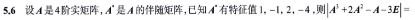

## 前言

本篇原本的产物为一份 docx，是 6-8 月写的，记录了数学写的练习册（张宇基础 30 讲高数、张宇 1000 基础、张宇基础 30 讲线代、张宇 1000 基础线代、武忠祥强化讲义、杨威线性代数讲义、880 综合题，以及上述所有题的二刷）。

未来应该会在卷子开完一遍之后，写一下李永乐 660，当然还有卷子的复盘。

数学未来的题目复盘就全部看这里了。

当然除了高数还有王道 408 选择题的 1 刷和 2 刷，以及真题 1 刷，王道选择题 3 刷等。前 2 刷很多是知识点没背熟，所以相对而言不那么重要（还没拟合）。

至于为什么要迁移，为了强迫自己再写一遍错题，不然就只会采用瞪眼法的方式看错题。

这份文档将持续更新，直至考研结束。

> 408 部分（王道选择题 1/2/3 刷、真题 1/2 刷、算法真题与数据结构应用强化）已拆到[错题本 · 408](/posts/npee/wq408/)。

## 时间线

数学基础：第 1 周 - 第 8 周，共 8 周。将基础 30 讲，三大计算（积分）和基础练习册 1000 写完，刷了一遍基础 30 讲，三大计算（积分）和基础练习册 1000 的错题。

数学强化：第 9 周 - 第 20 周，共 12 周。听完武忠祥老师的强化课，写完武忠祥强化讲义并错题重刷，杨威线代强化，880。

数学 2 轮：第 21 周 - 第 25 周，共 5 周。重刷一遍基础 30 讲，基础练习册 1000，武忠祥强化讲义，杨威线代强化。其中需要错题重刷 880。那么计划就是：基础 30 讲重刷，刷 880 高数部分错题，刷 880 线代部分错题；基础练习册 1000 重刷，重刷武忠祥强化；重刷杨威强化。

数学真题：第 26 周 - 第 30 周，共 5 周。09 - 20 的 12 年真题，以及超越部分试卷（3 套），因为课内 + 状态很差，这 5 周只干了这些事

数学模拟卷 1 + 二刷 880 一半：第 31 周 - 第 32 周，共 2 周。26 李 4 + 880 二刷一半，880 二刷一半

数学模拟卷 2 + 近些年的真题 + 二刷所有错题 + 卷子复盘：第 33 周 - 第 34 周，共 2 周。27 李 6，21 真题 - 26 真题，880 二刷剩下的，24 超越剩下 7 份，所有错题。

数学模拟卷 3 + 660 + 卷子复盘：第 35 周 - 第 38 周，共 4 周：25 超越 + 26 张四/张八 + 660。

408 基础：第 2 周 - 第 11 周，共 10 周。完成 4 本书的基础部分。

408 基础重复：第 12 周 - 第 17 周，共 6 周。完成 4 本书的选择题 2 刷。

408 强化：第 18 周 - 第 26 周，共 9 周。完成 4 本书的强化，4 本书的选择题错题再解析，4 本书的大题研究，以及最后的过一下几本书。

408 真题以及模拟：第 27 周 - 第 30 周，共 4 周。卷子从 09 - 19 年的所有题模考 + 操作系统汪道选择题三刷 + 计组选择题部分三刷。

408 近些年真题以及三刷选择题复盘：第 31 周 - 第 32 周。王道计组选择题三刷，计网挑部分三刷，20-22 真题

408 真题复盘：第 33 周  - 第 34 周。真题深度复盘。

英语仔细阅读：第 19 周 - 第 28 周，共 10 周。掌握仔细阅读的基本方法，写完 07 - 18 的仔细阅读

英语套卷：第 29 周 - 第 32 周，共 5 周，14 年 - 20 年真题所有客观题（也就是 07-13 年的完型和新题型没做，不过这里新题型只用写 11,12,13，完型看情况了）

英语套卷：第 33 周 - 第 34 周：21 年真题以及研究翻译和作文。与此同时，必须每天同时进行早年阅读重刷（阅读即可，一天 1 篇）

英语套卷：第 35 周：以 22 年真题为例，模考一份来点感觉。

政治：第 29 周 - 第 42 周，共 14 周。先花 6 周的时间刷一遍选择题（徐涛马原强化课 + 苍盾），也就是第 34 周结束，再花 6 周的时间 2 刷一遍选择题（肖背诵手册，肖 8 的选择题），再花 2 周的时间背大题。

## 张宇 30 讲基础高数 1 刷（补）

最开始没有写错题本，所以是后续补充的。

### 张宇 30 讲基础高数 1 刷第 1 章

没想出来怎么做，函数有四大性质：奇偶性，有界性，单调性，周期性，考虑该函数为奇函数，由此解答。

其实也有利用到奇函数的特性，我是利用相加去做的，最后做的有点复杂，但是也能做出来。

本题混淆定义域和值域的概念，对于这种题，首先要画图，然后将里面函数的值域作为外面函数的定义域带入，但是最后的定义域是写内层函数的。

做这道题的时候利用的是导数的性质。而答案采用的是基本不等式，上下同时除以一个绝对值 x（需要排除 0）。当然我认为不如分开讨论 x，-x 和 0，上下同时除以-x 然后用基本不等式感觉也不错。

针对这种题的思路是同取对数进行处理。

并且本题 1 刷时数字抄错（6lnx 求导时少抄了 6），错题重刷时 14 的平方 -12 的平方少算一个 10（算成 42）充分证明了计算错误的可怕，以及一步一回头的必要性。

本题在 1 刷时采用类泰勒公式的解法，而事实上 2 的 x 次方可以化成类似 e 的 x 次方的形式，直接将 x 带入即可。

如果采用类似泰勒公式的解法，则是事实上完全不需要给出这个式子。

直接像下面那样子 x=0 处泰勒展开就好了。

本题的做法是需要注意到 y=arcinx 的值域为-pi/2-pi/2，所以得分区间进行讨论。1 刷的时候进入了一个很大的误区，那就是：

令 y=sin(x-pi)，x 的范围为 pi/2-3pi/2，此时也就是说 x-pi 的范围是-pi/2-pi/2，如果直接取反三角函数，也就是 arcsiny=x-pi，最后得到 x=arcsiny+pi。

错误点在于，原函数其实是 y=sinx（也就是此 y 非彼 y），x 的范围为 pi/2-3pi/2，变化为-y=sin(x-pi) 才对，而不是直接令 y=sin(x-pi)。

本题采用直觉做，错误，告诫一定每一题都要算出来，而不是依靠直觉。

关于这题，对是对了，可以注意一下解法，也就是令 g(x)=f(x)/(f(x)/g(x))，当然直接反过来得到 1/A 也是没什么问题的。

本题把两边同时除以一个 n，错误点在于没有讨论 x=k 的情况。

本题采用洛必达，不过其实用 xlnx 的快慢收敛更简单。

这道题需要注意方法，也就是夹逼定理。需要注意的是其等号的作用范围。尤其需要注意当 10/x 时，符号方向得反过来。

关于本题，其实是作对的，但是一开始的时候把 ln(x+y) 拆成 lnx+lny 了，尤其需要注意。

本题完全忽略了 1+x 的平方也可以展开，所以没做出来。

尤其需要注意两个展开式应该相乘，而不是展开式直接相加。

Ln(cosx)/x 的平方，其中不可以直接利用 lnx<x，第一是因为这是无穷大时的结论，第二是因为 ln1=0，0/0 属于未定式。

注意求的是第二类间断点个数，不要把第一类算进去了。

求解这类题的时候，首先是找出可能的点，然后一个个去试，需要注意 acrtanx,e 的 x 次方，|x|。

错选为 C。想当然的锅，事实上认真算一下就知道了。

错选为 C。只考虑了>1，没有考虑<1 的情况，倒反天罡。

本题也是错在想当然上面，1+x+x=2+x，然后填错了。

做出来是一条直线，对完答案之后没有复盘。

对于这题，化简到 xe^x-e^x+1 的时候，如果提取 e^x 然后一阶泰勒展开就可以得到经典的错误，标准的零分。原因是底下是 x^2，而泰勒展开是有皮亚诺余项的，显然不足以满足。

-() 要变号，低级错误。

泰勒展开只对 sinx 展开，没有考虑 cosx。事实上这题应该把 sinxcosx 视为 sin2x 来处理会很方便。

### 张宇 30 讲基础高数 1 刷第 2 章

本题利用函数极限的保号性，只不过是对 1 保号，也就是最终肯定是在 1 处附近。所以前有限项只要有比 1 更大的，那么就存在最大值，前有限项只要有比 1 更小的，那么就存在最小值。

> 其实是保序性。

低级错误，脑测为 1。

本题 1 刷时毫无思路，对于第一问，显然是使用夹逼定理；对于第 2 小问，应该想办法把 an 或者 bn 变成对方，从而得出答案。既然思路是这样，那么根据等式，an 显然不方便进行代换，所以换 bn。由于 bn^2 和 1-cosx 可以代换，所以进行代换，从而迎刃而解。

本题作为错题二刷时做错了，因为分数倒腾来倒腾去导致计算错误。

证明此类题有两种做法，证单调有界，利用压缩映射（先猜再证）

对于本题，先证单调性。后一项减去前一项，可得一串式子，这串式子算对了，但是最后想利用单调性的时候，3/2 算成 3/4，且没有利用有界性。

顺带提一嘴，本题在二刷的时候最后脑算 2A^2=3A，算错了。

利用结论，1 刷和错题刷都错了。

事实上，只需要画图就可以很好的理解这个结论。

本题 1 刷和错题订正都没做出来，原因是不会。当然经过强化之后，这点知识是还可以的，因为这道题明显是上面说的第 2 类做法，在进行压缩映射的时候，需要利用拉格朗日中值定理等条件去放缩。

用夹逼定理和特值法做。

本题为低级错误，根号 n 除下去的时候要注意。

违规使用等价无穷小代换

考虑夹逼定理，这题二刷差点没做出来。比较正规的做法是分块算，也就是把 1/n 和后面的一大坨给分开。

一刷时没思路，错题重刷时没写，现在再做一次，二刷的时候再做一段时间才做出来。本质的思路是把 xn 解出来，然后 x1< x2，对应的函数单调递增，可得单调性，有界性对于 xn 而言显然。

### 张宇 30 讲基础高数 1 刷第 3 章

关于这道题，1 刷的时候暴露了一个问题，那就是我不是不会做，而是总是在最后一两步的时候突然犯蠢。所以不只是得走一步看一步，还得着重检查最开始和最后，这些都是最容易让人懈怠的。

这两题可以放在一起讲。这道题其实是有结论的，具体结论在武忠祥老师的强化课基本搞明白了。包括我没放进来的下一题，重点是记住这两个：

x|x|以及画图，画一张图就能理解函数的导数绝对值之间的关系了。

当然也可以用传统做法做。

例 3.5 就是想当然了，算一半直接选了错误选项。

例 3.6 则是试根用长除法，但是 2 刷的时候才突然意识到，原来可以先因式分解，然后问题就迎刃而解了。

开卷子初期时候补充：需要注意本身就不可导的点，例如 x 的 1/2 次方，x=0 不可导。

这道题是一刷的时候没算完，只算出来了交点没算完极限。

这两题可以放在一起讲，1 刷的时候明显对概念不熟悉，错题重刷的时候也一般，2 刷的时候险些没反应过来。

对于不经常考的考点也需要注意。

本题是知识点的不熟悉，需要注意。

没想到洛必达。

2 刷的时候看了提示才想起来。

在这里可以辨析一下洛必达可以洛几次，如果某个函数在一个区间内 k 阶可导，那么在这个区间内可以洛 k 次；如果一个函数在某点处 k 阶可导，那么在这个区间内只能洛 k-1 次。

上面这个说法是错误的！一样只能洛 k-1 次。可以洛的前提是第 k 阶导存在（或为无穷）

### 张宇 30 讲基础高数 1 刷第 4 章

本题一开始想成相加，后来做的时候使用的是上一节的导数思想，然而在处理 tanpix4 的时候翻车了，这里 x 趋向于 1，而不是 0，所以在这里的处理需要小心。2 刷的时候用的是洛必达，感觉也是可以去凑一下的，但是没必要。

本题答案的解法采用的是第 2 种，也就是采用 uv 的求导。

注意辨析 x 和 y 之间的关系，这里的 3+e 指的是 y，也就是当 y=3+e 的时候，x=1，而不是 x=3+e

连续的 yx 等的计算错误以及加减号

这题错在利用公式法的时候，求解出 dy/dt 和 dx/dt，直接拿前者去对 t 求导，而不是拿 dy/dx 对 t 求导。本题 2 刷时尝试使用公式法。

本题错在两个地方，第一，x=arctant 求导求出来最后是带 x 的，第二，一个经典的错误，标准的零分：除以 1/(1+t^2) 一定不是直接把这个写在分母。

大量的计算错误，且一开始没注意到取对数。

题没看完，求的是 x=0 时的点，而不是完整的。

本题可以采用归纳法，1 刷时采用牛莱公式，但是确在计算 C（上 1 下 n）时出现问题，做出来等于 1，实际上应该为 n。

利用牛莱公式，结果 C(n,k) 再次记错公式。

低级错误，漏抄了一个 2

低级错误，求二阶导的时候求成 A+1 了。

低级错误，求 dy/dx 的时候忘记除以 dx/dt 了。

没想到用泰勒公式

进行泰勒展开的时候需要尤其注意最后求的是什么，而不是直接把 x 的形式保留在那里。

### 张宇 30 讲基础高数 1 刷第 5 章

看了半眼才反应过来是构造函数

严谨的证明是利用费马定理 + 举特例

关于这题，需要注意两件事。第一，看到 e 的 x 次方一定要想到正无穷和负无穷；第二，关于无穷的时候 e^x>x>lnx，这个要记住。

数列。

1 刷时已经根据不出草稿了判断出哪里计算错了，二刷时则是因为对 tanx 求导，求导求成 secx 求导。

低级错误。1 刷时做对了，但是选错选项了（答案是 B，错选为 D）

本质是极限的计算错误：

1 刷的时候错误在计算 y-ax 的时候，单独先算了前一项；错题重刷时错了是因为不知道为啥洛必达的时候，把-e^x 跳步成了-xe^x。

### 张宇 30 讲基础高数 1 刷第 6 章

注意零点定理的作用范围。在[a,b]连续，在 (a,b) 上有零点

做这题的时候完全没有任何思路，只尝试了一下用二阶导表达。但是显然二阶导不能用

本题做的时候当时还没学为微分方程，所以没做出来。

这题 2 刷的时候虽然做出来了，但是花了大量的时间，原因有以下两点：

1. 被一阶线性非齐次微分方程的通解公式给影响了
2. e^x，e 的次方上面的式子假设是 alnx，那么不可以变成 e 的 a 乘上 e 的 lnx，原因很简单，e 的乘法等于幂上的加法。

应该是做了一会儿没思路直接看的答案。

本题可以利用罗尔原话去做，具体就不讲了。

这题证明的时候采用的是导数的定义，其实是可以做的，最后也是导向类似拉格朗日中值定理，但是当时做的时候完全没反应过来。

X^2>=0

这题做的是对的，不过除了构造法之外，还可以用拉格朗日中值定理。

一刷时标记先跳过，结果也没看。

这道题可以注意一下，可以看出有 3 个根，然后证唯一性可以用罗尔定理的推论来获得上界。

本题没看完题目（求正实根）

本题 1 刷时没做，2 刷时也没做，难度不高计算量很大，就放了。

但是可以注意一开始如何设函数。

本题和答案方法不一样，利用罗尔原话！

这道题我自己是在做的时候硬求导然后反复利用题设的结论。

没做出来。对于这类题在强化的时候总结为要证两可以相等的，用两次拉个两日/柯西中值去凑。

本题采用隐函数反带入做的，但是和 2 刷时的 sinx 那个一样，可以采用罗尔原话！

### 张宇 30 讲基础高数 1 刷第 7 章

用定义去做

单位

1 刷时没做。

### 张宇 30 讲基础高数 1 刷第 8 章

1 刷时没想到两边同时对 x 求导，需要注意这一点。同时求导可以消去积分号。

错题重刷时这题算错了。

想到用几何法做了，但是在做的时候没有沉下心来捋清楚对应关系所以才做错了。沉下心来捋清楚关系其实不难。

3 没想到用几何法去做，而 2 则是想当然的直接认为是对的。

事实上这题结合图像去做很简单。

想到强化阶段时武忠祥老师的一个简单结论，如果变化和 n 程度相当，大概率是往定积分方向去想，所以先提出一个 1/n，然后去凑形式。

这题错是因为上下同时乘上 n，而不是一步步去凑形式。

本题错在 2 个方面。第 1 是经典的错误标准的零分，tan(pi/4)=1，而不是 1/2，tan(pi/2) 不存在，而不是 1；第 2 是没有想到怎么放缩，也就是对放缩用的不熟练，这题是一个经典的放缩，并且在第 6 章的课后题有证明。

没想到怎么做。对于含三角的式子，第一反应就应该是区间再现。

变限积分存在就连续，其他就是应用对于变限积分的讨论了。这题应该是不小心看到了答案，做的还是没问题的。

导函数在该点存在不意味着导函数在该点连续。事实上这道题只需要说明导函数在该点存在就可以了，显然这道题导函数的左右极限都相等，所以存在导数。

又可以联想到此前的论证，函数极限存在和函数连续是两码事，函数的极限存在和函数的左极限=右极限一样，但是函数的左极限=右极限=函数在那个点的值才可以说明函数连续，这是一个我经常错误的点，需要注意。

当然这道题用结论做就好了。

这道题没有思路，但是放在 2 刷来看的话，其实绰绰有余，不断地利用绝对值不等式以及积分不等式就可以了，对于这类题，必要的时候也应该联想到拉格朗日中值定理。

这道题可以注意一下，是凭感觉直接做的。

这两题放在一起讨论。这两题张宇的课本给的都是很玄学的做法，导致我完全不能理解这一块内容。事实上，对于反常积分而言，并不是所有的点都是在 0 或者在 + 无穷处无定义，1 这个点只是常用分界点，而不是必然分界点。

所以，对于第 18 题，观察到无定义点为 0 和 1，所以分区间讨论，分成 0-1/2 和 1/2 到 1。当 x->0，可以发现 lnx 对 x 无影响，所以由 p 积分可知 a<1；当 x->1 时，对 lnx 进行变形可以得到 x-1，对其进行讨论发现其无论如何都可以积出来，所以不影响收敛性。

对于 19 题是类似的，这里就不展开了。

没想到简单做法，在那里硬算。

和前文同质错误，也就是原函数，可积和变限的可导连续判断。

本题没有踏踏实实计算，直接化简成了 (1/sqrt(1+x^2)) 去做，很是低级。

没想到怎么做，本题是夹逼定理和积分的结合。

本题采用一个很低效的办法做，也就是定义，而且最后还因为+-错误而错误。事实上，这道题可以利用本章第 1 题的做法，两边同时求导，就很轻松能做出来。

和前文的敛散性判断同质错误。

### 张宇 30 讲基础高数 1 刷第 9 章

关于这一章，计算问题非常的大，需要多复盘。

1 刷，错题重刷等多次错误。包括但不限于对 a 的处理以及+c

1 刷采用换元法进行处理，做错了，2 刷忘+c。

+c

采用换元法，但是这道题题抄错了，题抄成 f(lnx)=(lnx)/e^x 了。

+C

毫无思路。考虑到 e^x 的存在，猜测这道题应该是弄出来两项可以消掉或者可以合并。又考虑到三角恒等式。

1 刷的时候极为轻视，将这题直接跳过了，强化阶段也选择性的跳过了这部分。事实上，结果就是 2 刷的时候第 8 题错的一塌糊涂。

本题处理时对于 x^2+1 项用的直接是 B，而不是 Bx+C

对于 arctanx 的变形公式背错。我认为对于这种不应该去背公式，而应该求导完之后再算一次看看有没有问题。

算这道题的时候题抄错了，少抄了一个 ln。另外可以注意一下区间再现。

这两题可以放一起讲。后面那题没去算，因为计算太复杂了。前面那题则是没想到可以利用 arcsin(sinx) 去简便计算。

需要注意，这道题的结论的积分上限一直是 pi，其他变形另说，而不是一步到位。

一步步计算，本题变限积分求导的时候，一定要注意是 x^4！

法线。

第一是没想到应该拆绝对值。碰到绝对值想办法拆绝对值，这基本是铁律。

第二是理解错泰勒公式。这道题是 F(x) 展开式后面的式子，而不是里面的东西展开是这个式子。

这题在做的时候应该是认为里面的太复杂了，然后没敢化简。事实上，这题化简一下就可以迎刃而解了。

这道题应该是一直在那里想着怎么拆，对于这种题，一定要想一下三角换元。

这两题都没做，问题不大，和数学 1,3 相关。

做的时候没处理好连续。

定义，tanx 在 pi/2 上无定义。

不会做。

没有想到可以先利用奇偶性化简，导致做出来很复杂，然后计算错误。

思路正确，但当令 tx=u 进行变量代换时，对 x，t 和 u 之间谁是变量谁是常量混淆。

没考虑定义域。

### 张宇 30 讲基础高数 1 刷第 10 章

没有想好定义域和值域，也没有画图直接想当然做，导致减反了。

对于本类题无从下手，事实上这种题相当于换元。

对于这种题没有头绪，但是事实上这种常见曲线需要背诵。另外需要注意其定义域。

对于这题想到了这道题有很多个区间，但是没想到要分成 kpi-(k+1)pi 讨论，这点需要着重注意。另外可以注意一下等比数列的计算。

第一，注意定义域；第二，计算错误，最后这道题没有除以 2。

本题直接列公式硬算，但是最后在换元法的时候积分上下限理解错误。

但是我觉得这道题不应该硬算，而应该利用强化课武忠祥老师的方法去做，这样这道题就不会碰到什么很神秘的问题了。

采用微元法第 2 问计算错误。和上一题类似的，对于这类题用二重积分的思想去解题。这里微元法的错误来自于对锥形的计算错误，因为这道题的锥形是绕着 x=1 去算的，所以不可以粗浅的理解为绕着 y 轴转那样去算。

对于变上限积分理解不足。

没做。利用强化课的二重积分思想即可。

属于低级错误。对 1/y 积分，求出来是 lny，而不是-lny。

漏看范围，以及提取因子提取错误。

微元法的锅了，这道题采用二重积分思想很快。

### 张宇 30 讲基础高数 1 刷第 11 章

本题错在这几个方面。第 1，没想到变限积分；第 2，关于第 2 问，把 e 踢出去，而不是把 f(x) 提出去。这样犯了两个问题，其一，利用推广后的积分中值定理需要注意内部是不变号的，其二，就算 f(x) 是不变号的，那么提取出去的东西会有一个很抽象的问题，那就是随着 n 的变化，ε会变。

夹逼定理。

没做。

这道题的问题本质上来源于对变限积分的不熟悉。

这道题想到利用两次拉格朗日中值定理并不难，但是难的是想到放缩这里要拆开放缩。

这两题放在一起讲。本质是因为路径依赖，始终想到利用拉格朗日中值定理。但是事实上除了中值定理之外，面对积分还有两个处理路径。第一是分部积分，第二是牛莱公式。在拉格朗日中值定理走不通的情况下，可以考虑用分部积分或者牛莱公式，而且对于分部积分的考虑应该提前。

没想到积分中值定理。

没想清楚本质是在证明什么。

这道题只需要证明里面的大于等于 0 即可。

和 11.10，11.11 一样。

这道题 1 刷的时候完全没想明白在干啥，事实上利用一个很“土”的办法就是变量代换 b 为 x，迎刃而解。

泰勒公式背错了。

### 张宇 30 讲基础高数 1 刷第 12 章

“又”

搞清楚坐标系的位置，对于这类题，一定要搞清楚 x 和 s 之间到底分别是什么。

这里的 P 其实就是 F（公式里的），按照自己的理解就好了。

不会做。对于物理应用题，事实上强化那块搞一下才真正大概搞明白怎么个回事，对谁积分，谁是变量等，以及抽水做功是对重力做功，而不是对压力做功。

### 张宇 30 讲基础高数 1 刷第 13 章

本题没想到用夹逼定理，对于这类题，根据强化经验可知，先判断是否齐次，然后一般采用夹逼定理去证明。

本题巧合做对，事实上这道题如果采用换元法问题会很大，即便换元了，还是里面的 t 还是 t，又不会发生变化。

对于这题需要注意这几个问题：第一，u^2 抄错了；第二，换元法之后的代回问题。

本题巧合做对。原因是没有对 f1 等进行求导。

关于这题主要是对记号理解不清晰，对于第一个式子求导，是对 f(x,e^x) 求导，而不是对 f(x,y) 求偏导，这种题可以联想到先代后求和先求后代。

想当然没取倒数。

没想到举反例：(y-x)^3。

公式法求的时候要有负号。

本题是不封闭曲线（也就是得考虑区间），所以使用拉格朗日乘数法算出来的只是边界条件。

事实上这道题 2 刷的时候用了三角换元，迎刃而解。

这题当时 1 刷的时候没看懂是什么意思，其实很简单，先利用偏积分求出原函数，然后因为是面积内，所以需要考虑边界和本身。

属于低级错误，本题做对了，选项选错了。

### 张宇 30 讲基础高数 1 刷第 14 章

对于本题应该利用定义求解，没有理解定义。

对于这道题，没有想到用二元积分的积分中值定理去做，对于二元积分的积分中值定理，可以类比一元的去理解。

对于这题，没有理解什么是 x-y 给的条件是什么，也是用定义去做。

对于这题犯了一个经典的错误，也就是 1/2(1/2x+1/2x)=1/2

对于这种题，曾经一直执着于直接带入去计算，事实上只需要画出积分区间就很简单了。

对于这题是对 t 和 y 积分，尤其需要注意是对谁积分，二刷的时候也差点没捋过来。

没有想到轮换对称性在那里硬解。

没有想到利用极坐标且这道题跳步导致计算错误。

积分区域搞成整个圆。

这俩没啥好说的，直接跳。

本质这道题 a 不会算是对极限的定义理解不清晰以及对知识点迁移的能力还是不够。

考虑轮换对称性，然后被薄纱。对于这种题需要就事论事去分析。

最后一步。

没想到怎么做。

没想到先化简。

对于这两题没有稳扎稳打去分析，非常浮躁（这两题最开始先跳了，回头再来写的）

### 张宇 30 讲基础高数 1 刷第 15 章

本题没想到积分怎么积分，其实这个积分也是经典积分：1/(1+sinu)。

本题没有辨析清楚 y 和 Y 的区别。

本题应该辨析清楚 y 和 x 的关系，这道题采用 dx/dy 便迎刃而解。

这里 1 刷的时候是没有搞明白变限积分函数和不定积分的联系是什么，所以没有联想起来。

本题错误原因和上一题类似。

对于这一题是利用换元法，但是在写这道题的时候却进入误区，惯性思维直接 dy/dx 转换为 dp/dy，而没有就题论题去分析。

这道题在转换为特征方程的时候错误，所以还是一步步计算。

后面的题 1 刷的时候都没做，需要注意的是做了一道物理题，但是要分辨清楚变化率的正负性。

本题错在想当然上面，和 2 刷的时候的一个错误点（也就是没有想清楚 2 重根）类似。

本题没有搞懂怎么做，但是其实慢慢分析能做出来。

关于这道题，手生 + 计算量大，所以没算完。

本题错在没有一点一点分析背后的本质，所以心虚没做对。

## 三大计算积分篇

## 张宇 30 讲基础线代 1 刷（补）

### 张宇 30 讲基础线代 1 刷第 1 章

本题错误原因为第 3 行第 4 列的 -1 抄成了 1。

本题错误原因为行列式不是矩阵，对某一行乘上一个 k，那么外面需要除以一个 k，而不是什么都不做。

在全部加到第 1 行提取出来之后不会做了。这道题属于经典题，需要注意。

本题硬做的，没想到范德蒙行列式。

三对角矩阵用递推法，本题硬做没做出来。

硬算然后算错了。

只想到了一边，没想到另一边。

可拆分矩阵，再做一遍果然能有新的不同理解！

对概念的理解，没想到替换行。

再做一遍确有不晓得收获，对于这道题一开始完全没有意识到是什么意思，也就是学了后面的才知道这道题应该怎么分析，用矩阵不等式，而不是像答案里这样用反证法。

第 1 题，第 3 题没做，除了硬解之外没什么好方法。

第 2 题直接带进去了，没有考虑是否应该变号。

### 张宇 30 讲基础线代 1 刷第 2 章

本题没想到可以中间合并，需要注意的是，不要把矩阵当一个简单的 a，b 数值元素看待 0。

本题犯了一个经典的错误，标准的零分，那就是将 A 先变形成好算的样子再求幂，先变形意味着 A 不再是原本的 A 了。

本题是没想到可以将 E 拆出来，事实上对于这种题后续直接用求相似的方式去解就可以了。

本题没有思路。事实上需要将二者联系起来，也就是找一个可逆矩阵联系起来就好了。

多个可逆矩阵相乘一定是可逆矩阵，用行列式证明即可。

A*是竖着写。

算出 A*后，第一行第三列符号抄反。

忘记拉普拉斯定理。

提取提出去的时候要 n 次方，需要注意。

本题错误原因在使用伴随矩阵||提出去的时候没有按照行列式去算，也就是没有 n 次方。

与错题重刷时错误原因一致，没有考虑到可逆。

主要是矩阵不等式的应用需要熟练。

本题没有考虑利用行列式法进行考虑。

本题 -6 的 n 次方的 n 系数错误，属于低级错误。

第 9 题主要是没想到可以用那种方法表达。

第 10 题取逆的时候化简错误。

第 11 题在那里展开算，而不是同时取行列式分析，属于方法性错误。

第 12 题没有考虑到等价是秩相等。

第 14 题主要的问题是提取错误，例如 B-AB 应该是=(E-A)B，这个需要尤其注意。

第 15 题取逆计算错误。

### 张宇 30 讲基础线代 1 刷第 3 章

对于这题，本质上是一刷的时候没有捋清楚向量组和方程之间的关系，所以完全不会做。

0 向量肯定和其他向量线性相关。

没有考虑过方阵时采用行列式法。

用矩阵定义去做，错题重刷时计算错误（-1 想成 1）

这三题 1 刷的时候直接跳了。

第 2 题为低级错误，但凡多想一下就不会错。

第 3 题是想错了谁应该秩更大。

### 张宇 30 讲基础线代 1 刷第 4 章

单纯是没有捋清楚解这种题的套路。

没有捋清楚背后的转换，以及没有填+-

完全没有想到从秩不等式的角度出发。

本题也一样是秩不等式。

本题想当然地认为 D 是错的，而没有上手去算。

这两题都应该从秩不等式的角度去考虑。

从来没有想过可以从行列式的角度去思考，本质是对线代的理解不足，没有非常融会贯通。

对于这类题要辨析解的结构，然后就迎刃而解了。

本题没有想清楚路线，通解一定是求齐次解和非齐次解，分清楚慢慢求。

仅考虑了片面，没有考虑所有情况。

这道题就是捋清楚有解的结论以及如何变形为同解方程组即可。

没理解透增广矩阵的意义。

### 张宇 30 讲基础线代 1 刷第 5 章

本题理解错行列式，对于行列式，初等行变换和初等列变换都是可以的。

跳了。事实上这道题可以利用秩，显然秩为 1，所以有 n-1 个特征值为 0，所以用矩阵的迹可得后面。

对于这道题没有理解透约束，在强化阶段理解了。

没想出来怎么做。本题利用 A*和 A 得关系就可以解出来了。

本题毫无思路，原因是没有意识到 A 得每行元素之和为 2 意味着什么。并且本题也没有意识到 A*与 A 的关系。

矩阵相似迹相等，本题本来用的是算出特征值，其实完全没必要。

属于经典关系，矩阵相似迹和行列式相等。

判断这类题，首先从实对称矩阵入手，实对称矩阵一定可以化简成对角矩阵；对于 B，显然有 3 个不同的特征值；对于 C，显然 0 为其特征值，并且 0 时有 2 个线性无关的解，所以可以相似于对角矩阵。

即凑形式。

一一对应，但是我认为用分开成两个矩阵再做的方式更保险。

本题想当然认为 P=Aa。

与 11 题类似的错误。

本质是对概念和定义理解不清晰。

本题二刷时也有疑惑，为什么，但是实际上证明一遍就很清楚了。

本题对与 A 相关的特征值和特征向量不熟悉，在 2 刷的时候仍然忘记了。

第 6 题理解错 A\*的行列式与 A 行列式的关系，对于 A 的行列式，其 A 行列式/特征值可以得到 A\*的特征值，而已知 A\*的行列式，不能用这个方法反过来，而应该是利用行列式那里学的，A*恒等式来直接算出来 A 的行列式。

第 7 题应该是个关系式，只写了一个点。

计算错误。

### 张宇 30 讲基础线代 1 刷第 6 章

得拆成对称。

注意配方法，以及必须得写出可逆线性变换是什么。

使用配方法的时候，没有平方项要去凑。

注意是化成标准型，而不是规范形。

两次变形得到的经典题目。

配方法没配出来。

没有想明白合同应该考虑的是什么，合同应该考虑惯性系数。

实对称矩阵必然合同；本题又是相似的变形。

1 刷的时候非常迷茫，现在 2 刷再做一次理解了。

想当然。

低级计算错误。

## 张宇 1000 基础 1 刷（补）

### 张宇 1000 基础 1 刷第 1 章

本题没上手做直接选的答案，也就是想当然导致的错误。

对于这题是定义理解错误。

这道题不会做，并且对泰勒公式的定义理解错误（上下均用泰勒公式用了不知道多少次而且分子泰勒公式用错。

第 17 题泰勒公式理解错误，只展开了 tanx 而没有展开下面的。

第 18 题题没看完，求的是函数而不是单个极限。

本题抄错正负号并且滥用等价无穷小。

### 张宇 1000 基础 1 刷第 2 章

本题没想到使用拉格朗日中值定理，并且在错题重刷的算半错，因为这道题错题重刷的时候一开始就放缩为 1，导致实质上没法使用夹逼定理。

本题 1 刷时在那里试，错题重刷的时候对题目理解不清晰。事实上这道题只需要稳扎稳打分析，并且利用好 a=2ln(1+a) 这个条件。

### 张宇 1000 基础 1 刷第 3 章

本题错误是因为滥用等价无穷小，ln(x-1)/f(3-x) 确实可以代换为 2，但是在化简到需要通过定义计算的时候，想当然直接求了，也就是 (x-1)/2f(2-x) 的时候没有细致分析，而是直接认为是 1/2。

第 12 题做着做着题目抄错了，+-问题。错题重刷的时候仍然是同一个问题。

第 13 题一下没想出来怎么做，使用特值法做做错。

### 张宇 1000 基础 1 刷第 4 章

本题错误原因在于没有对 f(x) 本身求导。

第 8 题错误原因在于对参数方程的理解错误，原参数方程分别对 t 求导后得到的方程并不是导函数的参数方程。

第 9 题到最后一步推出来是偶函数，但是还是想着原函数是奇函数，事实上这道题一开始的时候就直接把 f(1) 算出来就好了，还代入代入那么多。

### 张宇 1000 基础 1 刷第 5 章

本题错选为 B。错题重刷时仍错。

本题 -1/2 带入错误。

未考虑正负无穷。错题重刷时仍错。

本题不会做。错题重刷时仍错。

### 张宇 1000 基础 1 刷第 6 章

本题被拉格朗日中值定理带偏，事实上只需要变形然后求解即可，错题重刷时也是错的。

没想到用拉格朗日中值定理求解。

没想到怎么做，包括错题重刷的时候也没想到。对于这类题也就是需要踩一个点去解，公式化两次拉格朗日找点。

详细解释一下这里的介质定理，ax+by，其中 a+b=1，那么一定存在一个 z=ax+by，其中 z 介于 x 和 y 之间。

### 张宇 1000 基础 1 刷第 7 章

对于这题属于低级错误，2 和 1/2 约分的时候，结果是 1 而不是 2。另外也需要注意这道题具体是求什么，dV/dt=1，而不是其他东西。

### 张宇 1000 基础 1 刷第 8 章

第 1 题对积分的定义理解错误，没有仔细去看。

第 2 题完全没理解自己当时在做什么，只能归咎于经验不足。

本题错选为 B，滥用等价无穷小。对于这种题应该先用奇偶性化简才对。

这类题不看当时是怎么解的了，当时对 p 积分的理解基本为 0。

本题 1-x^2，2 次方抄没了。

这道题印象深刻，是多个+-号导致的错误。但是事实上这道题直接用绘图法就可以轻松解决。

### 张宇 1000 基础 1 刷第 9 章

第 5 题属于低级错误，-2e^-1-2e^-1≠0。

第 6 题代入的时候少抄了一个 2 倍。

第 8 题没做，属于当时不熟。

第 9 题 xlnx 将 1 代入算成非 0。

本题只算到一半，然后就没继续算下去了。

本题不会做，我感觉答案的做法学不来，所以应该是利用 2 刷时的换元法做。

第 24 题 1/3+1/3 算成 0

第 25 题应该是拆根号的问题。

第 26 题换元法的时候上下限求错。

第 32 题少抄了一个 x。

第 33 题把 acrsinx 抄成 arctanx。

第 34 题直接将 1 代入然后计算出 y’是+-1，显然错误的想法

### 张宇 1000 基础 1 刷第 10 章

本题采用估算，结果估算算半天不如正常算。估算还估错了。

经典错误，积分上下限错了，直接填的 0-pi，而没有根据题目意思是 0-1。

单纯是因为没有认真分析。

牛莱公式最后一步代入错误。

算半天结果就是合起来算不如分开来算。

第 14 题积分求解错误，多约了一个 x。

第 15 题单纯是因为积分没积出来。

本题属于一个印象很深的错误，积分是升次，我算成了降次。

### 张宇 1000 基础 1 刷第 11 章

第 1 题完全没想到用基本的求导 + 零点定理就可以解决。

第 2 题也是完全没想到可以利用分部积分。

个人认为是熟练度问题。

不会做。

### 张宇 1000 基础 1 刷第 12 章

全部贴在这里，就不分析了。这里的每一题我其实都记忆深刻。

### 张宇 1000 基础 1 刷第 13 章

第 8 题，事实上这道题我都不知道在做什么，令 uv 即可。

第 9 题，二刷时才真正理解这道题的具体意思，把 y 当成常数来讨论，而不是当成变量来讨论。

一个计算量超级大的题，算错了。

没想到怎么做，令===0 即可

计算错误。

### 张宇 1000 基础 1 刷第 14 章

对于这类题的处理手法当时不清晰。先绘制出积分区域，然后再判断对称性。

第 13 题属于计算错误。

第 15 题漏抄一个乘 2。

第 16 题也是错在拆根号，当初没有意识到，结果就是二刷的时候也错了。

错的乱七八糟的。

跳了，没想到用极坐标去做。

方法复杂。本体就是想多了，直接轮换对称 + 正常地 x=pcos 即可。

本题对于积分换元法的理解不够充分，已经把 p^2 凑进去了，然后不会做了。

### 张宇 1000 基础 1 刷第 15 章

第 1 题代入的时候把特解想当然为 0。

第 2 题没有注意到法线。

第 3 题其实稳扎稳炸分析列出来就能做了。

这两题都没想到换元。

本题少抄了一个 +1。

注意到 y 轴的距离应该是 x。

### 张宇 1000 基础 1 刷线代第 1 章

利用余子式计算的时候+-号错误。注意并非+-轮替，而是必须得用 -1 的 i+j 次方去研究。

利用基础方法做，不如根据回头来看的经验去做（也就是相似性）

### 张宇 1000 基础 1 刷线代第 2 章

第 8 题。算半天的 A 的逆和 B 的逆，不如好好展开分析。

第 9 题属于超级低级的错误，2 刷的时候错的也是一模一样的原因，懒得喷了。

### 张宇 1000 基础 1 刷线代第 3 章

### 张宇 1000 基础 1 刷线代第 4 章

2 刷犯了一模一样的错误，上界和下界不能漏。

第 8 题，对于 D 注意是行满秩才满足，而这道题是列满秩。当初的对行，列的定义理解地非常不清晰。

第 9 题需要注意这里是非齐次的，所以得 +1。

第 11 题当初是完全没有理解什么意思。显然三个无关的向量可以表示任意向量，然后根据这个去做。

第 12，13 放一起讲，也是对行满秩，列满秩的理解，以及对于线性方程组有解秩的理解。

第 14 题则是用了三秩相等，但是没有理解为什么这么用，所以导致的错误。

### 张宇 1000 基础 1 刷线代第 5 章

当初对本章的理解极为匮乏。对于 E 的变形，特征值可以变，然后特征向量不变（可以证明过去）

单纯不会做。事实上利用初等矩阵去做。

本章的 12-23 题全部都做的非常神秘，我认为也是对线代理解地不完善，就不一道题一道题地解释了。在做完杨威线性代数之后，对线代地理解加深了非常多，从而对这类题也理解了很多。

### 张宇 1000 基础 1 刷线代第 6 章

这些都是第一次学不懂的产物。

## 武忠祥高数强化 1 刷（补）

### 武忠祥高数强化 1 刷第 1 章

本题 1 刷时没求定义域，错题重刷时候定义域写漏了 0。

本题 1 刷时定义域求解错误，1-x>=1 求出来并非 x<=2。错题重刷时绘图错误。

1 刷，错题重刷时均错误，从下面可以得知，2 刷时也错了。1 刷时候，没想到 1 为什么是错的。错题重刷时则没有考虑到：该点极限不一定为该点的值，需要尤其注意。

考虑这类定义题的时候，一定要先考虑不连续的情况。

属于低级错误，这道题忘记自己在选必为偶函数了。

这道题需要注意，尤其是绝对值=0 那个结论。以及这道题在选择题上的技巧，也就是直接法和排除法的应用。

对于这道题的第 1 问利用极限的保号性。

这道题是单调有界，但是这道题直接展开 lnn 的思想其实是不对的，应该是判断 an>0 和用 a_(n+1)-an 来算，然后发现可以化简。

对于泰勒公式的应用不要考虑弯弯绕绕，用最低次幂原则展开到不能约分即可。

对于这道题利用定积分定义的时候变成了 1+x^2。

这道题是对经典极限的定义把握不明确，x^2-ln(1+x)，泰勒展开后应该是 1/2，而不是 - 的。

利用泰勒公式的经典问题，即要全部展开，并且 x 可以和 x^3 匹配。

对 cosx 的泰勒展开不明确。

认为提出 e 是非法操作，本质是对概念理解不清晰。

对泰勒展开的理解问题，一定是要展开到不能约掉为止。

对 cosx 相关的泰勒展开不明确。1-cosx，对 x 进行变换和对 cosx 的次数进行变换是两码事。

Arcsinx-x=1/6

错题重刷也错了，u/v 一整个求导不要和 1/u 求导混用。

没想到怎么做。

连续取 2 次 e 就好了，其实不会难。

本题想当然认为 n 的 n 次方和 n-1 的 n-1 次方相关可以直接去掉。

忘记等比数列求和公式。

对于这类题需要注意 n/n-1 之类的去凑。

这类题需要注意 k 和 n 的区别。

没有思路。

没有思路。

没有思路。

这道题证明上界用的是数学归纳法。

对于这道题，e^x>=x+1，如果将 x 替换为-x，符号不变。

没想到怎么做。

知道要去把后面的消掉，但是不知道怎么消。显然不是利用三角不等式去消（因为带了尾巴）

提取-x 后直接利用泰勒展开。尤其注意这道题是提取-x。

完全没有理解 mn=1。

生搬硬套结论，不如硬算。

没有考虑 kpi

对于这类题，一定是一条路：没有条件要创造条件。显然设 g(x)，然后利用第一个条件，同时除以 x，然后就很轻松可以去证明了。

### 武忠祥高数强化 1 刷第 2 章

洛与不洛的问题，需要深度辨析。

泰勒公式，使用配凑法的时候，跳步导致 x 和 x^2 系数配错（分母）。

注意直接法和间接法的问题。对于 D，经典的反例，也就是绝对值 x。

这道题尤其需要注意，前面的 -3 本身也是不可导点。

细致分析即可。

只需要把握 tanx 的几何意义即可。

二刷犯了类似的错误，忘记把平方算进去了。

注意导数的链式法则可以直接用。

本题主要就是变量太多了，容易混淆，事实上搞清楚即可。对于这道题，错题重刷的时候也是错的。

使用硬求算错了。注意公式法。

谁是 x，谁是 y，属于是经典的问题。

注意使用泰勒展开的时候是把 0 带进去的。

本题的问题是脑子抽了想错了，所以最后选错了。

关于这道题的辨析详见 2 刷。

洛不洛的问题，当然这道题也可以直接用领域法去做。

罗尔定理。

罗尔定理推论。

分离参数。

这道题主要是分析方法，可以很容易得到 f‘1 小于 0，从而由于单调递减，可以得到之多一个零点。

当然这道题也可以采用泰勒公式进行分析。

主要注意可以用泰勒公式和拉格朗日中值定理进行分析。

不要盲目套公式，可以逐项分析。

变限积分这里可以用分段函数来表达。

自己构造出来的函数如果还是带有‘，再网上想一层。

次数问题。

这种题被这道题的上一题影响了，想着一定是 fc=1-c。

### 武忠祥高数强化 1 刷第 3 章

路是对的，主要的问题是做到最后一步的时候没想到直接利用原条件进行化简。

没想到用积分中值定理。

这道题被当初基础 1000 的那道题给绊住了，老是想着分部积分。

这道题尤其需要注意，尽管变限积分表示的是面积，但是，这道题当 x<0 的时候，应该上下限变一下，从容改变+-。

没想到利用变限积分。

主要是计算问题。

这类题经典需要注意变元怎么变。

1 刷的时候不会做，错题冲刷得时候没有注意 5/2×x，结果求导了之后 x 还保留。

本题是对的，但是需要再看。

柯西积分不等式，没招，这个回头和二重积分最后那里专门去看。

事实上，这道题直到 2 刷完基础 1000 之后才彻底理解了怎么做。

理解了就不难了，之前始终没有理解。

第 3 问为低级错误，x 凑进去的时候系数配错。

对于本题的 1，对 r 积分不要和对 e 积分搞混淆。

对于这道题，利用换元法的思想 + 二重积分来理解。

没想到可以计算出抛物线。

抽水做功是对重力做功。

### 武忠祥高数强化 1 刷第 4 章

对于第 1 题，属于基本功问题，C（fx）直接把 c 忽略了。注意多个常系数。

对于第 2 题，尤其要注意特解。特解的情况下可以不求出完整的再解系数，可以先猜后解。

注意对变限积分的求导问题。

注意两个问题：谁是 X 谁是 x；可以利用面积相减来化简，不一定要求出直线坐标方程。

1 刷的时候没做，错题重刷的时候三角形是什么错了。

其实也是一个经典的错误，坐标值不等于长，而应该坐标值之差。

### 武忠祥高数强化 1 刷第 5 章

先求后代？先代后求？忽略了定义。

本质是对高阶无穷小的理解错误。

这道题其实是不会求最后的不等式？我在 2 刷时的想法是拆成 y>x 和 y < x 讨论，这道题则是直接判断有界。

不多评价，这个是懂得都懂。

在先代后求的时候，一定要注意谁是常量，谁是自变量。

没做。

本质是对记号的理解问题。

本题无从下手，事实上上对于这种提，先不管必要性还是充分性，反正直接写先证谁推谁就可以了。

然后再进行其他的分析。

然而对这道题利用上面的结论根本不会利用，2 刷的时候直接用的通法，反而会做。

漏了 0，0 这个根。

对于这类题，尤其是要注意区域内的极值和条件最值都要算。

本质是没有捋清楚谁是目标函数，显然这道题 d 是目标函数。

求偏导计算错误。

### 武忠祥高数强化 1 刷第 6 章

对于这类题，尤其注意 x 平方+y 平方不是直接变成 R，也是需要代入计算的。

基本功问题，计算错误。

在 t/2 变成 u 的时候，不能想当然，必须要实打实的写出那些经典步骤。

这个就是范围选择错了。

这道题当时是最后一步的时候，对点火公式的对称性理解错误。

没做。

对于这类题的通法其实就是交换一下积分次序然后利用积分中值定理。

分析问题了。

## 杨威线性代数强化 1 刷

### 杨威线性代数强化 1 刷第 1 章

对于这种题，一定要想着往范德蒙行列式上面去凑。

对于这道题，我没有任何思路，用的是排除法。事实上，只需要凑出来 AB=E 这个式子，那么 A 和 B 必然是可逆的（为方阵的前提下）

这道题做的是对的，但是理解有误，没有理解为什么为什么可以这么做以及这么做的含义在哪里（本质是对知识点串联不起来）。

本题为计算问题，即把数字从行列式提出去，一定是 n 次方。这点要和 A\*的行列式区分开来，A\*的行列式是 n-1 次方。

本题采用特值法求解。对于这类题的核心要义是去凑，以及 A 的转置+B 的转置等于 A+B 一整个的转置。

计算错误。注意 -1 的 n×n 次方。

本题设出来所有的值，然后试图一个个代入计算，这是错误的。事实上应该考虑到他们的内在联系，即 A*和 A 的联系，从而凑出答案。

对于这道题没有思路。事实上这道题的思路来源应该是第 5 章，也就是 A 的每行元素之和均为 2，所以有一个特征值 2，而 A\*的特征值对应位 A 的行列式/特征值，特征向量不变，所以这道题应该是 1.5。这道题的本质是在求 A\*的特征值。

概念理解问题，A 不等于-E，只能说明 A+E 不等于 0，而不可以说明 A 满秩。

属于小学三年级级别的错误，3×7=21，而不是 24。

这道题错在两个地方，思路错误以及抄错了。

对于这类题，首先计算 A 的 n 次方，然后再 aE 去 - 即可。本质也是后续知识的串联。

### 杨威线性代数强化 1 刷第 2 章

这道题没思路，利用的是最传统的方法去做。对于这类题，可以考虑 A 和 A 的转置之间的关系，从而去凑答案。

概念理解问题。等价，不等价，行等价，躐等贾，这个辨析在二刷那里有详细说明。

此外，对于 AB=A+B 这个式子，一定要记住去凑+E-E。

计算 + 思路的双重错误。对于这道题，尤其需要注意能不能取逆。这道题的 A 不可逆，所以必须得配凑去消元。

而原题是注意到利用 A+E 的三次方/A-E 的三次方，我认为考场上我不可能这么注意到。将 A 右乘，然后得到一个式子，再右乘 A 然后带回原式，我认为这个思想才是可取的。

所以也就是说，对于原始式子可能不只是只利用一次，得蜿蜒曲折地前进。

这道题在做的时候采用了特值法。一样也是去提公因子然后去凑就可以了。

对这道题没有什么思路。事实上这道题就是前面说的，蜿蜒曲折地千金，以及去凑。例如对于这个式子，两边同时左乘一个 A，然后再利用原始的式子进行化简，蜿蜒曲折地前进。

这道题凭感觉，没有使用严格推到。

对于这类题的变换，一定是要采用乘上可逆矩阵的方法，不可以想当然。例如右乘只能做列变换，左乘只能做行变换，这类东西一定要捋地清清楚楚。

凭直觉做对的。对于这类题一定要注意，AA*=|A|E，当 A 不满秩地时候，A 地行列式为 0，从而直接 AA*=0。

这道题利用特值法派出了 CD。事实上对于这类题一定是要利用矩阵的秩不等式，采用类似“夹逼”的思想。

没有思路，这道题是和后面知识点的关联。

行等价一定是做行变换等价，所以是化简为行最简。

有思路，但是分析错误，尤其是对于 C 的特例。

对于 C，显然是举出一个例子，当 n=2 时，对于 C 不成立。对于 B 则是利用秩不等式去“夹”出来，对于 A 和 D，由于 A 列满秩，所以对于 m×n 的矩阵，m>=n，且 R(A)=n。利用秩不等式，R(AB)>=R(A)+R(B)-n，即 R(B)<=R(AB)<=R(B)，所以 R(AB)=R(B)。同理，R(AC)=R(C)，所以 R(B)=R(C)。

从另一种角度考虑，移过去解方程，方程唯一，所以 B=C。

### 杨威线性代数强化 1 刷第 3 章

注意方法的简便性与章节的联系。由于 A 不能由 B 表达，那么显然 A 的秩大于 B 的值。由于 A 满秩，所以 B 不满秩，所以|B|=0。

属于经典的错误标准的零分。秩不满则是无穷多解，我就写了一个，此外满秩也应该进行讨论。

采用特值法。这道题最正规的做法就是令γ=两个式子，然后两个式子变形解出来答案。

但是感觉不如特值法。

对于这类题要采用反证法。

没有任何思路，二刷的时候也错了。

把握 P 的思想，这个思想特别常见。

这道题错在对定义的理解上。对于这种经典的变形，也就是 Aa 这种，一定是构造。（第二问）

对于第一问也没想到用定义的方法去做，对于证明线性无关，采用定义法证明。

这道题没有思路。事实上直接令矩阵然后表达出来就可以做出来了。

大题不要老是想着用特值法。

对这类题没有头绪，也是二刷最开始写的辨析那里的问题。

一样也是辨析的问题。

思路错误，也是之前讨论的“回代”问题，题目条件不一定只使用一次。

D. 设矩阵 A、B 满足 AB=E，E 为 n 阶单位矩阵，则 A 列向量组线性无关，B 的行向量组线性无关。

讨论 B 和 D。对于 D 是辨析里面的错误，对于 B 则是脑子抽了错了。被之前那题 A 取 n=2 的反例影响了。

等价，行相关，列相关，行等价，列等价之类的问题。

### 杨威线性代数强化 1 刷第 4 章

这道题主要是数列的首项计算错了，以及没想到克拉默法则。

这道题主要是最后一步理解错误，假设 A 的秩和 B 的秩均为 1 的情况下，那么 B 矩阵就没用了。

从原本的式子下手去变形。

没有任何思路。其实逐项分析即可。

这两题属于同质错误，具体在 2 刷那里讲的很清楚了。

计算错误。

计算。

计算。

这类题就是我前面说的，可逆变换与不可逆的问题。

### 杨威线性代数强化 1 刷第 5 章

对于这题我其实不知道能不能直接约去 x1，x2，x3，按照标准答案来写吧。

一脸懵逼，不知道怎么做。对于通解可以挖掘出来很多东西，这道题显然 0.5 为特征值（一定要注意不是 2，这里是把 x 代入），以及 0 为二重特征值且器特征向量分别为。

可以注意一下这一系列的变形。

这道题非常经典，可以注意一下。例如利用 tr 等，主要是证明相似对角化的方法。

这道题需要注意分析方法。对于特征值还可以采用直接设特征值的做法去解。

计算问题。

抄错了。

### 杨威线性代数强化 1 刷第 6 章

对这道题，注意记号问题，本质上是不理解记号的含义。

计算过程乱七八糟的，一定要注意 aE+B 的优化。

后面就基本没写了。

## 880 综合 1 刷

### 880 综合 1 刷第 1 章

做这种题就不要想着用泰勒公式了，提取之后展开就行（其实和第 2 章那里是一样的，如果不是在 0 处展开，那就不要用泰勒公式了）

重刷的时候错了。有关于泰勒公式阶数的问题，需要注意在展开的时候，次数得大于下面的。

错选为 C。本题只需要举例即可。对于 1 和 2，显然错误，当 xn->正无穷时，前者趋于 pi/2，而后者肯定不是；对于 3 和 4，arcsinx 本身就是有界函数，只要证明其单调性即可。对于 3，由于 xn 收敛，所以后者肯定收敛于某个特定值，对于 4 即证明其单调性。

第 18 题，错选为 A。本题是结论记错了，对于变上限积分函数，如果里面有可去间断点或者连续，那么变上限积分可导；如果是跳跃间断点，那么变上限积分不可导但连续。

第 19 题，错选为 D。趋于 0 的时候判断错了，0 这一点虽然没有定义，但是其左右极限存在，不是无穷，所以肯定是在 0 的某个领域内是有界的。

本题理解错一个很重要的东西，那就是该点的极限不存在不意味着该点肯定是无穷。

低级错误。本题犯了一个经典的错误，标准的零分，那就是 sinx 和 cosx 同时展开后（同时展开多项），然后应该每一项都要和每一项匹配，而不是只匹配几项就开始算了。

本题类似基础三十讲第 1 章的练习最后 1 题，也可以把 sinxcosx 三角变换一下。

第 4 题为低级错误，考虑了等价代换和拉格朗日中值定理之后忘记把 A 带进去了。然后重刷错题也错了，ε是 b 没错，但是问题提示拉格朗日中值定理那个是 e^ε，好像第一次刷也是因为这个错了。

第 5 题为低级错误，计算问题。考虑将 an 进行分部积分，然后推导出 an-2 和 an 之间的关系，这条路其实是走不通的（被以前的固定题型给影响了）。对于这种题，应该先考虑夹逼定理，再去考虑分部积分。

然后重刷也错了，这题其实就是考虑分部积分，而不是用夹逼定理。我自己做出来用夹逼定理另一侧没得放缩，所以本来就是错误的。

用答案的方法在做一遍其实还是错的，因为这题其实不是分部积分，只是普通的积分罢了。我在计算的时候把他当分部积分去算了，自然是错的。

这道题给我最大的感想就是：不要被经验影响了。

低级错误，为计算问题。在考虑 x->0+ 和 0-的时候，想当然然后直接写答案，而没有具体计算。

第 2 次算的时候惯性思维，认为[x]是 x-[x]。

特值法解出答案。本题其实没想到怎么做，错题重刷时根据答案提供的泰勒公式解出来。

事实上我感觉这道题泰勒公式的来源应该是先通分，通分后可以发现使用泰勒公式

第 2 小问等比数列求和计算错误。

第 6 题 1-e^1/x 等价无穷小代换错误。

第 7 题 sec(pi/x)，当 x->0 时是什么，计算错误。

错题重刷时诱导公式符号又错了？其实是第一步错了，lin(sinpix) 求导没有上手去求，想当然认为是-cospix。

对泰勒公式和无穷小的计算不熟悉。本题计算量很大，需要慢慢去分析。

错题重刷的时候没做出来。

回归基础，这道题洛必达后，是无穷 - 无穷类型，

高中数学，对于 1，注意到可以乘上一个 1-x；对于 2，注意到可以乘上一个 sin(x/2)。

高中数学，列项相消没想到。

### 880 综合 1 刷第 2 章

错选为 C。本题是用蓝笔改成正确选项的，应该是知道错了之后再看一眼然后才改的。

果然，这题我再做一次之后还是 C，无论是利用特值法画出一个这样的函数还是利用定义简单求解，都做出来是 C。

复盘之下发现：我特值法出来的函数与该函数的导数没有任何的联系，只是各自为营。

这道题应该是利用构造函数：g(x)=f(x)-x 去做，这样就迎刃而解了。

错选为 C，属于低级错误。本题带来的启示是，如果想采用作图法来解这种题的话，一定要注意端点与两侧很可能情况是不一样的，需要单独考虑。

错选为 ACD，本质是对可导以及洛必达这个条件理解地不够深刻。错题重刷时仍然不知道怎么做，前几天刚看的说在一个区间内可导可以用洛必达，怎么现在又不行了？

回顾基础 30 讲的第 3 章第 7 题，这题的出来的结论是：如果某个函数在一个区间内 k 阶可导，那么在这个区间内可以洛 k 次；如果一个函数在某点处 k 阶可导，那么只能洛 k-1 次。

确实是这样的，但是回归洛必达本身，洛的前提是知道洛出来的极限存在，而这道题你不知道 f’(x)/x 极限存在，所以不能洛，得用定义去求 f’(x)，而这道题 f’(x) 你用定义求不出来是多少。

而我的记忆里为什么会出现洛呢，因为大部分的题目都是 f(x) 在某区间内二阶可导，然后这个时候你可以进行 n-1 次洛（n-1 次洛必然是合法的），但是对于第 n 次洛，你得提前知道这个极限是多少，你才能洛，否则必须得用定义；而对于某点处，必然只能进行 n-1 次洛。

基于上述可以总结，大部分情况下其实不管是某点处还是区间上都是只能进行 n-1 次洛，对于区间如果已经知道洛完后的答案，那可以洛第 n 次。

错选为 A。我其实没看懂我 1 刷这道题的方法是什么，应该是分别对 x 和 y 用定义求对 t 的导数（也得分对 t+ 和 t-），结果算出来都是 0，所以直接就选了 A。

这个逻辑很怪，第一方面，即便是算出来都是 0，那么 0/0 也是未定式，所以不能判断；第二方面，如果当 x>0 时和当 x<0 时算出来的导数 dy/dx，可以发现他们恰好是相反数，算一下当他们分别趋向于 0 的时候，前者是 1，后者是 -1，也选不出来是 A。

事实上，对于这种题应该这么思考：首先判断能不能把 x=t 带入 y，从而化简为 y=f(x) 的具体表达式；如果不行的话，考虑直接用 f’(x) 导数的定义去做，而不是分别去做，分别做只能算出来分别的值，没法得到整体的定义。

我在错题重刷的时候其实也理解错了，我是直接先求的二者 x>0 和 x<0 的导数然后判断，这样只能判断出 A 是错的，但是判断不出来其他选项是不是对的。

错选为 B。低级错误，做出来是对的，选错了。

本题错题重刷时也只能用画图法做出来正确答案（1 是直接割线的定义，2 是拆开然后移项可以化简为 f(1) < f(x)，然后就有点不会证了）。

事实上，对于割线那里，直接采用拉格朗日中值定理即可证明；对于拆开之后，其实也很简单，因为 f(x) 在 (0,c) 单调递减，在 (c,1) 单调递增。

D 改为 C 又改为 B，错选为 B。这错题重刷时仍然不怎么会，感觉是没有理解透。我记得 1 刷的时候考虑到了特值法，构造了一个分段函数，从而判断不是充分条件。但是这个例子后来复盘一下，发现其实这个例子即使是给他连续起来，也是一样的。

对于这个割线严格单调递增可以得出一个结论：f’(x) 是单调递增的，所以这道题可以翻译一下，f’(x) 严格单调递增是 f’’(x)>0 的什么条件，前提仅仅是在区间内有定义。显然，即便是 f’(x) 严格单调递增，f’’(x) 仍有可能等于 0，例如 (x-1/3)^3。所以这题是必要不充分条件。

但是这么理解启示是有问题的，凹函数只能推导出所有割线斜率递增，然后推导出固定端点割线递增；固定断电割线递增推导不出来导数递增，导数严格递增也推导不出来是凹函数（凹函数的定义是不可以有刚好为 0 的点）

割线斜率单调递增意味着函数只要在定义端点两侧构成的直线的下面，而具体的构造可以随意，如果是凹函数，那么可以天然的保证都在下面。

这道题还是画图最好理解，严谨证明感觉会很神秘。

其实本质上感觉这道题的后推前应该利用凹函数的定义，直接说明这个成立就好了（因为所有的点都落在割线之下，所以可以推导出割线单调递增），而割线单调递增不可以推导出凹函数。

第 28 题错选为 A。为低级错误。重刷错题时依旧跳入这个坑。导函数连续不意味着该点导数存在，例如可去间断点？并不是这么理解的。

这道题有点偷换概念的意思在这里，函数左极限等于右极限等于这个点的值，那么才是连续的，函数左极限等于右侧极限只能说明在该点处极限存在，这个概念很久以前就搓过，但是 1 刷的时候没反应过来。导函数的左右极限相等等于某个值也是一个道理，题目并没有说它等于该点的具体值，所以 A 是错的。

第 29 题错选为 D。低级错误，本题是考察导函数连续，而我自己在做的时候只考虑了普通的连续，从而只推导出后面那个条件，并且在做这题的时候错误的使用了等价无穷小来解这道题，应该使用定义推导。

第 2 空错答为 2，重刷又错了。对于第 1 空，考虑零点以及改变正负性的点，所以可以得到 x1，x3，O，x4，对于第 2 空，考虑改变单调性的点，所以可以得到 x2，x5，x6。尤其是注意 x6，x6 是驻点，但是不是极值点，但是它是拐点，因为它改变了单调性，被迷惑了。

第 2 问思路混乱。利用罗尔原话来捋清楚思路，重刷的时候猛然理解。两边同时加上一个 f’(η)，构造一次函数 g(x)，这个 g(x) 是需要两个零点可以得到证明得到答案，从而知道 g(x) 再往上构造一次的函数 f(x) 需要三个零点，从而很轻松的推导出逻辑。

第 8 题缪用泰勒展开，例如想对 exp(ln(x+1)/x) 展开，那得先对 ln(x+1) 对 x=0 展开，然后再对 e^x 进行展开，也可以直接对 exp(ln(x+1)/x) 对 1 展开，但得二次展开，否则你的得到的只是 (ln(x+1)/x) 的表达式。
然后在做这题的时候要注意计算，先展开再合并，不要跳步。

第 9 题在基础 30 讲第 6 章的第 3 题是一样的题目，具体是利用费马定理，也就是可导取极值导函数必为 0。

第 17 题，误用洛必达法则，和之前的情况一样，在不能洛的地方洛了。并且在错题重刷的时候超时，且没有注意到这题应该 x 有多个选项。本题有两种思路，第一种是利用微分，第二种是利用 f(x)=\*\*\*+O(x) 去做，而对于后面那种方法，尤其需要注意***是什么。另外还有低级错误，面对因式分解提取公共项，一定也要算出来。

并且这题其实可以不用导数的定义去做，直接求导就好了

第 18 题不想算，所以没做。重做的时候在进行计算的时候需要注意从根号里提东西的时候的次数，此外还需要注意一件事，那就是利用链式法则的时候是相乘，而不是相加。另外还需要注意，这道题求的是弧长，而不是距离长度。变限积分不一定要立刻算出来，可以看看有没有求导。

属于低级错误，求导错误，这道题直接令其中一个 x 为变量然后求导去算就好了，1 刷时是求导错误。

### 880 综合 1 刷第 3 章

本题没有上手做，纯凭感觉，错题重刷时也没什么头绪。再次看了答案才反应过来，这道题的做法应该是：看到 e^n 和 x^n，所以想到去凑 (x/e)^n，或者反过来，去凑无穷小。尤其需要注意的是，这道题在化简前者的时候，应该将 x 视为一个常量，而不是变量看待。

第 9 题采用特值法。比较好的做法是数形结合，然后利用凹凸函数，割线去做。另外以后看到这种题，可以考虑一下两边同时积分，而不是直接变成变限积分，思路来源于莫名其妙出现的 2。

第 10 题是函数求导问题，求导求错了，但是即便是当时订正，我也是直接根据选项去设函数去计算，本质也算特值法？但是感觉也只能用这种方法来计算。

本题错误原因来自于在进行最后几步构建函数的时候，理解错误。理解错误大致来源于直接对 y’/y 脑子构建，没有踏踏实实算。现在回想起来，应该是对微分方程理解不熟练。

第 17 题没有想明白为什么可以先算出来再去积分，现在想来，应该是被中间需要断开给误解了。事实上只需要算出来积分，然后分别求极限即可。

第 18 题属于低级错误，把积分下限 1 看成了 0。

第 19 题想到了洛，但是洛的合理性在哪里？事实上，这道题是趋于 0+，所以将区间分为两部分，x-1 和 1-+∞，显然，后面那部分是收敛的，但是前面那部分不是，所以上面是无穷！

第 20 题错误原因和 17 题类似。

第 21 题错误原因为换元法经典错误，也就是想当然的积分上下限，而对于错题重刷的时候，抄错了符号。

第 22 题对积分的定义理解不深刻，只理解了 1/n，没有理解其他的。事实上，应该这么理解定义：底边边长和采样点。对于区间 u-v，假设分为 n 份，那么底边边长自然是 (u-v)/n，而采样点则是 u+(u-v)i/n，这道题和前面第 15 章最后一题二刷那里错误类似，对于坐标的理解。一定要画图。

第 1 题的第 1 问使用牛莱公式代入的时候错误；第 2 问错误来源是变限积分的上限没有求导。

第 2 题直接没做。感觉是没敢作，但是其实把 f(x) 解出来就做出来了。可能是思路走错了，被第 1 问影响了认为是分部积分。

第 3 问没想到怎么做。错题重刷时其实也想错了，不应该先想分部积分，把希望放在赌老师刚好凑出来，应该先去思考怎么凑进去，尤其是 e 以及三角函数。

第 4 问没去做，应该是嫌麻烦。重刷时想当然了，注意 e 的上面是-sinx，而不是 sinx，我在换元法的时候用的是 sinx，然后 e 却没变。

第 5 问题目抄错了，上面的 x 本来是代对了，然后再抄一次抄成了 x。

第 7 题。本题属于低级错误，将 u 以为可以直接提到外面去做。

第 8 题。本题没有注意到一个条件，那就是 f(x) 仅为连续，所以不可以换元后直接求导，而是注意到 f(x)/x 存在，从而去把 f(x) 给消去，错题重刷的时候犯了一个经典的错误标准的零分，把已经提取到外面的 2 给漏了，提的时候还提醒了自己要记得，结果回头就忘了。

第 9 题。本题没敢做。重刷一下，其实只是计算量有点大，不难。

本题第 2 问计算错误，使用牛莱公式时的带入正负号计算错误，没有稳扎稳打写出来，只是脑测。

第 22 题，答案采用三角换元，我自己是采用分部积分计算出 an 和 an-2 的关系，然后不会做了。对于这种题，联想一下单调性便可以迎刃而解（类似 cosx，也就是基础 30 讲第 2 讲的题）

都 23 题，没想到怎么做。但是考虑将 x 凑进去，会发现此路不通，所以只能试着把 sinx 凑近去，就是别人凑好的。对于第 2 问其实也没想到，但是其实也是和 22 题类似，利用简单的单调性就可以放缩出来，对于这类题一定要注意单调性。

第 24 题求出递推关系之后想当然认为 I_(n-1) 递推出来的东西还是 n。

第 25 题采用了将下面凑进去的方法（直接消耗 2 次方），此路不通，所以换路，只能直接分部积分。我是觉得，这道题应该先考虑我自己方法的合理性，显然是不合理的，因为还得额外去讨论 n=1 的情况（毕竟是直接凑进去一个 2 次方）

第 28 题想到了把 b 代换为 x，但是落实的时候没有处理好 x-a，导致计算困难。答案采用了一个很神秘的方法，我认为这不是我能掌握的。但是对于这题，只要把 x-a 乘过去，然后用拉格朗日中值定理就可以很轻松的证明。

第 29 题第一反应是设 g(x) 把上面两个条件串起来然后求导。但是应该是有问题的，这样不可以充分利用条件。对于这道题，知道是一定要中间踩一个点，但是这个点是什么。由于原函数是 F(x)，那么也就是要找一个 F(x0)=0，所以考虑分部积分。

第 43 题极限求错了，原因是没想明白 0/-1=0，而不是 -1。

第 44 题没写。

第 45 题到这里才想明白抽球做功（或者水）都是对重力做功。

第 46 题没写。

第 47 题没想明白 x=r(theta)cosx。，把这个想明白之后就解出来了

第 48 题没算完。与基础 30 讲第 10 讲课后题最后一题是一样的。

第 49 题没算完。

第 50 题求导错误：f(x)=((ln2)^(-x))/x，求导没有对下面的 x 求导。

第 51 题没想出来第 1 步怎么推。

第 52 题搞错积分上下限。

第 54 题没想明白 costheta 是什么。

第 55 题没有证明出来=是对的。

### 880 综合 1 刷第 4 章

本题错选为 A，为低级错误。

本题没做。现在突然反应过来，这道题就是隐函数存在定理，也就是基础 30 讲第 13 章感觉到懵逼的点。

本题没考虑将 2 和 1 代入导致错误。

计算错误。

条件最值没有求出全的可能最值，只求了一部分。

本题想利用圆的极值去做，但是忽略了极值也是被底下分母 y^2 所影响。

第 16 题对记号的理解不够深刻，但是背后的本质是没有理解 d 这个符号（答案的做法太麻烦了）。D，也就是取全微分，利用全微分稳扎稳打去计算即可。

第 17 题对偏导数在点的连续判断错误（没有稳扎稳打去算，而只是猜了一个值）。

第 18 题则是完全没有想到转换为到圆点的最值（现在也没想明白），但是仔细想想，是不是椭圆的长半轴就是椭圆到原点的最大值？椭圆的短半轴是不是就是椭圆到原点的最小值？所以这道题就可以转换为条件最值去做。

第 19 题没具体去算。

第 20 题想用不等式去做，没做出来，其实用拉格朗日乘数法去做就可以了。

### 880 综合 1 刷第 5 章

第 3 题错选为 C。属于低级错误，arctan1=pi/4≠pi/2。

第 4 题错选为 A。属于低级错误，rcosθ=x≠y。

本题一刷时没看完题目，且没理解题目意思，错题重刷时完全没思路去解。

本题理解错上下限的定义，将 t 当为第二变量的上限，而不是正确的值。

1 刷时理解错对称性；错题重刷时候，在 -1 到 1 化简成 0 到 1 时，同时在外侧和内测乘了一个 2，最后算出来答案的两倍。

第 4 题一直想着用对称性化简，但是事实上这道题基本上是硬算。需要注意的是，在硬算的时候可以采用一个技巧，也就是不要把式子放在一起。例如我要硬算 x^2-y 的积分，那么可以先算 x^2 的积分，再去处理 y 的积分，不要放在一起，放在一起非常容易乱。

第 5 题为理解问题，将 x，y 代入为-x，-y 是关于原点对称。此外在错题重刷的时候，一定要想清楚自己这么化简是为了什么。显然这道题要求出 r=r()，从而进行换元法，而不是一开始就想着直接去拆开化简，最后画出来自己都不知道自己在做什么。做数学题一定不可以抱着试试的态度去做，一定要想清楚我这么做可能能得到什么。在计算积分的时候，对于三角函数，首先先直接考虑能不能用 sec，而不是先化简（被以前写的东西误解了）

第 6 题需要注意对称性，前面一直在那里错误的使用对称性，这道题应该使用对称性的反而没有用对称性。

第 7 题为低级错误。令 2θ=t，结果求 d 的时候忘记系数了。

第 8 题为低级错误。Y=(1-x^4)^(1/4)，而不是开根号。

第 10 题为低级错误，积分上下限错误。

第 11 题我其实没有看懂我那个时候是怎么做的，感觉本质是因为没有理解清楚积分中值定理。现在是理解了，这里还包括变限积分求导，可以把二维的变限积分，里面的那个写成一个函数，因为本质上其实就是一个函数来看待，这样的话会非常舒服。这道题积分中值定理是走不下去的。

第 12 题应该是直接用的 f(x,y)-f(0,0)。想当然解，没有根据具体的定义去具体代入。

第 13 题为低级错误，在最后使用牛莱公式代入得时候错了。

第 15 题没算完，处理技巧不好。

第 16 题积分上下限错误。

第 17 题我这边打印出来的题错了，且需要注意这道题是求得是一个点，而不是函数，所以和函数的处理手段不一样。

第 19 题跳。错题重刷时应该知道，对于这种题先是变限积分，变形到只有一维的时候，再往下走只能用一维积分的中值定理，然后再用泰勒公式展开。这里对定义的理解感觉也有偏差。微分的定义。另外还需要注意，如果用积分中值定理得到的东西，需要夹逼定理之类的去搞，而不能想当然地去让它等价于 x。

第 20 题求的是 f(x,y)。求出来 A 之后没有带回去。

第 21 题没有考虑定义域，导致积分上下限错误。

第 22 题积分错误，为 sinx，xsinx 之类的变形积分错误。

错用积分中值定理，对于变量的积分中值定理需要慎用。

### 880 综合 1 刷第 6 章

本题没有能做到稳扎稳打去分析。

第 6 题，注意正整数。

第 7 题，最后一小步错误，属于非常低级的错误。

没想到怎么做。

第 6 题，错误在于算出 N=1/2 时，想当然写余项，而不是代入。

第 7 题，用了一个神秘的方法，解出来之后，没有思考二阶导只有 2 个 C。

第 9 题没去做。

第 10 题属于低级错误，有一个问题就是 ecosx，其后面是无界的。

没见过这类题。错题重刷时其实也没想到怎么做。

第 9 题最后一步错误，cos2pi=1≠其他。

第 10 题最后一步错误，解出来了 y’之后，进行下一步的时候抄错了符号。

没见过这类题，看到这种题应该是要往上凑的，错题冲刷的时候没想到。

然后后面都没做了。

## 张宇 30 讲基础高数 2 刷

### 张宇 30 讲基础高数 2 刷第 1 章

本题做错，原因是只考虑了 x 范围是[-pi/2，pi/2]的情况。

做这题首先都考虑定义域，可知定义域就是 R。所以需要讨论其他情况。

这道题订正下来其实也是瞄到了答案才做出来的，无从下手分析，对于绘制函数图像，从函数的四个性态出发，显然本题应该从周期性考虑。

### 张宇 30 讲基础高数 2 刷第 2 章

这一题可以注意一下，没说做错了，但是在证明有下界的时候，我是直接说他>0，所以有下界，从而必然有极限，但是可以更优雅一点。

### 张宇 30 讲基础高数 2 刷第 3 章

本题考虑了复数。但是需要注意一件事，以 x^3-1 举例，其虽然有 2 个复根，但是它们并没有对函数的性态产生影响（指的是并没有在 x 轴上产生多余的零点）。所以不需要考虑复根。

### 张宇 30 讲基础高数 2 刷第 4 章

经典的错误，标准的零分：除以 1/(1+t^2) 一定不是直接把这个写在分母，一刷也错在这个知识点上面。

做了一阵子之后意识到要取对数，也意识到应该答案里不可以带 y’，但是最后一步的时候，忘了把 y’展开。

不过这道题订正的时候采用的是往回带的形式，我觉得比取对数更好想出来。

利用泰勒公式，先展开后面，但是在进行乘 x^2 时，只同步缩小了下面的 n，没有同步缩小上面的 n。尤其需要注意该漏洞。

### 张宇 30 讲基础高数 2 刷第 5 章

错选为 B。

当准则失效了，那么就利用最基本的东西去看，也就是当 x<0 的时候，y 的二阶导的性质，当 x>0 的时候，y 的二阶导的性质。

回归本源。

另外对于拐点，极值点的东西，可以去翻一下 p149 页的二级结论（感觉也不大会去看）

其实意思就是无定义点看附近。

做对了，但是这题需要着重注意：

1.特值法只能排除，不可以确定答案
2.针对这道题无从下手，为什么，因为没判断出函数的性质，所以需要对整体进行求导。

低级错误。uv 型求导的想当然：

关于这里，所有需要变动正负号的时候都必须要注意作用范围。

错题重刷的时候有歧义，主要是在 0 是不是拐点的讨论上。化简到最后，可以注意分母有一个是 x^4，所以 0 显然是不影响的。

### 张宇 30 讲基础高数 2 刷第 6 章

2 刷时，知道不妨令以及用导数定义区表达，并且可以通过画图得出结论，但是不知道怎么表达。

忽略了费马定理：某点可导且为极值，该点导数值为 0。

错选为 B。属于低级错误。意识到了是凹函数和凸函数的定义，但是直接想当然选选项，而没有细致分析。其实再多想一小下就可以意识到凹函数 f’’x>0，然后列出定义就可以做出来。

正推法，泰勒展开，在 1/2 处展开；排除法，显然可以通过直线排除 A 和 C，然后通过特例，也就是 (x-1/2)^2-1 相关排除掉 B

错题重刷也是用的特值法，特值法比较好想出来。

知道大概怎么做，但是不知道怎么表达。利用罗尔原话！

或者讨论 sinx/x

回过头来思考一下这道题。

如果是利用罗尔原话，那么得在闭区间上讨论，求二阶导之后发现至多有 2 零点，并且被端点占了，所以闭区间内必然没有零点，所以随便找一点就可以说明其正负性

而这道题也可以直接讨论，因为区间就是在 0-pi/2，不需要给自己加戏

然后，这道题直接用凸函数弦弧法即可，也就是因为两端点为 0，且二阶导恒负，所以是上凸的，可以直接说明。

被强化的一道题影响了，注意这道题给定区间是[0,1]，而不是[a,b]

### 张宇 30 讲基础高数 2 刷第 8 章

1 刷时没搞清楚原函数、定积分、变限积分和反常积分的概念，而二刷时这题也错了。

这里总结一下，如果一个函数的导数在该区间内有第一类间断点或者无穷间断点，那么一定没有原函数。如果有震荡间断点，那么不一定。

一个函数在某区间内可积的条件是连续，或者有界 + 有限个不包含无穷的间断点，或者单调，或者有有限个间断点。

对于这题，通过上面的判别法可知，1 不存在原函数，但存在定积分；2 存在原函数，但是不存在定积分。这里判断定积分存不存在的粗浅的办法是可以看导函数的这个是不是无穷振荡间断点；4 存在原函数，由于他是趋于 0 的震荡间断点，所以可积分（有界 + 有一个震荡间断点）；3 没有原函数，也没有不定积分。

这里又得和变限积分区别开来，假设变限积分里面的 f(t) 连续或者有可去间断点，那么变限积分可导，如果有跳跃间断点，那么是连续，如果有无穷间断点，那么是不连续。

那么，变限积分和定积分在判别法上的区别是什么？我们讨论的是定积分存在与否，而变限积分这里有更高的要求，要求判断这个变限积分函数的性质。

【定理】：如果函数 f(x) 在闭区间 [a, b] 上的定积分存在，那么 f(x) 在 [a, b] 上必定是有界函数！

如果导函数 f(x) 在有限区间上【有界】，那么原函数 F(x) 必然【有界】！

在有限区间上：若原函数 F(x)【无界】，导函数 f(x) 必然【无界】！

重刷的时候是没问题的，判断出来 2 的导函数是无穷震荡间断点，所以定积分不存在（定积分存在得该函数是有界的，在 0 处无界）。

积分中值定理证明这题会导致循环论证。

必然存在一点 C 是正的，然后取微小区间，用矩阵面积来算。

重刷，利用任取一点的附近证明，主要是思路得会（不可以用积分中值定理，因为涉及到循环论证）

本题变成先用介质定理创造一个 f(ε) 了，对介质定理理解错了。值得注意的是，这道题如果改成开区间，那么可以用拉格朗日中值定理证明。

重刷，应该利用最大值最小值定理，而不可以用拉格朗日中值定理（后者是开区间）

想当然没有把具体的过程写出来，导致原积分是什么写错了。经典的错误，标准的零分，可以注意 1/n 只是形式，而不是要把 1/n 写成 x。而应该把 i/n 记作 x。

错题重刷时没问题，主要是这类题比较经典，利用夹逼定理放缩一下就可以了。

### 张宇 30 讲基础高数 2 刷第 9 章

本题没想到用还原法，而是直接硬解，结果就是即便是把下面的东西凑出去了，也算不出来。事实上，观察到这题 x=tant 可以很方便的解出来。

重刷的时候没有具体计算，因为第一反应就是换元法了。

本题轻视。需要着重注意这种带有重根式的项如何拆，以及计算问题：采用增广矩阵求方程组的时候，一定要注意是 ax+by+cz=u，而不是四个相加等于 0。

重刷的时候把拆项的式子列出来了，这道题的主要问题就是不知道应该怎么拆项（或者说拆项的时候分子的系数不知道写什么）

1 刷没错，2 刷反而错了。想当然的将式子拆开然后没有验算是不是合理的。

错题重刷的时候这道题没做，错的是低级错误，这更应验了要做一步算一步（我的速度肯定是够的）

2 刷时这两题计算错误！！！！！！！

这两题可以放一起讲，应该都是滥用区间再现导致的计算错误。利用区间再现的时候，尤其需要注意三角函数的变形，也就是诱导公式。Sinx(pi/2-x)=cosx，cos(pi-x)=-cosx。诱导公式需要尤其注意。

然后有一个经典的错误，标准的零分，arcsin(sinx) 想拆开，需要注意其定义域！

区间再现的本质其实就是对称性，如果算出来是“奇”的，那么恰巧就可以拆掉变成 0，如果算出来是“偶”的，那么假设是对 0-pi 区间再现，那么可以优化为 2 倍的 0-pi/2。

错题重刷这两题都没问题，太经典了，尤其是考虑定义域的时候，这道题如果没有采用区间再现化简的话，会出现 arcsin(sinx)，其中 x 的范围是 pi/2 到 pi，所以非常阴。

这题是对的，不过可以注意一下原函数的表达，也就是利用变限积分+C。固定 (a,0) 点只是某点的，而不是全局的，最终还是要+C。

这题是对的，不过方法麻烦了，可以注意一下积分计算。对于 1/sqrt(x^2+-a) 来讲的原函数，一定要记住 ln(x+-sqrt(…))

这道题没去背伽马函数，感觉也不需要去背，没考概率论。唯一就是需要注意一下，对 e 的^-x2/a 的积分是 asqrtpi，如何推导？感觉不需要会推导。

Arctan(tan(x)/sqrt(2))，当 x=pi/4 的时候，里面算出来不是 1，从而推不出来 pi/4，属于低级错误。

错题重刷没去做，主要就是注意一下几个低级错误：arctanpi/4=1，arctanpi/2 不存在，arctan 根号 2/2 是退不出来是 1 的。

属于低级错误，-a(-b-b) 算成 abb。

错题重刷没去做，思路比较经典，区间再现然后第一换元法。

+C。但是这题为什么要+C 呢？f(x) 的原函数是 x(cosx+C)。当 x=0 时，显然不可以说 C=0。

无厘头错误，想到了要分 x<0 等情况讨论然后没写，然后区间在 0-1 内的算错了。

其实这个无厘头问题感觉是一个新问题，也就是对 t 从 0-1 积分，忘记积分直接用上下限相减了，同时这道题也没意识到其实对 t^2 的积分可以直接算出来。

然后，再次重刷之后发现了一个新的错误，那就是：

X 在 0-1 时，对于 t 的取值范围的前半段，并不和 x<0 时一致，反而是和 x>1 时一致。我认为的原因是我们讨论拆绝对值（在此处），应该是先讨论 x 的范围，然后根据 x 去确认 t 的取值范围，毕竟是对 t 的积分，所以才会出现不能连续的情况。无论取取多少，t 的积分范围始终是 0-1，而根据 x 进行拆开只不过是去绝对值的手段。

还有一个问题，是关于长除法的如果长除法最后一步要×-1，那么即便是×-1，也是对分解因式出来的东西的，而不是对于式子本身乘一个 -1，毕竟你已经是对因子进行长除了。

错题重刷没去做，主要是神秘的计算问题，就略过了。

其实会发现一个现象，对于计算问题，一旦这个式子非常难算，要么就是一遍算对，要么就是这错那错，我认为唯一的解决办法还是稳住心态一点一点咬下来计算，然后做一步检查一步。

### 张宇 30 讲基础高数 2 刷第 10 章

对于这类题始终没有搞懂怎么计算 theta 的取值范围。但是事实上这道题属于低级错误，当 theta 取 pi/2 的时候，会发现后面是 -1。本质和下面的第 5 题错误类似，也就是没搞清楚积分区间就开始算。

错题重刷没做，因为 880 二刷刚做过了一模一样的题目。

theta 的定义域或者说积分定义域也一直是我的一个高频错误点。

算的是没问题的，但是没算 k 趋于无穷时的结果。

错题重刷没做，这道题是 2019 年的真题。但是值得注意的是，在 26 李 4 卷有一道题是这道题的改变，那道题因为牛莱公式代入计算错误了。

所以，积分定义域和牛莱公式的错误我是需要引发高度重视。

属于低级错误，算一半题抄错了，把右边的根号抄到 e 的幂上去了，而且也没考虑定义域。

在订正的时候，还是一上手就算了。一定要先考虑定义域，一定要先考虑定义域（也就是积分范围）

错题重刷没做，880 二刷刚做过一模一样的题目，并且也错了。

定义域。

忘记形心坐标公式了。在重做的时候，犯了一个新的低级错误，就是在进行定积分的带入计算时，a+(b-c)|，算这种式子的时候，上面的带入了所有的，但是下面的那个只带入了局部的去算。

用二重积分去记，而不是用一重积分去背诵。

错题重刷没做，这道题是某年的真题。依旧是牛莱公式问题。

属于低级错误。2(1/(1-x^2))，拆项后没算最前面的 2。

错题重刷没做，这道题也是一个比较大的问题，同时在 26 李 4 卷 4 中也犯了这个错误。

之前扫过 R 神的帖子，对于系数，一定是要放在积分号外面，这样不容易忘记。

属于超级低级错误，这道题是 19 号晚上在数学结束之前写的，一方面是水群，另一方面是忘记走一步算一步，例如 1/4 开根没开根，并且 y 的积分忘记 1/2 的多连环错误。

积分上下限错误，绘图错误。

尽管采用轮椅法，但是忘记 2pi。忘记 2pi 的情况非常常见感觉。

这道题错题重刷没做，是某一年的真题。采用武忠祥老师二重积分算面积体积一定要注意是当成周长来算，所以要 +2pi。

有两个非常非常低级的错误，第一，1-cost=2sin^(t/2)，而不是=cos 啥的东西；第二，化简完了最后的那一小部分之后（也就是 32/(4*2*2)=2 后，没有乘上 3）

### 张宇 30 讲基础高数 2 刷第 11 章

柯西中值定理，这里需要注意，记错了柯西中值定理的形式。这道题和一类题混淆了，也就是和同一个区间内多个可以相同的ε和η的问题，那个是利用多次柯西中值定理/拉格朗日中值定理。但是对于单独的每次柯西中值定理，得出来的项是相同的。

感觉是 1/2，这道题忘了一个极为重要的思想，也就是夹逼定理。

对于这个经典函数，两个思考方向，放缩（夹逼）和图像化面积。

错题重刷没做，这道题我觉得最重要的问题是没想到夹逼定理。碰到这类式子一定要绘图 + 想夹逼定理。

有想到说在中间砍一刀，但是没想到中间可以是变量。为什么可以想到中间要切一刀，其实来自于不切一刀只能求出来 1/2，所以要切。这道题本来的想法是凑一个 x-1/4，这样可以恰好出来是 1/4，奈何如果加了绝对值算的话，积分的时候会超。

但是这道题即便看了正确解法也没做出来，感觉会很奇怪。本质上是对放缩的想法问题。

错题重刷做出来了，不过草稿很乱，就不放上来了。上面的问题这次重刷我也卡了一下，主要的原因在于没想清楚谁是 t，谁是 x，应该对谁进行讨论。

总结一下莫名其妙出现的 1/2 怎么凑：

1. x 的 0 到 1 的积分
2. 积分中间砍一刀分批算
3. 和 1 类似的，只不过是利用凹凸性的割线

这两题放一起讲，属于低级错误，不相信自己，其实再做几步就做出来了。这两道题提醒自己，放缩的时候可能两边用的不是同一个套路，例如前半边采用的是直接算出来，后半边可以是 cosx<1。

### 张宇 30 讲基础高数 2 刷第 12 章

错题重刷没做。其实我对物理应用生物痛觉，不过经历了一整个暑假的研究，现在对这类题只要不是看错题目条件，其实都问题不大。

### 张宇 30 讲基础高数 2 刷第 13 章

主要犯了以下几个问题：在令 xt^2=u^2，并且正确求得换元前的一切信息（包括 du）后，代入的时候，想当然塞了一个 u，导致全盘错误；在纠正了这个错误后（订正过程中），想当然的认为 1/sqrt(x) 求导就是它本身。

想不出来怎么做——忘记了隐函数存在定理。隐函数存在定理：对于 F(x,y)=0，确定的隐函数 y=f(x)，当 F’y(x,y)≠0 时，有 dy/dx=-Fx/Fy。所以充分性可证。
对于这道题的反例，可以举 F(x,y)=y^3-x^3。

错题重刷没做，我记得这道题是哪一年的真题。

本题没问题，但事实凭感觉做的（前者需要四面八方而后者只需要两根线）。并且这里混淆了充分条件的概念，以前一直记的是小推大，但是其实应该记住的是严格推宽松。

对于本题的反例，考虑 F(x,y)=x^2-y^2。

还可以举同一极值但二元无极值的反例：f(xⓜ,y)=(y-x^2 )(y-2x^2 )。

没做出来。可以取反例 F(x,y)=-x^2-y^2，以及 F(x,y)=-x^4-y^4 排除。

这里可以总结一下一些经典的反例（本章的），其实无外乎都是 x^m+y^n，中间的符号可以变，总体的符号也可以变，m=n。

错题重刷的思路是这样的，首先 AB 可以很容易排除，而对于 AC-B^2 的判定，如果为 0，那么是无法判断，所以再举一个特例就可以了。所以选 D。

本题做的是对的，只是放在这里注意一下。对于这种范围的题需要从两方面考虑，第一，函数本身的极值（利用 AC-B^2），第二，边界的极值（利用拉格朗日乘数法或者带入计算或者不等式）

对于全微分的不变性理解问题：对于这类题，采用全微分的不变性去做比采用隐函数求导法更方便，而求全微分的方法是将两边同时取 d，例如对于 sin(xy)=y 而言，同时取 d 即 d(sin(xy))=dy，而 d 的求导法则是将所有东西都当成单独的变量去算，所以是 (cosxy)(ydx+xdy)=dy。

错题重刷没做，这道题提醒我不可以某类方法入脑（我记得这道题也是某年真题来着）

对于这题，其实做的是对的，但是没敢继续往下写。

需要注意的是，利用拉格朗日乘数法算完后得出极值，但是这道题有 x>=0,y>=0 的条件，当时在做的时候脑子抽了没想到这个条件，想着 x，y 不是可以取无穷吗。

对于这道题，辨析一下拉格朗日乘数法。拉格朗日乘数法算出来的只能是驻点，所以题目里不会为难算出来的再去判断极大值极小值，带入边界条件去算就可以了。

### 张宇 30 讲基础高数 2 刷第 14 章

属于低级错误，对于这种题应该先绘制出完整的积分范围（而不是只绘制一部分甚至不绘制）

错题重刷碾过去了，还是要画出积分区间。

关于这题，如何求 a 完全没有任何头绪。事实上应该利用极限的 o(x) 去做？

并非啊，事实上这道题属于低级错误，当上下同时化简了之后是 0/0 的式子，所以上面肯定是 0，从而可以算出来 a 的值。

错题重刷：这道题我也不知道为什么会做错，这类题属于非常基础非常经典的题目。我做下来怀疑是当时把 e^x2 除下来的时候，直接没管 a 那一项，所以分析的很怪。

对于这题没想到怎么做，但是隐约知道应该拆开来进行讨论……复盘了一下，发现想的是对的，但是没去算，这里的 x^2 和 y^2 只是数值而已，并不是积分区间。

错题冲刷的时候想起来 26 李 4 卷 3 的倒数第二题，其实这类题都是类似的，通过 max 得到积分区间，然后分区间讨论即可。

对于本题，犯了一个经典的低级错误（我自己错了很多次了，甚至在化简的时候每次都会提醒自己：x=rcosθ，y=rsinθ。

错题重刷的时候，想起来了这个，其实对于数 2 的来讲，大多数时候都是经典变形，也就是 x=pcosθ，y=psinθ，很少出现其他的，因为数 2 没有雅可比矩阵。

当时错的时候应该把 x 和 y 想反了。

### 张宇 30 讲基础高数 2 刷第 15 章

本章需要注意一下，感觉掌握得不是很好，强化的时候当时应该也过的很快。

错题重刷时想起来 09 年真题还是哪一年真题，忘记了形式。微分方程主要就是背诵了。

本题犯了一个经典的错误，标准的零分，那就是+C，应该在化简到 ln 那个时候就+C 了，而不是等到算完之后最后再+C。

关于这题没想到怎么直接用 y/x 做，而是先同时平方然后做，结果就是没做出来。如果要取平方的话，最后会变成以 y’的方程，得解方程然后求出来 y’的表达式然后算。但是这道题其实是可以先判断齐次性。

关于这题，其实有想过正确想法，但是没敢往下推进。本题利用的是洛必达，也就是在推进的时候，忘记了自己正在讨论什么，在那里向自己应该怎么化简那个式子，却忘记了我们讨论的本来就是 y。

叽里咕噜说啥呢？两边同时取极限就算出来了。

错题重刷的时候利用的是洛必达法则，上下同时乘一个 x，推导出 xy'=0，继而 y'=0。

或者感觉用下面的做法更严谨：

对于这道题，虽然说不难，但是有几个点需要注意一下。首先是可以算一半的时候把常数项计算出来，这样可以提供一些化简的思路，然后就是和第 6 题类似的，我完全没有意识到其实 y’也可以被当作一个变量看待，然后将其解出来进行讨论，也就是忽略了“分离变量”这个最为核心的准则。

错题重刷的时候也有点忘了公式，还是想了一下才想出来的。

关于这题，我完全没有理解如何构建物理模型。感觉是被题目误导了，这题不要想什么自行车前后轮的接触点，也不要想什么物理，直接就是：

两个点 P，Q，P 的初始值是（0，0），Q 的初始值是（1，0），保持 PQ=1，令 P 向上移动，求 Q 的轨迹，完全不用考虑哪里是地面。

由于当 P（0，t），t>=1 时，Q 就变成直线向上运动了，所以仅考虑 t 在 0-1 的范围内。尤其需要注意，Q 不一定在 x 轴上，这也是我陷入迷糊的点。

对于这种题完全没有任何头绪。但是呢，其实这道题并不是我想象中的强化阶段的那类题，所以还是那句话，没敢下手是现在最严重的问题？其实不是，这道题好像就是那类不一定是常系数的题？并非啊。

y_h=(C_1+C_2 x) e^x

好好写一遍这个解，本质上是忘了。

对于这题，本质上是忘记了公式，也就是和例 17 相同的问题，是 C1cosx+C2sinx，而不是 A(cosx+sinx)。

此外对于第 2 问，三阶无穷小不等于等价三阶无穷小，所以三阶泰勒展开后，不需要三次为 1，只需要不为 0 即可。

直线方程的斜率是什么？是 k=tana，而不是 k=arctana。后续计算与例 12 类似。

错题重刷安：不过这道题其实是个真题。

本题错因为三角形底错误，三角形的底不是 T 的横坐标，而是 P-T。

错题重刷安：这道题也是一个真题。

### 张宇 30 讲基础高数 2 刷错题总结

小总结

综合上面来看，还是低级错误比较多，主要综合为以下几类：

1.定积分使用牛莱公式时+-号问题
2.漏抄系数以及最后忘记乘法乘进去
3.Arctan 相关的计算
4.怀疑自己，不敢往下继续算
5.对于公式的背诵错误（尤其是关于第 10 章的计算）
6.积分上下限的判断

### 张宇 30 讲基础高数 2 刷错题重刷总结

错题重刷以及过了一遍错题，我发现其实基础部分最重要的问题还是计算，思路谬误并不多。

包括从我写了真题以及模拟卷几份再回头看这些，思路都是一眼出的，拟合肯定也是到位了的，所以最严重的问题就是非思路性丢分。

## 张宇 30 讲基础线代 2 刷

### 张宇 30 讲基础线代 2 刷第 1 章

一边是对的，另一边计算错了。

属于低级错误，本题在做的时候最后一步在那里换行，明明换了 2 行，填了+，又想了一下注意换行，然后填了-。尤其注意。

### 张宇 30 讲基础线代 2 刷第 2 章

再次看到这道题才意味着藏得有多深，这道题在 880 的大题里也出现过类似的化简手段，1 刷的时候是排除法做对的。
这道题的变形是去凑，ab=a+b；ab-a-b=0；a(b-1)-b=0；a(b-1)-(b-1)=1；即 (a-1)(b-1)=1。

第 2 问没有考虑到“可逆”，算出来通解了。

属于低级错误，没有考虑成到取逆之后，数字也得取倒数。并且想当然，其实这道题我做出来的答案是 A-E。

### 张宇 30 讲基础线代 2 刷第 3 章

这三题 1 刷的时候直接跳了，2 刷的时候想做，但是没想出方法。

对于 9-10，这类题应该转换为向量组去做。

对于 11，应该利用经典恒等式去证明，这道题是想复杂了。

以下为错题重刷：

若向量组 (I) 可由向量组 (II) 线性表出，则向量组 (I) 的极大线性无关组容量（秩）不超过向量组 (II) 的极大线性无关组容量（秩）

只要证 ABj=B1ja1+B2ja2+...+bnjan

这三题做一个标记，回头必须回来再看。

注意本题是不正确的一项。CD 可以用秩不等式判断出 D 是对的。AB 选错为非常低级的错误。

第 6 题没做出来，A 和 D 正确的大前提是 A 和 B 同型。对于向量等价，可以有三种判别法：第一，双向表示；第二，单向表示 + 秩相等；第三，三秩相等。

同型指的是 m×n 一样

二刷错题本题依旧错误，需要格外重视，没有意识到同形。

### 张宇 30 讲基础线代 2 刷第 4 章

本题如果采用原始的方法去做的话，反而可以做对，我这道题用解反过来构造化简后的增广矩阵，结果就是构造反了。本题直接将解代入也可以做出来。

然后，反过来构造的时候尤其需要注意，一定要搞清楚行和列的意思。列意味着几个变量，显然这道题是 4，那么行是多少？不知道，但是一定有效行是 3 行！而不是 4 行。

本题需要辨析清楚基础解系，等价向量组之间的概念及其延申。尤其需要注意，等价向量组不一定要和原向量组个数相等，只需要保证每一个都可以由对方组合即可。

本题没想到好的方法。事实上，本题又陷入了三秩相等的逻辑，n 是方程组的解，那么显然满足最下面一条，也满足 Ax=0，所以 n 可以用ε1 和 2 表示，所以行列式为 0，即可以解出来。

本题问题在于，第一，求第一问的时候急躁了，4 个 x 只写了 3 个，第二，应该研究一下同解除了三秩相等之外的两个方法。例如我把我的解代入你的方程 + 秩相等即可。

### 张宇 30 讲基础线代 2 刷第 5 章

本题采用特值法，没有意识到 A\*与 A 的关系。A\*与 A 的特征向量相同，则 3/2。

求 a，Q。

本题的想法一直是把 A 想办法先解出来特征值再去求，但是这条路是不通的，原因主要是这几个。第一，这道题直接求特征值十分复杂；第二，本题没有告诉你他的第 1 列特征值是单根且其他特征值是重根。

所以这道题应该回到最朴素的想法，Aa=ka 去解。果不其然，解出来的λ没有重根。

本题对与 A 相关的特征值和特征向量不熟悉，在做这题的时候忘记了。P-1AP 所对应的特征值为λ，所对应的特征向量为 P-1λ，对于本题对应进去即可以得到 B。

与一刷时一样的错误，没有考虑到 A*的行列式不能套用 A 的行列式去解。

这里应该是特征值求错了，想当然是 -1？有这方面因素，但是更多的，|A|=-1 抄过来的时候抄错了。

### 张宇 30 讲基础线代 2 刷第 6 章

想当然直接选了，而没有切实去算，属于理解错误 + 嫌麻烦没有去算。这里的特征向量即便怎么取，取 2 也好，还是取 -1。都不会影响到特征值，只有位置会影响。

本题完全没想到怎么做，还是想着拆。除了拆之外还有什么做法？这里的意思是说换元法。这种方法是可能会导致不可逆，所以只要让凑出来的这个式子不可逆就好了。

低级计算错误，这道题就是仗着计算简单没去算，4-5t^2-4-4t>0，结果跳步化简化简完变成了 t(5t-4)<0。

关于这道题，不知道为什么是这个意思。比如说，假设存在一项 x1，那么这个东西其实就不是二次型。

低级计算错误，本题没做第 2 问，不过对于第 1 问，因式分解的时候没有考虑好正负号。

## 张宇 1000 基础 2 刷

### 张宇 1000 基础 2 刷第 1 章

属于低级错误，x-pi 没代入 sinx 里算。

做的是对的，但是还是放在这里。主要的问题就是，在进行 1+a 的时候，不是直接 1+o(x)，而是 1+a，然后下面的乘上去

属于低级错误，泰勒公式背错了，注意 n(n-1)/2，这个/2 忘了。

### 张宇 1000 基础 2 刷第 2 章

本题错选为 D。想错了当且仅当（算想当然的低级错误）。本题当且仅当应为 1，而不是 0。

### 张宇 1000 基础 2 刷第 3 章

低级错误，1-cosx 等价无穷小为 1/2 的 x^2，而不是 x^2。

### 张宇 1000 基础 2 刷第 4 章

低级错误。本题错误原因在于当 t=0 代入的时候，y 并不是 0，而应该计算出对应的值。

### 张宇 1000 基础 2 刷第 5 章

本题错选为 B。其实到这里为止，最终是理解对了，但是呢，想当然了，这道题是 f’’，而不是 f’的函数。

做这种题要耐心。

错题重刷再次总结一下，

如果题目给的是 f 和 x 的关系，那么很难判断出拐点，对于极值点，直接观察局部最值即可，对于零点直接观察和 x 轴的焦点即可。

如果题目给的是 f'和 x 的关系，那么可以通过 f'和 x 的交点（需要变号）或者无穷变号，可以判断出是极值点，可以通过 f' 的极值（包括无穷）判断拐点。

给的是 f''和 x 的关系，观察其两边变号的 0 点或者无穷点即可。

本质是要看清楚是什么关系。

本题属于低级错误 + 不会做，排除法可以显然知道 A 必然是错的，但是我在排除了 BD 后选了 A。

从曲率圆的定义出发，显然可以得到 y=1，y’=1，|y’’|=2。但是这一步之后就没法推下去了，因为不知道是取 2 还是 -2。根据曲率圆定义，该点的导数与导数的导数和曲率圆一致，所以可以得到 y’’=2。尤其需要注意，因为泰勒展开的时候，第 3 项是 1/2，所以最终 c=-1。

### 张宇 1000 基础 2 刷第 6 章

本题错选为 B。属于低级错误，和 16 题类似的，算着算着忘了自己在做什么。我的方法是求 x-xlnx，其中 x 是 b/a，也就是当它小于 0 的时候，也就是 b/a>e 的时候，而不是在算本来的和这个函数有 2 个交点。忘记求什么是一个很严重的问题。

第 12 题没有理解清楚泰勒展开。事实上对 sinx 在 x=0 处的展开，并非是根据已知公式得出最终结论，而是根据泰勒公式本身得到，也就是说，存在 x^2 项。

第 13 题属于低级错误，求到三阶导的时候，忘记加-。

本题错选为 D。属于低级错误，忘记自己要做什么了。显然，k=x/e-lnx，求出来图像长啥样了之后，我们应该求的是 k 的与函数的交点，而不是求其本身全>0 而导致的没有零点。

本题错选为 C，理解错罗尔原话与罗尔定理的区别。对于罗尔原话，是从底向上，对于 f(n)(x) 不变号且不为 0，n 的系数即为 f(x) 至多有 n 个零点。从上到下为罗尔定理，为存在以及至少。

不要想当然，认认真真分析，已知条件是让你用罗尔定理的，用完之后是存在，而不是唯一。

### 张宇 1000 基础 2 刷第 7 章

第 4 题没想到圆柱体的表面积不只是有侧面积，还有底面积。

第 5 题则是做出来 5/10=a/10，然后脑子抽了选了 B。

### 张宇 1000 基础 2 刷第 8 章

本题错选为 D。理解错误，函数不等式两边同时求导，这个符号可能会变。移过去然后积分中值定理就好了。

其实这道题移过去设函数就好了。

本题错选为 D。对于这道题，已经捋清楚 p 积分了，所以从中间拆。但是，需要注意的是，拆完之后，后面那一项仍然是对 a，也就是对有限值，所以得 p<1。

### 张宇 1000 基础 2 刷第 9 章

一元积分学的计算，心不在焉。

本题采用换元法的时候，忘记 dx=…dt 了，属于低级错误。

本题考虑过将 x 和 y 的关系互换，但是还是使用的是 dy=…dx 的方法。需要注意，得换上下限（本题这里没换上下限，导致算出来非常奇怪）

本题错选为 A，显然，x/x=1≠1/x。

错题重刷仍然错误。我记得答案是 D。然而选了 C。可导性可以讨论，但是导函数连续呢？通过可导的定义求出那一点的导数，然后求出全局的导数再逼近那一个点。

第 20 题采用华理士公式，但是一开始的时候把 an 的华理士公式写错了，从而引发连锁错误。

第 21 题属于低级错误，拆开后 x^2-9 写成+。

本题属于低级错误，误认为可以直接取 2，实则有一个问题，那就是 arccosx 不是偶函数也不是奇函数！

### 张宇 1000 基础 2 刷第 10 章

本题没做，感觉计算太麻烦了。本题计算感觉麻烦的原因是：分别算 SA 和 SB，但是这道题可以用 SA+SB-SA 的方法来计算 SB，如此计算就会很方便。积累一个技巧。

这三题放一起讲。这三题都是没乘 2pi，有一个很严肃的问题，对于这类题现在统一用二重积分去做，不要再用一维的公式了，这几题都是一维和二维的公式搞混了。

想当然直接写 1，而不是代入计算。

### 张宇 1000 基础 2 刷第 11 章

感觉这个不会做不是我的问题。换元然后分部积分，对于这类题算是一个可以总结的通法。

### 张宇 1000 基础 2 刷第 12 章

对于这类题，需要注意，我建系之后，是 x2-x1，而不是 f2-f1。做的时候就感觉不对劲了，因为要保持一个东西是一样的。对于这道题也就是保持 y 是一样的额，那么是 x2-x1。

对于这道题，知道要去表达 V 的体积，但是没想到用变限积分的形式去表达，所以做起来非常的困难。

没做。稳扎稳打分析即可，先算引力再算做功

### 张宇 1000 基础 2 刷第 13 章

第 8 题一下没想出来怎么做，所以跳了。事实上直接令 uv 即可。

第 9 题其实终于理解怎么做了，但是没有考虑完全（也就是对于 y 的讨论）

直接跳了。

第 18 题不会做。全设为 0 即可。感觉这道题主要是语文阅读理解，这道题一定要注意是 D。

第 19 题属于低级错误，做出来了但是选项选错了。

### 张宇 1000 基础 2 刷第 14 章

本题错误原因在理解错 x=rcosθ，应该直接算，而不是将 r(θ) 代入。对于这类题应该是二重积分的时候不用代，对于一重的时候要。

犯了一个经典的错误，标准的零分，拆根号的时候要注意正负号。

这两题都还没写，直接跳了先。

第 23 题最后一小步错了，I1-I2 减错误。

第 24 题则是整体代换后，反而漏了原本的 u。

这两题都属于非常低级的错误。

### 张宇 1000 基础 2 刷第 15 章

本题没有理解具体的含义，实则稳扎稳打一个个分析就可以分析出来（也就是经典怕了，而不是不会做）。

这道题其实是对的，但是对的比较模糊，我不知道为什么可以证明出 C=-1。细想之下，发现可以把通解公式变为变限积分的形式，从而轻松求解出来。

属于低级错误，想当然以为 a+-2i，没有 a。

属于低级错误。本题错误原因在算出来所有东西后往回带（即带 y’’之类的时候），-2y’的中间一部没有×2。

### 张宇 1000 基础 2 刷线代第 1 章

本题错选为 A，为经验主义（按照经验感觉是 A，然后没去算）

### 张宇 1000 基础 2 刷线代第 2 章

本题错选为 B，属于低级错误，和 1 刷时情况类似，也是只考虑了一边，然后没看清楚题目。

### 张宇 1000 基础 2 刷线代第 4 章

本题错选为 B。辨析一下 B 和 D。齐次通解 + 特解。想错了，想着如果是 D 的话展开可能会抵消。但是事实上如果把 B 代入原方程，那么就会解出来-b。

属于低级错误，2+(-5)=-3≠-7。

### 张宇 1000 基础 2 刷线代第 5 章

P^-1A^-1P＝λ^-1≠λ。

没有想到从特征值的角度走。

本题错选为 C。显然，r(A)=1，意味着重数至少为 2，这里是脑子抽了没有去验算。主要是要记住一下特例。

### 张宇 1000 基础 2 刷线代第 6 章

本题不想做，跳了。这里等略清醒的时候再看看。

第 11 题错选为 C。需要注意实对称

第 12 题感觉非常神秘，我没想到怎么做啊！欸，好像是对的，只是这个 a 不会被解出来罢了。这个做出来算出来 A+aE 的特征值，而不是 A 的特征值，前者的特征值算出来正好是 0，根号 2，根号 2。本质上是不自信带来的。
这道题的精彩之处是利用变形矩阵与原矩阵特征值和特征向量的关系。
还有就是，这类题似乎用 Q 去算可以简便计算（毕竟 Q 转置就是 Q 的逆）

没见过这类题，但是细想一下，其实就是配方法。但是需要两次配方法，这道题回头得再看看。

关于这类题得研究一下这种题的最大值点怎么解。实际上有个等价变化，然后取最大即可。这个什么 uvw，-w<=w 也只是单纯因为可以凑出来。

本题属于是脑子不清醒的产物，被意淫的答案影响了。事实上很简单。

## 武忠祥高数强化 2 刷

### 武忠祥高数强化 2 刷第 1 章

对于本章的重刷，低级错误非常多，评价为边看视频边写题导致的，而且对于非常多的步骤没有做一步算一步。

本题选对了，但是判断具体项判断错了。1 显然错 2 显然对。对于 3，没说这点是连续的。

对于举反例一定要从不连续的角度思考。

本题属于极为低级的错误，-1/3+1/6=-1/6≠-1/2。

属于低级错误，如下图：

本题错选为 A。
对于这道题，首先 1 显然是错误的，取 x+sinx；

对于 2，我的想法错在让前者取 0，即便前者取 0，那么后者 C/x，当 x 趋于无穷的时候，后面那个也是 0。

对于 3，想当然没去做。

综上所述，本题 2 和 4 其实是对洛必达法则的理解问题。如果一个函数 n 阶可到，那么可以洛 n-1 次。如果知道这个函数第 n 阶可到的时候同时它还存在，那么就可以洛 n 次。

对于第 3 空，其实是犯了一个神秘的错误，那就是没想到同时乘上 e 的 x 次方。事实上这道题在 880 里出现过的！

对于这道题属于很低级的错误，是因为通分完了之后在那里滥用等价无穷小（直接把 sinx 的平方看成了 x 去算）

本题属于低级错误，对于这道题，等价无穷小，1-e^x 等价无穷小代换为-x，脑子抽了想着 1-e^(-x) 代换为 x。评价为过拟合。

本题错误原因在 x 凑上去的时候应该是+lnx，而不是*lnx。

泰勒公式问题，arcsinx 的三界泰勒展开为 1/6，而不是 sinx 的。

第 3 题属于低级错误，ln(x+sqrt(1+x^2))，将 1 代入，结果代入成 ln2。

第 4 题不能用夹逼定理。

对于这道题，也是积分代入的时候漏代入了。

对于这种题，首先先思考方法，无非采用取对数凑积分定义或者采用夹逼定理。对于这题，显然是没法采用凑积分定义去做的，所以考虑夹逼定理。显然本题的上界为 1，考虑如何凑下界。利用移位技巧可以凑出来。

对于第 1 题，xlnx-x 把 1 代入的时候漏代。

对于第 2 题其实是对的，只是单纯没写完。

低级错误，b-1=3，b=4 而不是 2。

属于低级错误。看漏了一个条件。

### 武忠祥高数强化 2 刷第 2 章

属于低级错误，第一步的时候 -3 抄成了 3，从而全盘错误。思路其实是对的。

后来做对了，但是还是放在这里注意一下。前面那一块。

注意本来就不可导的点。

漏抄了一个平方，导致计算错误。

这道题我知道用不能用等价无穷小那个方法，但是还是没想到怎么做。这道题也错了非常多次了，没想到用求导法则直接得出结论。这个需要非常非常注意。可以直接用求导法则的那个结论。

是对的，不过有更好的解法（利用原方程化简）

属于低级错误，利用公式法求解 y’的时候代入求措。

对于这类题，还是要注意谁是自变量谁是因变量，这个得搞清楚。

属于低级错误，1/2(sin2x)^2 求导结果算的时候少了一个 2。

这道题标圈了，知道自己的分析可能是有问题的。

其实这类题从大一开始就很有问题，现在彻底分析一下。拐点的定义是连续曲线，所以不存在一个点同为拐点/极值点。
f^'' (x_0 )=0，判别法失效，必须得去看左右区间，而不是 f’’=0 的时候，fx 这个点不是极值。

第 1 问这里错了。依旧是利用经典不等式的时候错了。

### 武忠祥高数强化 2 刷第 3 章

本题在化简到最后地时候，没有考虑到 npi 对应的是 2 倍的 pi/2，从而漏了一个 2。Sinx 从 0 到 pi 的积分应该算出来是 2，而不是 1。

我没有采用变限积分的做法，但是这道题还是错的了。原因和上面一个一样，sinx 从 0 到 pi 的积分算出来应该是 2，而不是 0。

跳步了。这道题利用区间再现后，相加没有除以 2。

这题没招，我没去研究。

注意题目所说，m，n 均为正整数！

这道题必须放进来，犯了一个经典的错误，标准的零分。计算 u/v 求导的时候，如果 u 是 1，和 u 是函数的求导法则不可以混用。

本题也可以用变现函数直接算的方法（当然也得分区间），只是稍微麻烦了一点。

这道题可以注意一下，2(3a+b)，这个 3 其实就是当 x=3 的时候。

注意切线以及几何意义。

11/12算出来之后，结果放到原式算的时候，变成了12/11。

### 武忠祥高数强化 2 刷第 4 章

没想到把 dy 除下去然后利用一阶常系数。被上一题影响了，认为要凑令 u=tany。

属于低级错误，r^2-r-2=0 抄的时候把后面那个 - 抄成 + 了。

第 2 问变形过去的时候，漏抄了题目里的 2。

### 武忠祥高数强化 2 刷第 5 章

属于想当然的错误。对于这类题，首先先判断次数，上面 2 次下面 1 次，所以很有可能可以利用夹逼定理去做。

做的是对的，不过需要注意书写。

这道题想着用全微分做，属于是典型的被一种方法限制住了。也能用全微分去做，但是很麻烦。

对于这类题，首先先看是 du 还是 d 其他的，是其他的，那么可以采用全微分，如果不是，直接求偏导就可以了。

对于这道题的充分性，其实想到了一半，把 x 全用 tx 代换，然后呢，然后就不会了。

最后抄答案的时候，漏抄了一个 cosx。

主要是注意一下，这里的 f(x,y)=C，求导对 f1，f2，得出来的结果其实和 dy/dx 有差别。这道题是直接用全微分的不变性去做就很轻松能做出来。

属于低级错误，此前算出来了极值点，但是在后续的时候算出来 A 相关有 6，就直接把 6 当极值点了。

利用特殊的圆法做的时候，忽略了 z-2，只算了后半部分。

### 武忠祥高数强化 2 刷第 6 章

奇偶性利用错误，对于 x|y|的区间判断错误。

方法复杂。本题利用 y=1 对称解会非常快，对于这题，直接生搬硬套参数方程反而会更慢，不如直接硬算。

这道题错在一个地方，那就是把后者当 r=1 的圆去想了。

分开分析。

犯了一个经典的错误，标准的零分，牛莱公式误以为 1-p，0 代入后为 0，事实上应该为 1。

注意第 2 种解法。

柯西积分不等式没招，回头再来看。

## 杨威线性代数强化 2 刷

辨析一下最几把抽象的秩概念

行等价可以推导出等价，列等价可以推导出等价，只有等价推导不出来任何东西，只能说明秩相等。

假设 A 和 B 列等价，那么 AQ=B，C 和 D 行等价，那么 PC=D。

对于矩阵 A 和 B，假设 A 和 B 行等价，那么 AX=0 和 BX=0 同解。

判断向量组 a1，a2，an 是否线性相关，本质上是看等式 x1a1+x2a2+…=0 时候有零解，所以拼成矩阵 A，本质就是齐次线性方程 Ax=0。如果只有零解，那么线性无关，有非零解，所以线性相关。而 A 做行变换的时候，可以保证解不变。

对矩阵 A 做初等列变换，那么矩阵列的秩保持不变（也就是说列等价），变了的东西是列向量的线性系数表达。

对矩阵 A 做初等行变换，那么矩阵行的秩保持不变（也就是行等价），系数关系是保留的，但是里面的东西变了。

总共就是这些重要概念比较重要的抽象概念。

### 杨威线性代数强化 2 刷第 1 章

算错了 2 次。先化简到 3 维的形式，然后利用对角线法去做，做的时候尤其要注意两点，一个是最后那一项最高是 x 的四次方，第二是在利用副对角线的时候，一开始就有个-。

这道题没有很好的思路。利用范德蒙行列式构造一个四维行列式，然后进行系数对照。

此外，范德蒙行列式的值算出来是是什么，这个也忘记了。

算成 -1/2 了。其实答案应该是 2。

取绝对值得时候，里面的 2 要提出去变成 2 的 3 次方，这个错了无数次了。

混淆 A*的行列式和数字提取出去的次数了。

从直接的性质去考虑，A 和 A 的转置的行列式为 E，同时取行列式，也就是 A 行列式必然为 1 或者 -1。对于这道题，我仅仅只在想 A 的转置和 A 的逆之间的关系，而没有去想基于行列式出发的角度去考虑。

还有一点，A 的转置+B 的转置=A+B 一起的转置，这个是很多其他东西无法给予的性质，也属于较为冷门的考点。

3 的 3 次方是 27，不是 9。

分块矩阵，注意是 -1 的 n×m 次方，而不是 n+m。

方法复杂 + 算错。A-有的符号搞错，写成了 a+。此外，这道题应该利用特征值来解，首先显然特征值为 0，0，2，所以用 n 次方，a-这些，最后乘起来。

小总结一下，这些属于比较零碎但是高频的考点，需要反复练习，不然很容易遗忘。

对于小考点选填考点，切记不可轻视。

### 杨威线性代数强化 2 刷第 2 章

这道题放在这里，拆成 E+B 然后用二项式定理去做。

思考，对于这类题，我的想法依然还是一下子去算特征值，特征方程之类的，对于这届求 AAA，左下角那个值没想到怎么解。

这道题感觉没招，考场上肯定一下想不出来 AA 的转置可以直接等于 aE。

注意，XA=xxxA，那么 X-xxx A=0，前者不一定为 0。

主要是想不到分析方法。对原式子进行变形后也继续利用原来的式子，本题和上一题我认为都可以从整个角度出发，也就是：

结果其他方法分析入脑了，特征值分析又不会了。

对于这类题进行变换的时候，需要利用乘上某个矩阵进行变换，而不可以是某一行乘上什么加到哪里去，因为这个变化可能是不可逆的。

例如这道题，B 和 D，对于 B 是右乘列变换，对于 D 是左乘行变换，而对于 C 则是不伦不类！

没上手做，想当然。

### 杨威线性代数强化 2 刷第 3 章

我的想法是说构造一个γ=k1a1+k2a2=l1b1+l2b2，然后变形。最后分类讨论一下，说明必然存在。

答案这里用了一个更高级的结论，4 个 3 维向量一定是线性相关的，所以必然存在一个 x1a1+x2a2+x3b1+x4b4=0，其中 x1，x2，x3，x4 不全为 0，然后利用上面的结论，使用反证法证明即可。

一定要记住一个结论，m 个 n 维向量一定是线性相关向量组（m>n）

本题错选为 C。对于我自己的推导法而言，第 3 个系数被焊丝在了（km+ln=0）上，而对于线性无关而言，x1，x2，x3 必须是三个独立的数。

本题选出来 4 个选项都是对的。尤其是对于 A，对于 A 想当然认为这是正确了，尤其要注意不可以说明。

这里再次辨析一下等价的概念。行等价可以推导出矩阵等价，列等价可以推导出矩阵等价。这道题向量组等价的意思是说列等价，而这道题的初等变换是行等价。

### 杨威线性代数强化 2 刷第 4 章

非常低级的错误，逐步分析，不要因为题简单而轻视。狮子搏兔，亦用全力。

注意一下 RA=1 时的分析流程，不要被 B 误导了。

我觉得我还是不要跳步了，在计算解的时候，实实在在地把 x1，x2，x3 的关系全列出来。

不要忘记初等方法，对于这道题，是代入分析，也就是展开为 a1+a2+a3=xxx 的形式。

对于这道题的 5 分析错误，对于 4，可以利用单位向量去证明。对于 5，需要注意是任意，而不是存在。我构造出来的那个是存在。

对于 2，为什么是分别的 k1，k2，k3？

本质上是没有理解 AB=E 进行变换，为什么可以直接写成 A，E 矩阵然后进行变化。

本质这个操作是在解并联方程组，对于 AB=E 假设 A 是方阵，B 也是方阵，所以[A,E]进行初等变换把左侧变为 E 后，对于右侧，则是 B，为什么是 B，是因为对 AX=0 的解只有 0 解。所以直接就是 B。

那么对于 AB=C，A 为 3×4 的情况（也就是 m<=n 的情况），此时对并联方程组 A,C 求解，变化为 E,x,M，此时对于 x 而言，它是方程额外的根，例如假设有 x 有两列，那么就有 2 个自由变量。所以最后就是 Ax=0 有 x 的列数的通解，最终需要为每个变量单独+k 个这个自由变量，因为每列是相互独立的！

这道题没去做，但是值得分析一下思路。首先是判断 1 比不可能是满秩，从而推导出 a 的值，然后将 1 的基础解系直接代入 2，从而得到 b 和 c 的关系方程组。

### 杨威线性代数强化 2 刷第 5 章

需要注意的是，对于这类题还是要实打实的代入进去算，例如 A(2b)=b，那么可以直到 Ab=0.5b，所以特征值应该是 0.5 才对。

对于第 1 问，感觉还是得灵活应用知识点，对于这道题就没想到 A-2E 和 A，用秩不等式去讨论。

对于这道题没啥大问题，但是需要注意一下分析形式，也就是对于这类矩阵应该如何处理。

有点属于低级错误了，证明相似对角化一般有两种方式，第一种是直接找出特征值进行讨论，第二种是找出这个矩阵的相似矩阵进行讨论。

感觉属于分析范式问题，不知道如何下手，特值法也用的很奇怪。对于这种 i 我一直想着在 AB=BA 上面利用相似去变形，但是没走出来。事实上应该分开讨论，假设特征向量进行讨论。

这件事提醒了我，所有东西并不一定是都是对原本的方程进行变形，还应该想到如何利用本身的含义。

对于这道题，虽然说问题不大，但是感觉还是得注意一下思路。求出特征值和特征向量之后然后求矩阵 B，这里的思路需要行云流水。

这道题其实也是问题不大，但是还是需要注意一下，对于实对称矩阵而言，非同一个特征值的向量才必然正交，如果非实对称矩阵，只能推导出来线性无关。

这道题也是对的，但是也有一件事值得注意。如果只有一个式子，那么不能确定两个不同特征值的特征向量。

另外对于这道题也可以注意一下已知向量的时候的处理方式，可以直接相乘，也可以按照上面说的方式去确认。

### 杨威线性代数强化 2 刷第 6 章

对于这道题的第 2 问，完全没想到什么很好的处理方式。如何证明？其实回归本初，这道题本质上是计算特征值。那么特征值有哪些，所以就可以凑。

记当前矩阵为 A，所以试着 Aa，Ab，结果就可以得出来 2 和 1 是特征值，然后再利用秩不等式判断出第三个特征值为 0。
如果是我去做的话我肯定是不妨设 a 是一个单位向量，b 是另一个。

感觉还是思路问题。

对于这道题，要注意正交这两个字。正交变换，必须得通过矩阵的特征值去走。所以这道题就变成求矩阵的特征值，分别为 0，1，4 的情况下，a 是多少。

这道题没去做，问题不大，但是需要注意一下更简单的思路，对于这类题，aE+B 是更好的路线。

感觉对于这道题的第 3 问应该再加深一下理解。

原方程的意思是说，x_1+2x_2+3x_3=0，本质上是求在这个东西的条件下，x1，x2，x3 的解是什么。那我随便分别取 x2 和 x3 的值，算出来也是对的。只是说利用正交变换也可以的出来解。

## 数学早年真题（09-20）1 刷

- 完成时间：20260824-20260915
- 平均分：
- 平均作答时间：

### 2009 真题

- 完成时间：20260824
- 分数：135
  - 选择题：-4
  - 填空题：-4
  - 大题：-7
- 作答时间：180

错选为 D。

关于曲率的相关问题，以及分析范式不够严谨

确实这部分没准备到位。关于证明不存在极值点，这个一开始不知道怎么证明，但是后来想出来了，也就是回忆起了曲率相关的东西。同时求导 2 次即可，然后可以得到 y''小于 0，从而 y'恒小于 0。关于零点，我认为其实没有想到分析范式，事实上应该考虑这个区间，区间所以想到拉格朗日中值定理去凑零点，然后用零点定理，而不是仅考虑所谓意义上的“1 附近”，1 附近只是一个非常小的范围，可能不包括 2。

低级错误，答案填成了一个矩阵。

对于单位向量的相乘相关问题，这道题暴露了我在单位向量相乘的薄弱之处，以及想当然认为这是一个矩阵。事实上简单想想就知道了，这类矩阵有多种。

低级错误。

想当然认为第二象限圆的方程为-y=sqrt，导致整道题做错。这道题暴露了要检查，其实大题就这道题没验算过（没时间验算了算是，而且认为这道题低风险错误）在考场上不要轻视任何一道题目。（-7）

### 2010 真题

- 完成时间：20260825
- 分数：146
  - 填空题：-4
- 作答时间：165

低级错误

弧长公式记错了。弧长公式是根号下的平方 + 平方，我把这个平方漏掉了

### 2011 真题

- 完成时间：20260826
- 分数：140
  - 选择题：-4
  - 填空题：-4
  - 大题：-2
- 作答时间：150

二阶线性常系数非齐次微分方程。

这个以前错过，辨析清楚什么是重根。例如这道题，并不是重根。这道题甚至我还想了一下（回过头来也想了），然后错了。本质是想举例子结果最后还是懒了，没去举例子

结果在写 2021 年真题以及后续的题目的时候频繁又错了这相关的东西，微分方程虽然考的比较死，但是一定要深刻注意。

低级错误

e 的 x*\y次方，和 e 的*次方乘上 e 的 y 次方是两码事，这类错误以前也错过

这个在后续某一年的真题又错了，在模拟卷忘记错没错，总之是一个很神秘的低级错误，需要深刻注意。

低级错误

题目没写完，拐点没求，只求了前两问。（-2）

这道题也印象深刻，后续在写某份真题以及模拟卷的时候也是犯了一模一样的错误，题没算完就走了。

### 2012 真题

- 完成时间：20260828
- 分数：140
  - 大题：-10
- 作答时间：150

低级错误

L 是什么，切线是什么，而且这道题题设按照我想的做法，没办法变成一个封闭区间，所以显然是错误的。（-10，只求对那个点）本质是积分区域讨论错误

我当时是想当然 B 点是切线与 x 轴的交点，导致整道题错误。这道题只算出来了求 A 和求切线的分数属于是。

这道题给我的警示是：如果觉得积分区间很怪，那么一定是我想错了。

这也是我的几大错误点之一，积分区域！

### 2013 真题

- 完成时间：20260830
- 分数：142
  - 大题：-8
- 作答时间：150

低级错误

lnx 抄成 x 了（-2）

这道题证明过程是没问题的，但是把 lnx 抄成 x 了，导致整道题错误。

低级错误

x 的积分前面没有 1/2（-2）

意思是 x 积分成 1/2 x^2，这个 1/2 一定不可以漏。

低级错误。

线代矩阵某一行往上加，没有所有元素都往上加（-4）,一定不要跳步

总结一下，本质上是没检查后面的题，前面的题全部检查了。而且确实这两天态度有点摆，没有非常认真的去做

### 2014 真题

- 完成时间：20260903
- 分数：143
  - 大题：-7
- 作答时间：125

低级错误

化简化简对了，但是在代入的时候，忘记把 z 代入化简，从而全部错误（-7）这道题没检查。

起始就是化简出来是对的，然后 f''=4z+e^xcosy。u=e^xcosy，z=f(u)

然后在带入的时候，直接把 4z 给代入没了，变成了 f''=u。

### 2015 真题

- 完成时间：20260904
- 分数：145
  - 大题：-6
- 作答时间：120

积分的上下限与常规时不一致，想当然导致的错误

一般做题的时候，积分上下限都是 pi/2，但是这道题是 pi/4，导致有一半的积分算错（-5）

### 2016 真题

- 完成时间：20260905
- 分数：133
  - 大题：-17
- 作答时间：150

总结一下，这张卷子主要是计算问题比较大，以及数学不能停，停下来手感就没了（其实检查检查了 2 个选填出来）

低级错误

时间不够了，没检查。这道题错在把 x=pcosθ代入的时候，忘记把 cosθ平方，从而整体错误（-8）

低级错误

cosθ积分出来，然后忘了乘上原本在这之前的系数了。（-3）

求 P 的逆错误

错误原因是草稿纸上的 P 和答题卡上的 P 不一致（草稿纸上的 P 抄错了，这进一步说明了要做一步检查一步！（-6）

低级错误

cosθ积分出来，然后忘了乘上原本在这之前的系数了。（-3）

求 P 的逆错误

错误原因是草稿纸上的 P 和答题卡上的 P 不一致（草稿纸上的 P 抄错了，这进一步说明了要做一步检查一步！（-6）

总而言之，给我的警示就是做一步算一步。

### 2017 真题

- 完成时间：20260906
- 分数：146
  - 选择题：-4
- 作答时间：105

检查出来大题线代抄错（两道题都有），检查花了 30min

低级错误。

求写渐近线的时候，想当然直接脑算 b，并且检查的时候也认为没必要算。

也就是想当然认为 xarcsin(2/x)，当 x 趋于无穷的时候，这个应该是 2，而不是 0。

### 2018 真题

- 完成时间：20260913
- 分数：136
  - 填空题：-4
  - 大题：-10
- 作答时间：150

本张卷子处于恢复期，150min 耗时结束几乎没检查时间就结束了。检查了前 5 题检查出来了一个错的，然后就没检查了。最后填空题第一题错了。所以这样，即使再没时间检查，选择题前 5 题，填空题前几题以及大题前几题也一定要检查。并且这给了我一个警示，一定要连续的做卷子。虽然是被这个课影响了就是了，但是要赶紧恢复状态！

低级错误。

没检查，并且分母的系数提取出去的时候，结果变成了分子系数（也就是应该是 -2/-2，结果算成 -2✖️-2

然后我在订正完之后，突然发现可以用拉格朗日中值定理做。

低级错误。

没检查，这道题是为了凑 140 给的 -6，实际上看的话肯定会错的更多…然后我突然发现，这道题积分区域确定错了，直接 -10。把 A(0,1) 看成了 A(1,1)

### 2019 真题

- 完成时间：20260914
- 分数：142
  - 大题：-8
- 作答时间：150

导数不存在的点也可能是极值点，-2。

证明题第 2 问不会做，-6

自己的证明方法是错的（没搞清楚多个 epslion 之间的关系然后错了）这道题的正确思路是：两次积分构造函数，或者使用 2 次泰勒公式。

订正依旧不会做，采中间点，用 3 次拉格朗日推导下去。

### 2020 真题

- 完成时间：20260915
- 分数：142
  - 大题：-8
- 作答时间：150

第 17 题是低级错误，二阶导数的 C 算错，并且代入算极值点的时候算错（-3），+ 看成 - 了

第 18 题是计算错误最后一步在计算圆柱的时候，想当然认为高是 1。其他是对的（-2）

微分方程相关

u'(0)=0，C 不能推导出来是 1(-3)

## 24 超越 1-3

## 26 李 4

- 完成时间：20260930-20261004
- 平均分：126.75
- 平均作答时间：161.25

### 26 李 4 卷 1

- 完成时间：20260930
- 分数：130
  - 选择题：-10
  - 大题：-10
- 作答时间：165

真题大于等于 140，模考卷子大于等于 135，我认为才是合格的。这份卷子还可以，错误主要集中在选择题，选择题错第 2 和第 3 题真的蚌埠住了。这份卷子一开始做的也没那么好，也是冷静下来一点点思考慢慢做出来的，所以加油，实力肯定是有的。

本题错选为 D。没检查，只算了一半。而且，f’’x 单调递增，并不意味着 f’’x 大于 0，我是在这里出现了谬误。

本题错选为 A。不可以用链式法则。使用链式法则的前提是函数可微

数列极限的证明。最后的方法有想过这么做，但是没敢写（因为我认为是要是完美的形式，殊不知可以另外设 g。（-5）

并且，除了 xn+1-xn 把 xn+1 代入之外，还可以递推式，这也是我忽略的了。

我现在才反应过来，这道题事实上不是单纯的单调递增还是单调递减，应该是都有可能，所以只能证明出它单调。

但是单调这个条件已经够用了，不论他是单调递增还是单调递减，他是整个有界的。

而我原本试卷上那个直接相减的证明，证不出来的原因是它是设出来的函数是单调递减的，所以错了。

这道题做的有点云里雾里的，其实原因很简单，忽略了实对称这个条件。

### 26 李 4 卷 2

- 完成时间：20261002
- 分数：137
  - 大题：-13
- 作答时间：165

这份卷子才是真的还行，选填全对，大题倒三积分区间错误，最后一题确实没看懂什么意思

属于低级错误，积分区间看错 x^2+y^2=1 和 (x-1)^2+y^2=1 是两码事。（-8）

其实没什么好订正的，回头再算一次，这道题答案是 5/6+pi/4。

线代题目没看懂。这道题做的云里雾里的，第二问完全没看懂。

二次型本质上是一个数值，而右侧可以凑出来一个 P 转置 X 之类的式子。

计算量非常大，先过一下，这道题我觉得也得从头开始写一遍过去。

### 26 李 4 卷 3

- 完成时间：20261003
- 分数：118
  - 选择：-5
  - 填空：-10
  - 大题：-17
- 作答时间：165

这份卷子还差 2 题没检查完，分别是填空题第 13 题和倒数第二道大题，对个答案先。这份卷子全是计算问题

错选为 B。对于 2，有两个问题：

第一，数列极限不可以推导出函数极限，如下所示。

$f(x) = \begin{cases} \sin\left(\frac{2\pi}{x}\right), & x \neq 0 \\ 0, & x = 0 \end{cases}$

第二，n 只是正整数，那么趋近于负数呢？

所以这题选 B 很不应该。

对于 4，只需要利用拉格朗日中值定理 + 夹逼定理就可以证明了。

经典的错误标准的零分，这类题错过很多次了（包括下一份卷子）。

一定要记住，$(b-a)/n * (a+(b-a)i/n)$，这道题的 a 是 1，b 是 t，带进去就可以了。

属于计算错误。草稿纸上也不知道哪里算错了，最后没时间检查，订正的时候重新算了一遍就算对了。

经典的错误，牛莱公式代入的时候算错，导致全部错误。

超级复杂的计算，只算对了一半，另一半算错了。这道题没订正，需要回头再订正一遍。

本题也是计算错误，在 B-E 计算的时候，把 -1 -2 3，化简超成 1 2 3（应该是 1 2 -3），从而全盘错误。

对于第 3 问，和 26 李 4 卷 2 的最后一问其实差不多，都是凑东西。

这道题也还没订正，需要再做一遍。

### 26 李 4 卷 4

- 完成时间：20261004
- 分数：122
  - 选择：-5
  - 填空：-15
  - 大题：-8
- 作答时间：150

选填问题有点大。第 5 题不管先，这道题我认为我确实会掉进坑里。第 14,15,16 全是错的，大题的第 1 题则是对积分区间理解问题，依旧是黎曼积分和，第 3 题则是漏乘了一项

这份卷子总结下来不应该错那么多，这份卷子我非常自信可以拿比较不错的分数，结果选填扣那么多。

这类题型一直没掌握，直到那天认真看答案才知道怎么做。

这种表述换种说法，意思就是令 x=f(n)，其实就是取 x 为 y，那么反解出来自然也就是 f(n) 是 xe^x 的反函数。

知道了这一层，后面就都不难了。

第 14 题对 D 的把握错误，这道题有算出来是 x=1，y=1，但是，绕 x 轴转的时候，转的那个 D 用错了。

第 15 题没说 z 有二阶连续偏导数，所以应该用定义做（这个前面几份卷子就做过了）

第 16 题答案里保留了 k，事实上因为说了是正交的，所以可以把 k 算出来。

这类题不知道怎么做的时候，把这个式子抄上去：

$(b-a)/n * (a+(b-a)i/n)$

但是需要注意这个 n 是分多少份，这道题这个 n 应该是取 2n，因为原题是分成 2n。将 n 取 2n，b 取 2，a 取 0，一样解出来答案。

纯粹的低级错误。1/√2 这个式子第一行写了，然后后面每一行都没写，最后答案就差一个这个。

### 26 李 4 - 总结

总结一下，我认为我硬实力肯定是够的，但是目前存在以下几个问题：

- 对计算量大的东西把握一般
- 基础概念基础手法比较薄弱
- 重复的错误（比如说黎曼积分和，多元函数不存在二阶导情况需要使用定义，牛莱公式代入）

## 26 李 6

- 完成时间：20261006-
- 平均分：
- 平均作答时间：

重新看了一遍遗憾邂逅的帖子，发现 26 李 6 质量很差，所以就先放弃了。

正好 27 李 6 出了，转去做 27 李 6（听说质量不错）

### 26 李 6 卷 1

- 完成时间：20261006
- 分数：132-15-10
  - 选择：-10
  - 大题：-8
- 作答时间：150

这份卷子写到后面发现太神秘了。而且这份卷子也是晚上写的，头脑晕晕的，对草稿纸我认为划分的还是不合理。

做到最后半个小时没去检查，直接按照向下对答案，碰到错了看一遍草稿纸看看是不是简单错误或者一眼看出来的，是的分就加回去了。本来这份卷子应该选填额外 -15，不过选择 2 我知道这道题有其他可能性只是还没去写，填空 11 和 15 都是草稿纸上抄着抄着简单抄错，就算了，检查大概率是可以检查出来的（想了一下确实可以，因为这三题都画圈了）。

此外对于大题，这份的大题太神秘了，我一开始写的时候感觉还好，但是越做越神秘，然后发现一堆奇奇怪怪的问题，好在最后把第 18 题，第 19 题，第 21 题第一问和第 22 题大部分做出来了，对于第 20 题知道大概怎么做，但是没做出来，最后问了一下 ai 才做出来的，重点是奇偶性问题，这个确实好久没做了忘光了。

这份卷子按照自己的真实水平只有 115 附近，卷子还是要多练。还有就是写一步算一步的问题，这个也需要注意，一定要写一步算一步。想了一下，还是最后不想写了，感觉太难了想放弃。

哈哈，迎难而上，坚持下去，从下一份开始又是全新的东西我说！吸取教训前进！

但是没检查就是没检查，没得说，这份卷子我也会按照不合格来看待。

条件代入的时候直接代入错误。

特征值法判断合同只有实对称矩阵的时候才成立。

所以直接排除一些选项。

利用凹凸性凸函数的性质。

确实不会。

算到最后算昏头了，混淆了 a 和 b。

其实不会难。

## 27 李 6

- 完成时间：20261008-20261017
- 平均分：
- 平均作答时间：

### 27 李 6 卷 1

- 完成时间：20261008
- 分数：142
- 作答时间：135

在复盘之前需要说明，我认为我这份卷子考出来这个分数完全是运气，而不是实力。

包括这份卷子在内的 27 李 6 卷 1、2、3，我都执行了一个很错误的策略，那就是没做完，更准确的说，是怕自己做错，从而保有侥幸心理，然后直接不检查。

事实证明，越抱有侥幸心理，错的就越多。

现在要做的事情是端正态度，把每一份都当成考场上的卷子考。

等复盘完之后（20261013），晚再来一份卷子！

本题 -3。

复盘下来，这道题的计算都是对的，但是在计算发现这道题的二阶极值 AC-B^2，当 x=y=1 的时候，前面那个值为 0，然后就不会做了。

事实上，碰到这种情况要做的事情一定是找边界，这道题当时想的是既然给了 >=0 的条件，那么也就意味着边界就是 0，而没有去思考有没有其他边界。

这道题的这个形式很明显是类圆的形式，当 x 和 y 其中有一个取 2 的时候，另一个只能取 0，从而得到另一块边界最值。

本题 -5。

第 2 问有点不会做。第 2 问不会做的核心在于把第一问和第二问混淆了，第一问讨论的是 A 转置 A 的东西，而第二问讨论的是 A，搞混淆所以导致错误。

同时，做这道题的时候也陷入了套 Q 转置 A 转置 AQ，事实上这道题并不是这么做的。

这道题再做一遍如下：

自己再做一遍下来，感觉没多难。

主要还是对自己不熟悉的怕了。

### 27 李 6 卷 2

- 完成时间：20261010
- 分数：128-5-8
- 作答时间：165

这份卷子第一做的很怪，状态不好，我想是因为这几天熬夜，然后突然作息调整好，以后每天早上的卷子是不能拉下的，第二是这份卷子计算量很大，尤其是填空题那里。填空题那俩确实犯了一些不经常犯的问题，值得注意。对于大题第 2 题，这个是比较低级的错误，没有用定义做（不等于 0 的时候可以不用定义，脑子抽了属于是）大题第三题漏解，倒二题确实有点不怎么会做。最后就是这份卷子一整份卷子都没时间检查了。还有就是 e 的 x 次方一定要牛莱公式全代入，这个是后面检查出来的

教训：调整状态，每天早睡早起。这份卷子竟然完全没有时间检查计算。导致填空题第 13 题错误，并且第 14 题其实也得算错，猜了一个答案 0 上去（但是这道题计算量确实大到逆天）

微分方程的低级错误

这道题属于低级错误，是因为很神秘的 y\*设错了，y\*应该设为 AX+B，而不是直接 Ax（直接是 Ax 解出来也有问题，所以单纯是想当然认为是 x）

这类题也算是我的薄弱点，需要着重注意。

大计算量，最后猜了了一个 0 上去。

惯性思维，这类变化可能是不满秩的，是因为：

$f(x_1, x_2, x_3) = (x_1 + x_2)^2 + (x_2 + x_3)^2 - (x_1 + ax_3)^2$

如果是减法的时候，那必须拆开来，因为天生不再非负。

之前那个天然是大于等于零的数，所以可以这么做！

所以直接求行列式即可，也就是 a 不等于 1。

低级错误 -5。

左侧极限=右侧极限不能说明连续，但是左侧导=右侧导可以说明可导，左侧导=右侧导=其他逼近的极限可以说明导数连续

漏解 -2

x 和 y 定义域是 R，漏了一半。

本题没给自己扣分，但是要扣的话应该是 -8。

这道题错误原因是牛莱公式代入代入一半，包括 27 李 6 卷 3 也是有这个问题。

所以，做一步检查一步非常重要，以及自己的薄弱点，牛莱公式。

此外还可以注意一点，利用奇偶性化简完之后，不一定要采用奇偶性化简完后的那个式子计算，可以按照原本的计算。

但是这道题订正的话，我就采用我原来的方法去做。

还有一点，这道题的奇偶性其实也是我瞄到答案之后才做的（？），应该不是，这道题轮换对称性是一下就想出来的。

所以态度还是很不端正啊！越怕自己做错，那真的才是错。

本题 -5。

对于第 1 问，我自己的思路是利用拉格朗日中值定理，但是一次拉格朗日中值定理并不充分，得利用两次。

对于第 2 问，我想到了泰勒公式，但是一直在 1 处展开，然后证明没证出来怎么做。

证明题没做出来就没做出来了，问题不大，可以积累一下这个思路。

### 27 李 6 卷 3

- 完成时间：20261011
- 分数：119
- 作答时间：150

态度非常的不端正，事实上和上一份卷子一样，我这份卷子是没有检查的，直接对的答案，结果就是考 119，设身处地想了一下自己是否会检查出来一道填空题，然后给自己 + 了 5 分（但是感觉不好，又扣回去了）。态度非常的不对，包括上一份卷子也是，给自己 + 了 5 分（上一份卷子第 14 题猜了一个 0 上去）。我很能理解为什么自己这种心态，因为怕自己考得很差，偷偷给自己加分。然而自己的模考何来的差和不差之说呢，都是来时路罢了。以及抱有侥幸心理认为自己能算对，但是我又没有做一步算一步了。

同时，这份卷子再次暴露了我一个非常大的缺点，不敢算（保守）和牛莱公式代入错误（导致 -9）回顾了一下，你说我除了选择题 10 分和大题最后一题之外，其他的错误有什么好说的，但是我又不好说自己检查能不能检查的出来（因为完全没有检查，想象自己检查吗，太猎奇了。所以今天要做的事情就是摆正态度，复盘一下 27 李 6 卷 2 和 3，然后晚上写一下卷 4。我还是觉得是态度问题，态度问题非常大。

最后还是，既然选择了冲，那么就做到极致，把每份卷子都当成真题考，以及最近的作息问题也很大。我相信自己能做到，但是前提是不允许抱有任何的侥幸心理，错了就是错了，不可以为自己的错误找借口。这是第 11 套模拟卷，做下来我认为自己的下限是 120。下 10 套卷子的目标是稳定在 130+，再下 10 套的卷子目标是稳定在 140+。循序渐进，不可能一口吃成胖子，敢于犯错，敢于直面自己的错误。

总结一下自己的薄弱点：

1. 牛莱公式
2. 微分方程设 y*

总结一下这份卷子，其实就选择题 2 题真的不会，其他 21 分都可以说是低级错误。

这道题出错了。

题干写：$f(x)$ 有二阶连续导数。

这意味着在闭区间端点 $x = 0$ 处：

- $f(0) = 0$ 是有限值；
- $f'(0) = 0$ 是有限值；
- $f''(0)$ 必然是一个有限的确定实数（$\lim_{x \to 0^+} f''(x) = f''(0) \in \mathbb{R}$）

现在，让不等式两边同时取 $x \to 0^+$ 的右极限：

- 左侧极限：

  $$
  \lim_{x \to 0^+} \Big[ x f''(x) + e^{f(x)} \Big] = 0 \cdot f''(0) + e^{f(0)} = 0 + e^0 = \mathbf{1}
  $$
- 右侧极限：

  $$
  \lim_{x \to 0^+} 6\ln(1+x) = 6\ln(1) = \mathbf{0}
  $$

由极限的保序性定理，若在 $(0, \delta)$ 上恒有左边 $\le$ 右边，则两边的极限必定满足：

$$
\mathbf{1 \le 0}
$$

这道题按照题目给的做法是：

可以积累一下。

确实不会做。

回顾张宇基础 30 讲的例 14.1，那个是怎么解的，是令后者大于等于 0，然后解出来方程去和原式对比。

而这道题却迁移不过来，因为算出来后者恒大于等于 0，然后也没法和原积分区间很好的通过图像法比大小。

所以这道题就是利用换元法。

二次函数没有零点，deta 小于 0，而不是大于 0。

本题应该是让 deta 小于等于 0，而我写成大于等于 0。

本题是牛莱公式代入错误，下限是 1，结果我想当然认为是 0。

本题 -2。

这道题我记得某一年的真题我也是，算到最后一步没做完。

本题 -4（其实应该扣更多）。

本题属于牛莱公式计算错误，没有考虑 3/2 次方。

本题 -5。

保守和不敢算

自己的思路是对的，然后不敢继续向下走，导致后续都不敢做了（-5）

这道题我知道应该是用配方法做，但是做一半以为自己做错了。

本质上是思路不清晰导致的。

导致这个的原因是混淆相似与合同，这道题 A 和 B 就不可能相似，因为特征值完全完全不一样。

本质是过拟合刷题，很多题目没想好为什么就公式化直接上 Q。

第三问的结论是：

$\text{tr}(MN) = \text{tr}(NM)$

假设 $M$ 是 $m \times n$ 矩阵，$N$ 是 $n \times m$ 矩阵。

那么 $MN$ 是 $m \times m$ 方阵，它的主对角线元素之和（即迹）为：

$\text{tr}(MN) = \sum_{i=1}^m (MN)_{ii} = \sum_{i=1}^m \sum_{j=1}^n M_{ij} N_{ji}$
而 $NM$ 是 $n \times n$ 方阵，它的迹为：

$\text{tr}(NM) = \sum_{j=1}^n (NM)_{jj} = \sum_{j=1}^n \sum_{i=1}^m N_{ji} M_{ij}$

因为实数乘法满足交换律 $M_{ij} N_{ji} = N_{ji} M_{ij}$，且双重有限求和可以任意交换求和顺序，所以这两个和式完全相等！

所以，只需要交换一下，就可以得到 $X^T B X$，然后就迎刃而解了。

### 27 李 6 卷 4

- 完成时间：20261014
- 分数：135
- 作答时间：150+30

写了 150min，花了 30min 检查了一下选填，检查出来 2 填空，但是选填还是 -15。

本来以为是确实不会做，但是看了答案之后发现都是以前经历过的经典变形，所以属于套路的遗忘。

还可以，但是还需要再努力！

本题我一直想着构造函数，确实是构造函数，但是一直想不到怎么用。

本题确实是低级错误，利用经典变形上下同时乘上一个 e^x，然后放缩就可以证明出来了。

对于 1，脑子抽了理解错误。这句话的意思是有 n 个不同的实根，而不是有 n 个线性无关的特征向量。对于前者肯定是错误的。

对于 2，这个属于是显然的结论，略。

对于 3，从直观上理解，A 可相似对角化，也就意味着整个 $n$ 维空间可以被完全拆解为 $n$ 个互不干扰的独立特征方向。

如果某个方向上 $w - \lambda_i = 0$：

那这个方向上的分量在第一步的时候就已经瞬间被干成 0 了！

如果某个方向上 $w - \lambda_i \neq 0$：

这个分量在第一步没死（乘了一个非零数），那你再第二步，不过是再乘一个非零数 $(w - \lambda_i)$！

一个不是 0 的数，连续乘以两次非零数，不可能是 0。

当 A 不可相似对角化的时候，才会存在这种。

本题可以利用特征值去证明。

从特征值的角度理解，可以变化为特征值 1，特征值 2，等等的形式，并且这个特征值是原本的特征值进行线性变形。

原本的特征值进行线性变形后，平方后 0 的个数也不会变

对于 4，A 和 A 转置只有相同的特征值，但是对应的特征向量有很大差距，这个属于是背书错误。

本题就是理解错题目意思了，这道题的意思是求 a，而不是求 n，我理解成求 n 了。所以我猜了一个 n=1 进去，n=1 代入进去也就是 a 的值。这题不应该。

退一步来说，也应该是参变分离然后求导，其实就非常简单了。

### 27 李 6 卷 5

- 完成时间：20261016
- 分数：118
- 作答时间：150（没检查）

怎么说呢，卷 4 和卷 5 其实都算是没怎么检查的。然后卷 5 这份的大题稀烂，我本以为大题是我的优势，没想到这份卷子大题烂到了一个程度。

选填 -10，这个先不管。

然后大题的第一题，+-号错了，-4，第 19 题整道题积分区间和要求什么看错了，-10，第 21 题整道题抄错了，并且微分方程的设法又错了，-8。

怎么说呢，我认为一方面还是态度问题，态度太差了。这几份卷子都不是一气呵成结束的，第二就是低级错误仍然很明显，你看这份卷子，我觉得错的还是那几个一模一样的问题。这份卷子绝对不难，大题扣的 22 分我觉得全部都是低级错误。

对于微分方程设三角函数的特解，错了无数次了。y*=Acoswx+Bcoswx，这个 A 和 B 是不一样的，这个真的错了无数次。

然后第二就是经典的想当然积分区间，以及经典的想当然认为是算绕 x 的体积，这道题就是算表面积。

以及复合求导问题。

还是没有算一步检查一步，或者更准确的说，其实检查了，也检查出一些问题，但是更多的问题没有检查出来。

你说这种问题有什么必要讲吗，我觉得没有，因为这种问题，你只要稍微检查一下，就知道了。

而且确实现在实实在在 150min 写下来，只是刚刚好写完，然后也没检查，按照我这份卷子 -22 的大题量，最后 30min 即便是我全都知道我错哪了，也检查不完了。

回顾了一下，那么现在的问题就是，选填现在扎扎实实的花了 60min 附近，但是大题有点压缩时间了。大题老老实实均匀分布给 75 min 这样子，然后留 15min 给自己检查。

从明天开始，差不多就这样。选填压一下时间，压到 50min 这样，然后大题给 80min 差不多，反正加起来 2 个半小时必须得匀出来至少 15min 的时间检查一遍选填。

现在非方法性失误错的还是太多了，我觉得一方面还是有点怪作息，今早状态其实也一般，而且故意没开空调，锻炼心理压力在闷热环境下答题。

总结一下，进步空间很大，尤其是计算。这类计算问题我觉得我在写早年真题的时候基本就没碰到过啊？那为什么会变成这样呢？

明天直接开 2021 年真题，先不写 27 李 6 卷 6 了，这份周日写。

特征值一样 $\nRightarrow$ 相似，因为算出来的特征向量可能有些缺腿有些不缺腿）

相似 $\nRightarrow$ 可对角化，缺腿相同也是相似。

本题属于是对概念理解不清晰导致的。

确实不会，这道题先跳，回头再来看。

本题 -4.

低级计算错误。本题错误原因在于对 1/sin(1/x) 求导求错，最后应该算出来是 + 的，但是少乘了一个 -，最后导致错了。

本题 -10.

低级计算错误 + 积分区间思考错误。

本题 -8.

低级计算错误（因为漏抄了一个 2），以及计算过程中 y* 设错了。

### 27 李 6 卷总结

感觉很猎奇来的，卷子很简单，但是我感觉我做得很差。

主要还是计算问题，计算问题很大。

但是我也不知道要做什么，我感觉第一方面就是在意我的常错点，牛莱公式、积分区间以及微分方程的特解，第二方面就是做一步算一步。

以后在做卷子之前，每张卷子的开头都要把这三个名词写上去，最经常的易错点就是这三个了。

此外，就像遗憾邂逅说的那样，最后还是得看吸收。一份卷子你第一次考 60，第二次考 140，就比那些第一次考 120，第二次考 130 的吸收的好。

最重要的是把握心态，好好吸收，以及下次不允许再犯同类错误了。

同类错误非常严重。

## 数学近年真题（21-26）1 刷

- 完成时间：20261018-20261023
- 平均分：
- 平均作答时间：

### 2021 真题

- 完成时间：20261018
- 分数：142
- 时间：90+60

模拟卷还是太神秘了，果然还得是真题。

来点聊天记录：

21 年真题 136

感觉有点低

21 年真题是改革以来最简单的一年真题了

+1 分吧

大题俩低级错误，分别 -1，-2

填空一个不会做

一个低级错误 -5

这份卷子 90min 写完，然后检查了 60min，检查出来一道大题错了

挽救了 6 分大概

你大爷的

我要给我自己 +5 分

题印错了

我就说我怎么算都算不出来

那就是 150min 142，还可以

我说

非真题太怪了

而且这份卷子题我大多数应该都没做过

那些写教辅的老师应该在有意控制

总的来讲，其实最后大多数时间都在算第 14 题，题印错了那没招。这提示了我一定要找好的材料去印。

本题属于低级错误，直接想当然认为是 r^3-r=0，但是实际上应该是 r^3-1=0，这个错误我错过非常多次了，包括之前总结的时候也总结了。

这道题在二次做的时候依旧没有反应过来。

本题凹凸区间的凹凸二阶导都算出来了，但是最后忽略了 x+1 一整个的三次方也可以讨论正负性，所以 -2。

题目里明确说了 x>0，而我写了 2 个解，所以 -1。

### 2022 真题

- 完成时间：20261020
- 分数：140
  - 大题：-10
- 时间：120+30

还可以，以为自己寄了，其实做的真还行。30min 检查选择题检查出来 1 个。

本题有半边犯了一个非常低级的错误：

(x-y)^2/(y-x)^2=1≠-1，从而 -4。

充分性不会证明，先过。

### 2023 真题

### 2024 真题

### 2025 真题

### 2026 真题

## 24 超越 4-10

### 24 超越 8

- 完成时间：20261024
- 分数：
  - 选择题：
  - 填空题：
  - 大题：
- 时间：105+

### 24 超越 9

- 完成时间：20261022
- 分数：127(-5)
  - 选择题：（-5）
  - 填空题：-15
  - 大题：-8
- 时间：120+15

检查了 15min，然后不想检查了，直接对答案。

第 4 题确实思路问题，第 11 题是行为习惯问题，第 13 是滥用区间再现，第 15 是懒得算，第 18 题也是思路没顺下来。那这样的话这张卷子应该至少考 139。

（A 选项勘误为 <=-1）

第 4 题猜了一个 B，因为勘误改了 A 选项。

利用弦的特性积分，如下图所示。

关于利用弦积分，我觉得其实也算是比较常见的套路，需要注意！

第 11 题，属于低级错误的不规范范畴。f'(y) 我简写为 f'，但是 y 也要被求导，所以就忽略了，而且最后的答案应该是带 f'(0) 的，而不是只带 f'。

第 13 题应该就是单纯算错了，我没去检查这道题哪里算错了。

订正如下图所示：

滥用区间再现！！！

并且需要注意 ln(√2/2)=-1/2ln2。

第 15 题本质上是懒得算了，准备丢给检查的时候算，然后没检查（草稿很乱并且当时就是这么想的，丢到检查的时候检查）

思路还是很明确的，利用二阶连续导数先对 x 再对 y 求导和先对 y 求导再对 x 求导一样。

订正如下：

其实很简单，只是懒得算而已。

第 17 题 -2，因为想当然认为是 t^2，事实上应该再 +1。

本题 -6。

其实本题不算特别难，属于思路上的问题，主要是没有捋清楚 f(x)=x^n+lnx 和 {(xn)^n+lnxn} 的区别。

前者是一个函数，所以这里的 n 不会发生变化，后者是一个数列，所以 n 会发生变化。

通过第一问可以很轻松的证明出来 lnx+x^n 有一个实根 xn（这里的 xn 可以用更熟悉的方式，也就是 epslon 表述）

然后，根据题设，n 在变的时候这个根也在变，也就是 lnxn+x^n=lnx(n+1)+x(n+1)^(n+1)=0。

但是，根在变的时候，函数没变，也就是 f(xn)=lnxn+x^n=0 < f(x(n+1))=lnx(n+1)+x(n+1)^n，因为 f(x) 单调递增，所以 xn < x(n+1)。

由单调有界得证。

这道题最重要的就是辨析 f(x)=x^n+lnx 和 {(xn)^n+lnxn} 的区别。如果 n 变了，那么前者就不是同一个函数了！

小总结一下，我现在感觉有点过于依赖检查这个行为了，这份卷子选择题也是 15min 检查出来两个。

### 24 超越 10

- 完成时间：20261021
- 分数：122（-10）
  - 选择题：-5（-5）
  - 填空题：-15（-5）
  - 大题：-8
- 时间：120

总结一下，因为一个学长这份卷子写了 100min，然后考了 150，我也想试试，结果就是这样。

看来学长的风格不适合我，我还是继续简单卷子 90min 写完检查 60min，正常卷子 120min 写完检查 30min。

仔细看了一下，这个学长是 130min 写了 150 分，我看了一下这个学长的策略，他的策略是做一步检查一步，应该是力求一遍算对，我虽然也执行做一步检查一步，但是我做的很抽象，经常做这做着会忘记这件事。

所以我觉得我的检查是有必要的，而不是像这个学长一样，做完就直接对答案。

本题应该选 C。这道题我猜对的，所以算了 5 分（猜对了涂卡涂错了）

放在这里深度解析一下。

首先应该引入数列极限的定义，对任意的 $\epsilon > 0$，总存在正整数 $N$，使得当 $n > N$ 时，恒有 $|x_n - a| < \epsilon$。

先证明前推后，因为前者是有限的，所以一定存在一个最大值 A，保证其他所有项都<=A。也就是说，当 n>N 时，所有的项就都是 $|x_n - a| \le \epsilon$ 了。

然后证明后推前，对于定义，前 N 项最多有 N 个，这是一个有理数，不落在该区间内的只有有限个。

极限的本质是数列最终会无限逼近于 a。直观理解，意思就是除了最开始有限个项以外，后面所有的项都掉进了 a 的 ϵ 邻域里

这道题不该无从下手的，在张宇基础的时候有着重做过和注意过这类题。

本题 -5。这道题没检查，只粗略的看了一眼。I1 < I2 很显然，对于 I3，我的做法是计算出来，结果 sec 的积分形式错了，中间应该是+，我写成了-，所以直接判断出是错的（如果是 - 的话，那么 I3<0），所以选了 D。

这道题的正确做法是利用经典放缩，tanx<4/pix，所以可以得出 I2<1，而 I3 可以很轻松的出来是 >1 的...吗？

并非如此，后者真实计算出来是 <1 的，我正在用局部的思维（1/cosx）<1 来套进积分里。

这道题实质上应该只比较积分内部的大小，把 tanx 展开变成 sinx/cosx，由于 sinx/x 肯定小于 1，所以 I2 < I3

本题 -5，答案写的是 1。

我一开始的想法是分子 +1 凑 x-1/x，错误的原因在于原函数两端区间都收。

正确的思路是放缩，把 1+x^4 分别放成 x^4，x^2+x^4 即可。感觉这个属于是思路积累的问题。

本题 -5。本质上这道题不会做，采用的特值法。

一开始的思路是区间再现，然后没做出来。就搁置了。

答案用的是一个非常巧妙的方法，xcosx 求导出来是 cosx-xsinx，所以可以求出前者 - 后者=f(u) 从-pi/2 到 pi/2 的积分，也就是 F(0)-F(0)=0，所以后者也是 m。

本题忘记了积化和差的公式，在 AI 给了公式的前提下才做对，实质上应该 -5。

这道题很快就把握了思路，使用轴对称和轮换对称化简，但是对于如何处理 sinxcosy+cosxsiny 上犯了难。

事实上，sin(x+y)=sinxcosy+cosxsiny，太久没做高中数学了属于是。

本题 -4，我猜到了 F(x)/x 极限是 0，但是我不知道怎么证明。

因为 F(x) 在 [0,T] 上连续，所以有界，所有在 R 上有界，有界✖️无穷小=0

本题 -4。这道题是真的低级错误，P=MQt，带入的时候把 Qt 代成 Q 了。

小总结一下，这份卷子的低级错误就是第 4 和 22，也就是至少得 +9 分，剩下的确实认了，思路问题需要积累。

## 25 超越

## 880 综合 2 刷

### 880 综合 2 刷第 3 章

这道题一开始没做出来，不过后面冷静下来了，也是想出来要怎么做。也就是先把 f(x) 画出来，然后再去讨论 F(x)。但是，我分别讨论 x 大于 e 和 x 小于 e 之后，画出 f(x) 图像，然后就直接选了 B。显然 f(x) 连续但不可导，所以 F(x) 是可导的。

对于结论 F(x) 可不可导，如果 f(x) 是连续的，或者有可去间断点，那么 F(x) 可导；如果 f(x) 有跳跃间断点，那么 F(x) 连续但不可导。

这道题结论的应用出现了很大的问题。

本题完全没有思路。

这道题总结两个点，第一是如果出现了米奇妙妙 1/2，可以从对 x^2 0 到 1 的积分思考，第二是数形结合，这道题应该利用函数的凹凸性绘图来解答。

本题没什么思路。碰到这类题，应该从奇偶性下手，将原式切分为 -b 到 0 进行讨论，再利用对称性，就迎刃而解了。

本题依旧没什么思路。然而这道题不应该。使用求 A 的面积的公式，也就是 1/2 0 到 pi 然后 r^2。没反应过来，其实也可以利用二重积分去算，但是对这类题确实太少见了。

然而在知道这个去化简之后，还是有点不会做。一定要记住，无论对什么区间划分，都是划分为 n 份。所以最后应该是：

$(b-a)/n * (a+(b-a)i/n)$

遇到不会的时候，一定要把这个式子套上去看。

错选为 C，属于低级错误。这道题第一步的时候换元法，抄成了 $s+x/t=u$。

错选为 B。属于低级错误，x^(1-p) 下去的时候，x^p 不应该消掉。

答案是对的，但是方法是错的。这道题不可以把德塔 x 丢进去。正确的解法应该是拆，然后换元前面的。

很多东西不明确。第一是极坐标的面积公式，其实依旧可以用二重积分去推；第二是积分的定义域，定义域一定要看清楚是 0 到 pi/4，而不是 0 到 pi/2。

其实这些题目之前都做过，但是还是不会做。这道题应该用换元法做，令 x=rcosθ，y=rsinθ。主要是破题口问题，计算要小心，这道题计算也不好算。

这道题和第 5 题类似啊，都是凑出来一个 p^2，不同的是，这道题我想复杂了，硬是把那串式子给化简了，但是事实上不用化简直接算就完事了。

这道题做的是对的，但是需要注意方法。对于反常积分而言，不可以直接求导，而是应该利用取一点分开的方法讨论，这个方法在讨论 p 积分那里比较常见，在这里也别忘了。

这道题大体做的是对的，但是，在求变限积分导数的时候，对 -x^2 求导，求出来是 -2x，结果没有和前面的 1/2 运算，就带着这个 2 一直算到了最后。

思路是对的，但是算错了，这道题草稿太乱了，也不知道哪算错了，再算一遍看看。（答案是 1 我算出来 2）

找到了问题，x^2 乘 x 之后，求导还是按照 x^2 求的。

以及最后一步 x/sinx 直接写成 0 了。

本题没什么思路，一刷的时候使用的是把 tanx 变成 secx，但是现在做不出来了。

原来的方法是很容易可以解出来 an+an-2=1/(n-1)，然后就不会做了。

再后面，显然 an < an-1，所以只要把 an 替换为 an-2 就可以做出来了，另一侧则是利用 an 和 an-2 的关系。

瞄了一眼答案，是用换元法，就迎刃而解了（但是做的时候抄漏了 t^2 的 2）

这道题的第一问不适合用华里士公式（循环论证了），而第二问则是没想明白要怎么证明 an 的单调性，事实上只要做差相减即可。

并且，这道题答案给的复杂了，可以先用区间再现消去 x，然后就可以很轻松的证明了（这也是为什么答案直接一上来就把 sinx 凑进去的原因）。

这道题其实有思路，但是最后没做出来，一开始比分部积分是对的，然后就不会做了。

其实原因在于没有考虑 +1-1 的操作。

本题没想出来怎么做（第一问）

答案是利用区间再现。

所以，出现米奇妙妙 1/2 的时候，可以从两方面考虑，一方面是 x 从 0 到 1 的积分，第二是区间再现（尤其是三角函数和周期函数）

这道题做的是对的，利用的是换元法。

不过这道题还可以用拉格朗日中值定理，值得注意。

值得注意的低级错误，最后一步算错了。这道题最后一步算出来是 0 到根号 3，对根号下的 4-x^2 积分，此时可以利用几何法，但是要注意并不是 2/3 *pi。

本题单纯没算完，计算量太大了（三角函数的 4 次方，并且还是 pi/4 到 pi/2），这道题可以采用直角坐标系的方法来算。

注意定义域，x 的定义域是 0 到 pi，而没有 pi 到 2pi，以此类推。

### 880 综合 2 刷第 4 章

本题错选为 D，是以为要考虑 x 和 y 单独的路径。

对二重积分极限的定义理解错误。

$\lim_{\substack{x \to 0 \\ y \to 0}} \frac{f(x,y)}{x^2 + y^2} = 1$

这是二重极限，在多元微积分的定义里，二重极限写作：

$\lim_{(x,y) \to (0,0)} g(x,y) = A$

它的严格 $\varepsilon\text{-}\delta$ 定义是：对于任意的 $\varepsilon > 0$，都存在 $\delta > 0$，使得只要距离满足：

$0 < (x^2 + y^2)^{1/2} < \delta$

就有 $|g(x,y) - A| < \varepsilon$。

而不是偏导数所想的只对 x 或 y 有要求。

经典的错误，标准的零分，x^2+y^2 套到平房里，又想当然没有加一整个的平方，从而引起错误。

计算量奇大无比，最后的问题是 dz/dt 算错了，这个应该是 1/2，而我当成 1 算了，所以最后错了。

最后应该是 (-6-1/2)/4，我自己是把 -1/2 代成 1 算了。

漏解。

这道题确实有说法，计算出来了 3 个式子之后，会发现前两个只有 0 解。由于 0 解不满足第 3 个式子，所以前两个式子线性相关！

这个思想的迁移确实非常精彩！

这道题我就觉得没必要继续算下去了，思路掌握了就可以。到原点的距离公式会设即可。

这道题我认为也是没必要去算了，会很神秘。我感觉到了现在这个阶段，我不想二刷 880 的原因可能是我没把握清楚题目难度，或者说我没办法判断这是不是怪偏难。

所以我说我认为策略有点问题，应该先写近些年的真题，然后再来二刷看看。

## 660 1 刷（仅挑着做）

### 660 1刷填空题第7章 - 微分方程

尽量化简成 y=f(x) 的形式或者 x=f(y) 的形式。

## 27 张四

## 27 张八

## 数学真题 2 刷

## 数学卷子策略总结

1. 在卷子开头写下自己的三个薄弱点：牛莱公式，y* 以及积分区域
2. 确认题目要求求什么

## 数学标记题

1. 线代的秩不等式证明
2. 牛莱公式的应用

分界线

1. 柯西积分不等式
2. 2022 压轴证明
3. 2019 证明

