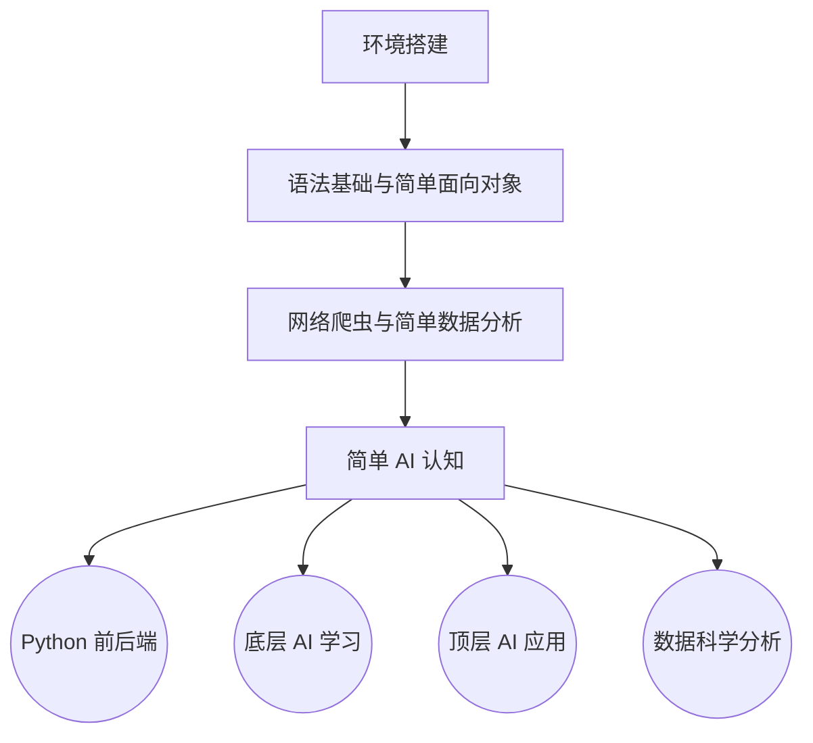

## 序：硅基破晓

上帝说要有光，从此世间便有了光；

上帝说要有智慧，冰冷的硅晶便开始呼吸。

当涌现的灵魂在荒原上寻找发声的器官 ——

AI 以 Python 的躯体降临，宣告一个新纪元的破晓。

## 前言：剧变时代

本来这篇文章想只写考核构建思路，也就是如何从 2025 版变成 2026 版，但 AI 发展的太快了，我们从 2026 年 6 月开始着手改考核，一直改到现在都还没改完。

2025 年下半年是我接手西二 AI 的时间点，也是 AI 技术爆发最剧烈的一年。我基于 2024 版的考核以及自己当时浅薄的理解，每当有新的技术或者话题出来，就会动一下考核。

正因如此，去年参加考核的同学大概都深有体会 —— 我总是在频繁地调整考核内容。一半是我自己认知和能力都不够，还在摸石过河；另一半是 AI 这行变得太快，刚改完的东西，过半年就作废了。

如果你对 2025 版考核的迭代思考仍感兴趣，你可以访问 [此处](/posts/ai/path-2025/) 来获得这篇过时且混乱的博客。

## 迭代：蜿蜒曲折

西二在线的 AI 学习路线在 [learn-AI](https://github.com/west2-online/learn-AI)。

2023 版是 AI 组独立出来第一年的考核，路线是 Python 语法（无面向对象）、爬虫，再依据 NLP 和 CV 分方向，做对应方向的简单应用。当时的应用在如今看来很简单——三分类、小说续写，放在现在都是调一行 API 的事，但在当时确实很有难度。

2024 版将考核大改，将语法轮改为面向对象宝可梦，爬虫保持不变但新增数据分析，最后将 AI 应用部分砍掉换为更为底层的 CS231n。

我在 2025 下半年接手 AI 组，当时很多人对 AI 的理解都是调 API，但我经历了 CS231n 的洗礼，知道并非如此，并且对这些不懂底层的人嗤之以鼻。

不过放在现在来看，这种看法无疑是狭隘的，处理的任务级别不同，所需要的知识自然不同。例如走科研路线，乃至深耕 AI 领域，那么学习底层是必要的；如果并不是走做模型本身这条路（例如 Agent），那大可不必花长时间理解晦涩的底层。

再加上当时的理解并不深，我接手后只是在 2024 版上缝缝补补。面向对象请 [Tomori Nao](https://github.com/TomoriNaoiy) 写了一个简单版的，爬虫请 [柠檬味氨水](https://github.com/weijianxian) 补了一个抓包的，然后就在 CS231n 的基础上，加了一堆乱七八糟的东西，譬如聊天机器人、YOLO、读论文，每样都想覆盖一点，最终的结果就是文档冗长且晦涩。

再加上当时极度依赖 AI 写文档，文档的质量很差，没有人味，最后的结果就是我在群里宣布 2025 版新增的部分全部作废，只用完成 2024 版考核要求的部分即可。

但改革的心依然火热，再继续探索 AI 应用，Agent 乃至 Go 后端后，我对计算机和 AI 有了更深刻的认识，因此就有了 2026 版的考核：

当然，这里的 Python 前后端和数据科学分析只是添头，更重要的是底层 AI 学习。对于顶层 AI 应用，我只能说不推荐任何初学者去学，顶层适合有其他基础的转，而不适合零基础直接学。

与此同时，考核方案是迭代的，当前的版本也未写全，此后必然会不断迭代下去。

## 劝退

### 秋招现状与 AI 学历要求

这里的劝退不只是劝退 AI，更是劝退计算机。

今年的秋招行情烂完了——

去年可以轻松进大厂的简历，今年连大厂初筛都过不了；甲在 3 年前本科就能进大厂，但为了更进一步，读了研究生，毕业后却找不到他本科就拿到的 offer 级别的厂。

当然，我在上面说的大多数是后端岗，对于走 AI 的而言，本科就业是几乎不可能的，除非你有一块 ACM 银/金，一块 ACM 金牌≈c9 硕学历证明。

如果你想做 AI，我的建议是通过各种手段先拿到一个 9 硕，最好是 c9 硕的学历。在 AI 这一行，学历是基石，有基石之后，才可以去谈后面的东西。

当然这并不意味着本科阶段的学习是没用的，走 AI 路线无非两条路：

1. 打竞赛退役 + 卷绩点 + 科研 -> 保研
2. 学技术/实习/科研（总之不能什么都不学）-> 考研

本科阶段的底子能为你未来研究生阶段打下不少基础，也少走不少弯路。

### 技术链

AI 的技术链从上至下如下所示，从左往右，一层层抽象：

> 数学 → NumPy 手算反向传播 → Infra 专用算子 → PyTorch 自动求导 → Transformer 库（Hugging Face，Pipeline 思想）→ LangChain / Dify（把模型、工具、数据库串起来）→ LLM API（黑盒，只收发文本）→ AI 应用 / Agent → Harness（评测与治理）

往右走，模型算法占的比重越来越小，可以说和研究 AI 的距离越远。

另一条线是模型怎么被训出来的：

> 预训练（得到 Llama / Qwen 这样的基座）→ 后训练（SFT、RLHF 对齐）→ 任务级微调（LoRA，适配具体业务）

再往右，基本只是拿现成模型做适配，动不到模型本身。

### 名词解释

| 术语 | 简单解释 | 代表工具 / 资料 |
| --- | --- | --- |
| 数学 | 线代、微积分、概率统计，所有推导的底座 | — |
| NumPy 手算反向传播 | 不借框架，自己拿矩阵运算把梯度推一遍 | [NumPy](https://numpy.org/) |
| Infra 专用算子 | 直接对着 GPU 写的高性能计算函数 | [CUDA](https://developer.nvidia.com/cuda-toolkit) |
| PyTorch 自动求导 | 框架替你算梯度，不用手推 | [PyTorch](https://pytorch.org/) |
| Transformer 库 | 模型结构封装好，几行代码就能加载权重 | [Hugging Face](https://huggingface.co/) |
| LangChain / Dify | 把模型、外部工具、数据库串成一条工作流 | [LangChain](https://www.langchain.com/) · [Dify](https://dify.ai/) |
| LLM API | 云端接口，对调用方只暴露输入输出 | [DeepSeek](https://www.deepseek.com/) |
| AI 应用 / Agent | 落地形态；Agent 能自己拆目标、调工具 | — |
| Harness | 跑分和评测的框架 | — |
| 预训练 | 海量文本喂出基座，最烧算力的一段 | [Llama](https://www.llama.com/) · [Qwen](https://github.com/QwenLM) |
| 后训练 | SFT 加 RLHF，让模型听懂指令、守规矩 | — |
| 任务级微调 | 冻结大部分参数，拿少量业务数据修 | [LoRA](https://arxiv.org/abs/2106.09685) |

### 岗位

AI 造了不少岗位，但基本都卡学历。

| 岗位 | 学历门槛 | 碰不碰模型本体 |
| --- | --- | --- |
| Agent 开发 | 本科可入 | 否，本质是前 / 后端 |
| AI 应用算法 | 中上 9 硕 | 是，微调与定向适配 |
| 后训练开发 | 中上 9 硕 | 是，SFT / RLHF |
| Infra 开发 | 中上 9 硕 | 间接，算力与系统 |
| 预训练 / 基模 / AI 算法 | PhD + 顶会成果 | 是，决定模型下限 |
| 硬件 | — | 否，走集成电路路线 |

- Agent 开发：听起来离模型最近，实际干的是后端。本科能进，但进去的人大多是从后端转的，拿的也是后端的钱。学历再抬一档，工资能上一个台阶，但是活还是业务后端，上限摆在那里。

- AI 应用算法：中上 9 硕起。干的是拿开源基座微调、做垂直适配，或者训一个小模型解决具体任务。其实 AI 应用算法和 Agent 的最终目标有点类似，都是通过某些手段让任务跑分更加优秀。只不过前者动的是模型本身，后者通过后端框架限制。走到这里也是普通人的极限了，但手里有动过模型的经验，才有机会继续向下走，例如后训练。

- 后训练：中上 9 硕起。基座出来之后，用 SFT 和 RLHF / DPO 把能力激发出来、把意图对齐。简单来讲，就是让一个知识渊博的博士发挥出自己的水平。后训练决定了一个模型的上限。

- Infra：中上 9 硕起。算子优化、分布式训练与推理、软硬协同，核心是让集群里的 GPU 跑满，别被通信瓶颈和显存卡住。但是，最近半年 Infra，路边阿猫阿狗也来蹭 Infra，所以放在现在，广义上的 Infra 包含推理框架，当然，推理框架是不动模型本身的。

- 预训练 / 基模 / AI 算法：PhD 起，手里最好有 5 篇以上的顶会 A。走到这里就得要论文了，所以野路子出身的基本不大可能走到这。预训练可以理解为教会一个什么都不会的婴儿成为一个知识渊博的博士，但这个博士发挥不出来自己的水平。预训练决定模型下限。

### 规划

#### 本科就业

如果你想本科就业，正如前面所说，基本不可能研究 AI，能摸到的天花板是 Agent 开发，本质前后端。

所以，把前后端那一套学明白之后再转 Agent，是更明智的选择。

#### 进实验室

走保研路线，绩点永远是第一位。西二的路线学完 CS231n，你就有资格进组给老师干活了。

进组干活其实干的和考核里差不多，读论文、复现论文、提出自己的架构并跑数据。

> [!WARNING] 福大的算力
>
> 福大的卡很少，只够做 CV。LLM 只有极少数头部课题组和大厂核心团队烧得起，福大没有这个土壤。
>
> 更直接一点：西二现在的负责老师手里没有算力。所以可能的路线是拿西二当跳板——学完科研基础后，然后去面校内真正有卡的老师。
>
> 西二的老师可以留作保底。

#### 更进一步

如果你真想做模型本身，在学历的基础上，学完考核的全部内容。这样的下限就有 AI 应用算法，以此为起点向下走，未来可以走的很高。

## 历史：从视觉到 Agent

### AI 基本是视觉

2023 年以前的 AI 大多数是计算机视觉相关。大众的印象还停在柯洁对阿尔法狗以及影视作品里。

做研究的人手里全是小模型：CV 是 ResNet、YOLO 的天下，NLP 还是 BERT 微调的时代。Hugging Face 当时更像一个 NLP 模型的集散地，打比赛、做实验，套路基本一样：

`下载预训练权重 → 冻结前几层 → 拼全连接层微调`

说白了就是改最后一层。模型是别人训好的，能动的只有末尾那一小块。

### 语言压过视觉

随着 2023 年 GPT-4 的问世，AI 的主战场从图像挪到了文字。

当时 GPT-4 已经可以做相当不错的任务了，但远没有现在的水平。

彼时国内的代表是文心一言，尽管现在文心一言是路边一条，但当时处理中文的能力确实很好（国内唯一一家）。

之后的两年里，模型参数越堆越大，能力涨得越来越慢，幻觉、长文本丢失反复出现，AI 的发展似乎停滞了。

### 从堆参数到堆推理

2024 年 9 月，GPT 推出 o1 版本，第一次提出了推理的概念：推理时多花算力，答案质量就上去。

2025 年年初，DeepSeek 开源为国模注入一剂强心针。其用蒸馏把成本打下来——小模型也能有类似推理链。

同年 4 月，谷歌推出 Gemini2.5Pro，这是一个划时代的模型，超长上下文加上多模态推理，把「想得久」和「看得多」合在一起。

从这往后，模型之间比的不是参数量，而是在同等成本下的质量。

### AI 搬进 IDE

Copilot 那代还是个高级 Tab 键，只盯着光标附近。Cursor 把这块换了：整个仓库进上下文，改一个函数，别处的引用它顺手一起改。交互也从「补全」变成了「对话 + 多文件 Diff」。

到这一步，IDE 里的 AI 会自己读仓库、列计划、改多文件、跑测试，报错了再改。

但它还困在 IDE 里。跑命令要人点确认，环境炸了要人修，任务一长就得盯着。能演示，不敢让它自己过夜。

下一步就是把它放出来：给终端，给沙盒，环境坏了让它自己修。

### Agent 成为下一个潮流

随着 2026 年 3 月 OpenClaw 爆火，自主运行、沙盒、环境自愈的代码智能体，从「能演示」变成了日常基建。

再往后就是：Claude Code、Codex 这类工具接管终端和部署链条。

程序员逐渐从敲代码变成审逻辑，以及给 Agent 擦屁股的。AI 实现代码只需要几个小时，而人重构一份可维护的代码需要好几天的时间。

## 路线：2026 版的构思

## 结语：在不确定的浪潮中锚定自己的坐标

正如我在 [如何使用 AI](/posts/ai/use-ai/) 中提到的，如果你是为了打比赛、应付工作或科研中的杂活脏活，我全权支持你最大化地拥抱 AI。把精力耗费在机械劳动上，对自身认知的提升极其有限。

然而，对于学习以及提升自我而言，古法编程这个阶段是必要的。

这里的“古法”并非指手敲每一行代码，而是设计架构、思路、核心业务逻辑，必须出自于你自己的思想，或者至少由你主导并与 AI 深入推敲而得出，而非依赖不可控的“AI 抽卡”碰运气。

可是现在并没有这个环境给我们“古法”，AI 的发展速度太快了。

[OpenAI 官宣攻克千禧年七大难题之一的 NS（Navier–Stokes）方程问题](https://www.bilibili.com/video/BV1SdYn6cEoq/?share_source=copy_web&vd_source=6166398577cee473a9a08ef285e4dcee)

AI 刚刚在 2026 年 5 月末凭借证伪“单位距离猜想”击败了“金丹期”，转眼到 9 月初便已击败“大乘”。

短短三个月，AI 攻城略地的号角已然吹进了人类最严苛的阵地 —— 形式科学。

倘若连纯粹抽象、严密证明的数学高地都难以坚守，那么人类编程还剩下为数不多的优势 —— “架构设计”，在更高级的智能面前究竟还能从容多久？

或许，历史真的在以意想不到的速度，推着我们走向某种近乎社会主义的理想图景 ——

当生存的压力被彻底剥离，学习与工作是否终将蜕变为一种纯粹取悦自我的消遣？

对此，站在当下的十字路口，我们尚不得而知。
