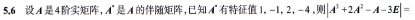

## 张宇 30 讲基础线代 2 刷第 1 章

> 【例 1.9】设关于 $\lambda$ 的方程 $\begin{vmatrix}\lambda-1&-2&3\\1&\lambda-4&3\\-1&a&\lambda-5\end{vmatrix}=0$ 有二重根，求参数 $a$ 的值。

一边是对的，另一边计算错了。

> $D_4=\begin{vmatrix}4&1&2&3\\3&4&1&2\\2&3&4&1\\1&2&3&4\end{vmatrix}=$ ______。

属于低级错误，本题在做的时候最后一步在那里换行，明明换了 2 行，填了+，又想了一下注意换行，然后填了-。尤其注意。

## 张宇 30 讲基础线代 2 刷第 2 章

> 【例 2.4】设 $A,B$ 均是 $n$ 阶矩阵，且 $AB=A+B$，则（ ）。
>
> - A. $A-E$ 为可逆矩阵
> - B. $A+E$ 为可逆矩阵
> - C. $A-2E$ 为可逆矩阵
> - D. $B+E$ 为可逆矩阵

再次看到这道题才意味着藏得有多深，这道题在 880 的大题里也出现过类似的化简手段，1 刷的时候是排除法做对的。
这道题的变形是去凑，$ab=a+b$；$ab-a-b=0$；$a(b-1)-b=0$；$a(b-1)-(b-1)=1$；即 $(a-1)(b-1)=1$。

> 【例 2.14】设 $A$ 是 3 阶矩阵，将 $A$ 的第 1 列与第 2 列互换得到 $B$，再将 $B$ 的第 2 列加到第 3 列得到 $C$，则满足 $AQ=C$ 的可逆矩阵 $Q$ 为（ ）。
>
> - A. $\begin{pmatrix}0&1&0\\1&0&0\\1&0&1\end{pmatrix}$
> - B. $\begin{pmatrix}0&1&0\\1&0&1\\0&0&1\end{pmatrix}$
> - C. $\begin{pmatrix}0&1&0\\1&0&0\\0&1&1\end{pmatrix}$
> - D. $\begin{pmatrix}0&1&1\\1&0&0\\0&0&1\end{pmatrix}$

> [原图非题目：教材「注」的结论摘录，给出副对角线分块矩阵与对角分块矩阵求逆的公式，非题目]

> 【例 2.18】设矩阵 $A=\begin{pmatrix}1&0&1\\-1&-1&1\\0&2&a\end{pmatrix}$，$B=\begin{pmatrix}1&0&1\\0&-1&2\\0&0&0\end{pmatrix}$。
>
> (1) 当 $a$ 为何值时，矩阵 $A$ 和 $B$ 等价；
>
> (2) 当 $A$ 和 $B$ 等价时，求一个可逆矩阵 $P$，使得 $PA=B$。

第 2 问没有考虑到“可逆”，算出来通解了。

> 设矩阵 $A$ 满足 $A^2+A-4E=O$，其中 $E$ 为单位矩阵，则 $(A-E)^{-1}=$ ______。

属于低级错误，没有考虑成到取逆之后，数字也得取倒数。并且想当然，其实这道题我做出来的答案是 $A-E$。

## 张宇 30 讲基础线代 2 刷第 3 章

> 【例 3.9】证明：$r(AB)\leqslant\min\{r(A),r(B)\}$。

> 【例 3.10】设 $A,B$ 均是 $m\times s$ 矩阵，证明：$r(A+B)\leqslant r([A,B])\leqslant r(A)+r(B)$。

> 【例 3.11】设 $A$ 是 $n(n\geqslant2)$ 阶方阵，$A^*$ 是 $A$ 的伴随矩阵。证明：
>
> $r(A^*)=\begin{cases}n,&r(A)=n,\\1,&r(A)=n-1,\\0,&r(A)<n-1.\end{cases}$

这三题 1 刷的时候直接跳了，2 刷的时候想做，但是没想出方法。

对于 9-10，这类题应该转换为向量组去做。

对于 11，应该利用经典恒等式去证明，这道题是想复杂了。

以下为错题重刷：

若向量组 (I) 可由向量组 (II) 线性表出，则向量组 (I) 的极大线性无关组容量（秩）不超过向量组 (II) 的极大线性无关组容量（秩）

只要证 $A\beta_j=\beta_{1j}\alpha_1+\beta_{2j}\alpha_2+\cdots+\beta_{nj}\alpha_n$

> [原图非题目：$r(AB)\leqslant r(A)$ 的证明过程截图，按分块矩阵与列向量组视角分步推导]

这三题做一个标记，回头必须回来再看。

> 设向量组（Ⅰ）$\alpha_1,\alpha_2,\cdots,\alpha_s$ 的秩为 $r_1$，向量组（Ⅱ）$\beta_1,\beta_2,\cdots,\beta_t$ 的秩为 $r_2$，向量组（Ⅲ）$\alpha_1,\alpha_2,\cdots,\alpha_s,\beta_1,\beta_2,\cdots,\beta_t$ 的秩为 $r_3$，则下列结论不正确的是（ ）。
>
> - A. 若（Ⅰ）可由（Ⅱ）线性表示，则 $r_3=r_2$
> - B. 若（Ⅱ）可由（Ⅰ）线性表示，则 $r_1=r_3$
> - C. 若 $r_1=r_3$，则 $r_2>r_1$
> - D. 若 $r_2=r_3$，则 $r_1\leqslant r_2$

注意本题是不正确的一项。CD 可以用秩不等式判断出 D 是对的。AB 选错为非常低级的错误。

> 设 $n$ 维向量组（Ⅰ）$\alpha_1,\alpha_2,\cdots,\alpha_s$，（Ⅱ）$\beta_1,\beta_2,\cdots,\beta_t$，记 $A=[\alpha_1,\alpha_2,\cdots,\alpha_s]$，$B=[\beta_1,\beta_2,\cdots,\beta_t]$。则下列结论正确的是（ ）。
>
> - A. 若 $r(\text{Ⅰ})=r(\text{Ⅱ})$，则 $A\cong B$
> - B. 若（Ⅰ）可由（Ⅱ）线性表示，则（Ⅰ）$\cong$（Ⅱ）
> - C. 若 $r(A)=r(B)$，且（Ⅱ）可由（Ⅰ）线性表示，则（Ⅰ）$\cong$（Ⅱ）
> - D. 若 $r(A)=r(B)$，则（Ⅰ）$\cong$（Ⅱ）

第 6 题没做出来，A 和 D 正确的大前提是 A 和 B 同型。对于向量等价，可以有三种判别法：第一，双向表示；第二，单向表示 + 秩相等；第三，三秩相等。

同型指的是 $m\times n$ 一样

二刷错题本题依旧错误，需要格外重视，没有意识到同形。

## 张宇 30 讲基础线代 2 刷第 4 章

> 【例 4.6】设非齐次线性方程组为 $A_{m\times n}x=b$，则（ ）。
>
> - A. 当 $r(A)=m$ 时，方程组有解
> - B. 当 $r(A)=n$ 时，方程组有唯一解
> - C. 当 $m=n$ 时，方程组有唯一解
> - D. 当 $r(A)<n$ 时，方程组有无穷多解

> [原图非题目：主人手写解题过程截图]

> 【例 4.7】设 $A$ 是 $m\times n$ 实矩阵，则对任意 $m$ 维列向量 $b$，线性方程组 $A^{\mathrm{T}}Ax=A^{\mathrm{T}}b$（ ）。
>
> - A. 无解
> - B. 有解
> - C. 必有唯一解
> - D. 必有无穷多解

> [原图非题目：主人手写解题过程截图]

> 【例 4.11】已知线性方程组 $a_1x_1+a_2x_2+a_3x_3+a_4x_4=a_5$ 有通解 $[2,0,0,1]^{\mathrm{T}}+k[1,-1,2,0]^{\mathrm{T}}$，则下列说法正确的是（ ）。
>
> - A. $a_5$ 可由 $a_1,a_2,a_3$ 线性表示
> - B. $a_4$ 不能由 $a_1,a_2,a_3$ 线性表示
> - C. $a_5$ 不能由 $a_2,a_3,a_4$ 线性表示
> - D. $a_4$ 不能由 $a_1,a_2,a_3,a_5$ 线性表示

本题如果采用原始的方法去做的话，反而可以做对，我这道题用解反过来构造化简后的增广矩阵，结果就是构造反了。本题直接将解代入也可以做出来。

然后，反过来构造的时候尤其需要注意，一定要搞清楚行和列的意思。列意味着几个变量，显然这道题是 $4$，那么行是多少？不知道，但是一定有效行是 $3$ 行！而不是 $4$ 行。

> 设 $\xi_1,\xi_2,\xi_3$ 是 $Ax=0$ 的基础解系，则该方程组的基础解系还可以表示成（ ）。
>
> - A. $\xi_1,\xi_2,\xi_3$ 的一个等价向量组
> - B. $\xi_1,\xi_2,\xi_3$ 的一个等秩向量组
> - C. $\xi_1+\xi_2,\ \xi_2+\xi_3,\ \xi_3+\xi_1$
> - D. $\xi_1-\xi_2,\ \xi_2-\xi_3,\ \xi_3-\xi_1$

本题需要辨析清楚基础解系，等价向量组之间的概念及其延申。尤其需要注意，等价向量组不一定要和原向量组个数相等，只需要保证每一个都可以由对方组合即可。

> 设 $\xi_1=[1,3,-2]^{\mathrm{T}},\ \xi_2=[2,-1,3]^{\mathrm{T}}$ 是 $Ax=0$ 的基础解系，已知 $\eta=[2,a,b]^{\mathrm{T}}$ 是方程组 $\begin{cases}Ax=0,\\x_1+2x_2+x_3=-2\end{cases}$ 的解，则 $\eta=$ ______。

本题没想到好的方法。事实上，本题又陷入了三秩相等的逻辑，$n$ 是方程组的解，那么显然满足最下面一条，也满足 $Ax=0$，所以 $n$ 可以用 $\varepsilon_1$ 和 $\varepsilon_2$ 表示，所以行列式为 $0$，即可以解出来。

> 已知方程组（Ⅰ）$\begin{cases}x_1+x_2-2x_4=-6,\\4x_1-x_2-x_3-x_4=1,\\3x_1-x_2-x_3=3\end{cases}$ 和方程组（Ⅱ）$\begin{cases}x_1+mx_2-x_3-x_4=-5,\\nx_2-x_3-2x_4=-11,\\x_3-2x_4=1-t.\end{cases}$
>
> (1) 求解方程组（Ⅰ）；
>
> (2) 求 $m,n,t$ 为何值时，方程组（Ⅰ）与方程组（Ⅱ）同解。

本题问题在于，第一，求第一问的时候急躁了，$4$ 个 $x$ 只写了 $3$ 个，第二，应该研究一下同解除了三秩相等之外的两个方法。例如我把我的解代入你的方程 + 秩相等即可。

## 张宇 30 讲基础线代 2 刷第 5 章

> 【例 5.5】设 $A=(a_{ij})$ 为 3 阶矩阵，$A_{ij}$ 为元素 $a_{ij}$ 的代数余子式，若 $A$ 的每行元素之和均为 2，且 $|A|=3$，则 $A_{11}+A_{21}+A_{31}=$ ______。

本题采用特值法，没有意识到 $A^*$ 与 $A$ 的关系。$A^*$ 与 $A$ 的特征向量相同，则 $\frac{3}{2}$。

> 【例 5.18】设 $A=\begin{pmatrix}0&-1&4\\-1&3&a\\4&a&0\end{pmatrix}$，正交矩阵 $Q$ 使 $Q^{\mathrm{T}}AQ$ 为对角矩阵，若 $Q$ 的第 1 列为 $\frac{1}{\sqrt6}[1,2,1]^{\mathrm{T}}$，[?]

求 $a$，$Q$。

本题的想法一直是把 A 想办法先解出来特征值再去求，但是这条路是不通的，原因主要是这几个。第一，这道题直接求特征值十分复杂；第二，本题没有告诉你他的第 1 列特征值是单根且其他特征值是重根。

所以这道题应该回到最朴素的想法，$A\alpha=k\alpha$ 去解。果不其然，解出来的 $\lambda$ 没有重根。

> 设 $A$ 是 $n$ 阶实对称矩阵，$P$ 是 $n$ 阶可逆矩阵。已知 $n$ 维列向量 $\alpha$ 是 $A$ 的属于特征值 $\lambda$ 的特征向量，则矩阵 $(P^{-1}AP)^{\mathrm{T}}$ 属于特征值 $\lambda$ 的特征向量是（ ）。
>
> - A. $P^{-1}\alpha$
> - B. $P^{\mathrm{T}}\alpha$
> - C. $P\alpha$
> - D. $(P^{-1})^{\mathrm{T}}\alpha$

本题对与 $A$ 相关的特征值和特征向量不熟悉，在做这题的时候忘记了。$P^{-1}AP$ 所对应的特征值为 $\lambda$，所对应的特征向量为 $P^{-1}\lambda$，对于本题对应进去即可以得到 $B$。

> 设 $A$ 是 4 阶实矩阵，$A^*$ 是 $A$ 的伴随矩阵，已知 $A^*$ 有特征值 $1,-1,2,-4$，则 $|A^3+2A^2-A-3E|=$ ______。

与一刷时一样的错误，没有考虑到 $A^*$ 的行列式不能套用 $A$ 的行列式去解。

> 设 $A=\begin{pmatrix}a&-1&c\\5&b&3\\1-c&0&-a\end{pmatrix}$，且 $|A|=-1$，$A^*$ 是 $A$ 的伴随矩阵，$A^*$ 有特征值 $\lambda_0$，对应于 $\lambda_0$ 的特征向量为 $\xi=[-1,-1,1]^{\mathrm{T}}$，求 $a,b,c$ 及 $\lambda_0$。

这里应该是特征值求错了，想当然是 $-1$？有这方面因素，但是更多的，$|A|=-1$ 抄过来的时候抄错了。

## 张宇 30 讲基础线代 2 刷第 6 章

> 【例 6.5】设二次型 $f(x_1,x_2,x_3)$ 在正交变换 $x=Py$ 下的标准形为 $2y_1^2+y_2^2-y_3^2$，其中 $P=[e_1,e_2,e_3]$，若 $Q=[e_1,-e_2,e_3]$，则 $f(x_1,x_2,x_3)$ 在正交变换 $x=Qy$ 下的标准形为（ ）。
>
> - A. $2y_1^2-y_2^2+y_3^2$
> - B. $2y_1^2+y_2^2-y_3^2$
> - C. $2y_1^2-y_2^2-y_3^2$
> - D. $2y_1^2+y_2^2+y_3^2$

想当然直接选了，而没有切实去算，属于理解错误 + 嫌麻烦没有去算。这里的特征向量即便怎么取，取 $2$ 也好，还是取 $-1$。都不会影响到特征值，只有位置会影响。

> 设二次型 $f(x_1,x_2,x_3)=(x_1+x_2)^2+(x_2+x_3)^2+(ax_3+x_2)^2$ 正定，则 $a$ 的取值范围是

本题完全没想到怎么做，还是想着拆。除了拆之外还有什么做法？这里的意思是说换元法。这种方法是可能会导致不可逆，所以只要让凑出来的这个式子不可逆就好了。

> $f(x_1,x_2,x_3)=x_1^2+2tx_1x_2-2x_1x_3+x_2^2+4x_2x_3+5x_3^2$ 正定，则 $t$ 的取值范围是 ______。

低级计算错误，这道题就是仗着计算简单没去算，$4-5t^2-4-4t>0$，结果跳步化简化简完变成了 $t(5t-4)<0$。

> 设矩阵
>
> $B=\begin{pmatrix}1&2&3\\-2&0&1\\0&4&5\end{pmatrix}$，$x=\begin{pmatrix}x_1\\x_2\\x_3\end{pmatrix}$。
>
> 问 $f(x_1,x_2,x_3)=x^{T}Bx$ 是否为关于 $x_1,x_2,x_3$ 的二次型？$B$ 是否为 $f$ 的矩阵？写出 $f$ 的矩阵表达式。

关于这道题，不知道为什么是这个意思。比如说，假设存在一项 $x_1$，那么这个东西其实就不是二次型。

> 设二次型
>
> $f(x_1,x_2,x_3)=kx_1^2+2x_2^2-2x_3^2+2mx_1x_3\ (m>0)$，
>
> 其中二次型的矩阵的特征值之和为 $1$，特征值之积为 $-12$。
>
> (1) 求 $k,m$ 的值；
>
> (2) 用正交变换化二次型为标准形，并求所作的正交变换及对应的正交矩阵。

低级计算错误，本题没做第 2 问，不过对于第 1 问，因式分解的时候没有考虑好正负号。
